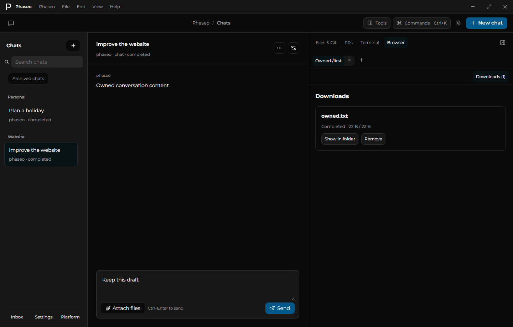
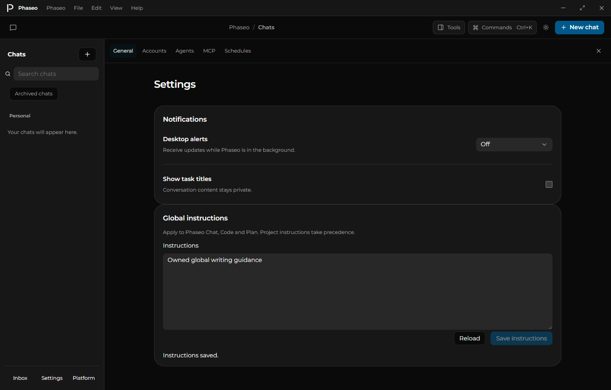
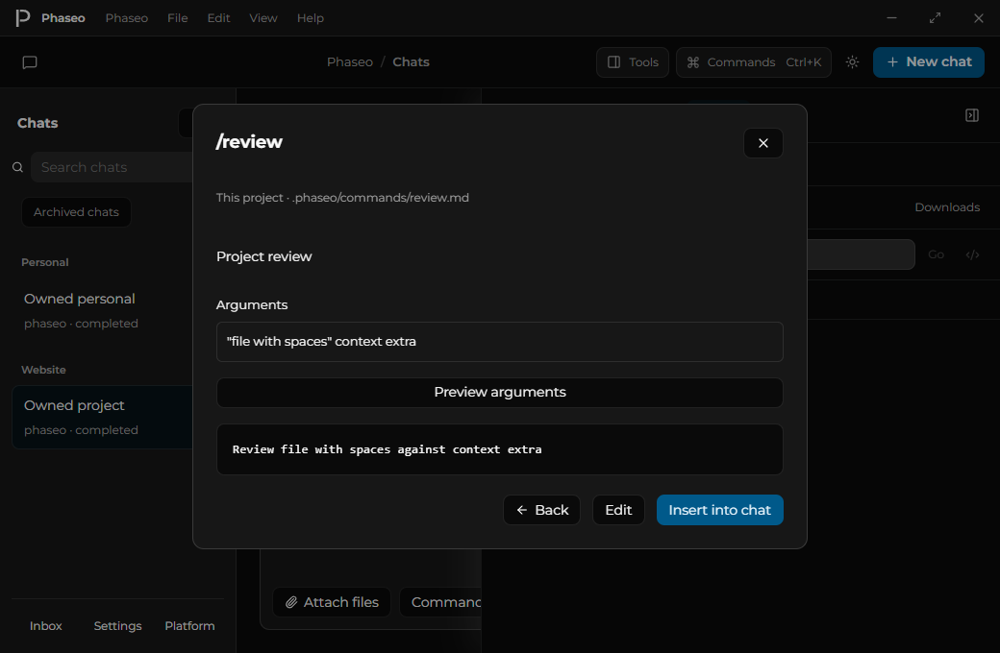
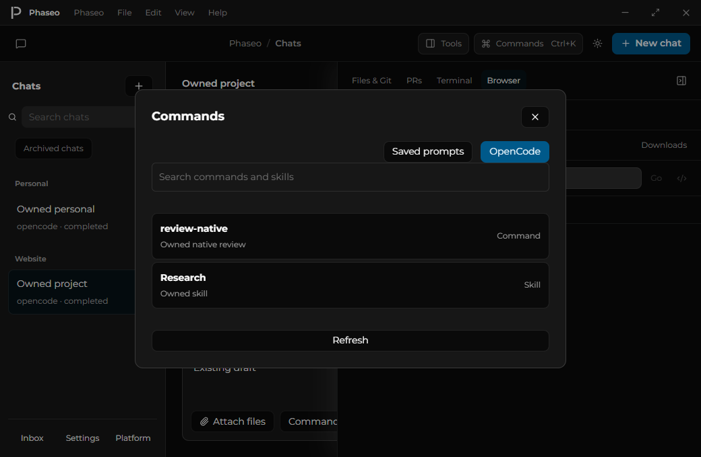
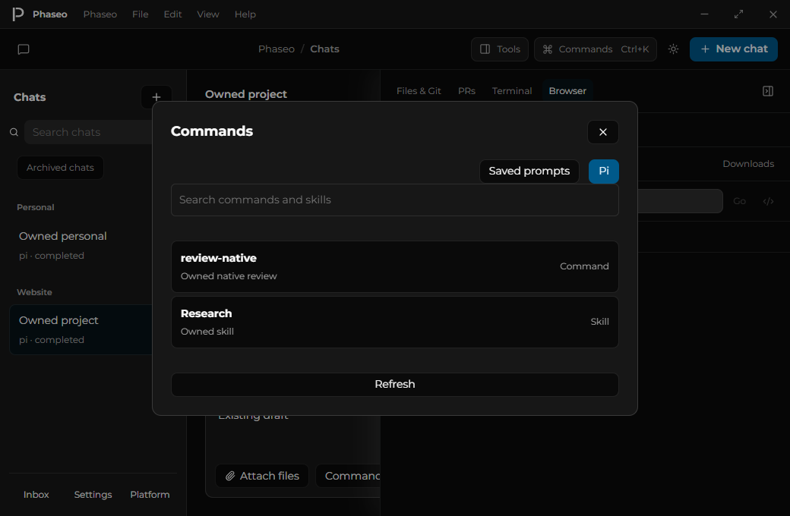
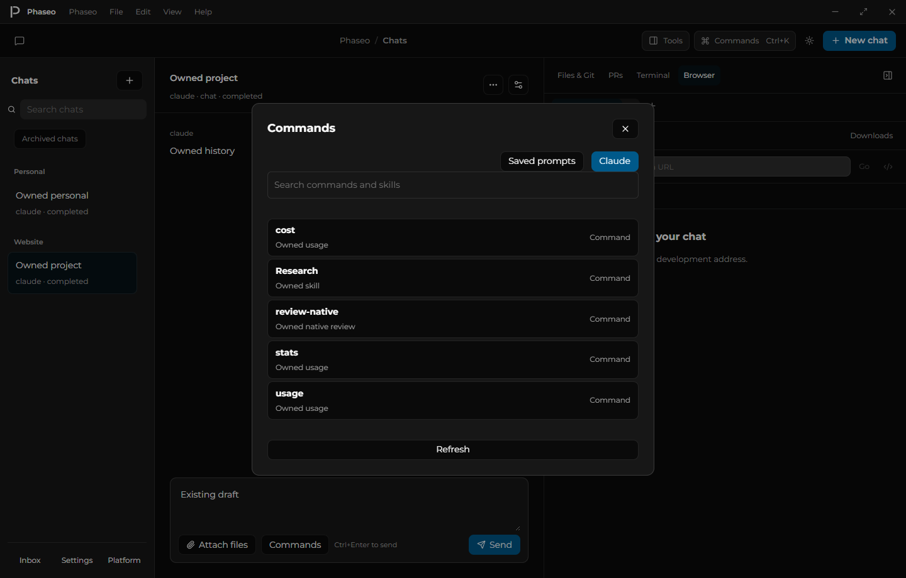
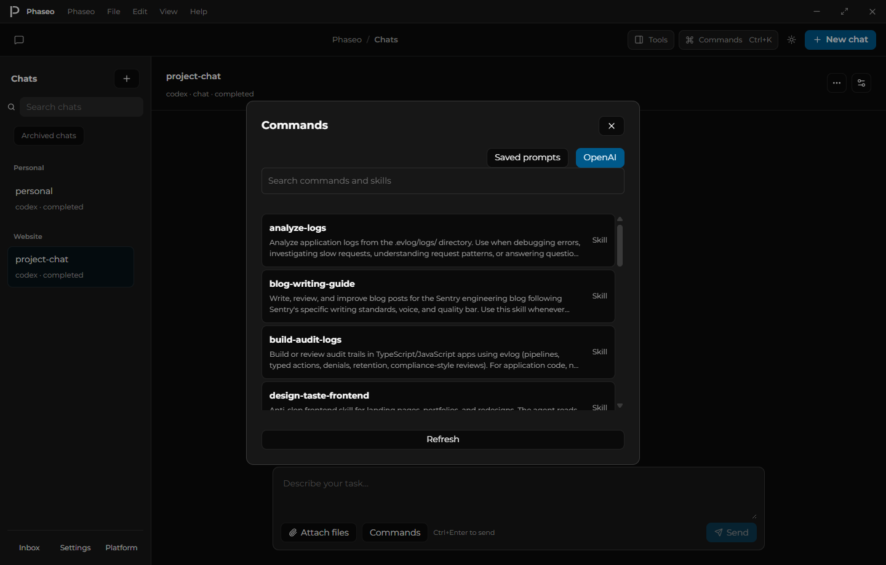

# Chats and contextual tools

Chats are the desktop workspace's primary navigation. Each chat can be personal or associated with a project; the bounded history projection carries the optional project ID without returning conversation bodies. Search, pinning, archives and pagination remain available in the single left sidebar.

The centre keeps the selected conversation mounted while opening tools and settings. Message drafts and history position survive those interactions. Accounts, agents, MCP connections and schedules live under Settings; Inbox and the existing Platform surface remain available from the sidebar footer. **Settings → Diagnostics** shows the processes Phaseo is running and what its trace log (`logs/traces.ndjson` in the app's data folder) says about slow or failed work; see [Settings](settings.md#diagnostics).

General Chat in the Phaseo harness can use enabled global MCP services and services associated with its project. Each tool call needs approval and identifies the service and tool. Chat has no built-in project file or command tools. Failed connection setup preserves queued input; interrupted approvals can resume from saved chat state. Stop affected chats before editing their connections.

MCP document services can provide resources alongside tools or on their own. The Phaseo harness can list resource pages and templates, then read a URI with approval. Responses are limited to 1 MB and catalogue pages to 200 entries.

Prompt services can list their templates and retrieve one with approved arguments. Returned messages remain tool results; they do not change system instructions. A dedicated prompt picker is not available yet.

Files & Git, pull requests, terminal and Browser share a collapsible right panel. Selecting a different chat initializes project tools from its project. Personal chats start without a project. Terminals belong to their chat and project. At narrower widths the tools overlay the conversation and can be dismissed without losing it.

## Native browser

The Browser uses Electron WebContentsView, as T3 Code's browser does. Each browser tab is its own tab in the right pane, titled with the page title (else the host, else "Browser") and the page's icon; there is no tab strip inside the browser. A chat holds up to twenty browser tabs, each with its own native history during the app session. Addresses, titles, device previews, zoom, colours and any name you give a tab are saved locally per chat; a fresh native page restores them. Tabs saved before this change, including their Desktop, Phone and Tablet previews, carry over. Closing a tab disposes its page. A dedicated persistent browser partition stores website sessions separately from the app and provider credentials. Closing the pane hides the page; reopening restores it. App shutdown disposes the pages.

Above the page is one quiet row, after T3 Code's: Back, Forward and Reload (it spins while the page loads; click it to stop), the address bar, then Annotate, Capture, Float and the menu. The address bar is plain text until you hover or focus it; focusing selects the address, Enter opens it, Escape puts the current address back. An address keeps its scheme; a host such as `localhost:5173` opens over http:// and other hosts such as `example.com` over https://; anything else searches DuckDuckGo. Hovering the bar shows **Open in system browser**. A thin bar under the row shows loading progress. **Annotate** lets you click an element on the page: its screenshot and a note naming the element go into your message (Escape cancels). **Capture** copies a screenshot of the page and adds it to your message. **Shift-click Capture** records the page instead (MP4 where this computer can encode it, otherwise WebM): the camera turns red with a pulsing dot, and clicking it again stops. A **Recording saved** row then offers Reveal in File Explorer (Finder, Files), Copy path and Add to message; recordings often pass the 10 MB attachment limit, so Add to message puts the file's path in your message. Recordings are saved in the app's `browser-recordings` folder, and only files there can be revealed. Zoom changes show a percentage pill at the top right of the page for a moment, drawn inside the page so it shows over it. The mouse's back and forward buttons navigate the page under the pointer.

The menu (⋮) has Hard reload, Open DevTools, Open separate preview window, Show device toolbar, Appearance (System, Light or Dark for the page's `prefers-color-scheme`), Mute tab, Downloads, Zoom (25% to 500% in T3 Code's steps) and Clear cookies or Clear cache, which apply to every browser tab. A new tab lists the project's recently used pages (the last fifty per project; eight are shown, each removable) and local web servers that answer on this computer. (T3 Code also lists the preview addresses of a project's dev scripts. Phaseo projects have actions that can carry a preview URL, which opens in the chat's browser when the action runs and its server answers (see [Project settings and actions](#project-settings-and-actions)), but the new tab does not list them yet.) A page that fails to load shows "This site can't be reached" with the host, the reason in plain words, Details with the error code, and Reload. A page whose renderer crashes reloads quietly, waiting longer after each crash.

Shortcuts, which apply while a page or its address bar has focus and can be changed in Settings: Ctrl+R (⌘R) reloads, Ctrl+L focuses the address bar, and Ctrl+=, Ctrl+- and Ctrl+0 zoom the page instead of the app. App shortcuts such as Ctrl+K and Ctrl+W still work while a page has focus; undo stays with the page.

Remote pages have no preload, Node integration or workspace bridge. HTTP/HTTPS addresses, including local development servers, are supported. File/data/custom protocol navigation and embedded URL credentials are rejected. Main IPC requires the application's own main-frame web contents, including when another native surface belongs to its window. Native surfaces hide for app dialogs and menus, and their bounds follow the host panel and zoom.

HTTP/HTTPS popup links open a new browser tab in the current chat; background-tab requests keep the current tab selected. Inactive native surfaces cannot request popups into another chat.

### Floating player and separate window

**Float preview over chat** (the picture-in-picture button) floats the tab over the chat, as T3 Code's mini player does, and closes the pane. The player starts at the top right, up to 320 × 320 at the page's shape, never smaller than 240 × 150, with 12-pixel corners; each chat remembers its player's size and place. Drag the handle above its top right corner to move it, and drag any edge or corner to resize it (the page keeps its shape). Hovering the handle shows **Open in right panel**, **Pop into separate window** and **Close floating preview**; a red pulsing dot there means the tab is recording. The player steps aside while the same tab shows in the pane. Native pages draw above the app, so the handle and pill sit just outside the player rather than over the page as in T3 Code.

**Pop into separate window** (or Open separate preview window in the menu) moves the page into a small window of its own that stays on top of other windows. The tab shows Showing in a separate window with **Bring back**; closing that window also brings the page back.

### Agents in the browser

Agents get T3 Code's browser tools through the Phaseo orchestration tools: browser_tabs, browser_open (open an address, reusing the tab used last unless asked for a new one), browser_snapshot (the page's text and its buttons, links and fields, each with a unique CSS selector; password values are never included), browser_click and browser_type (by selector, through real input events) and browser_screenshot (not for Phaseo chats, whose tool results are text). They act only on the chat's own browser tabs in this window, only on HTTP and HTTPS pages, and never on files, app pages or other chats' tabs; selectors and typed text are checked and passed to the page as data. In supervised chats, opening, clicking and typing each ask first; reading does not. A page an agent opens joins the chat's tabs and shows in the pane when that chat is open. While an agent acts, its pointer (T3 Code's cursor with a click ripple) is drawn inside the page: fully visible for 700 ms after each action, then faint, and fainter while you use the page yourself. Closing a tab the agent is using asks **Close browser while the agent is using it?** first.

### Secret requests

When an agent needs an API key, token or password, it calls `request_secret` (T3 Code's tool) instead of asking you to paste it. The chat shows what it wants and why, with a masked field (the eye shows what you typed), **Save** and **Don't share**. The value goes straight into Phaseo's credential vault, encrypted with the system's credential store; the chat keeps only the request and whether you saved or declined it, and the value never reaches the transcript or the model. The agent gets one of two things, usable for 24 hours and only in that chat: a `secretRef`, which a Phaseo chat's `run_command` takes as `secrets: { NAME: secretRef }` to set an environment variable for that one command (any copy of the value in the command's output is replaced with `[secret]`), or, for Claude, Codex and other harnesses, an owner-only file to read inside a command (`TOKEN="$(cat <file>)"`), deleted after a day. A request waits ten minutes by default and closes when the turn ends or the chat stops. While it waits, the chat shows as waiting for you.

Site permissions use a native dialog identifying the requesting origin. Choose **Deny** or **Allow for this page** for notifications, location, microphone/camera, clipboard reads, MIDI, fullscreen, pointer/keyboard capture and idle detection. Decisions last until navigation or reload; camera and microphone grants are separate. Only the visible owned main page can ask. Hiding or minimizing the window, hiding the page, navigating, closing its tab or closing the app cancels pending prompts. Focused visible main pages can use standard clipboard copy buttons. Embedded-frame permissions, persistent site settings and device/file/screen pickers remain in progress.

The permission service implements both [Electron permission handlers](https://www.electronjs.org/docs/latest/api/session#sessetpermissionrequesthandlerhandler). Owned Chromium tests cover notification grant/deny, repeated requests, page reset, minimized-window rejection/cancellation, hiding/closing and cancellation of a real native dialog on navigation. They show no system notifications and access no media, location or clipboard data. Camera/microphone decisions are covered by deterministic policy tests; real devices and additional operating systems remain unverified.

## Verification

`pnpm --filter @phaseo/desktop audit:design` runs the new chat-shell smoke/audit. It uses an isolated local profile, two seeded conversations and a local HTTP site, with no provider inference. It verifies grouping, drafts, settings, project PR/terminal context, native navigation/history, chat-specific browser restoration, unsafe-address rejection, remote privilege isolation, bounds, modal hiding and cleanup.

Source and Windows archive runs produce 16 shell captures across light/dark themes at 1440×920 and 1040×680, plus multiple-tab, phone-preview and downloads captures, two separate native browser page captures and four pull-request-detail captures and a file-review capture. Electron's host `capturePage` does not include the separate WebContentsView pixels; the native page is captured directly and is not composited into the shell screenshot.

The broader source/archive desktop smoke covers existing accounts, agents, MCP, schedules, attachments, Git, worktrees, notifications and native protocol fixtures through the new public navigation. Provider fixtures do not establish signed-in live inference or complete product parity. Multi-OS rendering, scaling and assistive-technology verification remain open.

Tab workflows verify independent native surfaces/history, selection and disposal through the pane's tabs, fresh-surface address restoration and closing the last tab. Renderer reload hides existing native surfaces before the new shell loads. Owned native window.open and Ctrl-click workflows verify foreground/background tab delivery, source-history preservation, unsafe-popup rejection, remote privilege isolation and disposal. Twenty tabs verify the admission limit, readable error and recovery after closing a tab. The audit fails on unexpected unhandled promise rejections. Blank-window/opener-dependent authentication flows remain unverified.

## Developer tools

A browser tab can open Electron’s native detached inspector from the menu (Open DevTools), F12, Ctrl+Shift+I or Cmd+Alt+I. Native open/closed events update the menu. The inspector targets that website web contents; the app renderer is not inspected. Closing the tab disposes its inspector. Owned source/archive workflows verify menu toggling, native Windows keyboard input, external inspector closure, selected-target isolation and disposal. macOS shortcuts and complete developer-tool workflows remain unverified.

## Responsive previews

**Show device toolbar** in the menu shows the page at a fixed size, as T3 Code's device toolbar does: choose Responsive or one of seventeen devices (iPhone SE to Nest Hub Max), type a width × height between 240 and 3840 pixels, lock the aspect ratio, rotate, or drag the edges of the device. The device is scaled down to fit the pane and centred. Close (×) returns the page to the full pane. Each tab saves its device; a fresh page restores it once it opens an address.

Source and Windows archive checks verify actual native page and screen dimensions in both orientations, modal dismissal and panel restoration, and rejection of invalid sizes. These are Chromium viewport previews; physical-device fidelity, touch and device-specific user agents remain unverified.


## Downloads

Downloads use [Electron’s native save workflow](https://www.electronjs.org/docs/latest/api/download-item) and appear in their originating chat. A Downloads button with the count appears in the browser row while the chat has downloads, and Downloads in the menu always opens the list. The list shows bytes and state, Pause/Resume, Cancel, Show in folder and Remove. Removing a record leaves the saved file intact. Only confirmed native download paths can be revealed. Active transfers continue when the pane is hidden; owner-window shutdown cancels them. The app bounds concurrent transfers to twenty and keeps up to one hundred records, pruning finished entries first. A rejected transfer reports the limit in its record.

Owned source and Windows archive workflows use temporary save destinations, verify exact saved bytes, pause/resume/cancel, chat isolation and removal, and confirm the native page hides behind the downloads list. Five deterministic cases cover progress, completion, owner isolation, action guards, bounds, limit feedback and shutdown. The native save-dialog interaction and operating-system folder UI remain unverified. Download records are stored in the workspace SQLite database and survive app restarts. Unfinished records recover as terminal interruptions; automatic transfer resumption across restarts remains open.



`pnpm --filter @phaseo/desktop test:downloads` runs three separate Electron processes against an isolated profile: download, reopen and remove its record, then reopen again. Source and Windows archive runs verify retained native paths, exact saved bytes and durable removal without deleting the file. SQLite reopening tests cover interrupted-state recovery and a one-hundred-record bound that preserves active transfers. Progress writes are limited to once per second; final states and control changes save immediately. Write failures report that history may not survive a restart, and failed removal retains the visible record. Windows CI repeats both restart audits.

## Pull requests

The Pull requests surface follows T3 Code. The pane's **+** menu and empty launcher offer **Pull request** (P), which opens the chat's current pull request (the highest open layer of a stack), or else the pull request for the branch the chat's checkout is on, linked or not; and **Linked pull requests** (L). An unavailable one says why when you point at it. In a chat the list shows the linked pull requests, with the project's open pull requests a click away (**Open pull requests**, in the footer or the empty list); without a chat it shows the project's open pull requests.

- **Rows** show the state glyph (open green, draft grey, closed red, merged violet) with a red warning in the corner when the branch conflicts, the number, the title, the checks and review glyphs, added and removed lines, then the author's avatar and name, repository, `head → base` and when it last changed. The checks glyph opens the checks in a popover, read from GitHub only when you open it. Hovering a row shows a menu, which right-clicking the row also opens: Copy link, Open, Watch for changes or Stop watching, and Unlink from chat. Open rows can be linked to the chat from their menu. A pull request opened from the Open list wears its state colour on its pane tab even when the chat does not link it.
- **Linked pull requests** belong to the chat and are kept by the app with the chat, so they survive restarts. As in T3, the rows start at the top with no bar; the footer reads "2 open · 3 linked · synced 4m ago". The number's tooltip says who linked it: you, the agent, **Created from this chat** (a pull request made from Git actions) or **Found in the stack**. **Link** accepts a GitHub URL, `owner/repo#42`, `#42` or `42` (a bare number uses the chat's project); the dialog shows the pull request it names as you type, explains what it accepts, and stays open until the link is made. The list remembers the last state GitHub reported for each one and refreshes it whenever the list or the pull request is opened. **Watch for changes** marks a link with an eye (see Watching below).
- **Stacks**: linked pull requests that build on each other (one's base branch is another's head) are grouped, each layer indented under the one it targets, and the bottom row shows the stack's size. GitHub's own stacks (a preview feature) are read too: when GitHub reports a linked pull request in a stack, its other layers join the chat as **Found in the stack**; unlinking one dismisses it, so it is not found again, and linking it yourself brings it back. Open-list rows in a GitHub stack show "2/3", which opens the stack's layers. A pull request whose base is not the default branch shows the stack glyph by its base. In a pull request that is in a GitHub stack, the header's "n/m" menu lists the layers (top first, then the base) to open, with **Merge stack** (this layer and every unmerged one below it, in the chosen merge method) and **Rebase stack** (every open layer, bottom to top, onto the new head of the one below). Both ask first, listing the layers, and refuse if any layer moved since you looked. Rebasing works in a scratch copy that borrows the checkout's objects, so your checkout never moves, moves only each layer's own commits, and pushes with a lease so a push that landed meanwhile is not overwritten; a conflict stops it at that layer and says so.
- **A pull request** opens with T3's header: the repository and `#N` coloured by state, which condenses to `#N title` as you scroll. The right side holds one main control chosen by state: a Merged or Closed badge, **Resolve conflicts** (checks the pull request out in a worktree and opens a chat with the task of bringing it up to date with its base; **Resolve conflicts on GitHub** in More opens GitHub's editor instead), **Ready for review** for drafts, the merge button in the repository's allowed method (Merge, Squash and merge, Rebase and merge), or, while checks are failing or still running and the repository allows it, **Auto-merge (squash and merge)** (in the chosen method), which asks GitHub to merge on its own once the requirements are met. Once auto-merge is on, an **Auto-merge** badge takes that place (or sits beside Resolve conflicts). Merging, closing and turning on auto-merge need a second click: the button turns into "Confirm merge?" and resets after 3 seconds, a click elsewhere, Escape or leaving the window.
- **More** (the dots) has Refresh, **Ask a question**, **Explain this PR**, **Fix findings in a chat**, **Write guide** or **Rewrite guide**, Ready for review or Convert to draft, Enable or Disable auto-merge, Merge now (when the main control is auto-merge), the merge method, Open on GitHub, Copy link (`Ctrl+Shift+C`), Copy PR number (`Ctrl+Shift+K`), **Link to this chat** or **Unlink from this chat** (when a chat is open), Close or Reopen, **Revert changes** on a merged pull request (a second click confirms; GitHub opens a pull request that undoes it, and the toast links to it), and Delete branch once the pull request is closed or merged.
- **Merge method**: a pull request starts with the method chosen in its own menu, else the project's default (Project settings), else the workspace default (Settings → General → Default merge method), else the one you picked last, and always one the repository allows.
- **Right-click a pull request number** (in the header, on list rows and on the Pull requests page) for **Copy link** and **Open on GitHub**.
- When GitHub is holding workflow runs for approval (as it does for first-time contributors and forks), **Approve workflows to run** appears in the tab bar for anyone with write access.
- Below the header: the title (hover for the pencil to rename it), the author, when it was updated, a copyable `gh pr checkout N` (click to copy; it reads "Copied" for a moment) and **Check out**, `base ← head`, files changed and lines added and removed. A base branch shown in amber means the branch is behind; its popover says by how many commits (read when it opens), says "Changes can be cleanly merged." when GitHub does, and offers **Update branch** and **Update with rebase**.
- While the pull request loads, the pane draws its shape, filled in from what the chat last saw of it when it is linked. If it cannot be read the pane says why, or "Pull request #N not found" when GitHub has no such pull request, with **Retry** and **Open on GitHub**.
- **Summary** lists reviewers (a green ring means approved, red means changes requested, faded means the verdict predates the latest commits) and labels, each with a picker: a searchable list, read from GitHub when it opens, of the people who can review (not the author) or the repository's labels, ticked where the pull request already has them; a pick asks or un-asks the reviewer or adds or removes the label, and the list stays open for the next one. As in T3 Code the picker is a combobox: typing stays in the search box, the first match is highlighted, the arrow keys (wrapping round), Home and End move the highlight, Enter toggles the highlighted row and Escape closes the list. The pickers are disabled, with the reason, when your account cannot make the change. Then the description, the checks with their status and Details links, and the comments as flat rows with reactions. The comment filter hides bot comments and resolved or dismissed ones by default and remembers your choice. The checks icon in the tab bar opens the checks in a popover; checks that were still running when the pull request was read more than two minutes ago say "Check details are out of date" until you refresh. Folding a section whose heading is pinned at the top keeps the heading where it was.
- **Editing**: hover the description, or a conversation comment or line comment GitHub lets you change, for the pencil. It opens a **Write** / **Preview** editor; Ctrl or Cmd+Enter saves and Escape cancels. A review's own summary is left to GitHub, as in T3 Code.
- **Fix**: each unresolved review thread, review remark and failing check has its own **Fix in this chat** (when a chat is open, the task goes into its composer) or **Fix in a chat** (a new chat in a worktree for the pull request, showing "Preparing…" while it is made).
- Comment bodies link `#123` and full commit hashes into the repository, play GitHub video uploads inline, and fold long reports with **Show full comment**.
- **Guide** is T3 Code's review guide: a tour of the pull request for the maintainer deciding whether it should land. **Write guide** sends the pull request's title, description and diff (from `gh pr diff`, with each line numbered) to your chat title model (Settings → General) through your Phaseo account, and asks for stops in reading order: each with a title, a short summary, at most one call to make (a trade-off, a promise to callers, a product call, a risk accepted or accessibility, marked **Look closely** in the list), a few excerpts of the diff, notes on particular lines, the other files it covers and questions to ask. The app holds the reply to the change, as T3 does: excerpts are narrowed to changed lines (and dropped when they point elsewhere), notes must sit inside an excerpt, and every changed file the tour leaves out is listed in a last **Other files** stop. The guide is stored per pull request with the head commit it was written for, so opening the tab again costs nothing; after a push it says **Written before the latest push** with **Rewrite**. Writing carries on if you leave the tab. The list of stops sits beside the stop from a wide pane (56rem) and folds into the stop's **Stop X of Y** header on a narrower one, and shows how many you have read; the up and down buttons, or J and K while the tab is on screen (Settings → Keyboard shortcuts → Pull requests), step through the stops, and each stop ends with **Next: <title>** or, on the last, **Finish review**, which opens the composer on your review. Excerpts are real diffs: drag their line numbers to comment on the lines (**Add to review**) or ask about them (**Add to agent**). Notes are lettered A, B, C under the excerpts, or in a column beside the stop on a very wide pane. **Also in this stop** lists the stop's other files; open one for its diff and line counts, or **Open in Code** to jump to it. Questions are buttons that ask an agent, and **Ask about this stop** asks your own. A change too large to show the model in full (over about 120,000 characters of diff) has its remaining files listed without excerpts. Unlike T3, the model reads only the diff, not the whole checkout.
- **Timeline** is a vertical rail of commits, the opening, reviews and the merge or close, with runs of comments folded into one row. **Newest first** flips the order. A commit row opens the Code tab at that commit. Comments can be edited here too, and a pull request with nothing but its opening says "No activity yet."
- **Code** shows every changed file as its own diff in reading order: the source (what a file imports before what imports it), then tests, then lockfiles and generated files. The toolbar starts with the scope, **All commits** or one commit (newest first, ten at a time with **Show more**); a single commit's changes cannot take line comments, which an icon explains. Then the file count, how many of the whole change you have viewed, and warnings as icons: GitHub withheld part of the diff, your ticks could not be read, or the count covers only part of the change. Hide whitespace changes, Stacked or Split and wrap lines fold into **Diff options** on a narrow pane; collapse all and the file tree stay. Tick **Viewed** on a file to fold it away. Ticks are GitHub's own, so they match github.com and other machines; they turn into "Changed" when the file is pushed to again. If GitHub's record cannot be read, ticks are kept on this computer and the count says "viewed here". Review threads sit under their lines with **Reply**, **Resolve** or **Unresolve**, editing, **Load more comments** and **Fix**; threads whose line is no longer in the diff (outdated ones included) are listed under **Conversations not on the current diff**.
- **Line comments**: drag line numbers in the Code tab (or press the gutter's button) to mark lines, then **Add to review** to hold a comment for your review, or **Add to agent** to hand the lines and your request to the open chat (or a new one). Held comments show under their lines as "Pending — sent when you submit the review", with a bin to discard them, and stay while the app is open, across tabs and panes.
- **Reactions** on every comment (Summary, Timeline and Code) are pills you can press to add or take back your own reaction; yours are highlighted and the hover text says who reacted ("You, octo and 2 others reacted with heart emoji"). The smiley button picks any of GitHub's eight reactions.
- The round comment button at the bottom right stays on every tab. It posts a comment, or the comment that closes or reopens the pull request (**Close with comment**, **Reopen with comment**), or submits a review as Comment, Approve or Request changes, carrying your held line comments; a badge on the button and **Review (n)** count them. It opens on whichever has work waiting, and both drafts survive closing it, switching tabs and leaving the pane. A change request needs a summary; a comment review needs a summary or line comments, and the placeholder says which.
- **Check out** opens T3 Code's two choices. **In a separate worktree** makes a separate worktree for the pull request, so nothing you have open moves: the app fetches the pull request's head from GitHub (forks included), creates a managed worktree on a new branch at exactly that commit (the pull request's branch name, or `pull/N` when that name is taken), sets a same-repository branch to push back to the pull request, and opens a new Code chat there. Remove it later like any worktree, from Files & Git. **In this repository** switches the project's own checkout to the pull request's branch, like `gh pr checkout`, and opens a new Code chat in the project. It refuses while the checkout has uncommitted changes (untracked files included), saying so, and never discards work: an existing local branch for the pull request is reused only when it is behind or at the pull request's head (and is then moved forward); otherwise the branch is `pull/N`. A branch checked out in a worktree is not switched to; open that worktree instead.
- **Ask a question**, **Explain this PR** and **Fix findings in a chat** hand the pull request to an agent, as T3 does: each opens a new Code chat with a prepared task in the composer for you to read over and send. With a chat open, **Ask a question** instead puts the pull request in that chat's composer as a chip. Ask and Explain open in the pull request's project and only answer; Fix findings checks the pull request out in a worktree first and lists its failing checks, unresolved review threads and review remarks. The pull request's text is marked as untrusted data in every prompt.

### Pull requests elsewhere

- **Chat rows and the composer** show a badge for the chat's pull requests, as in T3: the state glyph and number in the state's colour, "+3" for several, or a stack count. Hovering lists them; clicking opens the pull request, or the linked list when there are several. In the composer, a chat with nothing linked shows the pull request for its branch.
- **The chat details card** (title bar) lists the chat's current pull request (or its branch's): its title opens it, and its tooltip gives state, `base ← head`, checks, conflicts and size. Underneath sit the number, a checks count that opens the checks ("2/5" while running, "1 failed"), an eye while it is watched (click to stop), and one next step: **Resolve** (checks the branch out in a worktree and starts a chat to resolve the conflicts), **Ready**, **Fix** (the failing checks, in a new chat) or **Merge** (after a confirm). **Show 2 more** lists the rest.
- **Links in messages** to a pull request show a card on hover (repository, number, state, title, author, when it was opened) for pull requests in the chat's repository. Clicking opens it in the pane when **Open pull requests in Phaseo** is on (the default); Ctrl or Cmd click, or a middle click, opens it on GitHub.
- **#** in the composer lists the project's open pull requests (type a number or words from the title, branch or author; a number not in the list is looked up); picking one adds it as a chip with the same hover card. It is sent as a link to the pull request.
- **Git actions** offer **Create PR**, or **Push & create PR** when there is something to push, on a feature branch with no open pull request: the branch is published and GitHub CLI opens the pull request, titled and described from its commits, then it is linked to the chat as created from it. A branch with an open pull request shows it as a row instead. The branch menu's **Check out a pull request…** takes a pull request URL, a `gh pr checkout` command or a number, shows which pull request it is, and starts a chat on it in this checkout (**Local**) or a new worktree.
- **Review guides** say when they finish: a toast reads "Review guide ready" or "Review guide failed" with **Open guide**, unless that guide is on screen; with the window in the background a desktop notification follows the notification settings (ready only with All).

### Watching

Watching follows T3 Code. While a linked pull request is watched (the eye in the list, or an agent's `watch_pull_request`), the app reads it from GitHub every two minutes, once for every chat watching it, and keeps the link's state current. When a check fails, the required checks all pass (every check, where none is required), someone other than you comments or reviews, or the branch starts to conflict with its base, the app tells the chat's agent: the update is queued as a message after any turn in progress (starting the chat if it is idle) and shows in the chat as a compact notice, such as "Pull request #42: checks failed", that expands to the full update. A desktop notification says the same when the window is not in focus (passing checks only with notifications set to All). Updates the app queued are not listed with your queued messages.

Watching ends when the pull request merges (quietly) or closes (with one last update), when GitHub cannot be read 8 times in a row (with one last update), after 10 comment-only updates in a row (so a chatty bot cannot keep an agent busy), or when you press Stop on the chat, settle or archive it, or stop watching. A GitHub rate limit only pauses watching, waiting longer each time up to 30 minutes. A settled, archived or delegated chat cannot start a watch, nor can a pull request already merged or closed. Only the latest 50 comments, 50 reviews and 50 review threads with their first 20 replies are read on each pass, so a very long conversation can miss a remark.

### Pull requests page

**Pull requests**, under Scheduled tasks at the top of the sidebar (or **Open pull requests** in the command palette, `Ctrl+K`), lists the pull requests of every project in the workspace, as T3 Code's page does. Projects need a `github.com` origin and a signed-in GitHub CLI; a project that cannot be read is marked **Unavailable** in the Project filter, with the reason on hover.

- **Groups**: **Authored** (yours), **Review requested** (GitHub is waiting on your review) and **Others**, each with its count. Choosing Reviewing or Authored as the involvement shows one list without groups.
- **Rows** show the state glyph, `#N`, the title, the checks and review glyphs and the lines added and removed, then the author's avatar and name, the repository, up to three labels in their colours (fewer, with "+N", on a narrow page) and when it last changed. Click a row to open the pull request beside the list; its back button or Escape closes it.
- **Search** finds pull requests by words GitHub searches (titles, descriptions and comments), `#123` or `123`. It also takes GitHub's qualifiers: `label:bug`, `label:bug,ui` (either), `-label:wip`, `label:"needs design"`, `author:octocat` or `author:me`, `draft:true` or `draft:false`, `review:approved`, `review:changes_requested`, `review:required` or `review:none`, and `status:success` or `status:failure`. Any other `key:value` is read as a label of that name (`size:XL`, `area:web`); put it in quotes to search for the text. A result whose match is only in its description says **matched in the description**, and comes after the rows whose own words match. `Ctrl+F` (⌘F on macOS) moves to the search box.
- **Sort**: Merge readiness (the default: approved with passing checks, then passing checks, then the rest of the open ones, then finished ones, with conflicts last and smaller changes first), Blocked on me (your pull requests by what you have to do next: conflicts, requested changes, failing checks, drafts; ones you review that are still open first), Recently updated, Newest shown, Oldest shown, Largest shown and Smallest shown. Each sorts within its group; a search keeps the best matches first.
- **Filters** narrows by state (Open by default, Closed, Merged or All), involvement (All, Reviewing, Authored), author (from the pull requests loaded, with how many each has merged), labels, draft, review, checks and project. The button shows how many filters are on. Search, sort and filters are remembered.
- When nothing shows, the page says why: no projects yet (with **Add project**), nothing matching the search (with **Clear search** and **Check again**), or nothing under the filters. **Load more pull requests** reads 100 more, up to 500; past that, narrow the search.
- Scroll down and the header turns into the page's scope ("Pull requests / Open / All"), each part a menu, with a search button and Refresh.
- **Hold Shift** to show quick actions on each row: **Close** and **Merge** on open pull requests, **Close** and **Ready for review** on drafts, **Reopen** on closed ones. They act at once, without the second click the pull request's own header asks for. Hold the mouse on a row's **Close** and drag up or down to close every open pull request you pass in that group; Escape cancels the drag. Merge uses the method the pull request would start with (see Merge method above).

Every write goes through the project's GitHub CLI login in the main process and checks that the pull request has not moved on since you looked; otherwise it refreshes and asks you to try again. Results and failures appear as toasts at the bottom right, as in T3 Code: "Could not merge this pull request" with GitHub's own reason where it gives one, or a hint at what to check where it does not. Errors stay until dismissed; copying a link or number says so the same way. Pull requests from another repository than the chat's project open on GitHub.

Live native tabs now retain their configured viewport when the tools panel remounts, even if an immediate rotate/close leaves older saved metadata. Saved preview settings apply only to a fresh unconfigured surface. Source/archive regression checks reproduce the former portrait reversion and verify both live landscape preservation and fresh phone restoration. `pnpm --filter @phaseo/desktop test:browser-viewport` runs 96 native geometry cases across four device orientations, eight fractional panel sizes and app zoom factors of 1, 1.25 and 1.5; it verifies exact page/screen dimensions, containment and centring. The evidence is written to `output/playwright/browser-viewport/geometry.json` and uploaded by Windows CI. Physical display scaling and other operating systems remain unverified.

## Project instructions

Phaseo project Chats load the project's root `AGENTS.md`. Code and Plan also load directory-scoped `AGENTS.md` files when inspecting files or directories. Edit these files through the existing Files panel. Personal Chats do not load project instructions; native harnesses retain their own discovery rules.

More specific instructions apply to their directory and descendants. Files must be valid UTF-8 text within the registered project, at most 16 KiB each, with up to 32 loaded files and 64 KiB total. Invalid root instructions reject submission and retain queued input. Local writes and commands carry the confirmed instruction revision: changed or newly discovered instructions block execution until the model reviews them and requests a fresh approval. A saved pending approval is restored before continuing after a restart.

Owned model fixtures verify root and folder scopes, approval-time changes, new instruction discovery, commands, persisted approval recovery and actual file effects. Filesystem watchers, native instruction settings and broader skill/plugin management remain in progress.

Settings now includes global instructions for Phaseo Chat, Code and Plan, including personal chats. Guidance lives in the desktop profile's `workspace/instructions/AGENTS.md`, with a 16 KiB UTF-8 text limit. Project and folder guidance take precedence within their scopes. A changed global instruction revision blocks previously approved file writes and commands until the model sees the update and requests a fresh approval. Invalid guidance rejects admission before inference.

The editor preserves drafts after save failures, detects external edits, offers Reload and allows clearing guidance. Nine new tests cover ordering, personal scope, global change/removal, invalid-state atomicity, BOM revisions, edit bounds, concurrent/stale saves and an actual approved file effect. Current desktop suite: 726 tests across 95 files. Source and completed Windows archive settings verification each capture four states across both themes/window sizes and verifies durable file saves, stale-write rejection, retained drafts and reload with zero provider inference. Archive hashes match the current main/preload/renderer build, and Windows CI includes both settings workflows. Signed-in provider execution and native harness instruction editors remain unverified.



## Editing, steering and the message box

These follow T3 Code and work the same in Chat and Code.

- **Edit from here** (the pencil on your message) rewinds the chat to just before that message and puts it, with its attachments, back in the message box. The message and everything after it are deleted from the chat; anything already in the box is stashed. In a Code chat in a Git project you can also tick **Also restore the project's files to before this turn**: the dialog lists each file that would be reverted, restored or deleted, and only the working tree changes (staged changes, commits and ignored files stay as they are). It refuses while another chat is working in the same project. **Branch from here** still copies the chat instead.
- **Regenerate** (Chat only, under the last answer) removes that answer and sends your last message again.
- After a rewind the agent starts a fresh session seeded with the remaining conversation, as a branch from an earlier message does: Claude Code, Codex and the other agents keep their own sessions, which still hold the removed turns. Phaseo's own runs for the chat are deleted and rebuilt from what is left.
- **The queue**: messages sent while a turn runs wait above the message box. Each can be sent into the running turn now (**Send now**), edited in the message box (the pencil, or `Alt+↑` for the last one; Enter saves and Cancel puts your draft back), moved up or down, or removed. `Ctrl+Shift+Enter` (`⌘⇧Enter`) sends the draft, or the first queued message, into the running turn. Codex, Cursor, OpenCode, Pi and Phaseo take messages mid-turn; for the others (such as Claude Code) the queue says so and messages wait for the turn to end. A message the agent refused goes back to its place in the queue; an instruction whose delivery was never confirmed stays above the box with **Queue it** and **Discard**. Queued messages you did not write say who they are from (Autopilot, a pull request or issue update, or the chat whose agent sent its result); updates and agent results can be moved or removed but not edited or sent now. In the chat, a message sent into a running turn carries a **Steer** label. Messages you send back to back, with no answer between them, stack tight as one group, with one Steer label for consecutive steers and their actions beside the bubble.
- **Prompt history**: `↑` in an empty message box recalls your earlier prompts in this chat, then recent prompts from other chats on this device; `↓` steps back. Typing is never replaced.
- **Stash**: `Ctrl+S` (`⌘S`) parks the draft; in an empty box it brings back the newest. The stash button beside Attach files lists stashed drafts. Attachments stay with the chat they were added in.
- **Quote**: select text in a reply and choose **Quote** to put it in the message box as a Markdown quote, with an empty line to reply under.
- **Context meter**: in Phaseo chats a ring by the send button shows how full the model's context window was after the last turn. Hover it for the tokens in use, what that turn processed and cost, and **Compact now**.
- **Type or paste anywhere**: after a click in the conversation, typing a letter or pasting puts it at the end of the message box, so you don't have to click back into it. Shortcuts, Space (which scrolls), fields, terminals, buttons and open menus or dialogs keep their keys.
- **Sending**: your message shows in the chat (faded, with Sending…) the moment you send, and the box clears; if the app refuses it, it goes back in the box. Enter sends and Shift+Enter adds a line, or choose Ctrl+Enter (⌘Enter) under **Settings → General → Message box**. `Ctrl+Alt+Enter` sends and starts a new chat.
- **Attachments**: drop or paste images, audio (MP3, M4A, WAV, Ogg, FLAC, AAC), video (MP4, MOV, WebM), PDFs and UTF-8 text files (up to 10 MB; text up to 2 MB), in a new chat too. A paste of 32 KiB or more becomes `pasted-text.txt`; `Ctrl+Shift+V` (`⌘⇧V`) keeps it in the message. In the box, an image chip shows a thumbnail. In the chat, images and videos sit above your message (one image at a fixed height, several as a strip that opens as a gallery), audio plays inline, and other files show as cards with their type and size, a preview and **Download**. A long paste shows as a **Pasted text** card. A message of attachments alone shows no bubble. Agents see images and read text; audio and video reach them as a file path, since no harness takes sound or moving pictures.
- **Live timers**: Working, each running tool and Compacting context count up each second while they run.
- **Background commands**: a command the agent left running in the background (a dev server or watcher) shows at the end of the chat as **Running** with the command, its newest output line and how long it has run. Click it for the end of its output; **Stop** ends it and everything it started.

## Mentions

Type `@` anywhere in a message to mention a chat or a file. You can also drag a chat from the sidebar onto the composer: its chip goes in where you drop it, or at the caret if you drop it outside the text. Chats appear first, most recent first; in a project, files and folders follow, matched by name first and then by path, from the files Git tracks or would track (ignored files are skipped; outside Git, everything except `.git` and `node_modules`). A choice becomes a chip in the text where you typed it, and Backspace removes it whole. Attached and pasted files land as chips at the caret too. When you send, a file chip reaches the agent as `@path`, a chat chip as a reference it can read with `read_thread` (up to 10 per message), and attachments as attachments.

Messages and replies show the same chips: file paths and `@path` mentions open in your editor, links show the site or the GitHub pull request or issue, and chat mentions open the chat. Code blocks, version numbers, emails and paths inside sentences like `and/or` stay as text.

## Right pane

The pane on the right holds surfaces as tabs, as in T3 Code: Browser, Terminal, Files, Diff, Pull request, Linked pull requests and Agents. Each chat remembers its own tabs, which one is active and whether the pane is maximised. With nothing open the pane shows **Open a surface**: click a row or press its letter (B, T, F, D, P, L, A). The **+** after the tabs opens another surface. Hover a tab and its icon becomes a close button; middle-click also closes it, and right-click offers Close, Close others, Close to the right and Close all. `Ctrl+W` closes the active tab; closing the last one closes the pane. Maximise gives the pane the chat's space until you restore it. Drag the pane's left edge to resize it (360 pixels up to 70% of the window; double-click resets it to 540).

### Changes (diff)

The diff shows every changed file in one scrolling list, as in T3 Code. The menu at the top left picks what to compare:

- **Changes**: the branch against the branch it started from, including uncommitted work and new files. Next to it, the comparison target reads **Automatic** (the remote's default branch, otherwise `main` or `master`) until you search for and pick another local or remote branch.
- **Uncommitted**: everything not yet committed, new files included.
- **Latest turn** and **Turn N**: what one agent turn changed. Phaseo snapshots the project before and after each turn in a Git project (the snapshot never touches your staged files, branches or stash), so a turn's diff stays exact even after later edits. Turns finished before this version, chats outside a Git project and snapshots Git has since cleaned up show no turn diff. In a Code chat, a turn that changed files ends with one row naming them, with the lines added and removed and **Open diff**, which opens this pane at that turn. Click the names to show the files as a tree, with each folder's and file's lines added and removed, folders that fold and a button to expand or collapse them all; a file opens the turn's diff scrolled to it. In the turn's steps, a file edit names its file and, on hover, has **Open diff**, which does the same for that file. Codex records each edit's own patch, so expanding a Codex edit shows it as a diff; Claude Code's and Phaseo's edits keep only their result, so they open the turn's diff instead.

On the right: lines added and removed, **Refresh**, **Collapse all files**, stacked or split layout, line wrapping, **Hide whitespace changes** and the file tree, which lists changed files beside the diff; choosing one scrolls to it. Each file has a sticky header: its chevron (green for new files, red for deleted, amber for changed) folds the file, clicking the name opens the file, and the copy button copies its path. Binary and mode-only changes are listed as a count rather than shown. Click the unchanged-lines bars to expand context; if the file changed meanwhile, **Refresh** brings the diff up to date. The diff refreshes when a turn finishes, when the window regains focus and when you save, stage or commit.

Hover a line number and click **+** to comment on a line or a selected range. A comment is added to the chat as review context (with the quoted lines) and shows under the line with a coloured left rule; delete it from there. `Ctrl+Enter` adds a comment, `Escape` cancels it.

Branch switching, new branches and worktrees, staging, unstaging, commits and **Push** (or **Publish branch** the first time) are in the Git actions, kept apart from the diff. Push never asks for credentials in the app; set up Git credentials first.

- **Commit messages**: leave the message empty and committing writes one, as T3 does: the title model (Settings → General) reads the staged changes and writes an imperative subject of up to 72 characters, with a short body when it helps. The wand button writes one into the box first, so you can edit it. Without a title model or a Phaseo sign-in, it says which is missing.
- **Commit** commits the staged files; with nothing staged it reads **Commit all N files** and stages every change first, as T3's commit does. **Commit & push** (when the branch has a remote) commits and then pushes, setting the upstream on the first push.
- **Pull N** appears when the upstream has newer commits. It only fast-forwards (`git pull --ff-only`); a branch that has diverged says so and is left for you to rebase or merge.
- **Initialise Git** turns a project folder that is not a repository into one (`git init`).
- **Publish repository** appears when a repository has no remote. It suggests the folder's name, lets you choose your GitHub account or one of your organisations, and private or public, then creates the repository through GitHub CLI (`gh api --hostname github.com`), adds it as `origin` and pushes the branch when there are commits. If the push fails, the remote stays, so a later push finishes the job.

### Starting a chat in a new worktree

The new Code chat composer has T3 Code's workspace choice beside the permissions: **Local** works in the project's own checkout, **New worktree** gives the chat a checkout of its own. With New worktree, **from main** (the project's current branch at first) picks the branch it starts from, searching local and remote branches. The choice is remembered per project; folders that are not Git repositories only offer Local.

Sending makes the worktree on a temporary `phaseo/<8 characters>` branch and opens the chat at once. The chat then shows the setup as it runs: **Create the worktree**, **Name the branch** and **Run the setup action**. The branch is renamed from your first message, as T3 names it: by the title model (Settings → General) when one is chosen, else from the message's first words, always as `phaseo/<words>` and with `-2`, `-3` … when the name is taken. A failed rename keeps the temporary branch. Then each action marked **Run when a worktree is created** runs in a terminal of the chat (**Show the setup output** opens it), one after another, and the agent starts only when they have all finished. If one fails, the chat stops with its exit code and your message stays queued; fix it in the terminal and press **Resume**. Stopping the chat during setup does the same.

### Files

The file explorer lists the project as a tree, loading each folder as you open it. Files Git ignores stay hidden. **Search files** finds files and folders by name or path, and **Expand all folders** opens every folder (very large projects show the first 5,000 entries). Opening a file shows it in its own surface: the path at the top (click a folder to browse its neighbours), **Open in editor**, **Show source**/**Show preview** for Markdown, CSV and TSV (up to 100 rows and 30 columns) and HTML pages (shown without running scripts), word wrap, and the explorer on the right. Images show as pictures and PDFs as their text.

**Go to file** (`Ctrl+P`, ⌘P on macOS) finds a file in the open chat's project by name or path, ranked as the file tree and `@` mentions rank them. **Search in files** (`Ctrl+Shift+F`) lists every line containing the text, grouped by file, from `git grep` over the files Git does not ignore (outside a repository, the same file list is read file by file); it shows the first 300 lines. Choosing a result opens the file in the Files pane. Both are in the command palette too. Results open at the top of the file, not at the matching line.

Text files up to 1 MB are edited in place and saved automatically half a second after you stop typing; a dot after the file name marks edits not yet saved. If the file changed on disk since it was opened, the save stops and **Reload from disk** replaces your edits with the current file. Files over 1 MB show their first 1 MB read-only.

### Terminal

A terminal fills its tab, with split side by side, split stacked, new terminal and close in a small cluster at the top right (`Ctrl+D`, `Ctrl+Shift+D`, `Ctrl+N` and `Ctrl+W` while a terminal has focus). A tab holds up to four terminals per split group; with more than one terminal, a list on the right switches between them. A terminal closes when its process exits.

As in T3 Code, right-click a terminal for **Copy**, **Paste**, **Select all**, **Clear** and **Add to chat**, which puts the selected output into the open chat's composer as a quoted `text` block headed with the terminal's name. Web addresses in the output open in the chat's browser (Ctrl-click or ⌘-click: the system browser). File paths open in the Files pane: relative ones are read from the terminal's folder, `file:line`, `file:line:column` and `file(line,column)` scroll to and highlight that line, and only paths inside the chat's project are links. Scrolled up from the newest output, **Jump to latest** brings you back.

A chat's terminals can also open in a drawer under the chat (280 pixels tall by default, 180 pixels up to three quarters of the window; drag its top edge to resize).

## Code chats: settle and snooze

Code lists chats from every project in one list, as T3 Code does; the menu above it narrows the list to one project, and the gear at the end of each project in it opens that project's settings. Each card shows its project, the title, and its branch, tags and model. The right of the card says what the chat needs: Approval, Input, Working with a live timer, Waiting, Failed, Limited, Woke, or Done for a finished turn you have not opened since; otherwise how long ago you last wrote.

- **Settle** a chat when you are done with it: hover its card and choose Settle, press `Ctrl+Shift+S` (`⌘⇧S` on macOS) in the open chat, or use its menu. It moves to **Settled** at the bottom of the sidebar and the next chat opens. A chat that is running, waiting on an approval or question, or has a queued message cannot settle yet.
- **Snooze** hides a chat until a time: in an hour, in three hours, this evening, tomorrow at 9:00, next Monday at 9:00, or a custom time. It returns early if it needs you, fails or finishes a turn, marked **Woke**.
- Sending a message un-settles and wakes a chat; pinning does too. `Ctrl+Z` undoes the last settle, snooze, unpin or archive for five seconds after it.
- Code chats with no activity for three days settle on their own; change or turn this off under **Settings → General → Auto-settle inactive chats**, for one project in its **Project settings**, or per chat under **Auto-settle behaviour** in its menu. Un-settling a chat holds off auto-settle until something new happens in it.
- When a chat settles (by you, its agent or auto-settle), its terminals that sit at an idle prompt close, so they stop holding its checkout. A terminal running something (a dev server, an editor) stays open, and so does every terminal if Phaseo cannot tell (it reads the system process list: `ps` on macOS and Linux, Windows' process table on Windows). Then, if the chat has a worktree of its own, the project's settle action runs there, and its output appears in the chat as **Settle script: name**. It never runs in a project's main checkout or in a worktree another open chat still uses, and runs once per settle.
- **Working section** (off by default, as T3's beta is): turn on **Settings → General → Show a Working section** to fold chats that are working and need nothing from you (running, or waiting for agents they started) into **Working (n)** above Snoozed, newest message sent first. A chat leaves it when it needs you, fails or finishes. While it is on, the list above sorts by when each chat last came back to you, so dragging there only pins or unpins.
- Drag a card to reorder it; dropping it among the pinned chats pins it, among the others unpins it, and onto the Settled heading settles it. Ctrl-click (⌘-click on macOS) picks several chats and Shift-click a range; right-click a picked chat to unpin, settle, snooze, mark unread, archive or delete them together. Esc clears the selection. `Ctrl+1`…`9` open the first nine chats (hold Ctrl to see their numbers) and `Ctrl+Shift+[` / `]` step through them.
- Agents can settle, un-settle, snooze and wake chats too (`organize_thread`); a chat that settles itself does so when its current turn completes.
- Agents link the pull requests they open with `link_pull_request` and can `unlink_pull_request`, `watch_pull_request` and `unwatch_pull_request`, on their own chat or chats they delegated or launched, with the same rules as the pane (a delegated agent cannot watch). See [Watching](#watching). `list_thread_pull_requests` reports a chat's linked pull requests with their last known state and how they stack; `write_pull_request_guides` starts review guides for up to 20 pull requests and `read_pull_request_guide` reads one, each through the workspace project whose checkout has the repository.
- Right-click a card for its menu: pin, settle, snooze, tags, mark unread, filter by project, project settings, auto-settle behaviour, copy path, branch or chat ID, and archive. Under the last message, a settled or snoozed chat says so, with the way back.

## Project settings and actions

**Project settings** (in a Code chat's menu, the chat header's menu, the project menu above the sidebar, or under **Projects** in Settings) holds one project's own settings, as T3 Code's do. A worktree uses its project's settings.

- **Name**: how the project appears in the sidebar and chat lists.
- **Project icon**: **Choose icon** picks, as in T3 Code, a Lucide icon in one of 18 colours (popular icons first; search finds any Lucide icon), an emoji (or any pasted emoji), or a monogram of one or two letters in a colour. Without one, the project shows T3's automatic monogram: two letters from its name in a colour that stays the same for that name. The icon shows in the sidebar's chat rows and project menu, the chat header, the new chat project picker, the command palette, the files panel and Settings → Projects; worktrees show their project's. **Reset** goes back to the automatic monogram.
- **Code chats**: the three auto-settle settings (merged chats, keep chats with a pull request, inactive days). Each says **Same as General** until you change it, and shows what General is set to.
- **Pull requests**: the merge method this project's pull requests start with, or **Same as General**.
- **Actions**: named commands with an icon (play, test, lint, configure, build or debug), such as a dev server or the tests. The chat header shows the first action as a one-click button and the rest in the menu beside it, where each can be edited or a new one added. Running an action opens a terminal named after it in the chat's checkout, in the chat's terminal drawer. An action can also **run when a worktree is created** (in its own terminal in the new worktree) or **run when a chat settles** (only one action can; see above). Move actions up or down in Project settings to choose which one the header shows.
- **Action shortcuts**: an action can have a shortcut, recorded in its editor (press the keys; Backspace clears). It runs the action while a chat in that project, or one of its worktrees, is open, and shows beside the action in the header menu (giving way to the edit button on hover), in Project settings and under **Project actions** in Settings → Keyboard shortcuts, where it can be changed too. A warning marks keys another command uses; two projects can give their actions the same keys, because only the open chat's project's actions are active. Deleting an action removes its shortcut.
- **Import from t3.json**: when the chat's checkout has a `t3.json` at its root (T3 Code's checked-in project file), its scripts that are not already actions (same command, or same name ignoring case) are offered under **From t3.json** in the header's action menu and under **Import scripts** in Project settings. Importing adds the script as it is (name, command, icon, run on worktree creation, run on settle, preview URL); if it cannot be saved, the editor opens with it filled in and the reason. A `t3.json` that does not parse, or has one bad entry, offers nothing, and Project settings says **t3.json is invalid**. The file is read again each time the menu opens.
- **Preview URL**: an action can name the page it serves (`localhost:5173` is read as `http://localhost:5173/`). With **Open in the browser when this action runs** on, running it from a chat opens that page in the chat's browser, in a pane tab, once the server is up: when the action's terminal prints a local address on the same port (not the echoed command), or when the address answers. A tab already on that site is reused and reloaded. If the terminal exits first, nothing opens; after two minutes the page opens anyway. A preview URL that is not on this computer opens straight away. (T3 Code opens the preview the moment the action starts; Phaseo waits so the page does not open on a connection error.)
- **Local servers in terminals**: when an action's terminal prints a local address (`localhost`, `127.0.0.1`, `0.0.0.0`), the terminal shows it with **Open in browser**, which opens it in the chat's browser. Web addresses in any terminal are links: a click opens them in the chat's browser (or the system browser for a terminal outside a chat), and Ctrl-click (Cmd-click on a Mac) opens the system browser, as in T3 Code.

**Remove project** (at the bottom of Project settings, and in the project menu above the sidebar while a project is chosen) asks first, with T3 Code's wording: how many chats it deletes, the folder, and that only the project entry goes, not the files on disk. It then deletes the project entry, its worktrees' entries and all their chats (archived ones too), their terminal transcripts and the project's action shortcuts. Files on disk, worktree checkouts included, are never touched. It refuses while a chat in the project is running, while one of its terminals is open, while a Git action or worktree change is under way, or while a scheduled task runs like one of its chats.

## Questions from the agent

When an agent needs a decision it asks above the composer, one question at a time, as in T3 Code: the header and question, then each option as a row with its number. Press a number (1–9) or click to choose; a single choice moves to the next question by itself, and multiple choice toggles. The last row takes your own answer instead. Arrow keys move, Space toggles, Enter goes on, `Ctrl+Enter` submits from anywhere and Esc folds the panel away. Previous goes back. Dismiss (×) tells the agent you would rather not answer; it carries on without the answers. Answered or dismissed questions stay in the conversation, with secret answers hidden. Claude can ask in Chat as well as Code, and Phaseo models ask with the same shape as Claude: up to four questions with two to four described options each.

While a question is open, the composer answers it, as in T3 Code: its placeholder reads "Type your own answer, or leave this blank to use the selected option", Enter sends what you typed as your own answer to the current question (or, when blank, goes on with the option you chose), and attachments cannot be sent as an answer. Your own answer can also be typed in the panel's last row.

Some questions need a particular kind of answer. The panel then shows the matching field: several lines of text (with the agent's starting text already filled in, which you may edit or clear), a number with its limits, a date, a date and time, an email address or a web address. The answer is checked before it can be sent, and the reason shows under the field. Optional questions can be sent empty. When a server or agent other than the chat's model is asking, the header names it ("from GitHub").

How each agent asks:

- **Claude Code**: AskUserQuestion, with option previews in Markdown under the chosen option. Claude Code still asks for AskUserQuestion and ExitPlanMode when the chat has full access: both tools require user interaction, and Claude Code checks that before applying `bypassPermissions` (checked in Claude Code 2.1.300; the Agent SDK's generic warning that `canUseTool` is skipped in that mode does not apply to them), so no extra hook is needed. MCP servers that Claude talks to can ask too (see MCP below).
- **Codex**: request_user_input, with Codex's own-answer and secret flags. Questions Codex attaches to a message for later stay in the panel after the turn ends and are answered by message: your answer is sent as your next message (steered into the turn if it is still running), headed by each question. Dismissing one sends nothing.
- **OpenCode**: forms made only of text and multiple-choice fields (what OpenCode's question tool asks) appear in the panel; you can add your own answer where the field allows it. Dismissing cancels the form. Forms with numbers, yes or no, links or conditional fields keep the full form card, and so does any answer OpenCode rejects, with its reason.
- **MCP servers** (through Claude Code or Codex) and **ACP agents**: form requests made of text, number, yes or no and choice fields appear in the panel; choices become options, yes or no becomes Yes and No, and other fields get the typed field above. Dismissing cancels the request; the full form card (with Decline and Cancel) is used for links, hidden or conditional fields, or an answer the form rejects. ACP agents are told Phaseo handles form requests, not web-address ones, which Phaseo does not open. Codex's requests to approve an MCP tool call appear as approvals instead.
- **Pi**: extension dialogs. A choice lists its options. A text box can be left empty (Submit empty value sends empty text, which is not the same as dismissing). An editor opens in several lines with the extension's text filled in.
- **Cursor**: Cursor has no question tool, so Phaseo offers `ask_user` (the same shape as Claude's) on the orchestration server Cursor already loads. Cursor's MCP client fails a tool call after 60 seconds (its MCP client passes no longer timeout), so a question still open after 50 seconds turns into one answered by message: the tool tells Cursor the answer will arrive later, the question stays in the panel, and your answer is sent as a message.
- **Grok and other ACP agents**: their own question requests, as before.

### Proposed plans

When Claude Code (in Plan mode) or Grok (in Code mode) finishes a plan, it appears as a plan card in the conversation instead of an approval: the plan in Markdown under a left rule, folded with Expand plan when long, with a copy button. Implement lets the agent go ahead (and turns Plan mode off for the chat). Revise opens a box for what should change; Send revision returns it to the agent, which revises the plan and proposes it again. A plan waits for you even with full access. Decided plans stay in the conversation with what you chose, and any revision you asked for.

### Lasting approvals

Where an agent offers a lasting choice, the approval card adds it next to Allow and Deny: Always allow (ACP agents' allow-always option, or an MCP tool approval Codex lets you keep for the session or for good) and Always deny (ACP agents' reject-always option). Hover the button for the agent's own wording.

## Triage

Triage a Phaseo bug (in the command palette; type "triage") debugs the app with an agent working from the app's own source. The app fetches the commit it was built from (stamped into the main bundle at build time) from phaseoteam/Phaseo with one shallow fetch, into `triage/phaseo-<commit>` in the app's data folder, and adds it as a project. A later triage of the same build reuses that checkout, including any changes left in it. If GitHub does not have the commit, such as a local build, the checkout is main instead and the screen and playbook say so.

The new-chat screen then asks "What went wrong?" and shows the version and commit. The message box starts with a link to a playbook written into the checkout's `.phaseo-triage` folder, which Git ignores. The playbook gives the build, the system, recent failures and warnings from the trace log (with the home folder, email addresses and tokens hidden), where the code lives and how to check it, and the job: find the cause, fix it, prove it, and decide whether it is Phaseo's bug or the person's setup. Choose any agent and model as usual. Triage always works in the checkout itself, not a new worktree.

When it is Phaseo's bug, the agent drafts an issue with `draft_issue`, a tool only triage chats have. The draft appears above the message box. Review and file opens it to read and edit, and File issue creates it on GitHub with `gh` under your account and links it to the chat. Nothing else files it: the agent is told never to, and Full access and Autopilot only answer the agent's own approvals, not this button. Discard drops the draft. "Offer a pull request with the fix" is off by default; when on, the agent asks before opening one. `PHASEO_TRIAGE_REPOSITORY=owner/name` sends issues and pull requests to a test repository instead.

## Replies

Your messages and the agent's answers show when they were sent on hover: the time today, "Yesterday" and the time, or the date and time before that (with the year once it is a different year). Hovering the stamp gives the full date and time to the second.

Your own messages render Markdown, keeping each line you typed as its own line. Replies render Markdown as GitHub does, plus:

- **Images**, from the web or from the chat's project (a relative path, or an absolute one inside the project). Clicking one opens a viewer over the window: the wheel or the buttons zoom (up to 8×), dragging pans, double-click toggles 2×, and the arrow keys step through the message's other images. Web images open in the browser from the viewer.
- **Maths** with KaTeX: `$…$` inline and `$$…$$` on their own lines. Single dollars follow Pandoc's rule (no space just inside them, no digit straight after the closing one), so prices such as "$5 and $10" stay text. A formula KaTeX cannot read shows its TeX.
- **Mermaid diagrams** from `mermaid` code blocks, drawn in the app's light or dark colours, with **Show code** and **Expand diagram**. Until a diagram can be drawn (while it streams, or if it is invalid) the block shows its source. Diagrams are drawn in Mermaid's strict mode and cleaned with DOMPurify, so they have no links, images or scripts. KaTeX and Mermaid load only when a reply needs them.
- **Alerts** (`> [!NOTE]`, `[!TIP]`, `[!IMPORTANT]`, `[!WARNING]`, `[!CAUTION]`) as callouts, and **`<details>`** blocks with their `<summary>`, which fold Markdown inside them. Other HTML still shows as text.
- **Tables** with **Copy table** (as Markdown or CSV) under them, and **code blocks** with a wrap button for long lines.

A long message of yours (over 600 characters or 8 lines) folds to its first lines; **Show full message** opens it.

Screen readers hear one short announcement when a turn starts, needs you or ends (Working, Needs approval, Needs your input, Done, Failed, Stopped), not every streamed word. Each message starts with a heading, so heading navigation moves between them.

## Find and search

**Find in chat** (`Ctrl+F`, ⌘F on macOS; also in the command palette) searches the whole chat, including older pages not loaded yet: the count covers every message, and stepping to a match on another page loads it. Enter and Shift+Enter (or the arrows) move between matches, and Escape closes the bar. A match inside a folded message or a closed work log opens it. Find searches what you and the agents wrote, not tool output.

The command palette (`Ctrl+K`) searches the text of messages in every chat as well as titles, from two characters: **In messages** lists each chat's latest matching message with the words around it. Choosing one opens the chat with find on that word at that message.

With a chat open, the palette's **This chat** group starts a new chat in its project, and renames, pins or unpins, settles or un-settles (Code), marks unread, archives the chat, opens its project's settings and copies its ID. **New chat in…** lists your projects to start a chat in (Backspace in the empty field goes back), and a search also lists matching projects and their settings. The theme items switch to light, dark or the system's. The palette also has **Open project**, which opens the chat's project in any editor found on this computer (VS Code, Cursor, Zed, JetBrains IDEs and the others T3 Code detects; the one you pick becomes the favourite that file links use too) or in the file manager; and **Clone a repository…**, which takes an HTTPS or SSH address, asks for a folder, clones the repository into a new folder there and opens it as a project in Code. Git does not ask for passwords there, so a private repository needs saved Git credentials or an SSH key.

## Chat sidebar

Chat mode's rows mark a reply you have not read with a bold title and a dot. Opening such a chat, in either mode, draws a **New since your last visit** line above what arrived since you last looked; it stays until you open another chat. Each row's menu has rename, regenerate title, pin, tags, **Mark unread**, **Copy chat ID**, archive and **Delete**. Archive, unpin and delete can be undone for five seconds from the notice above the account bar or with `Ctrl+Z`; a deleted chat disappears at once but is deleted only when that notice goes, so quitting before then keeps it. **Archived chats**, at the bottom of the list (and in the command palette), searches every archived chat and restores or deletes it.

## Tags and navigation

Tag a chat from its header (Add tag, or + next to its tags) or from Tags in its sidebar menu: type to find a tag or create one with Enter. A chat has up to 8 tags of up to 24 characters; each tag keeps one colour everywhere. In Chat, the tags in use sit above the chat list: pick one to show only chats with it, and pick it again to show everything. Sidebar rows show up to three tag dots. Agents tag their own chat with `organize_thread` (action `tag`) once the topic is clear, reusing tags already in use and keeping yours.

A conversation with three or more questions that does not fit on screen shows the same navigation rail as the web chat on its left edge: one mark per question, the current one bright. Hover to preview the question and the start of its answer, and click to jump there.

A chat you scrolled back in reopens where you left it (until the app restarts); one left at the latest message opens at the latest. If that message is gone, as after a rewind, the chat opens at the latest.

Back and Forward (the arrows in the title bar) move between the chats and pages you opened. `Ctrl+[` and `Ctrl+]` (`⌘[`, `⌘]`), the mouse's side buttons and a two-finger sideways swipe on a trackpad do the same; a swipe shows an arrow at the edge that fills in once it is far enough to go. Over a browser page, the side buttons move through that page instead.

Drag the sidebar's right edge to resize it (200–480 pixels; double-click to reset, or focus the edge and use the arrow keys).

## Scheduled tasks

**Scheduled tasks**, under New chat at the top of the sidebar, lists chats that start themselves while Phaseo is open: at a time of day (every day, or on chosen days, in this computer's timezone) or every few minutes or hours. Each one runs like a chat you pick, with that chat's account, agent, model, project and permissions, and every run is a fresh chat listed under the task. New ones start paused; the switch turns them on, and Run now starts one immediately. Missed runs are skipped. Agents can schedule tasks from a chat with `schedule_task`, and those start turned on.

## Reusable chat commands

Type `/` at the start of a message to open the command menu. It starts with actions for the chat: archive, compact, fork, export, attach files, rename, pin, start a new chat, open MCP or account settings, switch the model, and change the model's own settings (Reasoning and the like, with Fast as a toggle). Code chats add plan mode and permissions. Actions with choices open them in the menu; Escape goes back. Plan mode has no button of its own: the composer shows a Plan indicator only while it is on, and clicking it turns it off. The model and permissions controls sit on the left of the composer. The model button names the model, then its effort and other settings (a bolt for Fast); its picker sets them in rows under the model list, so the model and its effort are chosen in one place. `Ctrl+Shift+E` (`⌘⇧E`) opens it.

After the actions, the menu lists saved prompts, then the agent's own commands and skills (Claude Code, Codex, OpenCode, Pi and Phaseo skills), then the chat's MCP prompts. Arrow keys move, Enter or Tab chooses and Escape closes it. A new chat lists the chosen agent's commands before the chat exists; comparing several models offers saved prompts only.

- A saved prompt without arguments replaces the draft with its text. One that takes arguments leaves `/name ` in the draft, and the arguments typed after it are filled in when you send.
- A native command or skill leaves `/name ` for its arguments. It only runs natively when chosen from the menu; typing the same text sends it as plain text.
- An MCP prompt with arguments asks for them in the menu, then inserts the prompt's text and any images.

Saved prompts can belong to **All chats** or **This project**, which the menu labels. Create or edit one as a Markdown file. Global commands live in the desktop profile's `commands` directory, and project commands in `.phaseo/commands`. Files use a lowercase name with letters, numbers and hyphens, and Markdown with optional YAML `description` frontmatter:

```md
---
description: Review a change
---
Review $1 against $2 and explain your findings.
```

`$ARGUMENTS` inserts all supplied text. Numbered arguments accept quoted phrases; the last numbered placeholder receives the remaining arguments. Templates without placeholders append the supplied arguments. Preview reloads the file; editing uses its confirmed hash to reject an external change. Invalid command files remain visible as diagnostics while valid commands are available. Files are limited to 16 KiB, catalogs to 200 commands, and expansion to the composer's message limit. Template expansion does not execute shell code or alter harness, model or permission settings.

For OpenCode chats, the same dialog has an OpenCode catalog of registered commands and skills. Select an action and enter arguments to prepare an explicit draft; Send or Queue submits it. Commands require approval before native execution, and native tool permissions still apply. Skills activate through the native skill API before submitting their task. Changing the draft prefix clears native execution intent; queued argument edits retain it. Catalogs use the same personal-chat or project directory as execution. Other harness catalogs, Phaseo skills, nested saved command names, advanced frontmatter, deletion/import and plugin management remain in progress.

Current verification: 669 tests / 90 files; source and Windows archive command workflows each capture 13 states across both themes/window sizes. They verify keyboard selection, draft/focus preservation, scope, UI creation, stale edit rejection and native browser hide/restore, with zero submissions or provider inference.



OpenCode native actions add fourteen deterministic cases for catalog scope/metadata, explicit identities, argument edits, queue persistence/rejection, command approval/catalog changes, skill ordering and durable output reconciliation. Current verification: 683 tests / 91 files. Source and completed Windows archive picker workflows each capture 18 states, preserve drafts across chat switches, verify native browser hide/restore and make zero native submissions or provider inference calls. Command execution is covered by owned protocol fixtures; signed-in native execution remains unverified.



Pi chats now expose their native extension commands, prompt templates and skills in the same Commands dialog. Discovery uses the exact execution directory through get_commands, without sending a prompt or persisting a discovery session. Interactive-only Pi commands are unavailable through RPC and do not appear. Selecting an action preserves explicit draft/queue intent; running it requires approval and a fresh catalog check afterward. Pi owns the action effects and its configured tool policies. Decline, cancellation and unavailable catalogs before submission retain the input; a failure after native submission does not imply safe retry. Skills use the registered skill:name identity through the native prompt path.

Pi validation adds twelve deterministic cases for catalog metadata, identity/source bounds, ambiguity, owned discovery cleanup/cancellation, command/skill dispatch and approval-time removal/decline/cancellation. Current desktop suite: 695 tests / 92 files. Source and completed Windows archive workflows each capture 18 picker states, execute two owned native RPC prompts, verify an approved actual file effect and both replies, retain queued input on catalog removal, and verify all owned child processes stop. OpenCode picker regressions also pass. These fixtures use zero provider inference; an installed signed-in Pi engine and extension/plugin-specific side effects remain unverified.



Claude chats offer registered commands and skills in the same composer dialog, including aliases and argument hints. Discovery uses the selected account profile and exact chat directory without submitting input or persisting a session. Native actions require approval and a fresh catalog check before their slash prompt is released. Unavailable actions retain queued input; local command output appears in activity alongside assistant replies.

Claude validation adds fourteen deterministic cases, bringing the desktop suite to 709 tests across 93 files. Source and completed Windows archive workflows each verify 18 picker states, selected-profile isolation, three owned SDK prompts, approved file effects, aliases, local output and child-process cleanup. Archive hashes match the current build, and OpenCode/Pi source regressions pass. Windows CI includes both Claude workflows. An installed Claude CLI catalog check independently discovers a project command with zero inference requests. Owned execution fixtures do not prove signed-in provider inference or arbitrary plugin behavior.



OpenAI chats now offer native skills in the existing Commands dialog. Catalog discovery uses the selected isolated account profile and exact chat directory without starting a thread or turn. Disabled skills are excluded; native loading errors remain visible. Selection keeps the native file identity in the draft and queue. Execution checks availability before and after approval, then sends structured skill input with the task arguments and attachments. Ordinary slash text does not activate a skill. Native OpenAI commands are unavailable through this catalog.

Eight new tests cover scope/identity bounds, selected-profile isolation, owned discovery cancellation/cleanup, fresh approval checks, structured input and removed-skill admission. The desktop suite passes 717 tests across 94 files, plus typecheck, lint and build. The installed native CLI independently discovers an owned project skill without a turn submission. Source and completed Windows archive picker verification each cover project/personal scope and explicit draft preparation in four captures across both themes and window sizes. Archive hashes match the build; Claude source regressions pass. Windows CI includes the pinned native catalog and both picker workflows. Native skill execution is covered by owned protocol fixtures; signed-in inference remains unverified. Skill list rows preserve spacing and show two description lines, with the complete description available on selection.

Claude catalog lifecycle follow-up: source and Windows archive bridge audits stall native initialization for the real 15-second deadline. Concurrent sign-in, account status, harness update and duplicate catalog reads reject before side effects. Timeout stops both owned relay/SDK child processes, releases guards and allows a fresh successful catalog read. No additional user prompts or provider inference occur. T3 nightly 2648 remains the latest published release on recheck.



All native catalogs share keyboard navigation: arrows cycle results, Home/End select the first/last result, and Enter opens its arguments. Search and argument fields receive focus on entry and Back. IME composition keeps Enter for text entry. The search exposes its active option to assistive technology, distinguishes an empty catalog from no matching results, and clears stale choices while refreshing or after discovery failure.

## MCP prompts

Open **Commands → MCP prompts** in any chat to browse enabled global services and services associated with that chat’s project. Search or use the arrow keys, Home/End and Enter to select a prompt. Enter its arguments, then choose **Load prompt** to review the resolved text. **Insert into chat** appends the text to the current draft; Send remains a separate action. Changing an argument requires reloading before insertion.

Assistant examples retain explicit role labels in the editable draft. PNG, JPEG, GIF and WebP prompts display image previews and insert durable attachments alongside ordered image markers. Embedded text resources remain labelled source material in the draft. Invalid image bytes or MIME mismatches reject insertion and preserve the draft. Audio, binary resources and resource links remain inspectable but cannot yet be inserted. Closing the dialog cancels its pending service request. Failed discovery can be retried with Refresh; discovery is currently all-or-nothing across enabled services. This picker does not handle server elicitation; approved in-chat MCP calls support interactive forms. Authentication, audio/binary-resource insertion and resource subscriptions remain in progress.

The same MCP prompt chooser works with configured HTTP services. Owned source/archive checks cover global/project isolation, pages, text and image previews, explicit insertion, failure/retry, cancellation and session termination. These checks use the installed SDK’s 2025-11-25 handshake/session transport; Approved in-chat HTTP prompt retrieval and resource reads also pass source/archive Chat, Code and Plan checks, including server-requested forms, denial, cancellation and all three session terminations. Newer protocol revisions, authenticated HTTP services and resource subscriptions remain separate validation work.

Assistant file links retain their descriptive labels. A complete local-file destination missing its closing angle bracket is corrected for display; original chat text stays unchanged. Code, HTML, directives, remote URLs and incomplete destinations remain literal. Project file actions use the existing editor bridge and show pending/error feedback; personal-chat file references remain inert.
