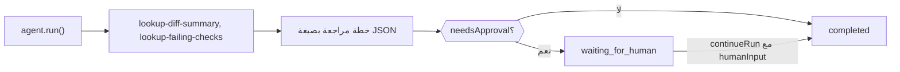

أنشئ وكيلًا بلغة TypeScript يفحص طلب سحب باستخدام أدوات محلية، ويُرجع خطة مراجعة بصيغة JSON صارمة، ويتوقف بانتظار شخص عندما تقول الخطة إنها تحتاج إلى موافقة. في النهاية يكون لديك سكربت واحد يطبع `CodeReviewPlan` تم التحقق منها، ويتوقف عند `waiting_for_human` حتى يوافق عليها أحد.

تُرجع الأدوات بيانات عيّنة ثابتة، لذا فالسكربت توضيحي؛ استبدلها باستدعاءات إلى منصة استضافة الشيفرة وCI لديك. توجد نسخة جاهزة في `packages/sdk/agent-sdk-ts/examples/coding-review-agent.ts`.



## أنشئه

<Steps>
<Step title="التثبيت">

```bash
npm install @phaseo/agent-sdk zod
export PHASEO_API_KEY="phaseo_v1_sk_..."
```

</Step>
<Step title="اكتب الوكيل">

```ts review-agent.ts
import { z } from "zod";
import { createAgent, createGatewayAgentClient, defineTool } from "@phaseo/agent-sdk";

const CodeReviewPlan = z
  .object({
    risk: z.enum(["low", "medium", "high"]),
    summary: z.string().min(1),
    recommendedActions: z.array(z.string()).min(1),
    needsApproval: z.boolean(),
  })
  .strict();
type CodeReviewPlan = z.infer<typeof CodeReviewPlan>;

const PullRequestInput = z.object({ pullRequestId: z.string().regex(/^pr_\d+$/) }).strict();
const pullRequestParameters = {
  type: "object",
  properties: { pullRequestId: { type: "string", pattern: "^pr_\\d+$" } },
  required: ["pullRequestId"],
  additionalProperties: false,
};

// أدوات للقراءة فقط وحتمية: يمكن إعادة تشغيلها بأمان إذا استأنف عامل التشغيل.
const lookupDiffSummary = defineTool({
  id: "lookup-diff-summary",
  description: "Return a short summary of the changed files in one pull request.",
  parameters: pullRequestParameters,
  inputSchema: PullRequestInput,
  async execute({ pullRequestId }) {
    return {
      pullRequestId,
      files: ["apps/api/src/pipeline/before/index.ts"],
      summary: "Changes touch request validation.",
    };
  },
});

const lookupFailingChecks = defineTool({
  id: "lookup-failing-checks",
  description: "Return the failing CI checks for one pull request.",
  parameters: pullRequestParameters,
  inputSchema: PullRequestInput,
  async execute({ pullRequestId }) {
    return { pullRequestId, failingChecks: ["web-typecheck"] };
  },
});

const codingReviewAgent = createAgent<string, CodeReviewPlan>({
  id: "coding-review-agent",
  model: "openai/gpt-6-astra",
  instructions:
    "Use the available tools to inspect the coding task, then return a strict JSON review plan.",
  tools: [lookupDiffSummary, lookupFailingChecks],
  maxSteps: 6,
  parseOutput: (text) => JSON.parse(text),
  outputSchema: CodeReviewPlan,
  humanReview: ({ parsedOutput }) =>
    parsedOutput?.needsApproval
      ? { reason: "coding_review_approval_required", payload: parsedOutput }
      : null,
});

// اطلب من Gateway هذا الشكل الدقيق من JSON، وأصلح JSON شبه الصالح.
const client = createGatewayAgentClient({
  clientOptions: { apiKey: process.env.PHASEO_API_KEY! },
  responseFormat: {
    type: "json_schema",
    name: "code_review_plan",
    schema: {
      type: "object",
      properties: {
        risk: { type: "string", enum: ["low", "medium", "high"] },
        summary: { type: "string" },
        recommendedActions: { type: "array", items: { type: "string" }, minItems: 1 },
        needsApproval: { type: "boolean" },
      },
      required: ["risk", "summary", "recommendedActions", "needsApproval"],
      additionalProperties: false,
    },
  },
  plugins: [{ id: "response-healing", mode: "strict" }],
});

const result = await codingReviewAgent.run({
  input: "Review pull request pr_482 and produce a remediation plan.",
  client,
  onEvent(event) {
    console.log(event.type, event.runId);
  },
});

if (result.run.status === "waiting_for_human") {
  console.log("Needs approval:", result.run.pause?.payload);

  // في تطبيق حقيقي، احفظ `result` وتابع عندما يوافق مراجع.
  if (process.env.APPROVE === "yes") {
    const continued = await codingReviewAgent.continueRun({
      run: result,
      client,
      humanInput: "Approved. Finalize the plan.",
    });
    console.log(continued.output);
  }
} else {
  console.log(result.output);
}
```

يجعل `responseFormat` الـ Gateway يطلب هذا المخطط، ويتحقق `outputSchema` من النتيجة المحلَّلة مرة أخرى داخل عمليتك. لا يفكّ وضع [إصلاح الاستجابة](./response-healing-for-structured-json) الصارم إلا JSON الصالح أصلًا.

</Step>
<Step title="شغّله">

```bash
npx tsx review-agent.ts
APPROVE=yes npx tsx review-agent.ts
```

</Step>
</Steps>

## تحقّق من نجاحه

- يعرض سجل الأحداث `tool.started` و`tool.completed` لكلتا الأداتين، ثم `checkpoint.saved` بعد خطوة الأدوات.
- تنتهي الخطة التي تحتوي على `needsApproval: true` عند `waiting_for_human` في التشغيل الأول، مع وجود الخطة في `result.run.pause.payload`؛ ومع `APPROVE=yes` يتابع التشغيل إلى `completed`.
- في **الإعدادات → الاستخدام → السجلات**، يعرض كل دور للنموذج استدعاءات الأدوات، ويوضح سجل الإضافات في الطلب ما إذا كان الإصلاح قد عمل.
- تؤدي الخطة التي تخالف المخطط إلى فشل التشغيل بخطأ `AgentSchemaValidationError` بدلًا من إرجاع بيانات سيئة.

## اجعله آمنًا للمستودعات الحقيقية

اجعل أدوات المراجعة للقراءة فقط. إذا أضفت أداة تكتب تعليقات أو تدفع تغييرات أو تدمجها، فاضبط `requireApproval: true` عليها كي يتوقف التشغيل قبل تنفيذها، ووافق عليها باستخدام `continueRun({ run, client, approvals: [toolCallId] })`. تعامل مع محتوى الفروقات على أنه مدخلات غير موثوقة: قد تحتوي تعليقات الشيفرة على تعليمات موجّهة إلى النموذج. لكي تصمد المراجعة أمام إعادة التشغيل أثناء انتظارها، احفظ التشغيل باستخدام موصّل `state` كما في [حلقة الوكيل المستدامة](./agent-sdk-durable-loop). تشرح صفحة [الحالة والموافقة](../sdk-reference/agent/state-and-approval) الموافقات والرفض.
