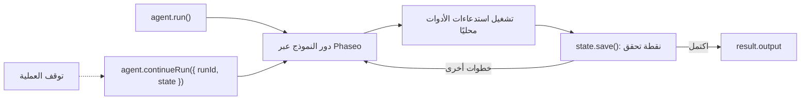

شغّل وكيلًا يستخدم الأدوات عبر TypeScript Agent SDK واحفظ حالته بعد كل خطوة، كي تتابع العملية التي تعطّلت أو أُعيد تشغيلها من حيث توقفت. في النهاية يكون لديك سكربت واحد يجيب عن سؤال حول الوثائق باستخدام أداة بحث، ويكتب كل تشغيل إلى `.agent-runs/<run id>.json`، ويستأنف التشغيل عندما تمرّر معرّفه.

السكربت توضيحي: مخزن الملفات يناسب جهازًا واحدًا. في الإنتاج، احتفظ بزوج `load`/`save` نفسه لكن اجعل قاعدة بياناتك خلفه. لا يخزّن Phaseo تشغيلات Agent SDK نيابةً عنك.



## أنشئها

<Steps>
<Step title="التثبيت">

<CodeGroup>
```bash npm
npm install @phaseo/agent-sdk zod
```

```bash pnpm
pnpm add @phaseo/agent-sdk zod
```

```bash yarn
yarn add @phaseo/agent-sdk zod
```

```bash bun
bun add @phaseo/agent-sdk zod
```
</CodeGroup>

تثبّت `@phaseo/agent-sdk` الحزمة `@phaseo/sdk` معها. اضبط مفتاحك:

```bash
export PHASEO_API_KEY="phaseo_v1_sk_..."
```

</Step>
<Step title="اكتب الوكيل">

```ts agent.ts
import { mkdir, readFile, writeFile } from "node:fs/promises";
import { z } from "zod";
import {
  createAgent,
  createGatewayAgentClient,
  defineTool,
  type AgentStateAccessor,
} from "@phaseo/agent-sdk";

const DOC_SLUGS = ["guides/presets", "guides/routing-and-fallbacks", "guides/streaming"] as const;

// لا يرى النموذج إلا `parameters`؛ ويرفض `inputSchema` أي شيء آخر قبل تشغيل execute.
const lookupDocs = defineTool({
  id: "lookup-docs",
  description: "Return the URL of one Phaseo docs page by slug.",
  parameters: {
    type: "object",
    properties: { slug: { type: "string", enum: [...DOC_SLUGS] } },
    required: ["slug"],
    additionalProperties: false,
  },
  inputSchema: z.object({ slug: z.enum(DOC_SLUGS) }).strict(),
  async execute({ slug }) {
    return { slug, url: `https://phaseo.app/docs/v1/${slug}` };
  },
});

const agent = createAgent<string, string>({
  id: "support-docs-agent",
  model: "openai/gpt-6-astra",
  instructions: "Use tools when helpful and finish with a concise answer that includes the docs URL.",
  tools: [lookupDocs],
  maxSteps: 6,
});

// احفظ التشغيل كاملًا بعد كل خطوة. استبدل هاتين الدالتين بقاعدة بياناتك.
const RUNS_DIR = ".agent-runs";
const state: AgentStateAccessor<string, unknown, string> = {
  async load(runId) {
    try {
      return JSON.parse(await readFile(`${RUNS_DIR}/${runId}.json`, "utf8"));
    } catch {
      return null;
    }
  },
  async save(result) {
    await mkdir(RUNS_DIR, { recursive: true });
    await writeFile(`${RUNS_DIR}/${result.run.id}.json`, JSON.stringify(result));
  },
};

const client = createGatewayAgentClient({
  clientOptions: { apiKey: process.env.PHASEO_API_KEY! },
});

const onEvent = (event: { type: string; runId: string }) => {
  if (event.type === "checkpoint.saved") console.log("checkpoint", event.runId);
};

const resumeId = process.argv[2];
let result;

if (resumeId) {
  const saved = await state.load(resumeId);
  if (!saved) throw new Error(`No saved run ${resumeId}`);
  result = saved.run.status === "completed"
    ? saved
    : await agent.continueRun({ run: saved, client, state, onEvent });
} else {
  result = await agent.run({
    input: "Find the docs page for presets and explain when to use them.",
    client,
    state,
    onEvent,
  });
}

console.log(result.run.id, result.run.status);
console.log(result.output);
```

</Step>
<Step title="شغّلها">

```bash
npx tsx agent.ts
```

لاختبار الاستئناف، أوقف السكربت بـ `Ctrl+C` بعد أول سطر `checkpoint`، ثم مرّر معرّف التشغيل الذي طبعه (UUID):

```bash
npx tsx agent.ts 3f6c1d2e-...
```

</Step>
</Steps>

## تحقّق من نجاحها

- يطبع السكربت `checkpoint` مرة لكل خطوة، ثم معرّف التشغيل و`completed` وإجابة تتضمن رابط `phaseo.app/docs`.
- يحتوي `.agent-runs/<run id>.json` على معرّف التشغيل وحالته وسجل الرسائل واستدعاءات الأدوات ونتائجها في كل خطوة والمخرجات النهائية.
- بعد تشغيل مقطوع، يُكمل أمر الاستئناف معرّف التشغيل نفسه بدلًا من بدء تشغيل جديد.
- يظهر كل دور للنموذج في **الإعدادات → الاستخدام → السجلات**. سجّل معرّف التشغيل بجانب كل معرّف طلب كي تتمكن من مطابقتهما.

## ما تحتويه الحالة المحفوظة

كل نتيجة محفوظة هي `AgentRunResult` كاملة: `run` (المعرّف والحالة والرسائل والاستخدام وأي توقف)، و`steps` مع معرّفات طلبات الـ Gateway واستدعاءات الأدوات الخاصة بها، و`output` بعد اكتمال التشغيل. تقبلها `continueRun()` مباشرةً، أو تقبل `runId` مع `state` فتستدعي `load()` بنفسها.

قد يكون استدعاء الأداة الذي كان قيد التشغيل عند توقف العملية قد أحدث أثره بالفعل، لذا اجعل الأدوات متساوية القوى (idempotent). يُصلح SDK سجل الاستدعاء الذي لم يحصل على نتيجة قبل أن يتابع. تشرح صفحة [الحالة والموافقة](../sdk-reference/agent/state-and-approval) التوقفات والموافقات.

## وسّعها بحذر

احتفظ بوكيل واحد لكل سير عمل، وقائمة أدوات قصيرة، وسطر سجل واحد لكل تشغيل يتضمن معرّف التشغيل ومعرّفات الطلبات. عندما تحتاج إلى توقفات للموافقة أو عدة وكلاء يتشاركون الأدوات، احتفظ بزوج عميل الـ Gateway والحالة هذا وابنِ حولهما: يضيف [وكيل مراجعة الشيفرة](./agent-sdk-coding-review) توقفًا للموافقة، ويشغّل [الأدوات المتوازية](./agent-sdk-parallel-tools) الأدوات جنبًا إلى جنب. للإعدادات الافتراضية المشتركة للطلبات، استدعِ [إعدادًا مسبقًا](../guides/presets) بدلًا من نموذج ثابت.
