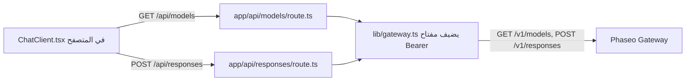

شغّل تطبيق دردشة صغيرًا مبنيًا بـ Next.js لا يتحدث كود المتصفح فيه إلا إلى مسارات الخادم الخاصة بك، كي لا يصل مفتاح Phaseo API إلى المتصفح أبدًا. في النهاية تكون لديك صفحة دردشة محلية مع أداة اختيار نموذج تُملأ من `GET /v1/models`، وإجابات من `POST /v1/responses`.

المثال توضيحي: مساراته بلا تسجيل دخول ولا حدّ للمعدل، لذا يستطيع أي شخص يصل إليها أن ينفق من مفتاحك. أضف الفحوصات الواردة في [قبل النشر](#before-you-deploy-it) أولًا.

لكي يبني وكيل برمجة التطبيق نفسه من الصفر، الصق هذه المطالبة:

<Prompt
  description="أنشئ **تطبيق دردشة ويب باستخدام Next.js** فوق Phaseo Gateway."
  icon="message-square"
  actions={["copy", "cursor"]}
>
{`You are building a small production-style chat app with Phaseo Gateway.

Create a Next.js app with:
- a chat UI
- a model picker backed by GET https://api.phaseo.app/v1/models
- a server-side route that calls POST https://api.phaseo.app/v1/responses
- server-side API key handling using PHASEO_API_KEY (Authorization: Bearer)
- loading, success, and error states

Keep the app intentionally small and easy to inspect.

Implementation requirements:
- Use one local API route for model discovery.
- Use one local API route for responses generation.
- Keep secrets server-side only.
- Send the whole conversation in input on every turn. The gateway rejects previous_response_id.
- Only accept model IDs from an allowlist on the server, and cap the input length.
- Show the request/response flow clearly in code.
- Add a short README with setup and run steps.

Verification:
- Run the app if possible.
- Verify two successful chat turns in a row.
- Report the exact files changed, what you verified, and any remaining assumptions.`}
</Prompt>

## كيف بُني المثال



يوجد المثال في [examples/web-chat-nextjs](https://github.com/phaseoteam/Phaseo/tree/main/examples/web-chat-nextjs):

| الملف | وظيفته |
| --- | --- |
| `app/components/ChatClient.tsx` | حقل الإدخال، وحالتا التحميل والخطأ، والرسائل المعروضة، وأداة اختيار النموذج |
| `app/api/models/route.ts` | يُرجع معرّفات النماذج من `GET /v1/models` |
| `app/api/responses/route.ts` | يتحقق من أن `model` و`input` سلسلتان نصيتان غير فارغتين (`400 missing_model`، `400 missing_input`)، ثم يستدعي `POST /v1/responses` |
| `lib/gateway.ts` | يبني الرابط والترويسات: `Authorization: Bearer $PHASEO_API_KEY` و`x-title`، و`http-referer` عند ضبطه |

## شغّله

تحتاج إلى Node.js ومفتاح Phaseo API.

<Steps>
<Step title="التثبيت">

```bash
cd examples/web-chat-nextjs
npm install
```

يأتي المثال مع ملف `package-lock.json`، لذا يثبّت `npm` الإصدارات التي اختُبرت.

</Step>
<Step title="أنشئ .env.local">

لا يحتوي المثال على `.env.example`. أنشئ `.env.local` بنفسك:

```bash .env.local
PHASEO_API_KEY=phaseo_v1_sk_...
# اختياري. القيمة الافتراضية https://api.phaseo.app؛ ويُضاف /v1 تلقائيًا.
NEXT_PUBLIC_GATEWAY_URL=https://api.phaseo.app
# ترويسات اختيارية لنسب التطبيق.
GATEWAY_APP_TITLE=My chat app
GATEWAY_HTTP_REFERER=https://myapp.example
```

لا يُقرأ `NEXT_PUBLIC_GATEWAY_URL` هنا إلا على الخادم، لكن البادئة `NEXT_PUBLIC_` قد تكشفه لكود المتصفح، لذا لا تضع فيه مفتاحًا أبدًا. تشرح صفحة [نسب التطبيق](../guides/app-attribution) الترويستين الاختياريتين.

</Step>
<Step title="أصلح دور الدردشة الثاني">

يرسل `ChatClient.tsx` قيمة `id` للإجابة السابقة بوصفها `previous_response_id`. لا يخزّن الـ Gateway الاستجابات، لذا يرفض هذا الحقل بالخطأ `400 validation_error` (الكلمة المفتاحية `unsupported_param`) وتفشل الرسالة الثانية. في `app/api/responses/route.ts`، احذف الكتلة التي تنسخ `previous_response_id` إلى الحمولة:

```ts app/api/responses/route.ts
  // احذف هذه الأسطر:
  if (typeof body.previous_response_id === 'string' && body.previous_response_id.trim()) {
    payload.previous_response_id = body.previous_response_id.trim();
  }
```

بعد ذلك يُجاب عن كل دور بمفرده. للحفاظ على السياق، أرسل الأدوار السابقة كمصفوفة رسائل في `input`.

</Step>
<Step title="شغّل خادم التطوير">

```bash
npm run dev
```

افتح `http://localhost:3000`.

</Step>
</Steps>

## تحقّق من نجاحه

- تمتلئ أداة اختيار النموذج بمعرّفات النماذج.
- تحصل رسالتان متتاليتان على إجابة لكل منهما.
- في لوحة الشبكة في المتصفح، لا تذهب الطلبات إلا إلى `/api/models` و`/api/responses`، ولا يحمل أي طلب `PHASEO_API_KEY`.
- يعرض معرّف النموذج الخاطئ رسالة الخطأ من الـ Gateway بدلًا من إجابة فارغة.
- تظهر الطلبات في **الإعدادات → الاستخدام → السجلات** مع عنوان التطبيق الذي ضبطته.

<span id="before-you-deploy-it"></span>
## قبل النشر

- **صادِق على المسارات.** اشترط وجود مستخدم مسجّل الدخول على `/api/responses` و`/api/models`، أو استخدم [منضدة OAuth](./build-an-oauth-nextjs-workbench) كي ينفق كل مستخدم من أرصدته الخاصة.
- **ضع قائمة سماح للنماذج.** يمرّر المسار أي سلسلة `model` تأتي من المتصفح. تحقّق منها مقابل قائمة ثابتة على الخادم.
- **حدّ من المدخلات والمعدل.** قيّد طول المدخلات وعدد الطلبات لكل مستخدم، واضبط [حدّ إنفاق على المفتاح](../api-reference/limits#key-limits-and-budgets).
- **استخدم البث إن احتجت إليه.** اضبط `stream: true` ومرّر الأحداث؛ توضح صفحة [البث](../guides/streaming) الحدث الذي يُنهي بث Responses.

لسكربت خلفي بدلًا من واجهة مستخدم، ابدأ من [تطبيق اختبار Node REST السريع](./build-a-node-rest-smoke-app) أو [أداة Python CLI للـ Gateway](./build-a-python-gateway-cli).
