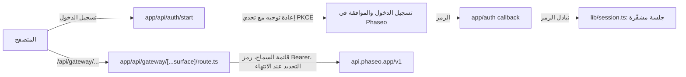

اسمح للمستخدمين بتسجيل الدخول باستخدام Phaseo وإنفاق أرصدتهم الخاصة في تطبيقك: يمنح OAuth 2.1 مع PKCE خادمك رمز وصول، ويُرفقه وكيل واحد من جهة الخادم بكل استدعاء للـ Gateway. في النهاية يصبح لديك تطبيق محلي فيه تسجيل دخول، ورموز محفوظة في الجلسة تتجدد، واكتشاف للنماذج، وتدفق محادثة عبر `/responses`، وأداة لاختبار نقاط النهاية الأخرى.

العينة توضيحية. لا يزال الملف `lib/oauth.ts` يستدعي نقطة نهاية قديمة لتسجيل الدخول، وتصلحها الخطوة 3 من [شغّله](#run-it)، كما أن قائمة السماح في الوكيل أوسع مما يحتاجه منتج حقيقي.

لتجعل وكيل برمجة ينشئ التطبيق نفسه من الصفر، الصق هذه المطالبة:

<Prompt
  description="أنشئ **منصة عمل Next.js تتطلب تسجيل الدخول** مع OAuth ووكيل Phaseo موحّد."
  icon="shield-user"
  actions={["copy", "cursor"]}
>
{`You are building a signed-in Next.js app on top of Phaseo Gateway.

Create a workbench-style app with:
- OAuth 2.1 + PKCE sign-in against https://api.phaseo.app/oauth/authorize and https://api.phaseo.app/oauth/token (discover them from https://api.phaseo.app/.well-known/oauth-authorization-server), requesting the gateway:access scope
- session-backed token storage in an encrypted, httpOnly cookie
- one unified gateway proxy route on the server that calls https://api.phaseo.app/v1
- model discovery
- one chat flow using the Responses API, sending the whole conversation in input on every turn
- one generic endpoint tester for additional Phaseo endpoints

Requirements:
- Keep gateway credentials and access tokens server-side.
- Use a proxy allowlist of exact paths for safety.
- Support token refresh. Store the new refresh token from every refresh and drop the old one.
- Sign out by sending the refresh token to https://api.phaseo.app/oauth/revoke.
- Keep the workbench understandable rather than over-engineered.
- Add a short README with setup, env vars, and run steps.

Verification:
- run the app if possible
- verify sign-in flow as far as local setup allows
- verify at least one proxied gateway request path
- report exactly what you verified and what remains dependent on external OAuth configuration.`}
</Prompt>

## كيف بُنيت العينة



توجد العينة في [examples/oauth-client-nextjs](https://github.com/phaseoteam/Phaseo/tree/main/examples/oauth-client-nextjs):

| الملف | ما يفعله |
| --- | --- |
| `app/page.tsx` | صفحة الدخول لتسجيل الدخول |
| `app/dashboard/page.tsx` | الهيكل المحمي |
| `app/dashboard/GatewayWorkbench.tsx` | يحمّل مسارات التحكم، ويعرض معرّفات النماذج، ويشغّل المحادثة عبر `POST /responses`، ويختبر نقاط النهاية الأخرى |
| `app/api/gateway/[...surface]/route.ts` | وكيل شامل: يتحقق من قائمة السماح، ويضيف رمز Bearer، ويجدّده عند انتهاء صلاحيته، ويمرّر المحتوى والحالة |
| `lib/oauth.ts` | PKCE وتبادل الرمز والتجديد |
| `lib/session.ts` | تخزين الجلسة المشفّرة |

فصل تسجيل الدخول عن استدعاءات الـ Gateway يعني أن مشكلة في تسجيل الدخول لن تبدو أبدًا كمشكلة في النموذج، وأن جميع نقاط النهاية تشترك في مكان واحد يتعامل مع الرموز.

<span id="run-it"></span>
## شغّله

تحتاج إلى Node.js، وتطبيق OAuth يتضمن `http://localhost:3000/auth/callback` (أو عنوان الاستدعاء الخاص بك) كعنوان إعادة توجيه، وسرّ جلسة عشوائي طويل. أنشئ تطبيق OAuth من **الإعدادات → تطبيقات OAuth** أو باستخدام [OAuth clients API](../api-reference/endpoint/oauth-clients-create).

<Steps>
<Step title="التثبيت">

```bash
cd examples/oauth-client-nextjs
npm install
```

</Step>
<Step title="أنشئ .env.local">

لا تحتوي العينة على `.env.example`. أنشئ `.env.local` بالأسماء التي تقرؤها الشيفرة:

```bash .env.local
NEXT_PUBLIC_OAUTH_CLIENT_ID=your_client_id
OAUTH_CLIENT_SECRET=your_client_secret
# The sample reads this name for the OAuth server's base URL.
NEXT_PUBLIC_AISTATS_URL=https://api.phaseo.app
NEXT_PUBLIC_REDIRECT_URI=http://localhost:3000/auth/callback
SESSION_SECRET=a-long-random-string
NEXT_PUBLIC_GATEWAY_URL=https://api.phaseo.app
```

لا تضع أبدًا `OAUTH_CLIENT_SECRET` أو `SESSION_SECRET` في متغير يبدأ بـ `NEXT_PUBLIC_`.

</Step>
<Step title="وجّه العينة إلى نقاط نهاية OAuth الحالية">

يبني `lib/oauth.ts` العنوانين `${NEXT_PUBLIC_AISTATS_URL}/auth/v1/oauth/authorize` و`/auth/v1/token` ويطلب `openid email profile`. ينشر خادم OAuth الخاص بـ Phaseo نقاط نهايته على `https://api.phaseo.app/.well-known/oauth-authorization-server`:

| الاستخدام | العنوان |
| --- | --- |
| التفويض | `https://api.phaseo.app/oauth/authorize` |
| الرمز | `https://api.phaseo.app/oauth/token` |
| الإلغاء | `https://api.phaseo.app/oauth/revoke` |

غيّر العناوين الثلاثة في `lib/oauth.ts` إلى هذه، وأضف `gateway:access` إلى `scope` ليتمكن الرمز من استدعاء الـ Gateway.

</Step>
<Step title="شغّل خادم التطوير">

```bash
npm run dev
```

افتح `http://localhost:3000`، وسجّل الدخول، ثم افتح لوحة التحكم.

</Step>
</Steps>

## تحقّق من نجاحه

- يعود تسجيل الدخول إلى عنوان الاستدعاء الخاص بك وينشئ جلسة.
- تعرض لوحة التحكم النماذج عبر `/api/gateway/models`.
- تحصل جولة محادثة عبر `/api/gateway/responses` على إجابة، ولا يحمل أي طلب من المتصفح رمز الوصول.
- يُرفض أي مسار خارج قائمة السماح في الوكيل.

## مدد صلاحية الرموز

تعيد نقطة نهاية الرمز رمزين:

| الرمز | مدة الصلاحية | الاستخدام |
| --- | --- | --- |
| `access_token` | 7 أيام (`expires_in`) | أرسله كـ `Authorization: Bearer` في طلبات الـ Gateway. يُنفق الأرصدة في مساحة العمل التي اختارها المستخدم. |
| `refresh_token` | 90 يومًا من آخر استخدام له | أرسله مع `grant_type=refresh_token` للحصول على زوج جديد. |

- **دوّر الرموز عند كل تجديد.** يعيد كل تجديد رمز وصول جديدًا ورمز تجديد جديدًا. احفظ الاثنين وتخلّص من القديمين: يتوقف رمز الوصول القديم عن العمل فورًا، ولا يمكن استخدام رمز التجديد القديم مرة أخرى.
- **جدّد بعد انتهاء الصلاحية.** يمكنك التجديد بعد انتهاء صلاحية رمز الوصول، ما دامت صلاحية رمز التجديد لم تنتهِ.
- **لا تُعِد استخدام رمز تجديد أبدًا.** استخدامه مرة ثانية يُنهي تسجيل الدخول. يعامله Phaseo كرمز مسرّب ويلغي رمز الوصول وكل رموز التجديد الصادرة من تسجيل الدخول ذاك، فيضطر المستخدم إلى تسجيل الدخول مجددًا.
- **النطاقات تتقلص فقط.** لا يضيف التجديد نطاقات أبدًا. يحتفظ بالنطاقات التي وافق عليها المستخدم، مطروحًا منها ما أزاله لاحقًا.
- **عند فشل التجديد.** يفشل التجديد بمجرد أن يلغي المستخدم تطبيقك، أو يلغي مفتاحه أو يعطّله، أو يزيل نطاقًا يحتاجه المفتاح (مثل `gateway:access`)، أو يغادر مساحة العمل. إزالة `gateway:access` تلغي المفتاح أيضًا، فيتوقف رمز الوصول عن العمل فورًا. ومنح النطاق مجددًا لا يعيد رمز التجديد. أعِد المستخدم إلى تسجيل الدخول.
- **تسجيل الدخول مجددًا يجدّد المفتاح.** يجدّد المفتاح نفسه بدلًا من إضافة مفتاح جديد، سواء أرسلت `resource=https://api.phaseo.app/v1` أم لا. تحصل على رمز وصول ورمز تجديد جديدين، ويتوقف السابقان عن العمل، ويحتفظ المفتاح بإنفاق هذا الشهر. ويصبح حد الإنفاق الشهري للمفتاح هو الحد الذي وافق عليه المستخدم للتو. أما رمز التجديد من تسجيل دخول سابق فيُرفض فقط، وإرساله إلى نقطة نهاية الرمز أو الإلغاء لا يُنهي تسجيل الدخول الجديد.
- **المفتاح الموقوف مؤقتًا يمنع تسجيل الدخول.** إذا كان أي من مفاتيح تطبيقك لذلك المستخدم ومساحة العمل موقوفًا مؤقتًا، أيًّا كان موردُه، تعيد نقطة نهاية الرمز `invalid_grant` حتى يعيد أحدهم تشغيل المفتاح من **الإعدادات → مفاتيح API**. لا يعمل التجديد إلا ما دام المفتاح غير ملغى: بعد تسجيل الخروج أو أي إلغاء آخر، يصدر تسجيل الدخول مفتاحًا جديدًا، وتبدأ حدوده وإنفاقه من جديد.
- **سجّل الخروج بالإلغاء.** أرسل رمز التجديد إلى `https://api.phaseo.app/oauth/revoke`. يلغي ذلك المفتاح وكل رموز التجديد الصادرة من تسجيل الدخول، بما فيها رمز أصدره تجديد قبل لحظات.

## حدود الإنفاق

في شاشة الموافقة يحدد المستخدم حد إنفاق شهريًا لتطبيقك: $20.00 افتراضيًا، أو مبلغًا آخر، أو بلا حد. بمجرد أن ينفق المفتاح هذا المبلغ خلال شهر تقويمي، تعيد طلبات الـ Gateway الرمز `429` مع `key_limit_exceeded` حتى الشهر التالي أو حتى يرفع المستخدم الحد من **الإعدادات → مفاتيح API**.

أيًّا كانت النطاقات التي يملكها، لا يستطيع تطبيقك رفع هذا الحد أو الالتفاف عليه عبر API. كل ما يمكنه هو إعادة تسمية مفاتيح API أو حذفها. لا يمكنه إنشاء مفاتيح أو تدويرها، ولا تغيير حدود مفتاح أو حالته أو تاريخ انتهائه، ولا إنشاء مفاتيح إدارة أو أحمال عمل موثوقة، ولا إضافة أعضاء، ولا تغيير الميزانيات أو ضوابط الحماية أو حدود المعدل أو قواعد الإنفاق، ولا تغيير حدود الأسعار في مساحة العمل للتوجيه أو الرجوع من BYOK إلى الأرصدة.

## قبل أن تطلقه

- **قلّص قائمة السماح.** يسمح `lib/gateway.ts` بمسارات محددة إضافةً إلى كل مسار تحت `videos/` و`music/generate/` و`control/` و`internal/`. احتفظ فقط بالمسارات المحددة التي يستدعيها منتجك.
- **أرسل المحادثة كاملة.** لا يخزّن الـ Gateway الردود ويرفض `previous_response_id`، لذا أعِد إرسال الجولات السابقة في `input`.
- **استبدل أداة الاختبار.** احتفظ بمنصة العمل لضمان الجودة داخليًا، وابنِ تدفقات مخصصة للمستخدمين النهائيين.

لتطبيق يعتمد على مفتاح API دون تسجيل دخول، ابدأ من [تطبيق المحادثة على الويب باستخدام Next.js](./build-a-nextjs-web-chat-app).
