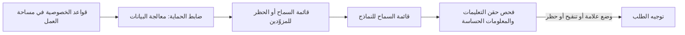

أنشئ ضابط حماية واحدًا من **الإعدادات → ضوابط الحماية**، واربطه بمفتاح API منخفض المخاطر، ثم وسّع نطاقه فقط بعد أن تُظهر السجلات أنه يعمل كما ينبغي. في النهاية لا يستطيع ذلك المفتاح الوصول إلا إلى المزوّدين والنماذج التي تسمح بها، وتُفحص مطالباته بحثًا عن حقن التعليمات والبيانات الحساسة قبل أن تصل إلى أي نموذج.

هذا إجراء من لوحة التحكم؛ ويمكن برمجة السياسة نفسها باستخدام [guardrails API](../api-reference/endpoint/guardrails-create).

تُطبَّق قواعد الخصوصية في مساحة العمل أولًا؛ ولا يستطيع ضابط الحماية إلا تضييقها. لا تضع ضوابط الحماية سقفًا للإنفاق: عيّن حدًا على المفتاح أو [ميزانية لمساحة العمل](../api-reference/limits#key-limits-and-budgets) بدلًا من ذلك.

## اطرحه

<Steps>
<Step title="أنشئ ضابط الحماية">

افتح **الإعدادات → ضوابط الحماية → ضابط حماية جديد**. سمّه بحسب ما يفرضه، مثل `eu-models-pii-redact`، لا باسم فريق، لكي يمكن إعادة استخدامه عبر المفاتيح.

اضبط الوصول إلى المسارات قبل فحوصات المحتوى:

| الإعداد | الخيارات |
| --- | --- |
| **وضع المزوّدين** | السماح بجميع المزوّدين، أو السماح بالمزوّدين المحددين فقط، أو السماح بجميع المزوّدين باستثناء المحددين |
| **وضع النماذج** | السماح بجميع النماذج، أو السماح بالنماذج المحددة فقط (يُطبَّق بعد تصفية المزوّدين) |
| **معالجة البيانات** | ZDR فقط، وما إذا كانت نقاط النهاية المجانية أو المدفوعة التي قد تتدرّب على المدخلات تبقى مؤهلة |

سياسة أولى شائعة تحظر المزوّدين منخفضي الثقة وتسمح فقط بنماذج الإنتاج المحددة التي يجب أن يصل إليها المفتاح. استخدم المعاينة للتحقق من المزوّدين والنماذج التي تبقى قابلة للتوجيه، وما إذا كان خيار **السماح فقط** أضيق مما قصدت.

</Step>
<Step title="أضف فحوصات المحتوى">

يفحص **حقن التعليمات** المحتوى الذي يقدّمه المستخدم بحثًا عن أنماط الحقن الشائعة. ويكتشف **معلومات حساسة** البيانات قبل أن يغادر الطلب Phaseo:

| الكاشف | يُنقَّح إلى | يضيف زمن استجابة |
| --- | --- | --- |
| عنوان البريد الإلكتروني | `[EMAIL]` | لا |
| رقم الهاتف | `[PHONE]` | لا |
| رقم الضمان الاجتماعي الأمريكي | `[SSN]` | لا |
| رقم بطاقة الائتمان | `[CREDIT_CARD]` | لا |
| عنوان IP (IPv4) | `[IP_ADDRESS]` | لا |
| اسم شخص | `[PERSON_NAME]` | نعم |
| العنوان الفعلي | `[ADDRESS]` | نعم |

لكل فحص إجراء: **وضع علامة** أو **تنقيح** أو **حظر**. ابدأ حقن التعليمات على **وضع علامة** أو **تنقيح**، ولا تنتقل إلى **حظر** إلا بعد مراجعة النتائج الإيجابية الخاطئة. استخدم الكواشف السريعة أولًا. وأضف الأنماط المخصصة كقواعد regex صريحة.

</Step>
<Step title="اختبره في المعاينة">

قبل الحفظ، مرّر ثلاثة مدخلات عبر المعاينة: مدخل غير ضار، ومدخل يجب إيقافه بوضوح، ومطالبة إنتاج واقعية. تحقّق من نص التنقيح، ومن نتيجة الحظر أو السماح، ومن عدم تطابق أي شيء لا علاقة له.

</Step>
<Step title="اربطه بمفتاح واحد">

ضمن **تطبيق على المفاتيح**، اختر مفتاحًا تجريبيًا أو منخفض المخاطر. يمكنك ربط ضابط الحماية أثناء إنشائه. أما **تطبيق على الأعضاء** فيفرضه بدلًا من ذلك على مفاتيح API التي ينشئها هؤلاء الأعضاء. لا يستطيع الأعضاء تعديل أو إزالة ضابط حماية عيّنه مالك مساحة العمل أو مسؤولها.

</Step>
<Step title="تحقّق من التطبيق">

أرسل طلبات حقيقية عبر المفتاح، ثم تحقّق من:

- **الإعدادات → الاستخدام → ضوابط الحماية** لأعداد الطلبات المحظورة والمنقّحة والموسومة.
- قسم **تطبيق ضوابط الحماية** في طلب ضمن **الإعدادات → الاستخدام → السجلات**، لمعرفة ضابط الحماية والكاشف اللذين تفعّلا.
- عمود **ضوابط الحماية** في **الإعدادات → مفاتيح API**، للتأكد من المفاتيح المرتبط بها.

</Step>
<Step title="وسّع الطرح">

اربط ضابط الحماية نفسه بمفاتيح أكثر، وشدّد الإجراءات من **وضع علامة** إلى **تنقيح** أو **حظر**، وأضف كاشفَي اسم الشخص والعنوان فقط حيث يكون زمن الاستجابة الإضافي مقبولًا.

</Step>
</Steps>

يحتفظ ضابط الحماية المعطَّل بإعداداته لكنه لا يُطبَّق. لمشاركة قواعد التوجيه بين المستدعين بدلًا من فرضها على المفاتيح، استخدم [إعدادًا مسبقًا](../guides/presets).
