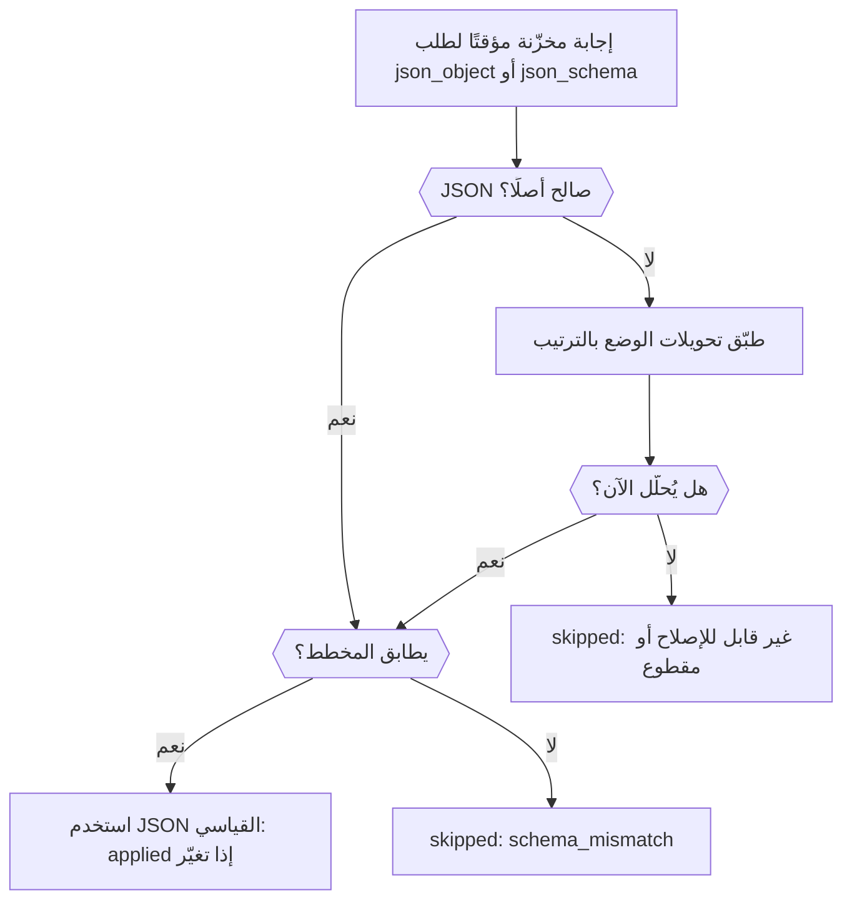

أضف الإضافة `response-healing` إلى طلب مخرجات منظَّمة، وسيصلح Phaseo الـ JSON شبه الصالح، مثل JSON داخل كتلة Markdown أو مع فاصلة زائدة في النهاية، قبل أن يصل إلى المحلّل لديك. في النهاية يصبح لديك طلب واحد يطلب JSON Schema، ويصلح الإجابة عند الحاجة، ويخبرك في الرد ما إذا فعل ذلك.

الطلب جاهز للإنتاج. يصلح الإصلاحُ البنيةَ فقط، لذا تظل شيفرتك تتحقق من النتيجة، كما في [تحقّق من النتيجة](../guides/structured-outputs#validate-the-result).



## أرسل طلبًا مع الإصلاح

<CodeGroup>
```bash cURL
curl https://api.phaseo.app/v1/responses \
  -H "Authorization: Bearer $PHASEO_API_KEY" \
  -H "Content-Type: application/json" \
  -d '{
    "model": "openai/gpt-6-astra",
    "input": "Summarize this release in one sentence: dark mode and faster search.",
    "text": {
      "format": {
        "type": "json_schema",
        "name": "answer",
        "strict": true,
        "schema": {
          "type": "object",
          "properties": { "summary": { "type": "string" } },
          "required": ["summary"],
          "additionalProperties": false
        }
      }
    },
    "plugins": [{ "id": "response-healing", "mode": "safe" }],
    "meta": true
  }'
```

```typescript TypeScript
import Phaseo from "@phaseo/sdk";

const client = new Phaseo({ apiKey: process.env.PHASEO_API_KEY! });

const response = await client.generateResponse({
  model: "openai/gpt-6-astra",
  input: "Summarize this release in one sentence: dark mode and faster search.",
  text: {
    format: {
      type: "json_schema",
      name: "answer",
      strict: true,
      schema: {
        type: "object",
        properties: { summary: { type: "string" } },
        required: ["summary"],
        additionalProperties: false,
      },
    },
  },
  plugins: [{ id: "response-healing", mode: "safe" }],
  meta: true,
});

console.log(response.meta?.plugin_executions);
```

```python Python
import os

from phaseo import Phaseo

client = Phaseo(api_key=os.environ["PHASEO_API_KEY"])

response = client.generate_response(
    {
        "model": "openai/gpt-6-astra",
        "input": "Summarize this release in one sentence: dark mode and faster search.",
        "text": {
            "format": {
                "type": "json_schema",
                "name": "answer",
                "strict": True,
                "schema": {
                    "type": "object",
                    "properties": {"summary": {"type": "string"}},
                    "required": ["summary"],
                    "additionalProperties": False,
                },
            }
        },
        "plugins": [{"id": "response-healing", "mode": "safe"}],
        "meta": True,
    }
)

print(response["meta"].get("plugin_executions"))
```
</CodeGroup>

في Chat Completions، أرسل المخطط نفسه في `response_format` بدلًا من `text.format`. لا يعمل الإصلاح إلا عندما يطلب الطلب `json_object` أو `json_schema`، ولا يعمل أبدًا مع البث: الطلب المبثوث يتخطاه مع `streaming_unsupported`.

## تحقّق من أنه عمل

مع `meta: true`، يسرد `meta.plugin_executions` الإضافة عندما تعمل:

```json
{
  "id": "response-healing",
  "stage": "response.post_provider",
  "status": "applied",
  "changed": true,
  "metadata": {
    "attempted": true,
    "healed": true,
    "mode": "safe",
    "transforms_applied": ["strip_markdown_fence"]
  }
}
```

| `status` | المعنى |
| --- | --- |
| `applied` | أُعيدت كتابة الإجابة إلى JSON صالح. |
| `skipped` | تُركت الإجابة كما هي. مع `attempted: false` لم يكن الطلب مؤهلًا؛ وإلا فإن الـ JSON كان صالحًا أصلًا أو تعذّر إصلاحه. يذكر `metadata.failure_reason` السبب: `streaming_unsupported`، أو `not_json` (لم تُطلب مخرجات منظَّمة، أو لا يوجد نص)، أو `unrepairable`، أو `truncated` (توقفت الإجابة عند حد الـ tokens)، أو `schema_mismatch` مع `validation_errors`. |
| `failed` | أخطأت الإضافة نفسها (`reason: plugin_error`)؛ والإجابة لم تتغير. |

يظهر السجل نفسه في الطلب ضمن **الإعدادات → الاستخدام → السجلات**. إذا لم تظهر الإضافة أبدًا، فتحقّق من أن الطلب أو إعداده المسبق أو مساحة العمل قد فعّلها فعلًا؛ تُظهر صفحة [عيّن الإعدادات الافتراضية للإضافات](./plugin-defaults-and-response-healing) أين يتم ذلك.

## اختر وضعًا

| الوضع | التحويلات، بالترتيب |
| --- | --- |
| `safe` (الافتراضي) | إزالة كتلة Markdown، والقص إلى أبعد `{…}` أو `[…]`، وإزالة الفواصل الزائدة في النهاية، ووضع علامات اقتباس حول المفاتيح المجردة، وإضافة أقواس الإغلاق الناقصة (ليس عندما تكون الإجابة قد بلغت حد الـ tokens) |
| `strict` | إزالة كتلة Markdown والقص إلى أبعد `{…}` أو `[…]` فقط، فلا يقبل إلا JSON كان صالحًا أصلًا داخل غلافه |

مع JSON Schema، تُفحص النتيجة المُصلَحة قبل أن تحل محل الإجابة: المفاتيح المطلوبة، والأنواع، و`enum` و`const`، وحدود المصفوفات و`uniqueItems`، وطول السلسلة النصية، و`pattern` والتنسيقات `email` و`uri` و`uuid` و`date-time`، وحدود الأرقام و`multipleOf`، وأعداد الخصائص و`additionalProperties: false`.

## اعرف متى لن يساعد

لا يخترع الإصلاح حقولًا ناقصة أبدًا، ولا يخمّن القيم، ولا يحوّل النثر إلى بيانات. ميّز بين حالات الفشل هذه قبل أن تلجأ إليه:

| الفشل | الحل |
| --- | --- |
| JSON قريب من الصحة بنيويًا | إصلاح الردود |
| JSON صالح بحقول خاطئة | شدّد المخطط والمطالبة |
| نثر بدلًا من JSON | اطلب `json_schema`، لا مجرد تعليمات في المطالبة |
| مقطوع عند حد الـ tokens | ارفع `max_output_tokens` |

يعمل الإصلاح بأفضل شكل مع كائن واحد بمفاتيح مطلوبة صريحة، و`temperature` منخفضة، ودون طلب نص خارج الـ JSON. فعّله لإعداد مسبق واحد أولًا، وراقب `plugin_executions` في السجلات، ثم وسّع نطاقه بمجرد أن تطابق الحمولات المُصلَحة مخططك.
