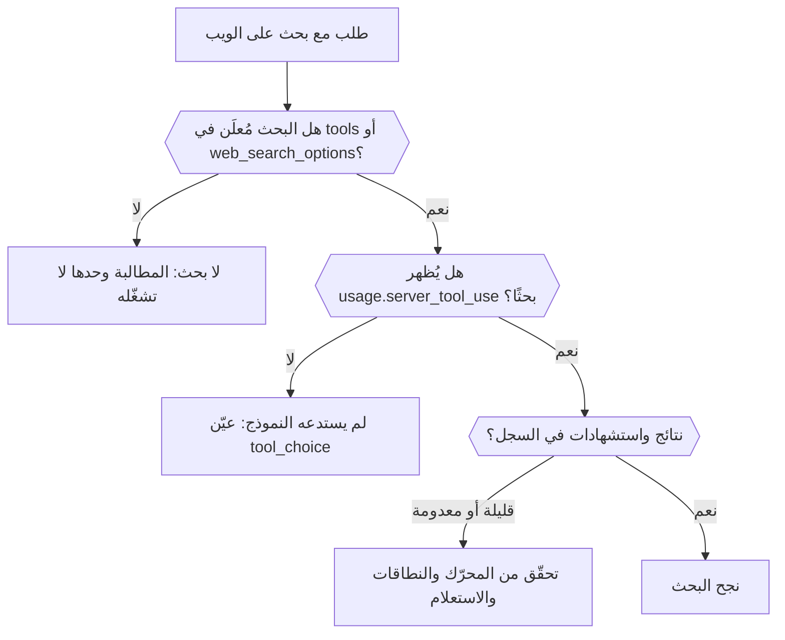

اكتشف من الرد ومن سجل الطلب ما إذا كان بحث الويب قد جرى فعلًا، وأي محرّك شغّله، وما الذي أعاده. في النهاية يمكنك التمييز بين بحث لم يحدث أصلًا وبحث جرى ولم يجد إلا القليل.



## أعلِن البحث في الطلب

طلب "the latest news" في المطالبة لا يشغّل بحثًا. أضفه صراحةً:

```json
{
  "model": "openai/gpt-6-astra",
  "input": "What changed in the Phaseo changelog this week?",
  "tools": [{ "type": "phaseo:web_search", "parameters": { "max_results": 5 } }],
  "tool_choice": "phaseo:web_search"
}
```

يعمل `phaseo:web_search` على Chat Completions وResponses وMessages. ويعمل `web_search_options` حيث تدعمه نقطة النهاية. يفرض `tool_choice` الاستدعاء؛ وبدونه قد يجيب النموذج من ذاكرته. يسرد [دليل البحث على الويب](../guides/server-tools/web-search) كل المعاملات.

## تحقّق من أنه جرى

| انظر إلى | ما يُظهره |
| --- | --- |
| `usage.server_tool_use.web_search_requests` في الرد | عدد عمليات البحث المُدارة التي جرت |
| **قابلية رصد البحث على الويب** في الطلب ضمن **الإعدادات → الاستخدام → السجلات** | عمليات البحث المُدارة، وعمليات البحث الأصلية، وعدد النتائج، وعدد الاستشهادات، مع سجلات النتائج والاستشهادات المستخرجة |
| **قابلية رصد التوجيه** في الطلب نفسه | المزوّدون الذين أُخذوا في الاعتبار، وأي مزوّدين استُبعدوا لأنهم لا يدعمون الطلب |

## ميّز بين حالات الفشل

| ما تراه | السبب | الحل |
| --- | --- | --- |
| لا توجد عدّادات بحث إطلاقًا | لم يُعلَن البحث، أو اختار النموذج ألا يستدعيه | أضف الأداة وعيّن `tool_choice` |
| تعيد الأداة `search_not_configured` إلى النموذج | المحرّك المُدار الذي اخترته غير مفعّل | استخدم المحرّك الافتراضي أو محرّكًا آخر |
| تعيد الأداة `unsupported_search_engine` | طلب النموذج `engine: "native"` داخل استدعاء | عيّن `native` في تعريف الأداة فقط |
| `400 not_supported` مع السبب `regional_hosted_tool_not_supported` | أُرسل إلى `eu.api.phaseo.app` أو `us.api.phaseo.app`، وهما يرفضان أدوات الخادم | استخدم `api.phaseo.app` |
| جرت عمليات البحث لكن الاستشهادات قليلة | كان الاستعلام أو المصادر ضعيفة | اضبط `max_results` أو `allowed_domains` أو `engine` |

مع `engine: "native"`، يذهب الطلب فقط إلى المزوّدين الذين يشغّلون البحث على الويب بأنفسهم. إذا لم يخدم أي منهم النموذج، يشغّل Phaseo محرّكه الافتراضي بدلًا من ذلك ويفوتره كبحث مُدار، لذا قد يُظهر طلب أصلي عدّادات مُدارة.

## قارن الطلبات

عندما تختلف النتائج بين التشغيلات، قارن معرّف النموذج، والمزوّد المختار، ومعاملات البحث، وأعداد النتائج والاستشهادات. هذه الأعداد موحّدة عبر المزوّدين، لذا تظهر الفروق في جودة البحث دون قراءة الحمولات الخام. لسير عمل كامل مؤسَّس على مصادر، راجع [البحث المُدار على الويب في TypeScript](./sdk-typescript-managed-search)؛ ولعنوان URL معروف، استخدم [جلب الويب](./tool-grounding-with-web-fetch) بدلًا من ذلك.
