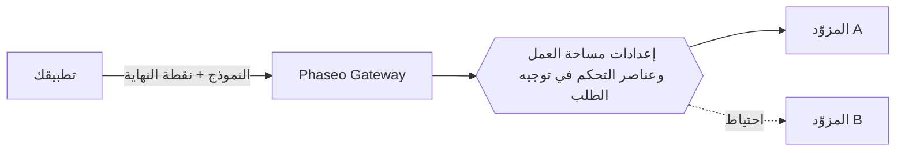

أرسل معرّف نموذج إلى نقطة نهاية Phaseo واحدة، وسيوجّه Phaseo الطلب إلى مزوّد يستضيف ذلك النموذج. يختار تطبيقك النموذج ونقطة النهاية؛ وتحدد إعدادات مساحة العمل وعناصر التحكم في التوجيه داخل الطلب المزوّدين الذين يمكنهم خدمته.

## النماذج والمزوّدون

النموذج هو النظام الذي يُنشئ المخرجات. ويستضيف المزوّد النموذج ويحدد توفره والمعاملات المدعومة وتسعيره وأداءه. قد يكون للنموذج الواحد عدة عروض من مزوّدين مختلفين.

يسرد الكتالوج العام أيضًا نماذج غير متاحة عبر الـ Gateway بعد. تحقّق من [توفر النموذج](../exploring/models.mdx) قبل استخدام معرّف في طلب.

## الطلبات والتوجيه

استخدم [Responses أو Chat Completions أو Messages](../api-reference/introduction.mdx)، أيها يطابق بروتوكول تطبيقك. لا تعني نقطة النهاية المشتركة أن كل نموذج يدعم كل معامل؛ فقدرات المزوّدين لا تزال تختلف.

تقيّد [عناصر التحكم في التوجيه](../guides/routing-and-fallbacks.mdx) المزوّدين الذين يمكنهم خدمة الطلب وطريقة ترتيبهم. يبقى الاحتياط ضمن هذه القيود ويعتمد على السعة المتاحة، لذا لا يضمن النجاح.

## الفوترة والوصول

تستخدم الطلبات المُدارة رصيد مساحة عمل Phaseo الخاصة بك، وتعمل نماذج `:free` دون إيداع أرصدة. ومع بيانات اعتماد المزوّد الخاصة بك (BYOK)، تنطبق فوترة المزوّد وحدود حسابه. راجع [التسعير والفوترة](../pricing/tiers.mdx) قبل الطرح.

تعيد [مهام الفيديو والدفعات](../guides/async-video-and-batch.mdx) مهمةً قبل انتهاء المعالجة؛ ويُدار الوصول التجريبي إليها لكل مساحة عمل. استعلم عن الحالة أو استقبل خطاف ويب، ثم نزّل النتيجة.

## الخطوات التالية

أرسل طلبك الأول باستخدام [البدء السريع](../quickstart.mdx)، ثم [ادمج الـ Gateway](./integrating-with-the-gateway.mdx) في تطبيقك مع إبقاء المفتاح في واجهتك الخلفية. عندما يفشل شيء ما، توضّح صفحة [الموثوقية والحالة](./reliability-and-status.mdx) كيفية التحقيق، وتعرض [سجلات الطلبات](../guides/integrations/observability.mdx) الاستخدام وزمن الاستجابة والتكلفة والأخطاء لكل طلب.
