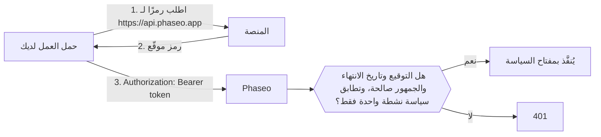

<Note>
ميزة أحمال العمل الموثوقة في المرحلة التجريبية، ويجري إتاحتها لمساحات العمل تدريجيًا. إذا لم يظهر **الإعدادات → مفاتيح API → أحمال العمل الموثوقة** في لوحة التحكم لديك، فهذا يعني أن مساحة عملك لم تحصل عليها بعد.
</Note>

أرسل رمز OIDC قصير الأجل الذي تصدره منصتك كرمز bearer بدلًا من مفتاح API لـ Phaseo، فلا يلزم تخزين أي شيء طويل الأجل في إعدادات مشروعك أو في أسرار CI. تمنح المنصات كل عملية نشر أو مهمة أو حمل عمل رمزًا موقّعًا يحدد هويته، مثل "عملية النشر الإنتاجية لمشروع `website`" أو "مهمة في مشروع GitLab رقم `4815162`"، وتنتهي صلاحية الرمز خلال ساعات. وأنت تحدد لـ Phaseo أحمال العمل التي يثق بها.

يثق Phaseo بالرموز الصادرة من Vercel وGitHub Actions وGitLab وGoogle Cloud وBuildkite وCircleCI وAWS، ومن جهة إصدار OIDC تشغّلها بنفسك، مثل عنقود Kubernetes أو Bitbucket Pipelines أو GitLab مُدار ذاتيًا. واصل استخدام مفاتيح API لكل ما عدا ذلك، مثل البرامج النصية المحلية وتطبيقات الجوال.

## طريقة العمل



ينشئ مالك مساحة العمل أو أحد مسؤوليها **سياسة ثقة** تحدد المنصة، والمالك الذي تثق به (مثل مالك على GitHub أو مشروع على GitLab أو دور في AWS)، وشروطًا اختيارية مثل مشروع أو مستودع أو فرع أو بيئة. يُنفَّذ الطلب المطابق بمفتاح السياسة، ويخضع لحدود المعدل والميزانيات والسجلات والفوترة نفسها التي يخضع لها الطلب المرسل بمفتاح API.

يجب أن تكون الرموز صادرة للجمهور `https://api.phaseo.app`؛ ويرفض Phaseo أي جمهور آخر. تستخدم معظم المنصات افتراضيًا جمهورًا تشترك فيه كل الخدمات التي يستدعيها حمل العمل، وقبول تلك الرموز سيسمح بإعادة استخدام رمز أرسلته إلى خدمة أخرى ضد Phaseo.

## إنشاء سياسة ثقة

<Steps>
<Step title="افتح أحمال العمل الموثوقة">
انتقل إلى **الإعدادات → مفاتيح API → أحمال العمل الموثوقة** واختر **سياسة جديدة**. يمكن لمالكي مساحة العمل ومسؤوليها فقط إدارة السياسات.
</Step>
<Step title="اختر المنصة وأدخل المعرّفات">
تربط كل منصة السياسة بمعرّف واحد لا يمكن تغيير اسمه أو أن يستحوذ عليه شخص آخر. قد تنتقل الأسماء إلى أيدٍ أخرى، لذلك لا يثق Phaseo أبدًا باسم وحده.

<Tabs>
<Tab title="Vercel">
- **الاسم المختصر للفريق**: الاسم المختصر (slug) للفريق، كما في `vercel.com/<team-slug>`. اتركه فارغًا إذا كان مشروعك يستخدم وضع جهة الإصدار العامة في Vercel (جهة الإصدار `https://oidc.vercel.com` بدلًا من `https://oidc.vercel.com/<team-slug>`).
- **معرّف الفريق**: يبدأ بـ `team_`. تجده في إعدادات فريقك على Vercel.
- **معرّف المشروع** (موصى به): يبدأ بـ `prj_`. تجده في إعدادات مشروعك على Vercel. بدونه، يُوثق بكل مشروع في الفريق.
- **البيئة**: الإنتاج أو المعاينة أو التطوير. اترك الكل دون تحديد لقبول أي بيئة.
</Tab>
<Tab title="GitHub Actions">
- **معرّف المالك**: المعرّف الرقمي للمستخدم أو المؤسسة التي تملك المستودع.
- **معرّف المستودع** (موصى به): المعرّف الرقمي للمستودع. بدونه، يُوثق بكل مستودع يملكه المالك.
- **الفرع أو الوسم** و**البيئة** (اختياريان): مثل `refs/heads/main` أو `production`.

احصل على المعرّفين باستخدام GitHub CLI:

```bash
gh api repos/OWNER/REPO --jq '.id, .owner.id'
```
</Tab>
<Tab title="GitLab">
للمشاريع على GitLab.com. أما GitLab المُدار ذاتيًا، فاستخدم **جهة إصدار OIDC مخصصة**.

- **معرّف المشروع**: المعرّف الرقمي الظاهر في صفحة نظرة عامة على المشروع. يبقى كما هو عند إعادة تسمية المشروع أو نقله إلى مجموعة أخرى، ولهذا يربط Phaseo السياسة به لا بالمجموعة.
- **الفرع أو الوسم** (اختياري): اسم الفرع أو الوسم، مثل `main`.
- **البيئة** (اختياري): بيئة المهمة، مثل `production`.

اترك الشرطين فارغين لقبول كل مهمة في المشروع.
</Tab>
<Tab title="Google Cloud">
للرموز الصادرة من خادم البيانات الوصفية على Cloud Run وCompute Engine وGKE وCloud Run functions وApp Engine وCloud Build.

- **المعرّف الفريد لحساب الخدمة**: المعرّف الفريد الرقمي الظاهر في صفحة تفاصيل حساب الخدمة في وحدة تحكم Google Cloud. تشترك جميع حسابات Google في جهة الإصدار نفسها، لذا فهذا المعرّف هو ما يميّز حمل العمل لديك. لا تستخدم البريد الإلكتروني بدلًا منه: إذا حُذف حساب الخدمة، يمكن لأي شخص إنشاء حساب جديد بالبريد نفسه.
- **بريد حساب الخدمة** (اختياري): تحقق إضافي. لا تتضمن الرموز البريد إلا عندما يطلبها حمل العمل باستخدام `format=full`.
</Tab>
<Tab title="Buildkite">
- **معرّف المؤسسة**: معرّف UUID للمؤسسة. يحمله كل رمز من Buildkite في المطالبة `organization_id`، لذا يمكنك قراءته من رمز يطلبه أحد مسارات العمل لديك. وعلى عكس الاسم المختصر للمؤسسة، لا يتغير أبدًا.
- **الاسم المختصر لمسار العمل** (اختياري): بدونه، يُوثق بكل مسارات العمل في المؤسسة.
</Tab>
<Tab title="CircleCI">
- **معرّف المؤسسة**: تجده ضمن **Organization Settings → Overview**. لكل مؤسسة في CircleCI جهة إصدار خاصة بها، `https://oidc.circleci.com/org/<organisation ID>`، ويبنيها Phaseo من هذا المعرّف.
- **معرّف المشروع** (اختياري): تجده ضمن **Project Settings → Overview**. بدونه، يُوثق بكل مشروع في المؤسسة.
</Tab>
<Tab title="AWS">
للرموز الصادرة عبر اتحاد الهوية الصادر في IAM، الذي يمنح دور IAM رمزًا موقّعًا لخدمة خارجية.

- **عنوان URL لجهة الإصدار**: لكل حساب AWS جهة إصدار خاصة به، تنتهي بـ `.tokens.sts.global.api.aws`. شغّل `aws iam get-outbound-web-identity-federation-info` وانسخ `IssuerIdentifier`. إذا فشل الأمر، ففعّل الميزة أولًا باستخدام `aws iam enable-outbound-web-identity-federation`.
- **ARN دور IAM**: لا تُقبل إلا رموز هذا الدور، مثل `arn:aws:iam::123456789012:role/evals`. تحدد جهة الإصدار حسابك مسبقًا، لذا يحدد ARN الدور حمل العمل.
</Tab>
<Tab title="جهة إصدار OIDC مخصصة">
استخدم هذا الخيار لأي جهة إصدار OIDC أخرى تستوفي جميع ما يلي:

- عنوان URL لجهة الإصدار عنوان `https://` عام، بلا منفذ أو استعلام أو جزء، وليس على مضيف يتبع إحدى المنصات المذكورة أعلاه.
- تقدّم مستند اكتشاف على `<issuer>/.well-known/openid-configuration`.
- مفاتيح التوقيع (`jwks_uri`) على المضيف نفسه الذي عليه جهة الإصدار.
- توقّع الرموز باستخدام RS256 أو ES256 أو ES384، ويمكنها إصدارها للجمهور `https://api.phaseo.app`.

املأ ما يلي:

- **عنوان URL لجهة الإصدار**: انسخه تمامًا كما يظهر في المطالبة `iss` في الرمز، بما في ذلك أي شرطة مائلة في نهايته.
- **مطالبة المالك** و**قيمة المالك**: المطالبة التي يجب أن يحملها كل رمز، والقيمة الدقيقة التي يجب أن تكون لها. اختر مطالبة لا يمكن لأحد غيرك إعادة استخدامها، مثل معرّف رقمي، بدلًا من اسم يمكن تغييره أو تسجيله من جديد.
- **مطالبة إضافية** و**القيمة المطلوبة** (اختياري): مطالبة أخرى يجب أن يطابقها الرمز.

لا تطابق الشروط إلا المطالبات في المستوى الأعلى. لا يمكن استخدام المطالبات المتداخلة، مثل الكائن `kubernetes.io` في Kubernetes.

**Kubernetes (EKS وGKE وAKS)**: لكل عنقود جهة إصدار خاصة به. على EKS، شغّل `aws eks describe-cluster --name <cluster> --query cluster.identity.oidc.issuer`. على AKS، فعّل جهة إصدار OIDC وشغّل `az aks show -n <cluster> -g <resource-group> --query oidcIssuerProfile.issuerUrl`. على GKE، جهة الإصدار هي `https://container.googleapis.com/v1/projects/<project>/locations/<location>/clusters/<cluster>`. استخدم `sub` كمطالبة المالك، بالقيمة `system:serviceaccount:<namespace>:<service-account>`.

لن تعمل عناقيد Kubernetes المُدارة ذاتيًا التي لا تكون نقطة الاكتشاف فيها عامة. يجب أن يتمكن Phaseo من جلب مستند الاكتشاف والمفاتيح من الإنترنت دون بيانات اعتماد، ومعظم العناقيد لا تسمح بذلك افتراضيًا.

**Bitbucket Pipelines**: جهة الإصدار هي `https://api.bitbucket.org/2.0/workspaces/<workspace>/pipelines-config/identity/oidc`. استخدم `workspaceUuid` كمطالبة المالك، مع القيمة شاملةً الأقواس المعقوفة، مثل `{a1b2c3d4-...}`. اطلب جمهور Phaseo في الخطوة:

```yaml
- step:
    oidc:
      audiences:
        - https://api.phaseo.app
```

**GitLab المُدار ذاتيًا**: جهة الإصدار هي عنوان GitLab الخاص بك، مثل `https://gitlab.example.com`. استخدم `project_id` كمطالبة المالك، مع المعرّف الرقمي للمشروع. يجب أن يكون الخادم لديك قابلًا للوصول من الإنترنت.
</Tab>
</Tabs>
</Step>
<Step title="حدّد أطول رمز مقبول">
في **أطول رمز مقبول (بالساعات)**، حدّد أطول مدة صلاحية تقبلها. تُرفض الرموز الصادرة لمدة أطول. الحد الأقصى، وهو أيضًا القيمة الافتراضية، 12 ساعة، وهو ما يغطي رموز التطوير في Vercel.
</Step>
</Steps>

تسري السياسات خلال دقيقة تقريبًا. ويؤدي إيقاف السياسة أو حذفها إلى توقف رموزها عن العمل خلال المدة نفسها.

## إدارة السياسات باستخدام Terraform أو الواجهة البرمجية

أدِر السياسات كشيفرة باستخدام [مفتاح إدارة](./management-api-keys.mdx) يملك الصلاحيات `keys:read` و`keys:write` و`keys:delete`. لا تستطيع استخدام هذه المسارات إلا مساحات العمل التي تتوفر فيها أحمال العمل الموثوقة.

مع Terraform، استخدم المورد `phaseo_trusted_workload`:

```hcl
resource "phaseo_trusted_workload" "deploy" {
  name     = "GitHub deploy (main)"
  platform = "github_actions"
  owner_id = "123456"

  claim_conditions = {
    repository_id = ["987654321"]
    ref           = ["refs/heads/main"]
  }
}
```

`owner_id` هو قيمة مطالبة المالك في المنصة. اضبط `issuer` حيث تحتاج المنصة إليه:

| `platform` | `issuer` | مطالبة المالك |
| --- | --- | --- |
| `vercel` | مطلوب: `https://oidc.vercel.com/<team-slug>`، أو `https://oidc.vercel.com` لوضع جهة الإصدار العامة | `owner_id` (معرّف الفريق) |
| `github_actions` | القيمة الافتراضية `https://token.actions.githubusercontent.com` | `repository_owner_id` |
| `gitlab` | القيمة الافتراضية `https://gitlab.com` | `project_id` |
| `google_cloud` | القيمة الافتراضية `https://accounts.google.com` | `sub` (المعرّف الفريد لحساب الخدمة) |
| `buildkite` | القيمة الافتراضية `https://agent.buildkite.com` | `organization_id` |
| `circleci` | مطلوب: `https://oidc.circleci.com/org/<organisation ID>` | `oidc.circleci.com/org-id` |
| `aws` | مطلوب: جهة الإصدار الخاصة بحسابك | `sub` (ARN دور IAM) |
| `custom` | مطلوب: عنوان URL لجهة الإصدار لديك | المطالبة التي تضبطها في `owner_claim` |

لجهة إصدار مخصصة، اضبط `owner_claim` أيضًا:

```hcl
resource "phaseo_trusted_workload" "cluster" {
  name        = "Production cluster"
  platform    = "custom"
  issuer      = "https://oidc.eks.us-east-1.amazonaws.com/id/EXAMPLED539D4633E53DE1B71EXAMPLE"
  owner_claim = "sub"
  owner_id    = "system:serviceaccount:prod:api"
}
```

حقول أخرى:

| الحقل | القيم |
| --- | --- |
| `claim_conditions` | اسم المطالبة مقابل القيم المسموح بها؛ يجب أن تطابق كل مطالبة إحدى قيمها. حتى 15 مطالبة إلى جانب مطالبة المالك، و20 قيمة لكل مطالبة. لا يمكن استخدام `iss` و`aud` و`exp` و`iat` و`nbf` و`jti` ومطالبة المالك. |
| `max_token_lifetime_seconds` | أطول مدة صلاحية مقبولة للرمز، من `60` إلى `43200` (12 ساعة). القيمة الافتراضية `43200`. |
| `enabled` (Terraform) أو `status` (الواجهة البرمجية: `active` أو `disabled`) | ما إذا كانت الرموز المطابقة مقبولة. |

يؤدي تغيير المنصة أو جهة الإصدار أو مطالبة المالك أو المالك إلى استبدال السياسة. لا تحتوي السياسة على سر، لذا لا يُخزَّن أي شيء حساس في حالة Terraform.

مع الواجهة البرمجية، أرسل الحقول نفسها إلى `/v1/workload-identity/policies`. تسمّي الواجهة البرمجية المنصة `provider`:

```bash
curl https://api.phaseo.app/v1/workload-identity/policies \
  -H "Authorization: Bearer $PHASEO_MANAGEMENT_KEY" \
  -H "Content-Type: application/json" \
  -d '{"name":"GitHub deploy (main)","provider":"github_actions","owner_id":"123456","claim_conditions":{"repository_id":["987654321"],"ref":["refs/heads/main"]}}'
```

لجهة إصدار مخصصة:

```bash
curl https://api.phaseo.app/v1/workload-identity/policies \
  -H "Authorization: Bearer $PHASEO_MANAGEMENT_KEY" \
  -H "Content-Type: application/json" \
  -d '{"name":"Production cluster","provider":"custom","issuer":"https://oidc.eks.us-east-1.amazonaws.com/id/EXAMPLED539D4633E53DE1B71EXAMPLE","owner_claim":"sub","owner_id":"system:serviceaccount:prod:api"}'
```

يسرد [مرجع الواجهة البرمجية](../api-reference/endpoint/trusted-workloads-create.mdx) كل حقل واستجابة.

## استدعاء Phaseo برمز

تقبل كل حزم SDK الخاصة بـ Phaseo دالة بدلًا من مفتاح API وتستدعيها قبل كل طلب وكل إعادة محاولة، لذا يستخدم كل طلب رمزًا حاليًا. تتضمن كل حزمة SDK باستثناء C++ دالة مساعدة لـ GitHub Actions وVercel. تجلب الدالة رمزًا صادرًا لـ `https://api.phaseo.app` وتعيد استخدامه حتى ما قبل انتهاء صلاحيته بدقيقة:

| SDK | GitHub Actions | Vercel |
| --- | --- | --- |
| TypeScript | `githubActionsToken()` | `vercelToken()` |
| Python | `github_actions_token()` | `vercel_token()` |
| Go | `phaseo.GitHubActionsToken()` | `phaseo.VercelToken()` |
| Java | `WorkloadTokens.gitHubActions()` | `WorkloadTokens.vercel()` |
| C# | `WorkloadTokens.GitHubActions()` | `WorkloadTokens.Vercel()` |
| PHP | `WorkloadTokens::githubActions()` | `WorkloadTokens::vercel()` |
| Ruby | `PhaseoSdk::WorkloadTokens.github_actions` | `PhaseoSdk::WorkloadTokens.vercel` |
| Rust | `phaseo::auth::github_actions_token()` | `phaseo::auth::vercel_token()` |
| C++ | مرّر دالتك الخاصة إلى `set_api_key_provider` | مرّر دالتك الخاصة إلى `set_api_key_provider` |

تحتاج الدوال المساعدة إلى الإصدار القادم من كل حزمة SDK. على Vercel، تستبدل الدالة المساعدة رمز عملية النشر المأخوذ من `VERCEL_OIDC_TOKEN_FILE` أو `VERCEL_OIDC_TOKEN`. في Vercel Functions يصل الرمز مع كل طلب في الترويسة `x-vercel-oidc-token`؛ مرّره إلى الدالة المساعدة كمصدر للرمز.

على المنصات الأخرى، مرّر دالتك الخاصة التي تعيد الرمز، مثل دالة تقرأ متغير مهمة GitLab أو تستدعي خادم البيانات الوصفية في Google Cloud:

```ts
import Phaseo from "@phaseo/sdk";

const client = new Phaseo({
	apiKey: async () => {
		const response = await fetch(
			"http://metadata.google.internal/computeMetadata/v1/instance/service-accounts/default/identity?audience=https://api.phaseo.app",
			{ headers: { "Metadata-Flavor": "Google" } },
		);
		return response.text();
	},
});
```

<Tabs>
<Tab title="Vercel">
استخدم `getVercelOidcToken` من مدخل الخادم في `@vercel/oidc` 4.x. يؤدي تمرير `audience` إلى استبدال رمز عملية النشر برمز صادر لـ Phaseo.

مع [حزمة TypeScript SDK](../sdk-reference/client/overview.mdx)، مرّرها كدالة `apiKey`:

```ts
import Phaseo from "@phaseo/sdk";
import { getVercelOidcToken } from "@vercel/oidc";

const client = new Phaseo({
	apiKey: () => getVercelOidcToken({ audience: "https://api.phaseo.app" }),
});

const response = await client.responses.create({
	model: "openai/gpt-6-astra",
	input: "Hello from a trusted workload",
});
```

يتطلب تمرير دالة كـ `apiKey` إصدارًا من `@phaseo/sdk` أحدث من 3.0.0.

مع أي عميل HTTP، اطلب رمزًا لكل طلب وأرسله كرمز bearer:

```ts
import { getVercelOidcToken } from "@vercel/oidc";

const token = await getVercelOidcToken({ audience: "https://api.phaseo.app" });

const response = await fetch("https://api.phaseo.app/v1/chat/completions", {
	method: "POST",
	headers: {
		Authorization: `Bearer ${token}`,
		"Content-Type": "application/json",
	},
	body: JSON.stringify({
		model: "openai/gpt-6-astra",
		messages: [{ role: "user", content: "Hello from a trusted workload" }],
	}),
});
```

لا تخزّن الرمز في متغير على مستوى الوحدة: قد يغيّره Vercel بين الطلبات.
</Tab>
<Tab title="GitHub Actions">
تحتاج المهمة إلى الصلاحية `id-token: write` لطلب رمز.

```yaml
permissions:
  id-token: write
  contents: read

jobs:
  evals:
    runs-on: ubuntu-latest
    steps:
      - uses: actions/github-script@v7
        with:
          script: |
            const token = await core.getIDToken("https://api.phaseo.app");
            const response = await fetch("https://api.phaseo.app/v1/chat/completions", {
              method: "POST",
              headers: {
                Authorization: `Bearer ${token}`,
                "Content-Type": "application/json",
              },
              body: JSON.stringify({
                model: "openai/gpt-6-astra",
                messages: [{ role: "user", content: "Hello from GitHub Actions" }],
              }),
            });
            core.info(String(response.status));
```

من خطوة shell، اطلب الرمز باستخدام `curl`:

```bash
TOKEN=$(curl -sS -H "Authorization: bearer $ACTIONS_ID_TOKEN_REQUEST_TOKEN" \
  "$ACTIONS_ID_TOKEN_REQUEST_URL&audience=https://api.phaseo.app" | jq -r .value)

curl https://api.phaseo.app/v1/chat/completions \
  -H "Authorization: Bearer $TOKEN" \
  -H "Content-Type: application/json" \
  -d '{"model":"openai/gpt-6-astra","messages":[{"role":"user","content":"Hello"}]}'
```

رموز GitHub Actions قصيرة الأجل، لذا اطلب رمزًا جديدًا في المهام الطويلة.
</Tab>
<Tab title="GitLab">
أضف إدخال `id_tokens` إلى المهمة في `.gitlab-ci.yml`. يضع GitLab الرمز في المتغير الذي تسمّيه:

```yaml
evals:
  id_tokens:
    PHASEO_TOKEN:
      aud: https://api.phaseo.app
  script:
    - >
      curl https://api.phaseo.app/v1/chat/completions
      -H "Authorization: Bearer $PHASEO_TOKEN"
      -H "Content-Type: application/json"
      -d '{"model":"openai/gpt-6-astra","messages":[{"role":"user","content":"Hello from GitLab"}]}'
```

تمتد صلاحية الرمز بقدر مهلة المهمة.
</Tab>
<Tab title="Google Cloud">
اطلب الرمز من خادم البيانات الوصفية. يعمل ذلك على Cloud Run وCompute Engine وGKE وCloud Run functions وApp Engine وCloud Build:

```bash
TOKEN=$(curl -sS -H "Metadata-Flavor: Google" \
  "http://metadata.google.internal/computeMetadata/v1/instance/service-accounts/default/identity?audience=https://api.phaseo.app")

curl https://api.phaseo.app/v1/chat/completions \
  -H "Authorization: Bearer $TOKEN" \
  -H "Content-Type: application/json" \
  -d '{"model":"openai/gpt-6-astra","messages":[{"role":"user","content":"Hello from Google Cloud"}]}'
```

أضف `&format=full` إلى عنوان URL إذا كانت سياستك تتحقق من بريد حساب الخدمة. تبقى الرموز صالحة لمدة ساعة واحدة.
</Tab>
<Tab title="Buildkite">
اطلب الرمز باستخدام الوكيل في أمر إحدى الخطوات:

```bash
TOKEN=$(buildkite-agent oidc request-token --audience https://api.phaseo.app)

curl https://api.phaseo.app/v1/chat/completions \
  -H "Authorization: Bearer $TOKEN" \
  -H "Content-Type: application/json" \
  -d '{"model":"openai/gpt-6-astra","messages":[{"role":"user","content":"Hello from Buildkite"}]}'
```

تبقى الرموز صالحة 5 دقائق افتراضيًا. للخطوات الأطول، اطلب رمزًا جديدًا أو مرّر `--lifetime` بالثواني.
</Tab>
<Tab title="CircleCI">
اطلب الرمز باستخدام CircleCI CLI في إحدى خطوات المهمة:

```bash
TOKEN=$(circleci run oidc get --claims '{"aud":"https://api.phaseo.app"}')

curl https://api.phaseo.app/v1/chat/completions \
  -H "Authorization: Bearer $TOKEN" \
  -H "Content-Type: application/json" \
  -d '{"model":"openai/gpt-6-astra","messages":[{"role":"user","content":"Hello from CircleCI"}]}'
```

تبقى الرموز صالحة لمدة ساعة واحدة.
</Tab>
<Tab title="AWS">
فعّل اتحاد الهوية الصادر مرة واحدة لكل حساب AWS، ثم اطلب رمزًا بصفة دور IAM. يحتاج الدور إلى صلاحية `sts:GetWebIdentityToken`.

```bash
# مرة واحدة لكل حساب
aws iam enable-outbound-web-identity-federation

# داخل حمل العمل
TOKEN=$(aws sts get-web-identity-token --audience https://api.phaseo.app \
  --signing-algorithm ES384 --query WebIdentityToken --output text)

curl https://api.phaseo.app/v1/chat/completions \
  -H "Authorization: Bearer $TOKEN" \
  -H "Content-Type: application/json" \
  -d '{"model":"openai/gpt-6-astra","messages":[{"role":"user","content":"Hello from AWS"}]}'
```

يقبل Phaseo `ES384` و`RS256`. تبقى الرموز صالحة 5 دقائق افتراضيًا؛ مرّر `--duration-seconds` لمدة تصل إلى ساعة واحدة.
</Tab>
<Tab title="جهة إصدار OIDC مخصصة">
على Kubernetes، اربط رمز حساب خدمة مُسقَطًا (projected) صادرًا لجمهور Phaseo:

```yaml
spec:
  serviceAccountName: api
  containers:
    - name: app
      volumeMounts:
        - name: phaseo-token
          mountPath: /var/run/secrets/phaseo
  volumes:
    - name: phaseo-token
      projected:
        sources:
          - serviceAccountToken:
              audience: https://api.phaseo.app
              expirationSeconds: 3600
              path: token
```

اقرأ `/var/run/secrets/phaseo/token` قبل كل طلب وأرسل محتواه كرمز bearer. يحدّث Kubernetes الملف قبل انتهاء صلاحية الرمز، لذا لا تحتفظ بالقيمة في الذاكرة.

في Bitbucket Pipelines، تحصل الخطوة التي ضُبطت فيها جماهير `oidc` على الرمز في `BITBUCKET_STEP_OIDC_TOKEN`.
</Tab>
</Tabs>

## السلوك والحدود

- **الضوابط نفسها التي للمفتاح.** تُنفَّذ الطلبات بمفتاح السياسة، لذا تنطبق كالمعتاد حدود المعدل للمفتاح والميزانيات وروابط الأقسام وقوائم السماح لعناوين IP وإعدادات التسجيل والفوترة.
- **استدعاءات النماذج فقط.** تعمل رموز أحمال العمل حيث يعمل مفتاح API للـ Gateway. وترفضها واجهات API الإدارية.
- **سياسة مطابقة واحدة.** يُرفض الرمز الذي يطابق أكثر من سياسة نشطة. إذا كانت السياسات في مساحات عمل مختلفة، فأرسل معرّف مساحة العمل في الترويسة `x-phaseo-workspace` لاختيار واحدة. وإذا كانت في مساحة العمل نفسها، فضيّق شروطها بحيث لا تطابق إلا واحدة.
- **مدة صلاحية الرمز.** تُرفض الرموز الصادرة لمدة أطول من **أطول رمز مقبول** في السياسة، ولا يقبل Phaseo أبدًا رموزًا صادرة لأكثر من 12 ساعة. تبقى رموز Buildkite وAWS صالحة 5 دقائق افتراضيًا؛ ورموز Google Cloud وCircleCI ساعة واحدة. تمتد صلاحية رموز GitLab بقدر مهلة المهمة، لذا تحصل المهمة التي تتجاوز مهلتها 12 ساعة على رمز يرفضه Phaseo. يمكن لـ AKS إصدار رموز تصل صلاحيتها إلى 24 ساعة، لذا اضبط قيمة أقصر لـ `expirationSeconds`.
- **Azure غير مدعوم بعد.** لا تستطيع الهويات المُدارة في Azure طلب رموز لجمهور Phaseo. لكن لا يزال بإمكان الحاويات (pods) على AKS استخدام رمز حساب خدمة Kubernetes عبر جهة إصدار مخصصة.
- **مفاتيح API لا تتأثر.** تضيف أحمال العمل الموثوقة طريقة ثانية للمصادقة؛ ولا تغيّر مفاتيح API ولا تعطّلها.

## إصلاح رمز مرفوض

يعيد الرمز المرفوض `401` مع رمز الخطأ `unauthorised` وإحدى قيم `reason` التالية:

| `reason` | المعنى | ما يجب فعله |
| --- | --- | --- |
| `workload_token_wrong_audience` | لم يصدر الرمز لـ `https://api.phaseo.app`. | اطلب الرمز بهذا الجمهور. |
| `workload_token_malformed` | الرمز ليس رمز OIDC سليم البنية: ليس له معرّف مفتاح أو جهة إصدار أو مطالبات زمنية صالحة. | أرسل الرمز دون تغيير، تمامًا كما أصدرته المنصة. |
| `workload_issuer_not_trusted` | لا توجد سياسة نشطة تستخدم جهة إصدار هذا الرمز. | تأكد من أن السياسة مفعّلة، وأن جهة الإصدار فيها تطابق المطالبة `iss` في الرمز تمامًا، بما في ذلك الاسم المختصر لفريق Vercel أو وضع جهة الإصدار وأي شرطة مائلة في نهاية جهة إصدار مخصصة. |
| `workload_identity_no_matching_policy` | الرمز صالح، لكن لا توجد سياسة نشطة تطابقه. | تحقق من معرّف المالك، ومن شروط المشروع أو المستودع أو مسار العمل أو الفرع أو الوسم أو البيئة، ومن أن صلاحية الرمز لا تتجاوز **أطول رمز مقبول** في السياسة. |
| `workload_identity_ambiguous` | تطابق أكثر من سياسة نشطة هذا الرمز. | عبر مساحات العمل، أرسل `x-phaseo-workspace: <workspace id>`. وفي مساحة عمل واحدة، ضيّق شروط السياسات. |
| `workload_identity_not_enabled` | أحمال العمل الموثوقة غير متاحة لمساحة العمل هذه بعد. | استخدم مفتاح API في الوقت الحالي. |
| `workload_token_expired` | انتهت صلاحية الرمز. | اطلب رمزًا جديدًا لكل طلب أو خطوة مهمة. |
| `workload_token_not_yet_valid` | وقت `nbf` في الرمز يتجاوز الوقت الحالي بأكثر من دقيقة. | تحقق من ساعة الجهاز الذي يصدر الرموز. |
| `workload_token_lifetime_too_long` | صدر الرمز لمدة أطول من 12 ساعة، وهي أقصى مدة يقبلها Phaseo. | اطلب رمزًا أقصر أجلًا، مثل قيمة أقصر لـ `expirationSeconds` على Kubernetes أو مهلة مهمة أقصر على GitLab. |
| `workload_token_too_many_claims` | يحتوي رمز جهة إصدار مخصصة على أكثر من 100 قيمة مطالبة مميزة في المستوى الأعلى. | اضبط جهة الإصدار لترسل مطالبات أقل، أو انقل القيم الإضافية إلى كائن متداخل. |
| `workload_token_unsupported_alg` | الرمز غير موقّع باستخدام RS256 أو ES256 أو ES384. | اضبط جهة الإصدار لتستخدم إحداها. |
| `workload_token_invalid_signature` | توقيع الرمز لا يطابق مفاتيح المنصة. | أرسل الرمز دون تغيير، تمامًا كما أصدرته المنصة. |
| `workload_token_key_not_found` | لا تتضمن المفاتيح المنشورة لجهة الإصدار المفتاح الذي وقّع الرمز. | أعد المحاولة بعد انتظار قصير. لجهة إصدار مخصصة، تحقق من أن `jwks_uri` يقدّم مفتاح التوقيع الحالي. |
| `key_ip_not_allowed` | لمفتاح السياسة قائمة سماح لعناوين IP لا تتضمن المستدعي. | أضف عناوين IP الخاصة بحمل العمل إلى قائمة السماح للمفتاح. |
| `workload_jwks_unavailable` | تعذّر على Phaseo جلب مفاتيح التوقيع للمنصة. | أعد المحاولة بعد انتظار قصير. لجهة إصدار مخصصة، تحقق من أن `<issuer>/.well-known/openid-configuration` يُحمَّل من الإنترنت العام دون بيانات اعتماد وأن `jwks_uri` على المضيف نفسه. |
