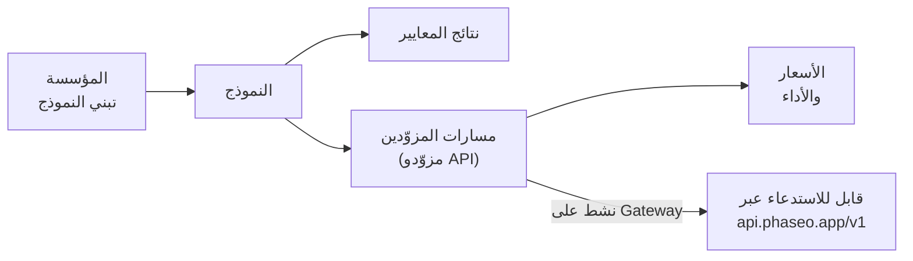

ابحث عن أي نموذج على [phaseo.app](https://phaseo.app/models) لترى من بناه، وأي المزوّدين يقدّمونه، وكم يكلّف، وما نتائجه، ثم استدعِه عبر الـ Gateway عندما يكون له مسار نشط.

## ما يحتويه الكتالوج

| السجل | ما هو | أين تبحث |
| --- | --- | --- |
| [المؤسسات](./organisations.mdx) | الشركات ومختبرات البحث التي تبني النماذج وتنشرها. | [المؤسسات](https://phaseo.app/organisations) |
| [النماذج](./models.mdx) | كل نموذج صادر، مجمّعًا في عائلات من النماذج المرتبطة. | [النماذج](https://phaseo.app/models) |
| [المعايير](./benchmarks.mdx) | التقييمات والنتائج التي تحصل عليها النماذج فيها. | [المعايير](https://phaseo.app/benchmarks) |
| [مزوّدو API](./api-providers.mdx) | المنصات التي تقدّم النماذج عبر واجهة برمجية. | [مزوّدو API](https://phaseo.app/api-providers) |
| [الأسعار والأداء](./pricing-performance.mdx) | سعر كل مزوّد لكل رمز أو صورة أو ثانية أو طلب، وسرعة الـ Gateway المقيسة. | صفحات النماذج، [المقارنة](https://phaseo.app/compare) |
| [خطط الاشتراك](./subscription-plans.mdx) | خطط Phaseo، والاشتراكات التي يبيعها المزوّدون. | [خطط الاشتراك](https://phaseo.app/subscription-plans) |

وجود سجل في الكتالوج لا يعني أنك تستطيع استدعاء النموذج. لا يملك مسارًا إلا النماذج الموسومة **نشط على Gateway**؛ ولا يعيد `GET /v1/models` سواها.

## كيف تقرأ البيانات

- **الأسعار** بالدولار الأمريكي، لكل مليون رمز للنص، أو بوحدة المزوّد نفسه (لكل صورة أو ثانية أو طلب) للوسائط.
- **التواريخ** أيام بتوقيت UTC، وتظهر بالصيغة `01 Jan 2026` بالإنجليزية.
- **نتائج المعايير** تحتفظ بمقياس المعيار واتجاهه. لا يحوّلها Phaseo إلى نتيجة مشتركة واحدة؛ راجع [المعايير](./benchmarks.mdx).
- **العائلات** تجمع النماذج المرتبطة، مثل الأحجام والإصدارات المختلفة لخط نماذج واحد.

## كيف تبقى البيانات محدّثة

تقترح مهام مزامنة المزوّدين أسعارًا جديدة، ويراجعها أحد المسؤولين قبل نشرها. وتحدّث عمليات استيراد المعايير ومهام دورة حياة النماذج قاعدة البيانات وفق جدول زمني. يمكن لأي شخص الإبلاغ عن تصحيح أو سجل مفقود عبر مشكلة على GitHub؛ ويراجع المشرفون الأدلة ويطبّقون التغييرات المعتمدة. راجع [المساهمة](../contributing/overview.mdx).

## أسئلة نموذجية

| الهدف | أين تجد الإجابة |
| --- | --- |
| مقارنة نموذجين على معيار | [المقارنة](https://phaseo.app/compare) أو صفحة المعيار |
| العثور على أرخص نموذج لمهمة | قائمة [النماذج](https://phaseo.app/models) مرتبة حسب السعر، ثم [حاسبة الأسعار](https://phaseo.app/tools/pricing-calculator) |
| معرفة كيف تغيّر معيار بمرور الوقت | مخطط **التقدم** للمعيار |
| العثور على مزوّدين يدعمون ميزة | قسم **المزوّدون** في صفحة النموذج، أو `GET /v1/models/{author}/{slug}/endpoints` |
| العثور على سجلات للمساهمة فيها | صفحات النماذج التي تنقصها معايير أو بيانات وصفية؛ راجع [المساهمة](../contributing/overview.mdx) |
