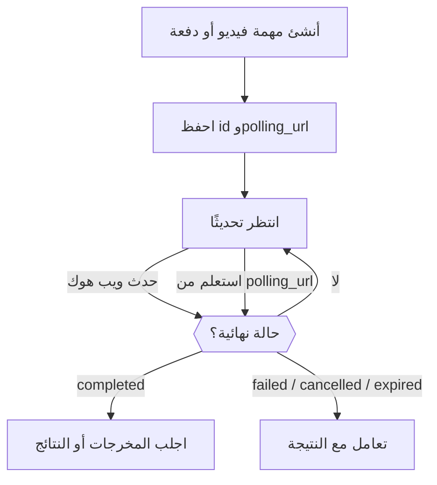

<Note>
واجهتا Video API وBatch API معاينتان تجريبيتان متاحتان بالدعوة فقط لمساحات عمل محددة. تحقق من التوفر في **الإعدادات → معاينة الميزات**. يُدار الوصول لكل مساحة عمل؛ وتفعيل تفضيل شخصي على الويب لا يمنح الوصول إلى الواجهة البرمجية. تنطبق رسوم استخدام النماذج المعتادة.
</Note>

يعيد إنشاء فيديو أو دفعة مهمةً قبل اكتمال العمل. احفظ `id` و`polling_url` الخاصين بها، ثم انتظر ويب هوك أو استعلم دوريًا حتى تصل المهمة إلى حالة نهائية: `completed` أو `failed` أو `cancelled` أو `expired`. لا تعني استجابة الإنشاء الناجحة إلا أن المهمة قُبلت.



احتفظ بمسار الاستعلام الدوري حتى عند استخدام الويب هوك. خلال المرحلة التجريبية، ابدأ بطلبات صغيرة وحد إنفاق لمفتاح API. تعتمد المدخلات المرجعية والإلغاء والاحتفاظ بالمخرجات على المزوّد والنموذج. احفظ نسختك الخاصة من المخرجات المكتملة قبل انتهاء صلاحيتها.

<span id="receive-updates"></span>
## تلقي التحديثات

أرفق نقطة نهاية ويب هوك تابعة لمساحة عملك عند إنشاء أي من نوعي المهام:

```json
{
  "webhook": {
    "endpoint_id": "YOUR_ENDPOINT_ID",
    "events": ["job.status_changed", "job.completed", "job.failed", "job.cancelled", "job.expired"]
  }
}
```

يطابق Phaseo حالة المزوّد ويرسل الإشعارات، لذا ينتج المزوّدون الذين لا يدعمون إلا الاستعلام الدوري، مثل دفعات رسائل Anthropic، ويب هوك أيضًا. فشل تسليم الويب هوك لا يعني فشل المهمة.

اشترك في أحداث الدفعات والفيديو كلٌّ على حدة باستخدام أنواع أحداث ذات نطاق أسماء مثل `batch.completed` أو `video.failed`. لا تزال أنواع الأحداث العامة `job.*` تعمل، وتشترك في المرحلة المقابلة لكلا نوعي المهام.

### تحقّق من التسليمات وأكّدها

تحقّق من `x-phaseo-signature` باستخدام سر نقطة النهاية: وهو HMAC-SHA256 بالصيغة السداسية العشرية لـ `x-phaseo-timestamp` متبوعًا بنقطة حرفية ثم **نص الطلب غير المعدّل**. تحقّق من حداثة الطابع الزمني، وأزل التكرار باستخدام `x-phaseo-event-id`، وأكّد التسليمات المقبولة باستجابة 2xx. قد يُعاد التسليم أو يصل بترتيب مختلف، لذا استرجع المهمة قبل تطبيق تغيير حالة متعارض.

| المحاولة | متى |
| --- | --- |
| 1 | فور وقوع الحدث |
| 2 | بعد نحو دقيقة واحدة من محاولة فاشلة |
| 3 | بعد نحو 5 دقائق |
| 4 | بعد نحو 15 دقيقة؛ وإذا فشلت، يُعلَّم التسليم بأنه فاشل نهائيًا |

تُنهي الاستجابة 2xx التسليم. ترسل عمليات المسح في الخلفية إعادات المحاولة، لذا قد تصل إعادة المحاولة متأخرة عن موعدها. تسجّل كل محاولة رقمها ووقتها وحالة HTTP والخطأ ووقت إعادة المحاولة التالية. ومع ذلك أزل التكرار: فقد يجعل تأكيد مفقود أو عامل معالجة متقطع التسليم غير مؤكد.

بعد حفظ نقطة النهاية، استخدم **إرسال حدث تجريبي** في الإعدادات لتسليم حمولة `webhook.test` موقّعة. يُجرَّب التسليم التجريبي مرة واحدة، ولا يُعاد، ولا يُضاف إلى سجل تسليمات المهام.

## اعرض سجلات المهام والطلبات

في **الإعدادات → الاستخدام → السجلات**، استخدم **الطلبات** لتفاصيل طلبات الاستدلال، و**فيديو** لدورات حياة الفيديو، و**المعالجة المجمعة** لمهام الدفعات ونتائج الصفوف. تتضمن عروض تفاصيل الفيديو والدفعات حالة الفوترة ومحاولات المزوّد ومحاولات الويب هوك. قد تكتمل المهمة بنجاح بينما يفشل تسليم الويب هوك الخاص بها.

يحجز إرسال الفيديو رصيدًا قبل التواصل مع المزوّد. تحتفظ مهلة انتهاء بلا معرّف مهمة بالحجز للمطابقة؛ وهي ليست دليلًا على فشل التوليد. إذا سُعّر حجز فيديو أو دفعة مدفوع بصفر على نحو غير متوقع بعد عمل ناجح، تبقى الفوترة مفتوحة بالحالة `unexpected_zero_cost` للتحقيق. أما استجابة إنشاء بتكلفة صفرية وحدها فهي طبيعية في التوليد غير المتزامن.

## قدّر تكلفة الفيديو

تعتمد أسعار الفيديو على المزوّد والنموذج. يجب ضرب السعر لكل ثانية في المدة القابلة للفوترة؛ أما السعر لكل مقطع فينطبق فقط على مدته ودقته المحددتين. قد تزيد المخرجات المتعددة والمدخلات المرجعية القابلة للفوترة الإجمالي.

يحتسب توليد النص/الصورة في LTX ثواني المخرجات، بينما يحتسب تحويل الصوت إلى فيديو ثواني الصوت المُدخل. يستخدم BytePlus Seedance رموز الفيديو، بأسعار مختلفة عند وجود فيديو مرجعي. يستخدم MiniMax Hailuo V1 أسعار مقاطع ذات مدة ثابتة؛ ويستخدم H3 الثواني وقد يحتسب المدخلات المرجعية. راجع أبعاد التسعير لدى المزوّد المختار بدلًا من تفسير السعر الرئيسي على أنه تكلفة الطلب كاملًا.

الحجوزات تقديرات تُحجز قبل الإرسال. تستخدم الفوترة النهائية الاستخدام القابل للفوترة للمهمة؛ ويُحرَّر الرصيد المحجوز غير المستخدم بعد المطابقة. لا يضمن دعم المزوّد لدقة أو خيار ما توفره في المرحلة التجريبية.

## اضبط المدة والإطارات والمراجع

استخدم `seconds` أو `duration` لمدة المخرجات. إذا وُجد الاثنان، فيجب أن يتطابقا. استخدم `resolution` مع `aspect_ratio`، أو `size` بالبكسل مثل `1280x720`.

استخدم `frame_images` لتحديد الإطارين الأول والأخير صراحةً:

```json
{
  "frame_images": [
    {
      "type": "image_url",
      "frame_type": "first_frame",
      "image_url": { "url": "https://example.com/start.png" }
    }
  ],
  "input_references": [
    {
      "type": "image_url",
      "role": "reference",
      "image_url": { "url": "https://example.com/character.png" }
    }
  ]
}
```

يجب أن تستخدم عناوين URL المرجعية HTTPS. حدّد `role: "reference"` صراحةً للصور المرجعية فقط: إذ تفسّر الطلبات القديمة التي لا تتضمن `frame_images` أول صورة بلا تسمية على أنها الإطار الأول. لا تجمع `frame_images` مع أدوار الإطار الأول/الأخير في `input_references` أو مع `input_reference`.

تستخدم مراجع الفيديو والصوت `type: "video_url"` أو `"audio_url"` و`media_url: { "url": "https://..." }`. تدعم النماذج والمزوّدون تركيبات مختلفة. وحيث تؤثر مدة المرجع في السعر، قدّم `input_video_duration` و`input_audio_duration` بالثواني.

## مرّر خيارات الفيديو الخاصة بالمزوّد

أبقِ النموذج والمدة والدقة وتوليد الصوت ووسائط الإدخال وعدد المخرجات في الحقول المعتمدة. ومرّر الامتدادات الخاصة بالمزوّد تحت معرّف المزوّد المعتمد:

```json
{
  "provider_options": {
    "atlascloud": { "watermark": false, "output_format": "mp4" },
    "byteplus": { "camera_fixed": true }
  }
}
```

لا تُمرَّر إلا خيارات المزوّد المختار. لا تختار الخيارات مزوّدًا؛ استخدم إعداد التوجيه `provider` لذلك. لا تجمع `provider_options` مع `provider_params` القديمة. لا يمكن للخيارات المتداخلة تجاوز حقول الفوترة أو رد الاتصال التي يتحكم بها الـ Gateway.

| المزوّد | أمثلة على الامتدادات الأصلية | المرجع |
| --- | --- | --- |
| AtlasCloud Seedance 2.5 | `watermark`، `output_format`، `return_last_frame`، `omni_reference_task_type` | [واجهة النموذج البرمجية](https://www.atlascloud.ai/models/bytedance/seedance-2.5/reference-to-video) |
| Novita Seedance 1.5 | `watermark`، `camera_fixed`، `fps` (24)، `service_tier` (`default`) | [واجهة الفيديو الموحدة](https://docs.novita.ai/api-reference/reference-unified-video-generation) |
| BytePlus Seedance | `camera_fixed` | راجع عقد المزوّد للنموذج المختار قبل الاستخدام. |
| MiniMax V1 | `fast_pretreatment`؛ استخدم `enhance_prompt` المعتمد لتحسين الموجّه | [واجهة الفيديو البرمجية](https://platform.minimax.io/docs/api-reference/video-generation-t2v) |

يستخدم AtlasCloud Seedance الحقول الأصلية `resolution` و`ratio` و`last_image`. ويتلقى متغيره لتحويل المرجع إلى فيديو مراجع صور وفيديو وصوت مرتبة. لا يدعم عقد الحجز ذو المدة الثابتة في الـ Gateway التعديل بمدة تلقائية (`duration: -1`). يجب إعداد توفر نموذج المزوّد وتسعيره قبل أن يمكن توجيه النموذج؛ ولا يفعّل خيار المزوّد نموذجًا غير متاح.

يستخدم MiniMax H3 الإصدار V2: من 4 إلى 15 ثانية كاملة بدقة `768P` أو `2K`. يدعم H3 Max من 5 إلى 15 ثانية كاملة بدقة `480P` أو `768P`، مع نص أو صور إطارات. يدعم H3 الصور والفيديو والصوت المرجعية؛ ولا يمكن خلط المراجع مع الإطارين الأول/الأخير. ينتج كلا النموذجين فيديو واحدًا لكل طلب ولا يدعمان خيارات تحسين الموجّه في V1. استخدم `aspect_ratio` المعتمد؛ وتحدد مدخلات الإطارات نسبتها الخاصة. تغطي حجوزات الفيديو المرجعي حد الإدخال البالغ 15 ثانية لدى المزوّد، ويُسوّى الاستخدام الفعلي عند الاكتمال. راجع [عقد MiniMax V2](https://platform.minimax.io/docs/api-reference/video-generation-v2-create).

## تحقّق مما يدعمه كل مزوّد دفعات

تقبل طلبات الدفعات أيضًا `provider_options`: يدعم OpenAI `output_expires_after`، ويدعم Mistral `metadata`. استخدم معرّفات المزوّدين المعتمدة ولا تكرر هذه الحقول في المستوى الأعلى. على سبيل المثال، يضبط `provider_options: { "openai": { "output_expires_after": { "anchor": "created_at", "seconds": 86400 } } }` مدة الاحتفاظ بمخرجات OpenAI. لا يمكن تجاوز مدخلات الصفوف والنماذج ونقاط النهاية ووجهات الويب هوك عبر الخيارات.

لدى Mistral بالفعل محوّل دفعات أصلي. تُستعلم دفعات رسائل Anthropic دوريًا؛ وقد يجمع مزوّدون آخرون بين الاستعلام الدوري وإشعارات الاكتمال الأصلية. يعتمد التوفر على نقاط النهاية التي يدعمها المزوّد وقائمة السماح للدفعات في عملية النشر. راجع استجابة قدرات الدفعات قبل إرسال ملف أو طلبات مضمّنة.

تقبل دفعات Vertex Gemini طلبات `requests` مضمّنة مع `/v1/generateContent`، أو `model` و`prompts`. اختر `provider: "google-vertex"` لاستخدام Vertex. تُحتسب الصفوف الناجحة بأسعار المعالجة الدفعية. يتطلب هذا المحوّل بيانات اعتماد مُدارة؛ ولا تتوفر BYOK والملفات المرفوعة والتضمينات ودفعات `google-vertex-eu`. يقتصر الإدخال على 20 MB و10,000 طلب. تنتهي صلاحية المدخلات والمخرجات المخزّنة بعد 30 يومًا.

تستخدم نتائج Vertex الحقل `custom_id` لتحديد كل صف مُرسَل، مع توليد ناجح في `response.body` أو `error` لكل طلب. قد يختلف ترتيب المخرجات عن ترتيب المدخلات. يبقى الإرسال الذي نتيجته لدى المزوّد غير مؤكدة قيد المراجعة اليدوية مع الإبقاء على حجز رصيده؛ تجنّب إنشاء بديل حتى تتأكد نتيجته.

قد يتضمن اكتمال الدفعة صفوفًا فاشلة. افحص كل نتيجة باستخدام معرّفها المخصص بدلًا من افتراض نجاح كل الصفوف. احتفظ بالمدخلات الأصلية ومعرّف المهمة حتى تتم مطابقة النتائج والفوترة. يجب التحقيق في الإرسال غير المؤكد قبل إعادة الإرسال، لأن المزوّد ربما قبل الطلب الأصلي.

### نزّل نتائج الدفعة

بعد أن تصل دفعة مدعومة إلى حالة نهائية، يشير `results_url` الخاص بها إلى تنزيل موثَّق من Phaseo. استخدم مفتاح API المعتاد لـ Phaseo من مساحة العمل التي تملك الدفعة:

```bash
curl --fail "https://api.phaseo.app/v1/batches/$BATCH_ID/results" \
  -H "Authorization: Bearer $PHASEO_API_KEY" \
  --output results.jsonl
```

تُبث الاستجابة بصيغة JSONL عبر نقطة النهاية نفسها لكل مزوّد دفعات مدعوم. يجمع Phaseo ملفات النجاح والخطأ المنفصلة، ويحوّل مصفوفات النتائج المضمّنة إلى JSONL، ويتتبع ترقيم صفحات النتائج. يُحفظ المحتوى المولَّد والأخطاء الخاصة بكل طلب. تبقى حقول الصفوف بالصيغة الأصلية للمزوّد: استخدم `custom_id` لصفوف OpenAI المتوافقة وAnthropic، وبيانات الطلب الوصفية لـ Gemini، و`batch_request_id` لـ xAI. تحتوي صفوف Anthropic الناجحة على الرسالة المولَّدة في `result.message`.

تدعم التنزيلات محوّلات OpenAI وAnthropic وGoogle AI Studio وMistral وTogether وGroq وAlibaba Cloud وMoonshot وParasail وOVHcloud وxAI. لا يزال توفر المزوّد يعتمد على الوصول إلى المعاينة وقائمة السماح للإرسال؛ ولا يفعّل دعم التنزيل مسارات إضافية. تظل `output_file_id` و`error_file_id` ونقاط نهاية محتوى الملفات الحالية متاحة. تحتوي نقطة نهاية صفوف طلبات الدفعة على بيانات التتبع والفوترة الوصفية، لا على نصوص الرسائل المولَّدة.

لا يؤدي تنزيل النتائج إلى إرسال دفعة أخرى ولا يضيف رسوم استدلال. لا تحتاج إلى بيانات اعتماد المزوّد. يشير الويب هوك إلى تحديثات المهمة؛ أما النتائج فنزّلها بشكل منفصل. قد تكون للمهمة النهائية نتائج جزئية أو لا مخرجات على الإطلاق: تعيد نقطة النهاية `409` أثناء المعالجة و`404` عند عدم توفر أي مخرجات. احفظ النتائج قبل انتهاء فترة الاحتفاظ لدى المزوّد. إذا انقطع التنزيل، فتخلّص من الملف الجزئي وأعد محاولة التنزيل، لا إرسال الدفعة. تُبث نتائج JSON المضمّنة بحد أمان قدره 8 MiB لكل صف؛ أما ملفات JSONL الأصلية فتُبث دون هذا الحد.

للمخرجات الكبيرة، تعيد الدالة `client.batches.streamResults(batchId, { signal })` في TypeScript قيمة `ReadableStream<Uint8Array>` دون تخزين مؤقت. وجّهها إلى وجهتك وألغِ التدفق أو أوقف الإشارة للتوقف مبكرًا؛ لا توجد مهلة ثابتة لإجمالي التنزيل. وتُنتج `client.batches.stream_results(batch_id)` في Python أجزاءً من البايتات مع مهلة HTTP المضبوطة؛ أغلق المكرِّر عند التوقف مبكرًا. تعيد عمليات `retrieveBatchResults` المولَّدة نص JSONL كاملًا، وهي الأنسب للمخرجات الصغيرة.

### حدود تنزيل الدفعات

تسمح تنزيلات نتائج الدفعات بـ 10 محاولات لكل مساحة عمل لكل دفعة ضمن نافذة متحركة مدتها 30 دقيقة، مشتركة بين مفاتيح API والاسمين البديلين `/batches` و`/batch`. تُحتسب المحاولات التي تصل إلى مرحلة قبول التنزيل حتى إن فشل التنزيل من المصدر أو أُلغي. لا تُحتسب إخفاقات الملكية والجاهزية. تتضمن الاستجابة `429` الترويسة `Retry-After` بالثواني. إذا كان المحدِّد غير متاح، تعيد التنزيلات `503` مع `Retry-After: 30`.
