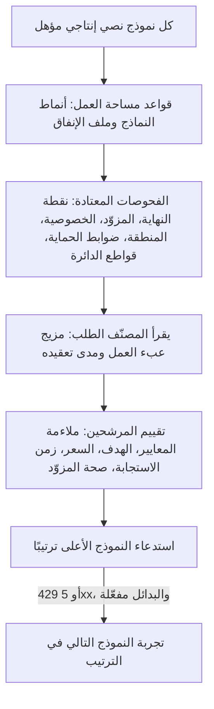

أرسل `"model": "phaseo/auto"` فيختار Phaseo نموذجًا لكل طلب بناءً على عبء العمل، وهدف مساحة عملك، وحدود الأسعار فيها. التوجيه التلقائي إصدار ألفا متاح لمساحات عمل مختارة.

```json
{
  "model": "phaseo/auto",
  "input": "Review this TypeScript function for correctness."
}
```

يُظهر الحقل `model` في الاستجابة النموذج الذي أجاب.

## كيف يُختار النموذج



1. **المرشحون.** يبدأ Phaseo من كل نموذج نصي إنتاجي معروف التسعير القياسي، ثم يُبقي فقط على النماذج التي تطابق أنماط النماذج وملف الإنفاق لديك.
2. **الفحوصات.** يجب أن يجتاز كل مرشح فحوصات نقطة النهاية ونماذج مساحة العمل والمزوّد والخصوصية وضوابط الحماية وقواطع الدائرة نفسها التي يجتازها طلب بنموذج ثابت.
3. **المصنّف.** يقرأ نموذج مثبّت منخفض التكلفة الطلب ويعيد مزيج عبء العمل (برمجة، استدلال، استخدام أدوات، وغير ذلك) ودرجة تعقيد ومستوى ثقة. ولا يختار النموذج بنفسه أبدًا. تُمرَّر إليه الأدوات والمخرجات المنظَّمة الموجودة في الطلب كحقائق موثوقة.
4. **التقييم.** يحدد التعقيد أقل النماذج قدرةً المرجّح أن يقدّم إجابة مقبولة، إضافة إلى هامش. ثم يجمع Phaseo بين معايير الكتالوج غير المُبلغ عنها ذاتيًا وهدفك وسعر كل مرشح الحالي وزمن استجابته وصحته وموثوقيته. تُعدّ البيانات المفقودة محايدة؛ ولا توسّع القائمة المختصرة أبدًا.

لا يستطيع الطلب تغيير هدف مساحة العمل أو ملف الإنفاق أو الأنماط. ويتخطى الطلب ذو النموذج الثابت التوجيه التلقائي كليًا.

## اضبطه

<Steps>
<Step title="افتح التوجيه التلقائي">

انتقل إلى **لوحة التحكم → الإعدادات → التوجيه → التوجيه التلقائي**.

</Step>
<Step title="اختر هدفًا">

| الهدف | ما يُعطى الوزن الأكبر |
| --- | --- |
| `balanced` | مزيج عملي من الجودة والسعر وزمن الاستجابة والموثوقية. |
| `quality` | نتائج المعايير ذات الصلة بعبء العمل. |
| `cost` | سعر أقل لرموز الإدخال والإخراج. |
| `latency` | زمن استجابة أقل للمزوّد مؤخرًا. |

</Step>
<Step title="اختر ملف إنفاق">

كل ملف سقف صارم لأسعار النص في المستوى القياسي، بالدولار الأمريكي لكل مليون رمز. لا يُنظر أبدًا في النماذج التي تتجاوزه.

| ملف الإنفاق | أقصى سعر للإدخال | أقصى سعر للإخراج |
| --- | ---: | ---: |
| اقتصادي | $0.10 | $0.50 |
| قياسي | $0.30 | $1.50 |
| مميز | $1 | $5 |
| أي سعر | بلا حد | بلا حد |

يتيح لك **حدود مخصصة** ضبط السقفين بنفسك.

</Step>
<Step title="ضيّق النماذج (اختياري)">

أضف أنماطًا مثل `anthropic/*` أو `openai/gpt-5.*` أو معرّف نموذج دقيق.

</Step>
<Step title="اسمح بالبدائل واحفظ">

عند تفعيل البدائل، يجرّب Phaseo النموذج التالي في الترتيب بعد `429` أو `500` أو `502` أو `503` أو `504`. يمرّ كل بديل بكل الفحوصات مجددًا. لا تؤدي أخطاء العميل إلى تبديل النموذج.

</Step>
</Steps>

من سطر الأوامر: `phaseo routing auto update --objective <o> --spend-profile <p> --allowed-patterns <list> --allow-fallbacks`، و`phaseo routing auto get` لقراءة الإعداد. والواجهة البرمجية هي `PATCH /v1/routing/auto`.

<Warning>
  تحدد ملفات الإنفاق والأنماط النماذج المؤهلة. لكنها لا تضمن الجودة، لذا تحقّق من مزيج النماذج الناتج مقابل أعباء عملك الخاصة.
</Warning>

## طلب المصنّف

ينشئ كل طلب `phaseo/auto` طلبًا فرعيًا منفصلًا إلى نموذج المصنّف، تحت هوية مساحة العمل والفوترة نفسها. يظهر وحده في سجلات الطلبات مع `purpose=auto_routing_classifier` ومعرّف الطلب الأصلي، ويُحتسب بشكل منفصل.

إذا فشل المصنّف أو انتهت مهلته أو أعاد بيانات غير صالحة، يستخدم Phaseo بدلًا منه مصنّفًا محليًا قائمًا على القواعد (برمجة، استدلال، استخدام أدوات، مخرجات منظَّمة، ترجمة، تلخيص، أو عام)، فيستمر تنفيذ الطلب الرئيسي.

## حدود الخصوصية والمنطقة

تنطبق حدود البيانات في الطلب على التوجيه التلقائي أيضًا:

- مع `provider.require_zero_data_retention: true`، أو ضابط حماية على مستوى مساحة العمل أو المفتاح لا يسمح إلا بمزوّدين لا يحتفظون بالبيانات، لا تدخل القائمة المختصرة إلا النماذج التي لها مزوّد من هذا النوع.
- تُفحص المناطق المطلوبة مقابل مزوّدي كل مرشح.
- يحمل طلب المصنّف الحدود نفسها، إضافة إلى قائمتي المزوّدين `only` و`ignore`. إذا لم يستطع نموذجه تلبيتها، يستخدم Phaseo المصنّف المحلي.

إذا لم تُبقِ متطلبات الإقامة وحدها أي نموذج، يفشل الطلب بالخطأ `403 model_region_unavailable` مع `unmet_requirements`، كما يحدث مع نموذج ثابت. وإذا استُبعدت نماذج لأسباب أخرى أيضًا، يفشل بالخطأ `400 unsupported_model_or_endpoint`.

## افحص قرارًا

تعرض تفاصيل الطلب عبء العمل والهدف والنموذج المختار وترتيب البدائل ودرجات كل مرشح ودرجات العوامل ومعرّفات المعايير والاستبعادات وإصدار الخوارزمية. لا تحتوي التتبعات على أي محتوى من الموجّه أو الاستجابة.

## اجمعه مع أنواع التوجيه الأخرى

- **المسارات الديناميكية.** تكون الأولوية للنموذج الثابت الذي يختاره [مسار ديناميكي](./routing-and-fallbacks#attach-routing-rules-to-api-keys) مرفق. يُسجَّل هذا التجاوز، وتُعطَّل بدائل التوجيه التلقائي لذلك الطلب.
- **بدائل الطلب.** يدير `phaseo/auto` بدائله المرتبة بنفسه، لذا لا يمكن جمعه مع [قائمة `models`](./routing-and-fallbacks#request-level-model-fallbacks) ولا إدراجه فيها.
