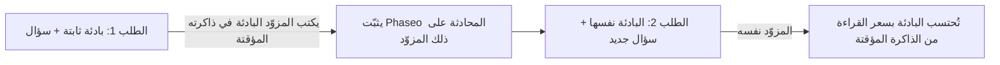

أبقِ بداية موجّهك كما هي عبر الطلبات، فيقرؤها المزوّد من ذاكرته المؤقتة بدل معالجتها من جديد: تُحتسب هذه الـ tokens بسعر القراءة من الذاكرة المؤقتة، ويصل أول token أسرع. يخزّن معظم المزوّدين البادئات المتكررة تلقائيًا. أما Claude فلا يخزّن إلا ما تضع عليه علامة `cache_control`.



لا يزال التخزين المؤقت للموجّهات يشغّل الاستدلال في كل طلب. فهو لا يعيد إجابة سابقة لطلب مطابق.

## خزّن موجّهًا مؤقتًا

ضع علامة على آخر كتلة في الجزء الثابت. يُخزَّن كل شيء حتى تلك الكتلة، بما فيها.

<CodeGroup>
```bash Chat Completions
curl https://api.phaseo.app/v1/chat/completions \
  -H "Authorization: Bearer $PHASEO_API_KEY" \
  -H "Content-Type: application/json" \
  -d '{
    "model": "anthropic/claude-sonnet-5.5",
    "messages": [
      {
        "role": "system",
        "content": [
          {
            "type": "text",
            "text": "You are a support assistant. Follow the company policy exactly.",
            "cache_control": { "type": "ephemeral", "ttl": "1h" }
          }
        ]
      },
      { "role": "user", "content": "Summarise the latest ticket." }
    ]
  }'
```

```bash Responses
curl https://api.phaseo.app/v1/responses \
  -H "Authorization: Bearer $PHASEO_API_KEY" \
  -H "Content-Type: application/json" \
  -d '{
    "model": "anthropic/claude-sonnet-5.5",
    "input": [
      {
        "role": "user",
        "content": [
          {
            "type": "input_text",
            "text": "Reference document: Refunds are available for 30 days when...",
            "cache_control": { "type": "ephemeral", "ttl": "5m" }
          },
          {
            "type": "input_text",
            "text": "Answer this customer: Can I return an item after 20 days?"
          }
        ]
      }
    ]
  }'
```

```bash Anthropic Messages
curl https://api.phaseo.app/v1/messages \
  -H "Authorization: Bearer $PHASEO_API_KEY" \
  -H "Content-Type: application/json" \
  -d '{
    "model": "anthropic/claude-sonnet-5.5",
    "max_tokens": 512,
    "system": [
      {
        "type": "text",
        "text": "You are a careful support assistant. Use the policy below.",
        "cache_control": { "type": "ephemeral", "ttl": "1h" }
      }
    ],
    "messages": [
      {
        "role": "user",
        "content": [
          {
            "type": "text",
            "text": "Policy: refunds are available for 30 days when...",
            "cache_control": { "type": "ephemeral", "ttl": "5m" }
          },
          { "type": "text", "text": "Can this customer return an item after 20 days?" }
        ]
      }
    ],
    "tools": [
      {
        "name": "lookup_order",
        "description": "Look up order status.",
        "input_schema": {
          "type": "object",
          "properties": { "order_id": { "type": "string" } },
          "required": ["order_id"]
        },
        "cache_control": { "type": "ephemeral", "ttl": "5m" }
      }
    ]
  }'
```
</CodeGroup>

ثم تحقّق من أنه نجح:

1. أرسل الطلب مرة واحدة لكتابة الذاكرة المؤقتة.
2. أرسله مرة أخرى بالمحتوى القابل للتخزين نفسه.
3. تحقّق من `cached_tokens` و`cache_write_tokens` في بيانات الاستخدام في الاستجابة (راجع [حقول الاستخدام والتسعير](#usage-and-pricing-fields))، ومن عدّادات الذاكرة المؤقتة في تفاصيل الطلب.
4. قارن زمن الاستجابة والتكلفة عبر عدة استدعاءات، لا الاستدعاء الأول فقط.

خزّن مؤقتًا المحتوى الذي يبقى كما هو عبر الطلبات: تعليمات النظام الطويلة، والمستندات المعاد استخدامها، وأمثلة few-shot، وتعريفات الأدوات، ونتائج الأدوات الكبيرة التي يعيد الدور التالي إرسالها. لا تضع علامة على محتوى يتغير في كل طلب، أو مدخلات قصيرة لمرة واحدة، أو بيانات لا تسمح سياستك للمزوّد بتخزينها.

<Note>
يرسل Phaseo إلى كل مزوّد عناصر التحكم في الذاكرة المؤقتة التي يوثّقها فقط، ويزيل الباقي. لا تستبعد عناصر التحكم في الذاكرة المؤقتة أي مزوّد من التوجيه أبدًا. تسرد كل صفحة نموذج أسعار القراءة من الذاكرة المؤقتة والكتابة فيها.
</Note>

## أي المزوّدين يخزّنون مؤقتًا تلقائيًا

| المزوّد | التخزين المؤقت | ما يرسله Phaseo |
| --- | --- | --- |
| [OpenAI](https://developers.openai.com/api/docs/guides/prompt-caching)، [Azure OpenAI](https://learn.microsoft.com/en-us/azure/foundry/openai/how-to/prompt-caching) | تلقائي للموجّهات التي تبلغ 1,024 token أو أكثر | `prompt_cache_key`؛ ونقاط التوقف و`prompt_cache_options` على GPT-5.6 وما بعده؛ و`prompt_cache_retention` على النماذج الأقدم |
| [Anthropic Claude](https://platform.claude.com/docs/en/build-with-claude/prompt-caching) على Anthropic، وClaude على AWS، وAmazon Bedrock، وGoogle Vertex AI | بالاشتراك الاختياري | نقاط توقف `cache_control`، أربع على الأكثر لكل طلب |
| [Google Gemini](https://ai.google.dev/gemini-api/docs/caching) على Google AI Studio و[Vertex AI](https://docs.cloud.google.com/vertex-ai/generative-ai/docs/context-cache/context-cache-overview) | تلقائي على Gemini 2.5 وما بعده | `cached_content` لذاكرة مؤقتة صريحة أنشأتها |
| [xAI](https://docs.x.ai/developers/advanced-api-usage/prompt-caching/maximizing-cache-hits) | تلقائي | `prompt_cache_key` والترويسة `x-grok-conv-id` |
| [DeepSeek](https://api-docs.deepseek.com/guides/kv_cache) | تلقائي | لا شيء إضافي |
| [Moonshot AI](https://platform.kimi.ai/docs/guide/context-caching) | تلقائي، بمدة صلاحية 5 دقائق؛ ومدة الساعة الواحدة اختيارية على Kimi K3 | `prompt_cache_key` و`prompt_cache_options` |
| [Groq](https://console.groq.com/docs/prompt-caching) | تلقائي على النماذج التي يسردها Groq | لا شيء إضافي |
| [Fireworks](https://docs.fireworks.ai/guides/prompt-caching) | تلقائي | `prompt_cache_key`، إضافة إلى الترويسة `x-session-affinity` و`user` |
| [Cerebras](https://inference-docs.cerebras.ai/capabilities/prompt-caching) | تلقائي | `prompt_cache_key` |
| [Cloudflare Workers AI](https://developers.cloudflare.com/workers-ai/features/prompt-caching) | تلقائي على نماذج مختارة | الترويسة `x-session-affinity` |
| [Together AI](https://docs.together.ai/docs/inference/chat/prompt-caching)، [Mistral](https://docs.mistral.ai/studio-api/conversations/advanced/prompt-caching) | تلقائي؛ ويحسّن `prompt_cache_key` معدل الإصابة | `prompt_cache_key` |
| [Alibaba Model Studio](https://www.alibabacloud.com/help/en/model-studio/context-cache) | تلقائي (ضمني)؛ والذاكرة المؤقتة الصريحة اختيارية | `cache_control` على الكتل |
| [Venice](https://docs.venice.ai/overview/guides/prompt-caching) | تلقائي؛ يضيف Venice نقاط توقف Claude بنفسه | `cache_control` على الكتل |
| [DeepInfra](https://docs.deepinfra.com/chat/prompt-cache-retention) | تلقائي؛ ونافذة الاحتفاظ اختيارية | `prompt_cache_key` و`prompt_cache_breakpoint` و`prompt_cache_options` |
| [Inference.net](https://inference.net/models/claude-opus-5/) | تلقائي؛ وتخزين صريح على نماذج Claude وGemini 2.5 | `cache_control` على الكتل في نماذج Claude وGemini 2.5، دون `ttl` |
| [Baseten](https://docs.baseten.co/inference/model-apis/pricing-and-limits) | تلقائي | `prompt_cache_key` والترويسة `x-session-affinity` |
| [Morph](https://docs.morphllm.com/sdk/components/caching) | تلقائي | `prompt_cache_key` والترويسة `x-session-id` |

يتلقى المزوّدون الآخرون المتوافقون مع OpenAI الحقل `prompt_cache_key` عندما تقبله واجهتهم، ولا يتلقون أي عناصر تحكم أخرى في الذاكرة المؤقتة. يرسل Phaseo دائمًا تجزئة لمساحة عملك والمفتاح بدل المفتاح نفسه؛ راجع [الارتباط بالمزوّد](#provider-affinity).

<span id="cache-controls"></span>
## عناصر التحكم في الذاكرة المؤقتة

### دع Phaseo يضع نقاط توقف Claude

يفعّل الحقل `cache_control` في المستوى الأعلى على Chat Completions أو Responses أو Anthropic Messages التخزين المؤقت لمسارات Claude، ويضع Phaseo نقاط التوقف نيابةً عنك. يتجاهله المزوّدون الآخرون.

```json
{
  "cache_control": { "type": "ephemeral", "ttl": "5m" }
}
```

استخدم `ttl: "5m"` (الافتراضي) للسياق المشترك قصير العمر، و`ttl: "1h"` عندما يدعم النموذج إدخالات ذاكرة مؤقتة أطول عمرًا. يبقي `cache_control` في المستوى الأعلى المحادثة أيضًا على مزوّد واحد؛ راجع [الارتباط بالمزوّد](#provider-affinity).

الحقل `provider_options.anthropic.cache_control` هو الإعداد نفسه، ويقبل أيضًا `scope`. عندما يرسل الطلب الاثنين، تفوز قيمة `provider_options`:

```json
{
  "provider_options": {
    "anthropic": {
      "cache_control": { "type": "ephemeral", "ttl": "5m", "scope": "agent" }
    }
  }
}
```

| `scope` | أين يضع Phaseo نقاط التوقف |
| --- | --- |
| `all_text` (افتراضي) | نص النظام وأحدث ثلاث رسائل مستخدم تحتوي على نص أو صور. |
| `last_user_message` | أحدث رسالة مستخدم فقط. |
| `agent` | لحلقات الأدوات: آخر تعريف أداة، ونص النظام، والرسالة الأخيرة (بما فيها نتائج الأدوات)، والرسالة من الخطوة السابقة. `conversation` اسم بديل له. |
| `none` | لا مكان. |

استخدم `agent` لحلقات الأدوات متعددة الخطوات. لا يضع `all_text` و`last_user_message` علامات على الرسائل التي تحتوي على نتائج أدوات فقط، فتتوقف البادئة المخزّنة عن النمو. تُعامَل قيم `scope` غير المعروفة على أنها `agent`.

نقاط التوقف التي تضعها بنفسك على الكتل تفوز على السياسة الافتراضية، وتُحتسب ضمن حد Anthropic البالغ أربع نقاط لكل طلب: تتوقف السياسة الافتراضية عن إضافة العلامات عند أربع. إذا حملت كتلك أكثر من أربع علامات، يحتفظ Phaseo بالأولى وبأحدث ثلاث ويزيل البقية، حتى لا يُرفض الطلب.

### نقاط توقف الذاكرة المؤقتة على الكتل

تخزّن علامة الذاكرة المؤقتة على كتلة محتوى كل شيء حتى تلك الكتلة، بما فيها. يقبل Phaseo صيغتين:

- `cache_control`: `{"type": "ephemeral"}`، مع `ttl` اختياري بقيمة `5m` أو `1h`.
- `prompt_cache_breakpoint`: صيغة OpenAI `{"mode": "explicit"}`، مع `ttl` اختياري بقيمة `30m` أو `12h` (راجع [ذاكرة مؤقتة لمدة 12 ساعة على OpenAI](#12-hour-cache-on-openai)). عندما تحمل الكتلة الاثنين، يفوز `prompt_cache_breakpoint`.

على Chat Completions وResponses، تُقبل العلامات على أجزاء النص والصور، وعلى تعريفات أدوات الدوال، وعلى نتائج الأدوات التي يكون محتواها مصفوفة من أجزاء النص. وتقبل Anthropic Messages الحقل `cache_control` حيثما تقبله Anthropic: كتل نص `system`، وكتل النص والصور في الرسائل، وكتل نتائج الأدوات، وتعريفات الأدوات. عندما يحتوي طلب واحد على عدة قيم TTL، تشترط Anthropic أن تأتي نقاط توقف `1h` قبل نقاط `5m`.

يتلقى كل مزوّد العلامة بصيغته الخاصة:

| المزوّد | `cache_control` على الكتلة | `prompt_cache_breakpoint` |
| --- | --- | --- |
| Claude على Anthropic، وClaude على AWS، وAmazon Bedrock، وGoogle Vertex AI | يُرسَل بصيغة `{"type": "ephemeral"}` مع `ttl` الخاص بك | يُرسَل بصيغة `cache_control: {"type": "ephemeral"}` |
| OpenAI، GPT-5.6 وما بعده | يُرسَل بصيغة `prompt_cache_breakpoint: {"mode": "explicit"}`؛ ويُحذف `ttl` | يُرسَل مع `ttl` الخاص به |
| Azure OpenAI، GPT-5.6 وما بعده | يُرسَل بصيغة `prompt_cache_breakpoint: {"mode": "explicit"}`؛ ويُحذف `ttl` | يُرسَل دون `ttl` |
| OpenAI وAzure OpenAI، النماذج الأقدم | يُزال | يُزال |
| DeepInfra | يُزال | يُرسَل دون `ttl` |
| Alibaba Model Studio وVenice | يُرسَل | يُزال |
| Inference.net، نماذج Claude وGemini 2.5 | يُرسَل دون `ttl` | يُزال |
| المزوّدون الآخرون | يُزال | يُزال |

لا تصل العلامات على تعريفات الأدوات إلا إلى مسارات Claude وAlibaba Model Studio وVenice ونماذج Claude وGemini 2.5 على Inference.net؛ لا تقبل OpenAI نقاط التوقف على الأدوات. إزالة العلامة تترك بقية الموجّه دون تغيير، لذا تطابق البادئة المخزّنة طلبًا بلا علامات.

يخزّن Amazon Bedrock وGoogle Vertex AI نماذج Claude 3.7 Sonnet و3.5 Sonnet و3 Opus لمدة 5 دقائق فقط، وقد يرفض Bedrock وجود `ttl` على تلك النماذج. على تلك المسارات، يرسل Phaseo نقاط توقفك دون `ttl` فتُخزَّن لمدة 5 دقائق، ويبلغ عن قيمة `1h` المُزالة باسم `cache_control.ttl` في الترويسة `X-Phaseo-Dropped-Params` وفي `meta.routing.dropped_params`. يوثّق Inference.net نقاط التوقف دون `ttl`، لذا يزيل Phaseo أي `ttl` هناك ويبلغ عنه بالطريقة نفسها، وتُحتسب الكتابات ككتابات لمدة 5 دقائق.

<span id="openai-retention-and-options"></span>
### الاحتفاظ والخيارات في OpenAI

تعتمد عناصر التحكم في الذاكرة المؤقتة لدى OpenAI على جيل النموذج. يرسل Phaseo كل عنصر حيث يُقبل فقط:

| الحقل | القيم | يُرسَل إلى |
| --- | --- | --- |
| `prompt_cache_options` | `mode`: `implicit` أو `explicit`؛ `ttl`: `30m` (افتراضي) أو `12h` | OpenAI GPT-5.6 وما بعده |
| `prompt_cache_options` | `mode`: `implicit` أو `explicit`؛ `ttl`: `30m` | Azure OpenAI GPT-5.6 وما بعده |
| `prompt_cache_options` | `mode`: `explicit`؛ `ttl`: `5m` أو `1h` | DeepInfra |
| `prompt_cache_options` | `mode`: `implicit`؛ `ttl`: `5m` (افتراضي)، أو `1h` على Kimi K3 | Moonshot AI |
| `prompt_cache_retention` | `in_memory` أو `24h` | نماذج OpenAI وAzure OpenAI السابقة لـ GPT-5.6 |

لا يخزّن الوضع `explicit` إلا نقاط التوقف التي تضعها. ويحتاج DeepInfra أيضًا إلى `prompt_cache_key` في كل طلب ضمن الجلسة. يرسل Phaseo قيمة `1h` الخاصة بـ Moonshot AI فقط إلى مسارات Kimi K3 التي لها سعر كتابة لمدة ساعة، فتُحتسب تلك الكتابات بذلك السعر؛ وفي غيرها يزيل `ttl` ويبلغ عنه باسم `prompt_cache_options.ttl` في الترويسة `X-Phaseo-Dropped-Params`. لا يتلقى المزوّدون الآخرون أيًا من الحقلين.

أرسل أيًا من الحقلين في المستوى الأعلى أو تحت `provider_options.openai`. عندما يوجد الاثنان، تفوز قيمة المستوى الأعلى:

```json
{
  "prompt_cache_retention": "24h",
  "provider_options": {
    "openai": { "prompt_cache_retention": "in_memory" }
  }
}
```

هنا يستخدم الطلب `24h`.

<span id="12-hour-cache-on-openai"></span>
### ذاكرة مؤقتة لمدة 12 ساعة على OpenAI

على GPT-5.6 وما بعده، تحتفظ OpenAI بإدخال الذاكرة المؤقتة 12 ساعة على الأقل عندما تضبط `ttl: "12h"`، إما للطلب كله في `prompt_cache_options` أو لنقطة توقف واحدة في `prompt_cache_breakpoint`. تستخدم نقطة التوقف التي ليس لها `ttl` خاص بها قيمة الطلب. تحتسب OpenAI الكتابة لمدة 12 ساعة بـ 2.5× سعر الإدخال، والكتابة لمدة 30 دقيقة بـ 1.25×؛ وتكلفة القراءة من الذاكرة المؤقتة واحدة في الحالتين.

```json
{
  "model": "openai/gpt-5.6-sol",
  "prompt_cache_options": { "ttl": "30m" },
  "input": [
    {
      "role": "developer",
      "content": [
        {
          "type": "input_text",
          "text": "Shared tool manual...",
          "prompt_cache_breakpoint": { "mode": "explicit", "ttl": "12h" }
        }
      ]
    },
    { "role": "user", "content": "Find the failing test." }
  ]
}
```

- توثّق OpenAI مدة الـ 12 ساعة على Responses API فقط. يُنفَّذ طلب Chat Completions الذي يطلبها على Responses API لدى OpenAI، وتحافظ الاستجابة على صيغة Chat Completions.
- تُجرَّب أولًا المسارات التي تقبل ذاكرة مؤقتة لمدة 12 ساعة: واجهة OpenAI نفسها (`openai` و`openai-eu`)، على نموذج GPT-5.6 أو أحدث تحتوي بطاقة أسعاره على سعر كتابة لمدة 12 ساعة. أي مسار آخر، مثل Azure OpenAI أو مزوّد آخر أو نموذج سابق لـ GPT-5.6، يتلقى الطلب بدونها، فتنطبق مدة الـ 30 دقيقة الافتراضية. يظل الطلب يُنفَّذ، ويُبلَّغ عن الحقل المُزال باسم `prompt_cache_options.ttl` أو `prompt_cache_breakpoint.ttl` في الترويسة `X-Phaseo-Dropped-Params` وفي `meta.routing.dropped_params`.

### استخدم ذاكرة Gemini مؤقتة صريحة

يخزّن Gemini 2.5 وما بعده ضمنيًا، دون الحاجة لإرسال أي شيء. لاستخدام ذاكرة مؤقتة صريحة أنشأتها عبر واجهة التخزين المؤقت من Google، مرّر اسمها في `provider_options.google.cached_content`:

```json
{
  "provider_options": {
    "google": { "cached_content": "cachedContents/abc123" }
  }
}
```

- على Google AI Studio، لا يعمل `cached_content` إلا مع مفتاح Google API الخاص بك (BYOK). مع مفتاح Phaseo يعيد الطلب `400`، لأن الذاكرة المؤقتة تخص الحساب الذي أنشأها.
- على Vertex AI، لا يعمل `cached_content` إلا مع بيانات اعتماد Vertex AI الخاصة بك؛ مع بيانات اعتماد Phaseo يعيد الطلب `400`. أرسل الاسم الكامل للذاكرة المؤقتة، `projects/{project}/locations/{location}/cachedContents/{id}`، فيرسل Phaseo الطلب إلى ذلك المشروع والموقع. يستخدم الاسم المختصر مثل `cachedContents/abc123` القيمتين `project_id` و`region` من ملف JSON لحساب الخدمة، ويعيد `400` إذا غابت أي منهما.
- لا تدعم Google الذاكرة المؤقتة الصريحة على Gemini 4 Argon وما بعده.

يُقبل الحقلان `provider_options.google.cache_control` و`provider_options.google.cache_ttl` لكنهما لا يُرسلان إلى Google.

### Responses: أرسل المحادثة كاملة

لا يخزّن Phaseo الاستجابات. تعيد الطلبات التي تضبط `previous_response_id` أو `conversation` الخطأ `400` `unsupported_param`، لذا أرسل المحادثة كاملة في `input` في كل خطوة. بدايتها الثابتة هي البادئة التي تُخزَّن. في حلقات الأدوات، أعد إرسال عناصر مخرجات `reasoning` أيضًا؛ راجع [الاستدلال في حلقات الأدوات](../api-reference/endpoint/responses.mdx#reasoning-in-tool-loops).

<span id="usage-and-pricing-fields"></span>
## حقول الاستخدام والتسعير

تبلغ كل نقطة نهاية نصية عن القراءات من الذاكرة المؤقتة والكتابات فيها. تتبع Chat Completions وResponses دلالات OpenAI: يشمل عدد الإدخال القراءات والكتابات. وتتبع Anthropic Messages دلالات Anthropic: يستبعدها `input_tokens`.

| نقطة النهاية | إجمالي الإدخال | القراءات من الذاكرة المؤقتة | الكتابات في الذاكرة المؤقتة |
| --- | --- | --- | --- |
| Chat Completions | `prompt_tokens`، بما في ذلك القراءات والكتابات | `prompt_tokens_details.cached_tokens` | `prompt_tokens_details.cache_write_tokens` |
| Responses | `input_tokens`، بما في ذلك القراءات والكتابات | `input_tokens_details.cached_tokens` | `input_tokens_details.cache_write_tokens`، مقسّمة حسب المدة على OpenAI GPT-5.6 وما بعده في `input_tokens_details.cache_write_tokens_details.ttl_30m_tokens` و`ttl_12h_tokens` |
| Anthropic Messages | `input_tokens` + `cache_read_input_tokens` + `cache_creation_input_tokens` | `cache_read_input_tokens` | `cache_creation_input_tokens`، مقسّمة حسب TTL في `cache_creation.ephemeral_5m_input_tokens` و`cache_creation.ephemeral_1h_input_tokens` |

على Chat Completions وResponses، الإدخال غير المخزّن هو إجمالي الإدخال مطروحًا منه القراءات من الذاكرة المؤقتة والكتابات فيها. تحمل استجابات Anthropic Messages المتدفقة حقول الذاكرة المؤقتة في `message_delta`. لا يحتوي استخدام Chat Completions على تقسيم حسب المدة، لأن OpenAI لا توثّق أي تقسيم هناك؛ لكن تفاصيل الطلب تظل تسجّله.

<Note>
كانت الاستجابات السابقة تبلغ عن الكتابات في الذاكرة المؤقتة في `output_tokens_details.cached_tokens` (و`completion_tokens_details.cached_tokens` على Chat Completions)، وكانت مسارات Claude تستبعد القراءات والكتابات من `input_tokens` على Chat Completions وResponses. لم يعد أي من ذلك ساريًا: اقرأ الكتابات من `cache_write_tokens`. كانت استجابات Anthropic Messages غير المتدفقة تعيد `cache_creation_input_tokens: null`؛ وهي الآن تعيد الأعداد الفعلية.
</Note>

تستخدم تفاصيل الطلب وتفصيلات التسعير هذه العدّادات:

| العدّاد | ما يعدّه |
| --- | --- |
| `cached_read_text_tokens` | القراءات من الذاكرة المؤقتة. |
| `cached_write_text_tokens` | الكتابات في الذاكرة المؤقتة، عندما يكون للمزوّد سعر كتابة واحد. |
| `cached_write_text_tokens_5m`، `cached_write_text_tokens_1h` | كتابات Claude في الذاكرة المؤقتة بمدة TTL تبلغ 5 دقائق أو ساعة، عندما يبلغ عنها المزوّد بشكل منفصل. |
| `cached_write_text_tokens_30m`، `cached_write_text_tokens_12h` | كتابات OpenAI في الذاكرة المؤقتة بمدة 30 دقيقة أو 12 ساعة. |

### كيف تُسعَّر الـ tokens المخزّنة

يحتسب Phaseo كل token إدخال مرة واحدة بسعر واحد: الإدخال غير المخزّن بسعر الإدخال، والقراءات من الذاكرة المؤقتة بسعر القراءة، والكتابات بسعر الكتابة، أو بسعري 5 دقائق وساعة (Claude) أو بسعري 30 دقيقة و12 ساعة (OpenAI) عندما يسعّرها المزوّد بشكل منفصل. يحتسب بعض المزوّدين الكتابات ضمن إجمالي الإدخال ويبلغ عنها آخرون فوقه؛ وفي الحالتين، لا يُحتسب token مكتوب أبدًا كإدخال عادي أيضًا.

على سبيل المثال، بأسعار توضيحية تبلغ $5.00 لكل مليون token إدخال، و$0.50 للقراءات من الذاكرة المؤقتة، و$6.25 للكتابات لمدة 30 دقيقة، و$30.00 للمخرجات، فإن طلبًا يحتوي على 53,100 token إدخال، منها 48,000 قراءة من الذاكرة المؤقتة و3,000 كتابة فيها، إضافة إلى 850 token مخرجات، يكلّف:

| الـ Tokens | السعر لكل مليون | التكلفة |
| --- | ---: | ---: |
| 2,100 إدخال غير مخزّن | $5.00 | $0.01050 |
| 48,000 قراءة من الذاكرة المؤقتة | $0.50 | $0.02400 |
| 3,000 كتابة في الذاكرة المؤقتة | $6.25 | $0.01875 |
| 850 مخرجات | $30.00 | $0.02550 |
| الإجمالي | | $0.07875 |

لو كانت 2,000 من تلك الكتابات بمدة 12 ساعة، لكلّفت $12.50 لكل مليون بدل $6.25، ولكلّف الطلب $0.09125.

لا يخفّض بعض المزوّدين سعر الـ tokens المخزّنة على بعض النماذج. تعرض صفحات نماذجهم السعر نفسه للإدخال وللقراءات من الذاكرة المؤقتة.

### عندما لا يكون للمسار سعر ذاكرة مؤقتة بعد

إذا أبلغ مزوّد عن tokens مخزّنة على مسار ليس له سعر ذاكرة مؤقتة في الكتالوج بعد، فلا يفشل الطلب:

- تُحتسب القراءات من الذاكرة المؤقتة بسعر الإدخال للمسار.
- تُحتسب الكتابات بسعر الإدخال مضروبًا في مضاعف الكتابة الذي يوثّقه المزوّد.
- يُوسم سطر التسعير بـ `pricing_fallback: "input_rate"`.

| الكتابات | مضاعف سعر الإدخال |
| --- | --- |
| Claude، على أي منصة | 1.25× للكتابات لمدة 5 دقائق، و2× للكتابات لمدة ساعة |
| كتابات OpenAI لمدة 30 دقيقة، على أي مسار | 1.25× |
| كتابات OpenAI لمدة 12 ساعة، على أي مسار | 2.5× |
| OpenAI وAzure OpenAI وAlibaba، الكتابات الأخرى | 1.25× |
| Moonshot AI وKimi K3 | 1× للكتابات لمدة 5 دقائق، و2× للكتابات لمدة ساعة |
| المزوّدون الآخرون | 1× |

على مسار Claude الذي يحتوي كتالوجه على سعر كتابة واحد، يكون ذلك السعر هو سعر الـ 5 دقائق. تُحتسب الكتابات التي يبلغ عنها المزوّد ككتابات لمدة ساعة بـ 2× سعر الإدخال، في سطر `cached_write_text_tokens_1h` موسوم بـ `pricing_fallback: "input_rate"`.

يبلغ آخر `message_delta` في استجابة Claude المتدفقة عن إجمالي الكتابات في الذاكرة المؤقتة دون تقسيم TTL. تُحتسب الكتابات التي تتجاوز التقسيم ككتابات لمدة 5 دقائق، لأن كتابات أدوات الخادم قد تستخدم 5 دقائق حتى عندما يطلب الطلب ساعة.

<span id="provider-affinity"></span>
## الارتباط بالمزوّد

تعيش الذاكرة المؤقتة للموجّه لدى مزوّد واحد، وغالبًا لدى منطقة واحدة أو عملية نشر واحدة لذلك المزوّد. يبقي Phaseo الطلبات المترابطة على المزوّد والمسار اللذين خدماها، حتى لا تدفع حلقة الوكيل ثمن إعادة بناء ذاكرتها المؤقتة في مكان آخر.

أرسل `prompt_cache_key` أو `session_id`، أو اشترك في التخزين المؤقت باستخدام `cache_control` (في المستوى الأعلى، أو `provider_options.anthropic.cache_control`، أو علامة `cache_control` أو `prompt_cache_breakpoint` على كتلة رسالة أو أداة)، لتثبيت محادثة. يثبّتها Phaseo على المزوّد والمسار اللذين خدما أول طلب ناجح، وتذهب الطلبات اللاحقة بالمفتاح نفسه إلى هناك أيضًا. تُحفظ التثبيتات لكل مساحة عمل ونقطة نهاية ونموذج.

تعتمد مدة التثبيت على مدة احتفاظ المزوّد بالذاكرة المؤقتة:

| الطلب | مدة التثبيت |
| --- | --- |
| `session_id` | 24 ساعة، تتجدد ما دامت الجلسة نشطة |
| Anthropic `cache_control` مع `ttl: "1h"` | 90 دقيقة |
| OpenAI أو Azure OpenAI مع `prompt_cache_retention: "24h"` | 24 ساعة |
| OpenAI أو Azure OpenAI مع الاحتفاظ في الذاكرة (الافتراضي) | 90 دقيقة |
| OpenAI مع `ttl: "12h"` في `prompt_cache_options` أو على نقطة توقف، أو كتابة لمدة 12 ساعة مُبلَّغ عنها | 18 ساعة |
| OpenAI أو Azure OpenAI مع `prompt_cache_options.ttl: "30m"` | 45 دقيقة |
| أي شيء آخر | 15 دقيقة |

لا ينتقل التثبيت إلا عندما يفشل مزوّده (قاطع دائرة مفتوح أو معدل أخطاء حديث مرتفع)، أو عندما تُستنفد حصة Phaseo المُدارة لدى ذلك المزوّد، أو عندما لم يعد المسار النشط أو الإعداد المسبق أو ضابط الحماية أو سياسة الطلب يسمح به. عندئذٍ ينتقل الطلب إلى بديل، وينتقل التثبيت إلى المزوّد الذي خدمه. تسجّل تفاصيل الطلب ذلك باسم `sticky_routing.demotionReason` في تشخيصات التوجيه. لا تُستخدم الطلبات المثبّتة لاختبار المزوّدين قيد الاستعادة.

دون مفتاح أو `session_id` أو علامة ذاكرة مؤقتة، يظل Phaseo يثبّت السياق الافتتاحي لمدة 15 دقيقة على مزوّد أبلغ عن قراءة من الذاكرة المؤقتة أو كتابة فيها لذلك السياق، ما دام الإدخال المخزّن لدى ذلك المزوّد أرخص من إدخاله العادي.

يرسل Phaseo إلى المزوّدين تجزئة لمساحة عملك و`prompt_cache_key`، وليس المفتاح الخام أبدًا، لذا لا يتشارك المفتاح نفسه في مساحتي عمل ذاكرة مؤقتة لدى المزوّد أبدًا. مع `session_id` فقط، يشتق Phaseo تلك التجزئة من الجلسة لـ OpenAI وxAI وFireworks وCerebras. ويتلقاها أيضًا Fireworks وCloudflare Workers AI وBaseten في الترويسة `x-session-affinity`، وMorph في الترويسة `x-session-id`، وxAI بصيغة `x-grok-conv-id` ما لم تضبط `provider_options.xai.conversation_id`. تظل الاستجابات تعيد `prompt_cache_key` الخاص بك كما هو.

اضبط `provider.cache_aware_routing` على `false` لإلغاء الاشتراك في طلب واحد. واضبط `routing.session_affinity` على `false` عندما يحمل الطلب `session_id` لكن يجب أن يستخدم التوجيه العادي القائم على السياق فقط؛ عندئذٍ يتوقف Phaseo أيضًا عن اشتقاق مفتاح ذاكرة مؤقتة للمزوّد من الجلسة. لمعرفة كيف يتلاءم الارتباط مع ترتيب المزوّدين والبدائل، راجع [التوجيه والبدائل](./routing-and-fallbacks.mdx). كما أن كل حقل من حقول الذاكرة المؤقتة مدرج في [مرجع المعاملات](../api-reference/parameters.mdx).
