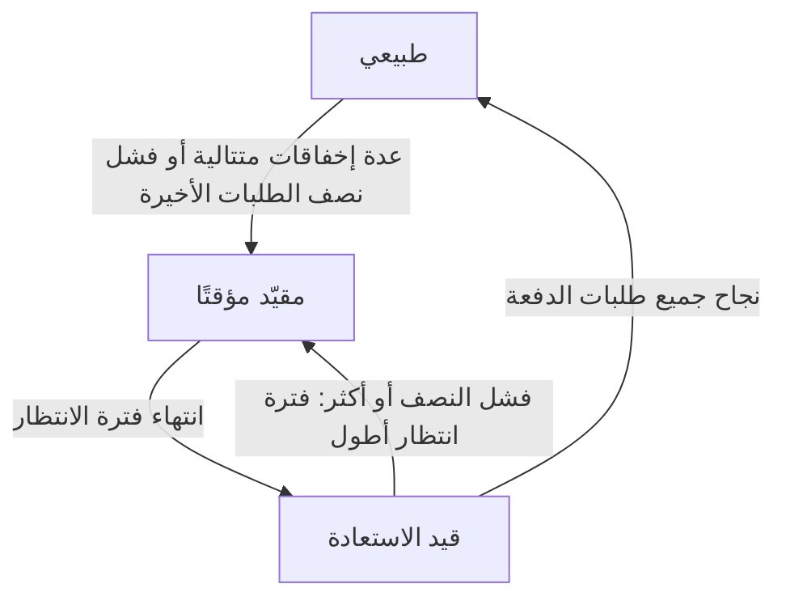

import { ProviderStatusExplorer } from "/snippets/provider-status.jsx";

في صفحة النموذج، تظهر حتى أيقونتين بعد اسم كل مزوّد: **أيقونة الحالة** التي يحددها Phaseo، و**أيقونة التوجيه المباشر** التي تظهر فقط ما دام الـ Gateway يحوّل الحركة بعيدًا عن مزوّد يفشل.

<ProviderStatusExplorer locale="ar" />

## أيقونة الحالة

يحدد Phaseo هذه الحالة يدويًا، وتبقى حتى يغيّرها Phaseo. المسار ذو الأولوية الأقل ملاذ أخير: لا يجرّبه الـ Gateway إلا بعد جميع المزوّدين السليمين الآخرين.

| الأيقونة | الحالة | التوجيه |
| --- | --- | --- |
| <Icon icon="circle-check" color="#16a34a" /> | `Active` | يُوجَّه بشكل طبيعي. |
| <Icon icon="triangle-alert" color="#d97706" /> | `أولوية أقل` | كاحتياط فقط، بعد جميع المزوّدين السليمين الآخرين. |
| <Icon icon="ban" color="#dc2626" /> | `Disabled` | لا يُوجَّه. |

## التوجيه المباشر

يحدده الـ Gateway تلقائيًا لكل مزوّد ونموذج ونقطة نهاية، بناءً على الطلبات التي يعالجها الآن. يبقى المسار المقيّد أو قيد الاستعادة قابلًا للتوجيه، لكن تُجرَّب المزوّدات الأخرى أولًا.

## التوفر والتكامل

تعرض بطاقة الحالة أيضًا ما إذا كان المزوّد يقدّم النموذج، وما إذا كان Phaseo قد فعّله. لا يكون المسار عامًا إلا إذا سمح الاثنان بذلك. على سبيل المثال، قد يقدّم المزوّد نموذجًا جديدًا (`Available`) بينما لا يزال Phaseo يطوّر دعمه (`Implementing`).

### توفر المزوّد

| الحالة | المعنى |
| --- | --- |
| `Available` | يقبل المزوّد الطلبات لهذا العرض حاليًا. |
| `Preview` | يوفّر المزوّد العرض في معاينة. |
| `Limited Access` | العرض موجود، لكن الوصول إليه يعتمد على الحساب أو المنطقة أو قائمة السماح أو السعة. |
| `Coming Soon` | أعلن المزوّد عن العرض أو أدرجه، لكنه غير قابل للاستخدام بعد. |
| `Deprecated` | لا يزال العرض متاحًا، لكن المزوّد يوصي بالترحيل. |
| `Removed` | لم يعد المزوّد يقدّم العرض. |
| `Unknown` | لم تتحقق Phaseo بعد من التوافر لدى المزوّد الأصلي. |

### تكامل Phaseo

| الحالة | المعنى | توجيه Phaseo |
| --- | --- | --- |
| `Unsupported` | لا يتوفر لدى Phaseo تكامل متوافق مع العرض. | غير قابل للتوجيه. |
| `Planned` | اعتُمد عمل التكامل لكنه لم يبدأ. | غير قابل للتوجيه. |
| `Implementing` | يجري تنفيذ التكامل. | غير قابل للتوجيه. |
| `Testing` | نُفّذ التكامل ويخضع لاختبارات العقد أو التجهيز أو الإطلاق التجريبي. | غير قابل للتوجيه علنًا. |
| `Enabled` | مدعوم ومفعّل للاستخدام في الإنتاج. | قابل للتوجيه إذا سمحت مفاتيح التوجيه والحالة الصحية بذلك. |
| `Disabled` | عطّلت Phaseo التكامل عمدًا. | غير قابل للتوجيه. |
| `Blocked` | تمنع تبعية خارجية أو غير محسومة الإطلاق. | غير قابل للتوجيه. |

لا يمكن أن تكون عامة إلا المسارات `Enabled`. تخدم المسارات `Internal` حركة الاختبار الخاصة بـ Phaseo فقط.

## التوافق

تبقى `availability_status` و`routing_status` و`is_active_gateway` و`routable` في الواجهة البرمجية للتكاملات الحالية. يجب أن تقرأ التكاملات الجديدة حقول المزوّد وPhaseo المنفصلة.

## صفحات ذات صلة

- [التوجيه والرجوع الاحتياطي](./routing-and-fallbacks.mdx)
- [فئات الخدمة](./service-tiers.mdx)
- [مرجع Models API](../api-reference/endpoint/models.mdx)
