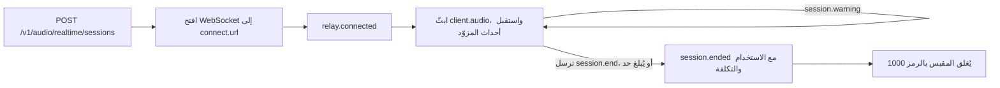

أنشئ جلسة من خادمك، واربط العميل بمرحّل Phaseo عبر WebSocket، وابثّ صوت الميكروفون إلى نموذج فوري لدى مزوّد. يمرّر المرحّل أحداث المزوّد نفسها دون تغيير، ويقيس المكالمة أثناء سيرها، ويضيف ثلاثة أحداث خاصة به: `session.warning` أثناء المكالمة، و`session.end` لإنهاء المكالمة، و`session.ended` مع الفاتورة النهائية.

<Note>
الصوت الفوري في مرحلة بيتا، والوصول إليه مقيّد لكل مساحة عمل.
</Note>



## ابدأ جلسة

أنشئ الجلسة من خادمك:

```bash
curl https://api.phaseo.app/v1/audio/realtime/sessions \
  -H "Authorization: Bearer $PHASEO_API_KEY" \
  -H "Content-Type: application/json" \
  -d '{"model": "openai/gpt-realtime-2", "voice": "marin"}'
```

تتضمن الاستجابة `client_secret` و`connect.url` و`max_duration_seconds` و`idle_timeout_seconds` (دائمًا `null` لجلسات API).

افتح WebSocket إلى `connect.url` على `api.phaseo.app` واعرض بروتوكولين فرعيين: `statsync-realtime` و`rtsec.<client_secret>`. يختار المرحّل `statsync-realtime`. إذا عرضت `rtsec.<client_secret>` فقط، تُفشل المتصفحات ومعظم مكتبات WebSocket المصافحة لأنه لا يُختار أي بروتوكول.

يرسل المرحّل `relay.connected` بمجرد أن يصبح المزوّد جاهزًا. ثم أرسل صوت الميكروفون بصيغة `{"type": "client.audio", "audio": "<base64 PCM16>"}` بمعدل العينات الخاص بالمزوّد:

| المزوّد | صوت الإدخال |
| --- | --- |
| OpenAI، xAI، ElevenLabs، GPT Live | 24 kHz PCM16 |
| Google، Mistral | 16 kHz PCM16 |

يحجز Phaseo رصيدًا بقيمة $5 عند بدء الجلسة ويمدّد الحجز أثناء سير المكالمة.

تتولى [حزم SDK لـ TypeScript وPython](/ar/v1/sdk-reference/client/audio-realtime) كل ذلك نيابةً عنك: ينشئ `client.realtime.connect()` الجلسة ويفتح المقبس، ويعيد `session.end()` الحدث `session.ended`. تحتوي حزم SDK الأخرى على العميل الصغير نفسه؛ ويضم ملف README لكل حزمة مثالًا.

| SDK | الاتصال | مكتبة WebSocket |
| --- | --- | --- |
| Go | `realtime.Connect(ctx, client, realtime.Options{...})` | `github.com/coder/websocket`، في الحزمة المنفصلة `realtime` |
| Java | `client.realtime.connect(Map.of("model", ...))` | JDK `java.net.http.WebSocket` |
| C# | `await client.Realtime.ConnectAsync(new RealtimeConnectOptions { ... })` | `System.Net.WebSockets.ClientWebSocket` |
| PHP | `$client->realtime()->connect(["model" => ...])` | `phrity/websocket` (اختيارية، `composer require phrity/websocket`) |
| Ruby | `client.realtime.connect(model: ...)` | gem `websocket` (اختيارية) |
| Rust | `client.realtime().connect(RealtimeOptions::new(...))` | `tungstenite`، خلف الميزة `realtime` |

لا تحتوي حزمة C++ SDK على عميل فوري.

### اتصالات Google Live

استمر في بث صوت الميكروفون طوال المكالمة، بما في ذلك الصمت. تغلق Google الاتصال الذي لا يتلقى صوتًا لمدة 150 ثانية تقريبًا (رمز الإغلاق `1008`)، فتنتهي المكالمة بالسبب `provider_closed`. يرسل المرحّل تحذير `provider_closing` مع `threshold: "input_idle"` بعد دقيقتين دون صوت. الصمت بين الأدوار ليس جزءًا من أي دور، لذا لا يُحتسب.

تستبدل Google أيضًا كل اتصال بعد 10 دقائق تقريبًا. ينقل المرحّل المكالمة إلى اتصال جديد باستخدام استئناف الجلسة من Google، ويبقي مقبسك مفتوحًا ويرسل `{"type": "relay.provider_reconnected", "reconnects": 1}` عند اكتمال التبديل. يُحتفظ بالصوت الذي ترسله أثناء التبديل (عادةً أقل من ثانية) ثم يُمرَّر. يعيد الاتصال المستأنف معالجة المحادثة حتى تلك اللحظة، وتحتسب Google ذلك مجددًا كـ tokens إدخال في الدور التالي، لذا تكلّف المكالمة الطويلة أكثر قليلًا لكل دور بعد كل تبديل. كل ذلك مضمّن في `usage` وفي الفاتورة. لا يحذّر المرحّل بـ `provider_closing` إلا إذا تعذّر عليه الاستئناف، وعندئذٍ تنتهي المكالمة حين تغلق Google الاتصال.

### جلسات GPT Live

يتولى GPT Live (`openai/gpt-live-1`) الصوت ويسلّم الاستدلال إلى نموذج خلفي عبر Responses. أنشئه باستخدام `POST /v1/live/sessions`:

```bash
curl https://api.phaseo.app/v1/live/sessions \
  -H "Authorization: Bearer $PHASEO_API_KEY" \
  -H "Content-Type: application/json" \
  -d '{
    "model": "openai/gpt-live-1",
    "provider": "openai",
    "voice": "marin",
    "backend_model": "openai/gpt-5.6-luna",
    "backend_settings": {
      "tools": [{ "type": "function", "name": "get_time", "description": "Returns the current UTC time.", "parameters": { "type": "object", "properties": {} } }]
    }
  }'
```

قيمة `voice` هي إحدى `alloy` أو `ash` أو `ballad` أو `beacon` أو `bossa` أو `cedar` أو `cinder` أو `coral` أو `delta` أو `echo` أو `gleam` أو `marin` أو `meridian` أو `quartz` أو `ripple` أو `sage` أو `shimmer` أو `stone` أو `tempo` أو `verse` أو `vesper` أو `willow`. وقيمة `backend_model` هي `openai/gpt-5.6-luna` (الافتراضية) أو `openai/gpt-5.6-terra`. اتصل وابثّ صوتًا بتردد 24 kHz بالطريقة نفسها كبقية الجلسات.

تعمل أدوات الدوال على العميل الخاص بك. يصل استدعاء النموذج الخلفي كحدث `response.event` تكون فيه قيمة `event.item.type` هي `function_call`. يأتي اسمه و`arguments` من النموذج، وقد يوجّههما ما يقوله المتصل، لذا عاملهما كمدخلات غير موثوقة:

1. شغّل فقط الأدوات التي صرّحت بها، مع البحث عنها بـ `name`، وارفض أي اسم آخر.
2. حلّل `arguments` كـ JSON وتحقق منه مقابل مخطط `parameters` الخاص بالأداة قبل استخدامه.
3. تحقّق من أن المستخدم المسجّل دخوله مسموح له بفعل ما يطلبه الاستدعاء، واطلب تأكيده قبل أي شيء يغيّر البيانات أو ينفق المال أو يتواصل مع أحد.

ثم شغّل الأداة، وأرسل النتيجة، واطلب الرد اللاحق. إذا فشل استدعاء في هذه الفحوص، فأرسل `output` يوضّح السبب بدل تشغيله:

```json
{ "type": "response.item.create", "item": { "type": "function_call_output", "call_id": "call_63hZ...", "output": "{\"utc\":\"2026-10-22T09:42:48Z\"}" } }
{ "type": "response.create" }
```

لا يقبل المرحّل `function_call_output` إلا لاستدعاء أجراه النموذج الخلفي، مرة واحدة لكل استدعاء وحتى 64 KB، ولا يقبل `response.create` إلا بعد مخرج واحد على الأقل. أي شيء آخر يتلقى `{"type": "relay.client_event_rejected", "reason": "..."}` وتستمر المكالمة. لا يشغّل Phaseo أدوات الدوال بنفسه أبدًا.

تُحتسب مكالمة GPT Live لكل ثانية من الصوت ($0.05 للدقيقة، من `usage.seconds` الخاص بـ GPT Live) إضافة إلى tokens النموذج الخلفي لكل استجابة، بما في ذلك الردود بعد نتائج الأدوات. ينهي GPT Live صلاحية الجلسة التي لا تتلقى صوتًا لمدة 30 ثانية تقريبًا، فتنتهي المكالمة بالسبب `provider_idle_timeout`. استمر في بث صوت الميكروفون، بما في ذلك الصمت.

### جلسات ElevenLabs Realtime

يأتي ElevenLabs Realtime في نموذجين: `eleven-labs/eleven-realtime-v1-mini`، وهو الافتراضي الأسرع والأرخص، و`eleven-labs/eleven-realtime-v1-max`، الذي يستدل قبل أن يجيب ويناسب التعليمات المعقدة واستخدام الأدوات متعدد الخطوات. يستخدم كلاهما طلب الإنشاء والمرحّل نفسيهما كما في OpenAI، بصوت 24 kHz. يتصل Phaseo بـ ElevenLabs بمفتاحه الخاص؛ ولا يرى العميل الخاص بك سوى المرحّل.

تحتسب ElevenLabs المكالمة عن كل ثانية اتصال، إضافة إلى tokens النموذج اللغوي التي تستخدمها، ولا تبلغ عن الاستخدام أثناء المكالمة. يقيس المرحّل وقت الاتصال أثناء سير المكالمة، لذا تعمل الحجوزات وسقف السحب على المكشوف كما مع المزوّدين الآخرين. عند انتهاء المكالمة، يقرأ Phaseo فاتورة ElevenLabs للمحادثة ويحتسب الأكبر بينها وبين إجماليه الخاص بسعر القائمة. يستغرق ذلك عادةً بضع ثوانٍ. إذا استغرق وقتًا أطول، يصل `session.ended` مع `billing_status: "pending"` وطلب `final_bill`، وتُسوّى الفاتورة بمجرد أن تبلغ عنها ElevenLabs، عادةً خلال بضع دقائق. تبقى حجوزاتك قائمة حتى ذلك الحين. إذا لم تبلغ ElevenLabs عن الفاتورة بعد 24 ساعة، تنتقل الجلسة إلى مراجعة الفوترة بدل احتسابها على وقت الاتصال وحده.

### النسخ المتدفق

تنسخ نماذج Voxtral Realtime من Mistral الصوت المباشر فور وصوله: `mistral/voxtral-mini-transcribe-realtime-3` و`mistral/voxtral-mini-transcribe-realtime`. لا ترد بالكلام، لذا أنشئ الجلسة دون `voice` أو `instructions`:

```bash
curl https://api.phaseo.app/v1/audio/realtime/sessions \
  -H "Authorization: Bearer $PHASEO_API_KEY" \
  -H "Content-Type: application/json" \
  -d '{"model": "mistral/voxtral-mini-transcribe-realtime-3"}'
```

اتصل بالطريقة نفسها وابثّ 16 kHz PCM16 كـ `client.audio`. تُمرَّر أحداث Mistral دون تغيير: `session.created`، ثم `transcription.text.delta` مع كل جزء جديد من النص، و`transcription.language` و`transcription.segment` حيث ترسلهما Mistral. لتغيير إعدادات النسخ، أرسل `{"type": "session.update", "session": {...}}` مع أي من `language` و`target_streaming_delay_ms` (من 80 إلى 1,200، أو 2,400) و`context_bias` و`diarize` و`turn_detection`. تُرفض الحقول الأخرى، بما فيها صيغة الصوت، بالحدث `relay.client_event_rejected`. تُثبَّت الإعدادات بمجرد بدء الصوت، لذا أرسل `session.update` قبل أول `client.audio`؛ وتُرفض التحديثات اللاحقة بالطريقة نفسها. لا يقبل النموذج الأقدم `mistral/voxtral-mini-transcribe-realtime` إلا `target_streaming_delay_ms`.

عندما ترسل `session.end`، ينهي المرحّل تدفق الصوت إلى Mistral وينتظر حتى 10 ثوانٍ لـ `transcription.done`، الذي يحمل النص الكامل، قبل أن يسوّي الفاتورة ويرسل `session.ended`. يُستخدم الصوت الذي أرسلته بالفعل؛ ولا يُتجاهل شيء.

يُحتسب النسخ المتدفق لكل دقيقة من الصوت الذي ترسله ($0.008 للدقيقة لـ Voxtral Mini Transcribe Realtime 3)، ويقيسه المرحّل. عدد Mistral الخاص في `transcription.done` هو الحد الأدنى المحتسب. لتسجيل موجود لديك بالفعل، استخدم [نسخ الصوت](/ar/v1/api-reference/endpoint/audio-transcriptions) بدلًا من ذلك.

## أنهِ جلسة

أرسل `session.end` عندما ينهي المتصل المكالمة:

```json
{ "type": "session.end", "reason": "caller hung up" }
```

| الحقل | النوع | الافتراضي | المعنى |
| --- | --- | --- | --- |
| `reason` | string | لا شيء | ملاحظتك الخاصة، حتى 120 حرفًا قابلًا للطباعة، تُعاد كـ `client_reason`. |
| `cancel_response` | boolean | `true` | `true` تلغي ردًا لا يزال يُشغَّل. `false` تتركه ينتهي، لمدة تصل إلى 20 ثانية. |

ثم يقوم المرحّل بما يلي:

1. يتوقف عن قبول الصوت؛
2. يتجاهل صوت الميكروفون الذي لم يُلزمه المزوّد بدور؛
3. يلغي الرد الجاري، أو يتركه ينتهي، وينتظر حتى 10 ثوانٍ لبيانات استخدامه؛
4. في GPT Live، يرسل إلى المزوّد `session.close` وينتظر `session.closed`؛
5. يسوّي الفاتورة؛
6. يرسل `session.ended`؛
7. يغلق المقبس بالرمز `1000`.

إغلاق المقبس دون `session.end` ينهي المكالمة أيضًا ويحتسبها بالطريقة نفسها، لكن العميل الخاص بك لن يتلقى `session.ended`.

## اقرأ الفاتورة النهائية: `session.ended`

يرسل المرحّل `session.ended` في كل إنهاء: ما طلبته أنت، وما بدأه المزوّد، وما بدأه الـ Gateway. يُرسَل بينما لا يزال مقبسك مفتوحًا، قبيل أن يغلقه المرحّل.

```json
{
  "type": "session.ended",
  "session_id": "rt_01k8...",
  "reason": "client_requested",
  "initiated_by": "client",
  "client_reason": "caller hung up",
  "duration_seconds": 184.2,
  "usage": { "input_audio_tokens": 1840, "output_audio_tokens": 3120, "input_text_tokens": 412 },
  "cost": {
    "total_usd": 0.231,
    "total_nanos": 231000000,
    "estimated": false,
    "estimate_basis": null,
    "debt_nanos": 0,
    "uncollected_nanos": 0,
    "currency": "USD"
  },
  "billing_status": "settled"
}
```

| الحقل | المعنى |
| --- | --- |
| `reason` | رمز سبب ثابت. راجع [رموز الأسباب](#reason-codes). |
| `initiated_by` | `client` أو `gateway` أو `provider`. |
| `duration_seconds` | الوقت منذ اتصال المرحّل. |
| `usage` | الاستخدام الذي تُفوتَر عليه المكالمة: أعداد الرموز حسب الوسيط، بما فيها القراءة من ذاكرة التخزين المؤقت والكتابة إليها؛ و`audio_seconds`، أي مدة الصوت في المكالمة، وهي ما تُفوتَر عليه مكالمات xAI وElevenLabs وMistral وصوت GPT Live (وفي المكالمات المفوترة بالرموز تظهر للعلم فقط)؛ و`native_web_search_requests` لعمليات البحث على الويب في GPT Live. عندما تكون قيمة `billing_status` هي `pending` أو `unresolved`، يعرض الاستخدام المعروف حتى الآن، ويعيد `final_bill` العدّادات النهائية. |
| `cost.estimated` | `true` عندما قُدّر جزء من الاستخدام من الصوت المُقاس لأن بيانات استخدام المزوّد لدور مقاطَع لم تصل قط. يوضح `estimate_basis` السبب. |
| `cost.debt_nanos` | جزء التكلفة المحتسب كسحب على المكشوف يتجاوز حجوزاتك ورصيدك الحر. |
| `cost.uncollected_nanos` | التكلفة التي تتجاوز سقف السحب على المكشوف ولم تُحتسب. |
| `provider_close_code` | رمز إغلاق WebSocket الخاص بالمزوّد، عندما يكون المزوّد هو من أنهى المكالمة. |
| `billing_status` | `settled` أو `pending` أو `unresolved`. |

إذا كانت التسوية لا تزال قيد إعادة المحاولة، تكون قيمة `billing_status` هي `pending` ويعرض `cost` التقدير الجاري. إذا كانت الجلسة تحتاج إلى مراجعة فوترة، تكون القيمة `unresolved`. في الحالتين، يقدّم `final_bill` الطلب الذي تجلب به التكلفة النهائية بعد تسويتها:

```json
"final_bill": { "method": "GET", "path": "/v1/generations?id=realtime%3Art_01k8..." }
```

<span id="reason-codes"></span>
### رموز الأسباب

| `reason` | `initiated_by` | متى |
| --- | --- | --- |
| `client_requested` | client | أرسلت `session.end`. |
| `client_disconnected` | client | أُغلق مقبسك دون `session.end`. |
| `provider_closed` | provider | أغلق المزوّد اتصاله، مثل Google بعد نحو 150 ثانية دون صوت (الرمز `1008`)، أو بعد `goAway` تعذّر على المرحّل الاستئناف منه. |
| `provider_idle_timeout` | provider | أنهى GPT Live صلاحية الجلسة لأنه لم يتلقَّ صوتًا لمدة 30 ثانية تقريبًا. |
| `provider_error` | provider | فشل اتصال المزوّد أو أبلغ عن خطأ. |
| `max_duration_reached` | gateway | بُلغ حد الجلسة لدى المزوّد. |
| `insufficient_funds` | gateway | بُلغ سقف السحب على المكشوف. |
| `key_revoked` | gateway | أُلغي مفتاح API أو حُذف أثناء المكالمة. |
| `key_expired` | gateway | انتهت صلاحية مفتاح API أثناء المكالمة. |
| `key_blocked` | gateway | أُوقف مفتاح API مؤقتًا أثناء المكالمة. |
| `workspace_disabled` | gateway | لم تعد مساحة العمل موجودة. |
| `policy_blocked` | gateway | حظر تغيير في سياسة مساحة العمل النموذج، أو أزال المزوّد من قائمة السماح، وظل ساريًا بعد 30 ثانية من تحذير `policy_blocked`. |
| `input_rejected` | gateway | رفض المرحّل صوت العميل: كبير جدًا، أو أسرع من الوقت الفعلي، أو تأخر المزوّد. |
| `session_reconciled` | gateway | فقد المرحّل حالته وأُغلقت الجلسة عبر المطابقة. |
| `gateway_error` | gateway | تعذّر على Phaseo معالجة أحداث المزوّد أو تسجيل الاستخدام. |
| `idle_timeout` | gateway | في Playground فقط: خمس دقائق دون صوت. |
| `spend_limit_reached` | gateway | في Playground فقط: بُلغ حد إنفاق المفتاح أو ميزانية مساحة العمل. |

قد تُضاف رموز جديدة، لذا عامل أي `reason` غير معروف مثل `gateway_error`.

## تعامل مع التحذيرات: `session.warning`

تخبرك التحذيرات بما هو قادم دون إنهاء المكالمة. يُرسَل كل رمز مرة واحدة على الأكثر لكل عتبة.

```json
{ "type": "session.warning", "code": "max_duration_approaching", "message": "...", "seconds_remaining": 120, "expires_at": "2026-10-22T11:00:00.000Z" }
```

| `code` | حقول إضافية | متى |
| --- | --- | --- |
| `max_duration_approaching` | `seconds_remaining`، `expires_at` | قبل دقيقتين من حد الجلسة لدى المزوّد، ومرة أخرى قبل 30 ثانية. |
| `provider_closing` | `seconds_remaining`، و`threshold: "input_idle"` لحالة الخمول | ستغلق Google الاتصال: بعد `goAway` تعذّر على المرحّل الاستئناف منه، أو (`input_idle`) لأنه لم يصل أي صوت لمدة دقيقتين. |
| `funds_low` | `remaining_usd` | تعذّر تمديد حجز الرصيد. تستمر المكالمة على رصيدك الحر. |
| `overdraft_in_use` | `remaining_usd`، `overdraft_used_usd` | استُنفد رصيدك الحر وتعمل المكالمة على السحب على المكشوف. يُرسَل مجددًا عندما يتبقى أقل من $0.25 من السقف. |
| `spend_limit_exceeded` | `limit` (`key` أو `workspace_budget`) | بُلغ حد إنفاق المفتاح أو ميزانية مساحة العمل. تستمر المكالمة؛ وتُرفض الطلبات الجديدة. |
| `policy_blocked` | `status`، إضافة إلى `seconds_remaining` و`ends_at` عندما تكون قيمة `status` هي `ending` | أصبحت سياسة مساحة العمل تحظر المكالمة، أو أُزيل مزوّدها من قائمة السماح. تنتهي المكالمة بعد 30 ثانية ما لم يُتراجع عن التغيير، وفي هذه الحالة يصل تحذير ثانٍ مع `status: "cleared"`. |

`remaining_usd` هو ما تستطيع المكالمة إنفاقه بعد قبل أن تنتهي، بما في ذلك السحب على المكشوف.

## متى تنتهي المكالمة من تلقاء نفسها

لا ينهي Phaseo جلسات API أبدًا بسبب الخمول، وحدود الإنفاق تحذّر فقط. لا تنتهي المكالمة من تلقاء نفسها إلا عند حدوث أحد ما يلي:

| الحد | القيمة |
| --- | --- |
| OpenAI Realtime | 60 دقيقة |
| xAI | 120 دقيقة |
| Google Live | 60 دقيقة، عبر الاتصالات التي يستأنفها المرحّل. تنتهي المكالمة أيضًا إذا توقف العميل عن إرسال الصوت لمدة 150 ثانية تقريبًا. |
| GPT Live | 25 دقيقة |
| ElevenLabs Realtime | 30 دقيقة |
| النسخ المتدفق من Mistral | 60 دقيقة |
| سقف السحب على المكشوف | $1 يتجاوز حجوزاتك ورصيدك الحر |
| فقدان الوصول | أُلغي المفتاح أو انتهت صلاحيته أو أُوقف مؤقتًا، أو أُزيلت مساحة العمل. يُكتشف خلال دقيقة تقريبًا، ثم تنتهي المكالمة دون مهلة سماح. |
| تغيير السياسة | بعد 30 ثانية من تحذير `policy_blocked`، إذا ظلت السياسة تحظر المكالمة |

تُحتسب حدود الجلسة من لحظة اتصال المرحّل، لا من لحظة إنشاء الجلسة.
