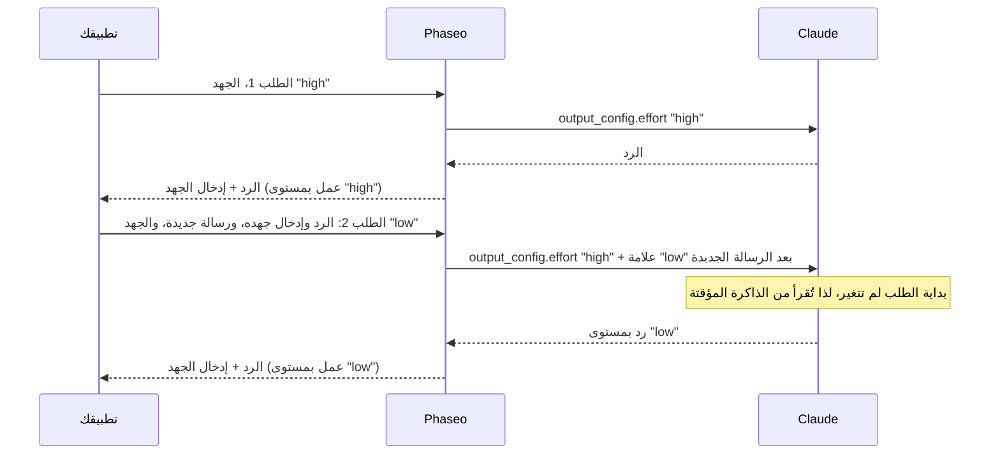

import { EffortCacheExplorer } from "/snippets/effort-cache.jsx";

أرسل قيمة مختلفة لـ `reasoning_effort` (Chat Completions) أو `reasoning.effort` (Responses) في أي طلب، فيغيّر Phaseo جهد Claude دون إعادة تشغيل ذاكرته المؤقتة للموجّهات. لا تحتاج إلى تغيير أي شيء آخر في شيفرتك، ما دمت تعيد إرسال استدلال Claude دون تغيير في كل طلب.

<EffortCacheExplorer locale="ar" />

يواصل Phaseo إرسال جهد الطلب الأول في محادثتك إلى Claude، ويضيف كل تغيير كعلامة جهد بعد رسالتك الجديدة. يبقى كل ما قبل العلامة كما هو، فيقرؤه Claude من الذاكرة المؤقتة. إذا أسقطت الاستدلال، يغيّر Phaseo الجهد في المستوى الأعلى بدلًا من ذلك، ويعالج Claude كل شيء من رده الأول فصاعدًا من جديد بدلًا من قراءته من الذاكرة المؤقتة.

## كيف يحافظ Phaseo على الذاكرة المؤقتة

لا يقرأ Claude محادثة مخزّنة مؤقتًا إلا عندما تكون بداية الطلب مطابقة بايتًا ببايت، والجهد في المستوى الأعلى جزء من تلك البداية. أما [الجهد لكل رسالة](https://platform.claude.com/docs/en/build-with-claude/effort-per-message) من Anthropic فيغيّر المستوى داخل `messages` بدلًا من ذلك، عبر رسالة `system` ذات `content` فارغ و`output_config.effort`. يكتب Phaseo هذه العلامات نيابةً عنك:



لا يخزّن Phaseo أي شيء بين الطلبات. ينتهي كل رد من Claude بإدخال استدلال واحد يسجّل المستوى الذي عمل به، ويعيد Phaseo بناء كل علامة سابقة، في المكان نفسه، من الإدخالات التي تعيد إرسالها:

| الطلب | ما ترسله | ما يرسله Phaseo إلى Claude |
| --- | --- | --- |
| 1 | `"high"` | `output_config.effort: "high"` |
| 2 | `"low"` | `"high"`، بالإضافة إلى علامة `low` بعد رسالتك الجديدة |
| 3 | `"low"` | `"high"`، بالإضافة إلى العلامة نفسها في المكان نفسه |
| 4 | `"high"` | `"high"`، والعلامة السابقة، وعلامة `high` بعد رسالتك الجديدة |

لا تُغيَّر الرسائل التي تعيد إرسالها أبدًا. توجد العلامات فقط في الطلب الذي يرسله Phaseo إلى Claude.

## أعد إرسال الاستدلال دون تغيير

<Warning>
أعد إرسال كل إدخال استدلال كما استلمته تمامًا، في كل طلب: `reasoning_details` في Chat، وعناصر `reasoning` في Responses، وكتل `thinking` في Anthropic، سواء كانت مشفّرة أم لا. لا تُسقطها ولا تعدّلها ولا تُعِد ترتيبها ولا تلخّصها. من دونها، يعيد تغيير الجهد تشغيل ذاكرة Claude المؤقتة، ويفقد Claude استدلاله بين خطوات حلقة الأدوات.
</Warning>

لا يحتوي إدخال الجهد على نص. في Chat Completions هو آخر إدخال `reasoning.encrypted` في `reasoning_details`:

```json
{
  "role": "assistant",
  "content": "1. Export the data. 2. Create the schema. 3. Import and verify.",
  "reasoning_details": [
    { "type": "reasoning.text", "text": "…", "signature": "phx1.…", "format": "anthropic-claude-v1" },
    { "type": "reasoning.encrypted", "data": "phx1.…", "format": "anthropic-claude-v1" }
  ]
}
```

وفي Responses هو آخر عنصر `reasoning` في `output`، وله `id` يبدأ بـ `rs_effort_`:

```json
{ "type": "reasoning", "id": "rs_effort_req_123", "summary": [], "content": [], "encrypted_content": "phx1.…" }
```

القيمة معتمة، ويزيلها Phaseo قبل أن تصل المحادثة إلى أي مزوّد.

## غيّر الجهد في شيفرتك

ألحِق رد Claude كاملًا بمحادثتك، ثم عيّن الجهد الذي تريده في الطلب التالي. يفعّل `cache_control` في المستوى الأعلى التخزين المؤقت على مسارات Claude؛ راجع [التخزين المؤقت للموجّهات](./prompt-caching.mdx#which-providers-cache-automatically).

### Chat Completions

<CodeGroup>
```ts TypeScript
import OpenAI from "openai";

const client = new OpenAI({
	apiKey: process.env.PHASEO_API_KEY,
	baseURL: "https://api.phaseo.app/v1",
});

const messages: OpenAI.ChatCompletionMessageParam[] = [
	{ role: "user", content: "Plan a migration from SQLite to PostgreSQL." },
];

async function ask(effort: "low" | "medium" | "high") {
	const response = await client.chat.completions.create({
		model: "anthropic/claude-opus-5.5",
		reasoning_effort: effort,
		messages,
		// @ts-expect-error Phaseo field: cache the conversation on Claude routes
		cache_control: { type: "ephemeral" },
	});
	const message = response.choices[0].message;
	messages.push(message); // the whole message, reasoning_details included
	return message.content;
}

await ask("high");
messages.push({ role: "user", content: "Summarise the plan in one sentence." });
await ask("low"); // Claude reads request 1 from cache
```

```python Python
import os
from openai import OpenAI

client = OpenAI(
    api_key=os.environ["PHASEO_API_KEY"],
    base_url="https://api.phaseo.app/v1",
)

messages = [{"role": "user", "content": "Plan a migration from SQLite to PostgreSQL."}]

def ask(effort: str) -> str | None:
    response = client.chat.completions.create(
        model="anthropic/claude-opus-5.5",
        reasoning_effort=effort,
        messages=messages,
        extra_body={"cache_control": {"type": "ephemeral"}},
    )
    message = response.choices[0].message
    # The whole message, reasoning_details included
    messages.append(message.model_dump(exclude_none=True))
    return message.content

ask("high")
messages.append({"role": "user", "content": "Summarise the plan in one sentence."})
ask("low")  # Claude reads request 1 from cache
```
</CodeGroup>

### Responses

لا يخزّن Phaseo الاستجابات، لذا أرسل المحادثة كاملة في `input`، بما في ذلك كل عنصر من عناصر `output`.

<CodeGroup>
```ts TypeScript
import OpenAI from "openai";

const client = new OpenAI({
	apiKey: process.env.PHASEO_API_KEY,
	baseURL: "https://api.phaseo.app/v1",
});

const input: OpenAI.Responses.ResponseInput = [
	{ role: "user", content: "Plan a migration from SQLite to PostgreSQL." },
];

async function ask(effort: "low" | "medium" | "high") {
	const response = await client.responses.create({
		model: "anthropic/claude-opus-5.5",
		reasoning: { effort },
		input,
		// @ts-expect-error Phaseo field: cache the conversation on Claude routes
		cache_control: { type: "ephemeral" },
	});
	input.push(...response.output); // every item, reasoning items included
	return response.output_text;
}

await ask("high");
input.push({ role: "user", content: "Summarise the plan in one sentence." });
await ask("low"); // Claude reads request 1 from cache
```

```python Python
import os
from openai import OpenAI

client = OpenAI(
    api_key=os.environ["PHASEO_API_KEY"],
    base_url="https://api.phaseo.app/v1",
)

conversation = [{"role": "user", "content": "Plan a migration from SQLite to PostgreSQL."}]

def ask(effort: str) -> str:
    response = client.responses.create(
        model="anthropic/claude-opus-5.5",
        reasoning={"effort": effort},
        input=conversation,
        extra_body={"cache_control": {"type": "ephemeral"}},
    )
    # Every item, reasoning items included
    conversation.extend(item.model_dump(exclude_none=True) for item in response.output)
    return response.output_text

ask("high")
conversation.append({"role": "user", "content": "Summarise the plan in one sentence."})
ask("low")  # Claude reads request 1 from cache
```
</CodeGroup>

### Anthropic Messages

على `/v1/messages`، ترسل العلامة بنفسك: رسالة `system` ذات `content` فارغ و`output_config.effort`. أبقِ `output_config.effort` في المستوى الأعلى كما هو في كل طلب، وأبقِ كل علامة في مكانها في الطلبات اللاحقة. يضيف Phaseo ترويسة النسخة التجريبية `mid-conversation-output-config-2026-07-01`، فلا تحتاج إلى إرسالها.

```bash cURL
curl https://api.phaseo.app/v1/messages \
  -H "x-api-key: $PHASEO_API_KEY" \
  -H "anthropic-version: 2023-06-01" \
  -H "Content-Type: application/json" \
  -d '{
    "model": "anthropic/claude-opus-5.5",
    "max_tokens": 4096,
    "cache_control": { "type": "ephemeral" },
    "output_config": { "effort": "high" },
    "messages": [
      { "role": "user", "content": "Plan a migration from SQLite to PostgreSQL." },
      { "role": "assistant", "content": "1. Export the data. 2. Create the schema. 3. Import and verify." },
      { "role": "system", "content": [], "output_config": { "effort": "low" } },
      { "role": "user", "content": "Summarise the plan in one sentence." }
    ]
  }'
```

يحدد موضع العلامة متى يبدأ المستوى الجديد:

- **مباشرةً بعد رسالة مستخدم:** يستخدم رد Claude على تلك الرسالة المستوى الجديد.
- **في أي مكان آخر**، مثل ما بين رد Claude ورسالتك التالية كما في المثال أعلاه: يبدأ المستوى الجديد من رسالتك التالية.

لا تُحتسب رسالة المستخدم التي لا تحتوي إلا على نتائج أدوات رسالةً جديدة. على المسارات التي لا تدعم الجهد لكل رسالة، يزيل Phaseo العلامات ويرسل المستوى الساري كجهد في المستوى الأعلى.

## متى يعيد التغيير تشغيل الذاكرة المؤقتة

يغيّر Phaseo الجهد في المستوى الأعلى، كما يفعل مع المزوّدين الآخرين، عندما:

- **يكون الاستدلال مفقودًا.** لا يحتوي أحدث رد من Claude على إدخال جهد، لأن عميلك أسقط `reasoning_details` أو عناصر `reasoning`.
- **يأتي التغيير بين خطوات حلقة الأدوات.** لا تحتوي أحدث رسائلك إلا على نتائج أدوات، لذا لن تسري العلامة إلا من رسالتك التالية. يغيّر Phaseo الجهد في المستوى الأعلى حتى تعمل هذه الخطوة بالمستوى الذي طلبته، وتستخدم التغييرات اللاحقة العلامات من جديد.
- **لا يعيّن الطلب أي جهد، أو يوقف الاستدلال.** أرسل `reasoning_effort` أو `reasoning.effort` في كل طلب. القيمتان `"none"` و`reasoning.enabled: false` توقفان الاستدلال.
- **لا يدعم المسار ذلك.** راجع [النماذج المدعومة](#supported-models).

يُبقي التغيير في المستوى الأعلى الجزء من المحادثة الذي يسبق رد Claude الأول في الذاكرة المؤقتة. يعالج Claude كل شيء من ذلك الرد فصاعدًا من جديد، ويحتسبه كمدخلات جديدة.

<span id="supported-models"></span>
## النماذج المدعومة

| المسار | النماذج |
| --- | --- |
| Anthropic، Google Vertex AI | Claude Fable 5.2 و5.1، وMythos 5.2 و5.1، وOpus 5.5 و5، وSonnet 5.5، وHaiku 5.5 |
| Claude on AWS | النماذج نفسها باستثناء Mythos |
| Amazon Bedrock | Claude Fable 5.1 وOpus 5.5 |

على كل مسار آخر، بما في ذلك Claude على Azure، يذهب تغيير الجهد إلى المستوى الأعلى.

## تحقّق من بقاء الذاكرة المؤقتة

اقرأ أعداد الذاكرة المؤقتة في الطلب الذي يلي التغيير: `usage.prompt_tokens_details.cached_tokens` في Chat Completions، و`usage.input_tokens_details.cached_tokens` في Responses، و`usage.cache_read_input_tokens` في Anthropic Messages. تسرد [حقول الاستخدام والتسعير](./prompt-caching.mdx#usage-and-pricing-fields) كل الحقول.

قسنا محادثة Chat Completions نفسها المكوّنة من خمسة طلبات على `anthropic/claude-haiku-5.5` في 11 نوفمبر 2026، مرة مع إعادة إرسال إدخالات الجهد ومرة دونها. كان الجهد `high`، `high`، `low`، `low`، `high`، ووصل مستند من 3,400 token في الرسالة الثانية:

| الطلب 3 (الجهد من `high` إلى `low`) | إسقاط إدخالات الجهد | إعادة إرسال إدخالات الجهد |
| --- | --- | --- |
| الـ tokens المقروءة من الذاكرة المؤقتة | 0 | 3,575 |
| الـ tokens المعالَجة من جديد والمكتوبة في الذاكرة المؤقتة | 3,499 | 75 |
