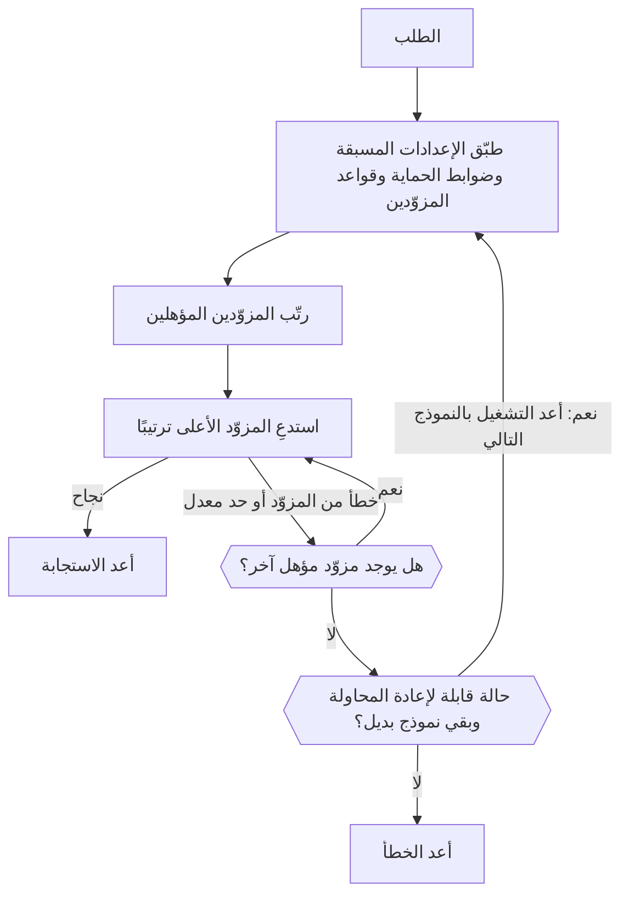

import { RoutingCostExplainer } from "/snippets/routing-cost.jsx";
import { FallbackChainExplorer } from "/snippets/fallback-chain.jsx";

يخدم معظم النماذج عدة مزوّدين. لكل طلب، يحتفظ الـ Gateway بالمزوّدين الذين تسمح بهم قواعدك، ويرتّبهم، ويستدعي أفضلهم. إذا فشل ذلك المزوّد، يجرّب التالي؛ وإذا فشل كل المزوّدين بخطأ قابل لإعادة المحاولة، يمكنه الانتقال إلى نموذج بديل.



يجب أن يظل العميل الخاص بك يعيد محاولة استجابات `429` و`5xx` مع تراجع أُسّي.

<span id="choose-how-providers-are-ranked"></span>
## اختر كيف يُرتَّب المزوّدون

| الوضع | يرتّب حسب | استخدمه عندما |
| --- | --- | --- |
| `balanced` (افتراضي) | التكلفة لكل إجابة ناجحة | تريد أفضل مزيج من السعر والسرعة والموثوقية. |
| `price` | السعر | تهمّك التكلفة أكثر من زمن الاستجابة. |
| `latency` | الوقت حتى أول token | يجب أن تبدأ الاستجابات بسرعة. |
| `throughput` | سرعة المخرجات | يجب أن تنتهي المخرجات الطويلة بسرعة. |

اضبط الإعداد الافتراضي لمساحة العمل في **لوحة التحكم ← الإعدادات ← التوجيه**، أو باستخدام `phaseo settings update --routing-mode <mode>`، أو باستخدام `routing_mode` في `PATCH /v1/settings`. لطلب واحد، أرسل `provider.sort` أو `routing.mode`، أو أضف لاحقة إلى معرّف النموذج:

| اللاحقة | الوضع | مثال |
| --- | --- | --- |
| `:nitro` | `throughput` | `openai/gpt-6-astra:nitro` |
| `:cheap` | `price` | `openai/gpt-6-astra:cheap` |
| `:fast` | `latency` | `openai/gpt-6-astra:fast` |

تتجاوز اللاحقة `routing.mode` و`provider.sort` وأوضاع الإعداد المسبق ومساحة العمل. تظل قوائم السماح والمناطق وضوابط الحماية وسقوف الأسعار سارية.

تحتوي صفحة إعدادات التوجيه أيضًا على مفاتيح لقناتي بيتا وألفا، فلا يحصل المزوّدون التجريبيون على حركة إلا عندما تشترك.

## كيف يرتّب الوضع المتوازن المزوّدين

لطلبات النص (Chat Completions وResponses وMessages)، يقدّر `balanced` **التكلفة لكل إجابة ناجحة** لكل مزوّد:

- **الـ Tokens:** تكلفة طلب نموذجي لهذا النموذج لدى المزوّد، باستخدام أحجام الموجّه والمخرجات المقيسة للنموذج ومعدل إصابة الذاكرة المؤقتة المقيس لدى المزوّد.
- **الانتظار:** الوقت حتى أول token وحتى الاستجابة الكاملة، محوّلًا إلى دولارات بالسعر النموذجي للنموذج لكل ثانية.
- **الإخفاقات:** الإجمالي مقسومًا على معدل نجاح المزوّد الأخير، إضافة إلى عقوبة على أخطاء المزوّد وعقوبة أصغر على حدود المعدل.

يتقاسم المزوّدون القريبون من أدنى تكلفة معظم الحركة. يحتفظ كل مزوّد بحصة صغيرة، حتى يُلاحظ تعافيه. اختر سيناريو لترى كيف يجري (المزوّدون أمثلة):

<RoutingCostExplainer locale="ar" />

تُقيَّم نقاط النهاية الأخرى حسب الموثوقية وزمن الاستجابة وزمن الاستجابة في الأطراف والإنتاجية والسعر وملاءمة الـ tokens. إذا كنت مزوّدًا، فإن [كيف يكسب المزوّدون الحركة](./how-providers-earn-traffic) توضح كيف تفوز بحصة أكبر.

<span id="request-level-model-fallbacks"></span>
## البدائل على مستوى الطلب للنماذج

اسرد النماذج البديلة في `models`. يجرّب Phaseo `model` أولًا، ثم كل إدخال بالترتيب:

```json
{
  "model": "openai/gpt-6-astra",
  "models": ["anthropic/claude-sonnet-5.5", "google/gemini-4-argon"],
  "input": "Summarize this incident report."
}
```

اختر ما يعيده كل نموذج لترى متى ينتقل Phaseo إلى التالي:

<FallbackChainExplorer locale="ar" />

**ما ينتقل إلى النموذج التالي.** لا يُجرَّب نموذج إلا بعد أن ينتهي النموذج السابق، بكل إعادات المحاولة لدى مزوّديه، بـ `429` أو `500` أو `502` أو `503` أو `504`. ينتقل أيضًا خطأ `429` الناتج عن ميزانية Phaseo أو حصة نموذج مجاني، إذ قد يناسب نموذج آخر الحد المتبقي. وكذلك النموذج الذي لم يعد يخدمه أي مزوّد، مثل نموذج [متقاعد](#retired-models).

**ما لا ينتقل.** تُعاد أخطاء العميل مثل `400` و`401` و`402` و`403` و`404` و`408` و`413` و`422` فورًا. وكذلك الإخفاقات التي تحدث قبل تشغيل النموذج الأول، مثل المصادقة أو حدود معدل مفتاح API.

**قواعد القائمة:**

- `model` مطلوب؛ وإرسال `models` وحده يعيد `400`.
- يقبل `models` من 1 إلى 25 إدخالًا. تُتجاهل الإدخالات المكررة ونسخ `model`.
- يمكن أن تكون الإدخالات معرّفات نماذج، أو [معرّفات مقيّدة بمزوّد](./provider-qualified-models)، أو إعدادات مسبقة مثل `@support`.
- يُتحقق من كل محاولة كطلب مستقل (نقطة النهاية، والمعاملات، ونماذج مساحة العمل، وضوابط الحماية، والإعدادات المسبقة، والتسعير، وBYOK). يُتخطى البديل الذي لا يستطيع خدمة الطلب ويُسجَّل؛ ولا يحل أبدًا محل الخطأ الذي كنت ستحصل عليه لولاه. تُتخطى أيضًا المحاولة المطابقة لمحاولة سبق إجراؤها.

**السجلات والفوترة.** كل محاولة طلب منفصل بسجل استخدام خاص، ويُحتسب كما لو لم تكن البدائل موجودة. يسمّي الحقل `model` في الاستجابة النموذج الذي أجاب، ويسرد أثر التوجيه الخاص به معرّف الطلب الأساسي وترتيب البدائل وكل محاولة سابقة.

**التدفق والفيديو والموسيقى.** لا ينتقل التدفق إلى بديل إلا قبل أول بايت منه؛ وبعد ذلك تصل الأخطاء داخل التدفق. لا ينتقل الفيديو والموسيقى إلى بديل إلا أثناء إرسال المهمة.

**مع عناصر التحكم الأخرى في التوجيه.** تأخذ البدائل في مسار ديناميكي مرفق الأولوية على `models`، ويظل النموذج الثابت الذي يختاره المسار ساريًا على كل محاولة. يطبّق الإعداد المسبق قيوده الخاصة على كل محاولة يُستخدم فيها. يدير [`phaseo/auto`](./auto-routing) بدائله الخاصة ولا يمكن دمجه مع `models`.

| نقطة النهاية | `models` |
| --- | --- |
| Chat Completions، Responses، Messages | مدعوم، بما في ذلك التدفقات قبل أول بايت |
| Embeddings، Moderations، Rerank | مدعوم |
| توليد الصور وتحريرها | مدعوم، بما في ذلك عمليات الرفع متعددة الأجزاء |
| الكلام والنسخ والترجمة | مدعوم، بما في ذلك عمليات الرفع متعددة الأجزاء |
| OCR، Parse، Decisions | مدعوم |
| توليد الفيديو والموسيقى | مدعوم عند إرسال المهمة |
| الدفعات | `400`: يستهدف كل صف في الدفعة نموذجًا واحدًا |
| الجلسات الفورية والمباشرة | `400`: ترتبط الجلسة بنموذج واحد |
| تشغيلات Council | `400`: تأتي النماذج من إعدادات التشغيل |

تقبل نقاط النهاية متعددة الأجزاء حقول `models` المتكررة، أو حقول `models[]`، أو سلسلة مصفوفة JSON واحدة. راجع أيضًا [حدود المعدل](../api-reference/limits.mdx) و[الأخطاء](../api-reference/errors.mdx).

<span id="pin-one-provider"></span>
## ثبّت مزوّدًا واحدًا

ضع المزوّد أمام معرّف النموذج لاستخدام ذلك المزوّد بالضبط:

```json
{
  "model": "baseten:thinking-machines/inkling-small",
  "input": "Hello"
}
```

يعطّل هذا الرجوع إلى مزوّدين آخرين لهذا الطلب. تبقى اللواحق جزءًا من معرّف النموذج، كما في `baseten:google/gemma-4-26b-a4b:free`. تغطي [معرّفات النماذج المقيّدة بمزوّد](./provider-qualified-models) الصيغة الكاملة والأخطاء.

## حدّد المزوّدين المستخدمين

| عنصر التحكم | أين | ما يفعله |
| --- | --- | --- |
| [الإعدادات المسبقة](./presets) | **الإعدادات ← الإعدادات المسبقة** | النماذج المسموح بها وقوائم السماح أو التجاهل للمزوّدين، تُطبَّق قبل الترتيب، لذا تحدّ من البدائل أيضًا. |
| [التوجيه الإقليمي](./regional-routing) | الطلب أو مساحة العمل | يبقي التنفيذ أو البيانات داخل منطقة. |
| المسارات الديناميكية | **الإعدادات ← التوجيه** | قواعد لكل مفتاح: انظر أدناه. |
| بديل BYOK | **الإعدادات ← BYOK** | ما إذا كان يجوز لطلب BYOK فاشل إعادة المحاولة على أرصدة Phaseo. |

<span id="attach-routing-rules-to-api-keys"></span>
### أرفق قواعد التوجيه بمفاتيح API

المسار الديناميكي تدفق من القواعد مرفق بمفتاح API استدلال واحد أو أكثر. يمكنه:

- التفرّع بحسب حقول جسم الطلب، أو الترويسات، أو `metadata` المخصصة، أو نقطة النهاية، أو النموذج، أو معرّف الجلسة
- تقسيم الحركة بالنسبة المئوية لاختبارات A/B وعمليات الطرح
- وضع سقف للطلبات أو التكلفة اليومية أو الأسبوعية أو الشهرية لكل مفتاح
- تبديل النموذج، ووضع التوجيه، وتفضيل المزوّد، والنماذج البديلة (حتى ثمانية)
- تفعيل الارتباط بالمزوّد المراعي للذاكرة المؤقتة والجلسة

للشروط مخرجان صحيح وخاطئ؛ ولعقد المعدل والميزانية مخرجان ضمن الحد وتجاوزه. التقسيمات بالنسبة المئوية حتمية لكل جلسة أو مفتاح ذاكرة مؤقتة للموجّه، لذا لا تنتقل المحادثة المخزّنة بين الفروع.

ينشئ الحفظ إصدار مسودة غير قابل للتغيير. ينسخ النشر ذلك الإصدار إلى الـ Gateway ويمسح ذاكرة السياسات المؤقتة لمفاتيحه؛ وتبقى الإصدارات السابقة متاحة للتراجع. تظهر توصيات صحة المزوّدين تحت **Insights**. من سكربت، استخدم واجهة `/v1/routing/dynamic-routes` مع مفتاح إدارة.

توضع البيانات الوصفية المخصصة في جسم الطلب على نقاط النهاية النصية المتوافقة مع OpenAI:

```json
{
  "model": "openai/gpt-6-astra",
  "metadata": { "customer_plan": "pro", "workspace": "acme" }
}
```

## أبقِ المحادثة على مزوّد واحد

التوجيه المراعي للذاكرة المؤقتة مفعّل افتراضيًا لتوليد النص. يُثبَّت الطلب الذي يرسل `prompt_cache_key` أو `session_id`، أو يشترك في التخزين المؤقت باستخدام `cache_control` (في المستوى الأعلى، أو في `provider_options.anthropic`، أو كعلامة `cache_control` أو `prompt_cache_breakpoint` على كتلة رسالة أو أداة)، على المزوّد والمسار اللذين خدما أول طلب ناجح له. تُثبَّت الطلبات الأخرى لمدة 15 دقيقة بمجرد أن يبلغ مزوّد عن قراءة من الذاكرة المؤقتة أو كتابة فيها للسياق الافتتاحي نفسه، إذا كان الإدخال المخزّن لدى ذلك المزوّد أرخص من إدخاله العادي.

| | |
| --- | --- |
| مدة التثبيت | من 15 دقيقة إلى 24 ساعة، وفق مدة احتفاظ المزوّد بالذاكرة المؤقتة. مع `session_id`، حتى 24 ساعة من نشاط الجلسة. |
| النطاق | لكل مساحة عمل. مع `session_id`، يرتبط بالجلسة بدل السياق الافتتاحي. |
| ينتقل التثبيت عندما | يُفتح قاطع الدائرة لدى المزوّد، أو يرتفع معدل أخطائه، أو تنفد حصة Phaseo المُدارة لديه، أو لم تعد قواعدك تسمح به. |

عطّله لطلب واحد باستخدام `provider.cache_aware_routing: false`، أو أبقِ الارتباط بالذاكرة المؤقتة مع تجاهل الجلسة باستخدام `routing.session_affinity: false`:

```json
{
  "model": "openai/gpt-6-astra",
  "session_id": "support-session-42",
  "routing": { "session_affinity": false }
}
```

يسرد [الارتباط بالمزوّد](./prompt-caching.mdx#provider-affinity) التلميحات التي يرسلها Phaseo إلى كل مزوّد.

<span id="explain-a-routing-decision"></span>
## افهم قرار التوجيه

افتح **لوحة التحكم ← الإعدادات ← الاستخدام ← سجلات الطلبات**، واختر طلبًا، ووسّع **قابلية رصد التوجيه** تحت **ردود المزوّدين**. يعرض:

- كل مزوّد مرتّب مع درجته النهائية، وأيهم اختير وجُرِّب
- المزوّدين المستبعدين قبل الترتيب، مع السبب
- المزوّدين الذين خُفّض ترتيبهم بسبب حالة الطرح أو التوجيه
- مدخلات كل درجة وأوزانها ومساهماتها ومضاعفاتها

عوامل الدرجة تغيّر الدرجة؛ أما السياق المسجّل فيشرح القرار دون أن يؤثر فيه بالضرورة. تحتوي الآثار على أرقام وحالات فقط، ولا تحتوي أبدًا على موجّهات أو مخرجات. قد تُظهر الطلبات التي أُجريت قبل تفعيل قابلية رصد التوجيه أثرًا جزئيًا أو لا شيء.

### ما الذي يُحتسب ضد وقت تشغيل المزوّد

| يخفّض وقت التشغيل | لا يخفّضه |
| --- | --- |
| إخفاقات المصادقة `401` | الطلبات غير الصالحة `400` |
| إخفاقات الدفع `402` | القيود الجغرافية `403` |
| النموذج غير موجود `404` | الحمولات كبيرة الحجم `413` |
| `500` وما فوقه | حدود المعدل `429` |
| الأخطاء بعد بدء التدفق | |
| استجابة `200` تنتهي بسبب خطأ | |

تُتتبَّع القيود الجغرافية وحدود المعدل بشكل منفصل، لأنها لا تعني أن المزوّد متوقف. في الإنتاج، سجّل معرّفات الطلبات ورموز الحالة ومعرّفات النماذج حتى تتمكن من مطابقة الإخفاقات مع هذه الآثار.

<span id="retired-models"></span>
## النماذج المتقاعدة

يظل النموذج المتقاعد يعمل ما دام أي مزوّد لا يزال يخدمه. بعد ذلك، تفشل الطلبات بالخطأ `410 model_retired`، ما لم ترسلها مساحة العمل إلى بديل عبر توجيه النماذج المتقاعدة. تُجرَّب قائمة `models` الخاصة بك دائمًا أولًا. راجع [إهلاك النماذج وتقاعدها](./model-retirement.mdx).

<span id="byok-considerations"></span>
## اعتبارات BYOK

مع <Tooltip tip="أحضِر مفتاحك الخاص: يوجّه Phaseo الطلب باستخدام مفتاح API الخاص بك لدى المزوّد، ويفوترك المزوّد مباشرة على استخدام النموذج.">BYOK</Tooltip>، يوجّه Phaseo الطلب ويسجّله بينما يفوترك مزوّدك على استخدام النموذج.

| | |
| --- | --- |
| رسوم الخدمة | لا شيء لأول 250,000 طلب BYOK مكتمل في كل شهر بتوقيت UTC، ثم 2.5% من التكلفة المكافئة لدى المزوّد. |
| رصيد Phaseo | احتفظ بـ $1 متاح على الأقل، للبديل المُدار والرسوم بعد الحصة المجانية. |
| قواعد المزوّد | تظل حصص مزوّدك وسياسة بياناته والوصول إلى النماذج وحدود الحساب سارية. |
| التخزين | تُشفَّر المفاتيح باستخدام AES-256-GCM، مرتبطة بمساحة عملها ومزوّدها. |

قيّد كل مفتاح بالنماذج ومفاتيح API التي تحتاجه. لمنع طلب BYOK فاشل من إعادة المحاولة على أرصدة Phaseo، عطّل البديل في **لوحة التحكم ← الإعدادات ← BYOK**، أو اضبط `byok_fallback_enabled` في `PATCH /v1/settings` باستخدام مفتاح إدارة. أضف المفاتيح من المكان نفسه، أو باستخدام `POST /v1/byok` ومفتاح إدارة.
