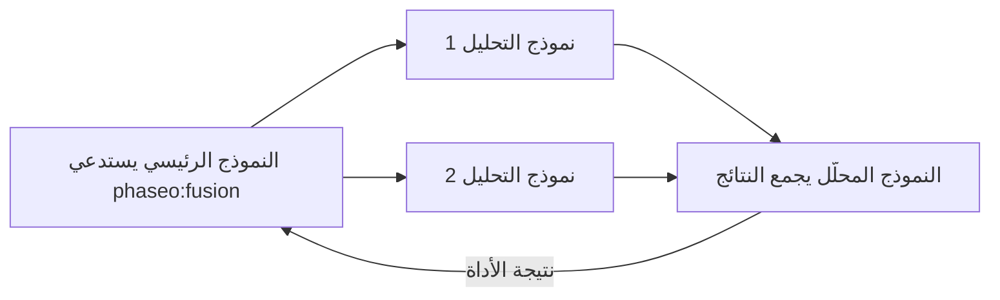

أضف `phaseo:fusion` عندما تستفيد الإجابة من عدة آراء مستقلة، مثل قرار تخطيطي أو تجميع بحثي أو مراجعة تصميم. عندما يستدعيها النموذج الرئيسي، يرسل Phaseo السؤال إلى كل نماذج التحليل بالتوازي، ويطلب من نموذج محلّل دمج نتائجها، ويعيد هذا التجميع. تضيف هذه الأداة زمن انتظار، لذا استخدم [Advisor](./advisor) واحدًا عندما تكفي جولة مراجعة واحدة.



```json
{
  "tools": [
    {
      "type": "phaseo:fusion",
      "parameters": {
        "analysis_models": ["anthropic/claude-opus-5", "openai/gpt-5"],
        "model": "google/gemini-pro-latest",
        "instructions": "Reconcile disagreements and return concise synthesis guidance.",
        "max_uses": 1,
        "max_completion_tokens": 1400
      }
    }
  ]
}
```

في Playground، تضبط قائمة أدوات الخادم الأمور نفسها: نماذج التحليل، ونموذج حَكَم (محلّل) اختياري، وحد الاستدعاءات.

## المعاملات

| المعامل | النوع | الافتراضي | الوصف |
| --- | --- | --- | --- |
| `analysis_models` | string[] | مطلوب | نموذجان على الأقل. العدد الأقل يؤدي إلى رفض الطلب. |
| `model` | string | نموذج الطلب | النموذج المحلّل الذي يكتب التجميع. |
| `instructions` | string | لا يوجد | تعليمات لاستدعاءات التحليل والمحلّل معًا. |
| `max_uses` | integer | `1` | عدد استدعاءات Fusion في كل طلب، حتى `4`. |
| `max_completion_tokens` | integer | `1400` | توكنات الإخراج لكل تحليل وللتجميع، حتى `32000`. |

## ما يرسله النموذج

`prompt`: السؤال الذي يحتاج إلى عدة وجهات نظر.

## ما تعيده الأداة

```json
{
  "status": "ok",
  "analyses": 2,
  "analysis": "Both reviewers flag the cutover order..."
}
```

يعدّ `analyses` نماذج التحليل التي أجابت. إذا فشل بعضها، يستخدم التجميع الباقي. نتائج الخطأ هي `fusion_invalid_request` (لا يوجد موجّه)، و`fusion_max_uses_exceeded`، و`fusion_panel_failed` (فشلت كل نماذج التحليل)، و`fusion_request_failed` (فشل المحلّل).

## الاستخدام والتسعير

يضيف كل استدعاء 1 إلى `usage.server_tool_use.fusion_requests` ويمكن احتسابه عبر `server_tool_fusion_requests`. يُحتسب كل استدعاء تحليل ومحلل بأسعار نموذجه، كبند مستقل في فاتورة الطلب، ولا تُضاف رموزه إلى عدد رموز النموذج المستدعي. وتتطلب النماذج المدفوعة رصيدًا حتى عندما يكون النموذج المستدعي مجانيًا.
