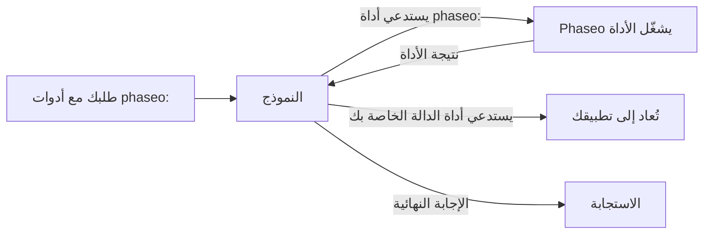

أضف أداة `phaseo:` إلى `tools` فيشغّلها Phaseo نيابةً عنك عندما يستدعيها النموذج: يطلب النموذج الوقت الحالي أو بحثًا على الويب أو رأي نموذج ثانٍ، فينفّذ Phaseo الاستدعاء ويعيد النتيجة إليه، ثم يُكمل النموذج إجابته. لا تحتاج إلى كتابة منفّذ للأدوات.



<Note>
أدوات الخادم في مرحلة تجريبية. قد تتغير أشكال الطلبات وحمولات النتائج مع تغيّر دعم المزوّدين.
</Note>

## الأدوات المتاحة

| الأداة | النوع | استخدمها لـ | نقاط النهاية |
| --- | --- | --- | --- |
| [التاريخ والوقت](./datetime) | `phaseo:datetime` | التاريخ والوقت الحاليان في حتى 5 مناطق زمنية | الثلاث كلها |
| [بحث الويب](./web-search) | `phaseo:web_search` | البحث على الويب عن معلومات حديثة أو موثّقة المصادر | الثلاث كلها |
| [جلب الويب](./web-fetch) | `phaseo:web_fetch` | قراءة نص URL محدد | الثلاث كلها |
| [Advisor](./advisor) | `phaseo:advisor` | طلب مراجعة أو خطة من نموذج آخر | الثلاث كلها |
| [Subagent](./subagent) | `phaseo:subagent` | تسليم مهمة مستقلة إلى نموذج عامل | الثلاث كلها |
| [Fusion](./fusion) | `phaseo:fusion` | الحصول على تحليل عدة نماذج، ثم تجميع واحد | الثلاث كلها |
| [البحث عن النماذج](./search-models) | `phaseo:search_models` | العثور على نموذج في كتالوج Phaseo المحدّث | الثلاث كلها |
| [إنشاء الصور](./image-generation) | `phaseo:image_generation` | إنشاء صورة أثناء الإجابة | الثلاث كلها |
| [تطبيق التصحيح](./apply-patch) | `phaseo:apply_patch` | إعادة تصحيحات ملفات تم التحقق منها | `/v1/responses` فقط |

"الثلاث كلها" تعني `/v1/chat/completions` و`/v1/responses` و`/v1/messages`.

## إرسال طلب

```bash
curl https://api.phaseo.app/v1/chat/completions \
  -H "Authorization: Bearer $PHASEO_API_KEY" \
  -H "Content-Type: application/json" \
  -d '{
    "model": "openai/gpt-6-astra",
    "messages": [
      { "role": "user", "content": "What are the latest AI policy updates this week?" }
    ],
    "tools": [
      { "type": "phaseo:web_search" },
      { "type": "phaseo:datetime", "parameters": { "timezones": ["Europe/London", "UTC"] } }
    ]
  }'
```

تأخذ كل أداة كائن `parameters` اختياريًا، موصوفًا في صفحتها. يعمل `stream: true` أيضًا: يشغّل Phaseo أدوار الأدوات بنفسه ويبث إليك الإجابة النهائية.

## دمج أدوات الخادم مع دوالك الخاصة

لا يشغّل Phaseo إلا أدوات `phaseo:`. تُعاد أداة `function` العادية في الطلب نفسه إلى تطبيقك كالمعتاد، وترسل نتيجتها في طلب متابعة، كما في [استدعاء الأدوات](../tool-calling).

```json
{
  "model": "openai/gpt-6-astra",
  "messages": [
    { "role": "user", "content": "Find recent funding news and save the best item." }
  ],
  "tools": [
    { "type": "phaseo:web_search", "parameters": { "max_results": 3 } },
    {
      "type": "function",
      "function": {
        "name": "save_research_item",
        "description": "Save a selected research item",
        "parameters": {
          "type": "object",
          "properties": {
            "title": { "type": "string" },
            "url": { "type": "string" }
          },
          "required": ["title", "url"]
        }
      }
    }
  ]
}
```

## حدود حلقة الأدوات

| الحد | القيمة | عند بلوغه |
| --- | --- | --- |
| استدعاءات أدوات الخادم لكل طلب | `max_tool_calls` في الطلب، الافتراضي `30`، والحد الأقصى `100` | `400 gateway_server_tool_limit` |
| أدوار المتابعة | `8` | `502 gateway_server_tool_error` |
| الاستدعاءات لأداة واحدة | قيمة `max_uses` لتلك الأداة | تعيد الأداة نتيجة خطأ إلى النموذج، الذي يمكنه المتابعة بدونها |

## الاستخدام والتسعير

تضيف كل أداة خادم عدّادًا إلى `usage.server_tool_use`، ويمكن لبطاقة أسعار النموذج احتساب العدّاد المقابل. تُضاف التوكنات التي يستخدمها نموذج ثانٍ (Advisor وSubagent وFusion وإنشاء الصور) إلى استخدام الطلب وتُسعَّر بأسعار ذلك النموذج.

```json
{
  "usage": {
    "input_tokens": 105,
    "output_tokens": 250,
    "server_tool_use": {
      "datetime_requests": 1,
      "web_search_requests": 2,
      "web_search_results": 8
    }
  }
}
```

| الأداة | عدّاد الاستخدام | عدّاد التسعير |
| --- | --- | --- |
| التاريخ والوقت | `datetime_requests` | لا يوجد |
| بحث الويب | `web_search_requests`، `web_search_results`، `web_search_extra_results` | `server_tool_web_search_requests`، `server_tool_web_search_extra_results` |
| جلب الويب | `web_fetch_requests` | `server_tool_web_fetch_requests` |
| Advisor | `advisor_requests` | `server_tool_advisor_requests` |
| Subagent | `subagent_requests` | `server_tool_subagent_requests` |
| Fusion | `fusion_requests` | `server_tool_fusion_requests` |
| البحث عن النماذج | `search_models_requests` | `server_tool_search_models_requests` |
| إنشاء الصور | `image_generation_requests` | `server_tool_image_generation_requests` |
| تطبيق التصحيح | `apply_patch_requests` | `server_tool_apply_patch_requests` |

عندما يعمل بحث الويب أو جلب الويب كأداة المزوّد الخاصة (`engine: "native"`)، يُحتسب باستخدام `native_web_search_requests` أو `native_web_fetch_requests` بدلًا من ذلك.
