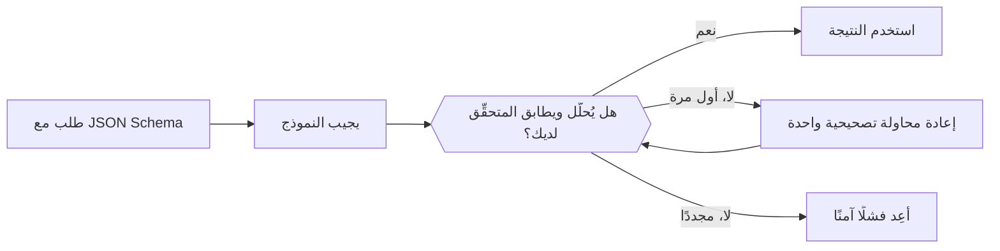

أرسل JSON Schema مع الطلب فيعيد النموذج JSON بهذا الشكل بدلًا من النص الحر. ويظل على شيفرتك تحليله والتحقق منه قبل استخدامه.



## اختيار تنسيق

| `type` | ما تحصل عليه |
| --- | --- |
| `json_schema` | JSON يتبع المخطط الذي ترسله. استخدمه افتراضيًا. |
| `json_object` | كائن JSON صالح ما، دون فرض شكل معيّن. |
| `text` | نص عادي (الافتراضي). |

يعتمد موضع التنسيق على نقطة النهاية:

| نقطة النهاية | الحقل |
| --- | --- |
| `/v1/chat/completions` | `response_format` |
| `/v1/responses` | `text.format` |
| `/v1/messages` | غير مدعوم. اطلب JSON في الموجّه وتحقّق منه بالطريقة نفسها. |

## إرسال مخطط

<CodeGroup>
```bash Chat Completions
curl https://api.phaseo.app/v1/chat/completions \
  -H "Authorization: Bearer $PHASEO_API_KEY" \
  -H "Content-Type: application/json" \
  -d '{
    "model": "openai/gpt-6-astra",
    "messages": [
      { "role": "user", "content": "Return the city and weather for London." }
    ],
    "response_format": {
      "type": "json_schema",
      "json_schema": {
        "name": "weather",
        "strict": true,
        "schema": {
          "type": "object",
          "properties": {
            "city": { "type": "string" },
            "weather": { "type": "string" }
          },
          "required": ["city", "weather"],
          "additionalProperties": false
        }
      }
    }
  }'
```

```bash Responses
curl https://api.phaseo.app/v1/responses \
  -H "Authorization: Bearer $PHASEO_API_KEY" \
  -H "Content-Type: application/json" \
  -d '{
    "model": "openai/gpt-6-astra",
    "input": "Return the city and weather for London.",
    "text": {
      "format": {
        "type": "json_schema",
        "name": "weather",
        "strict": true,
        "schema": {
          "type": "object",
          "properties": {
            "city": { "type": "string" },
            "weather": { "type": "string" }
          },
          "required": ["city", "weather"],
          "additionalProperties": false
        }
      }
    }
  }'
```
</CodeGroup>

يعود JSON في صورة سلسلة نصية داخل محتوى الرسالة:

```json
{
  "choices": [
    {
      "finish_reason": "stop",
      "message": {
        "role": "assistant",
        "content": "{\"city\":\"London\",\"weather\":\"Cloudy\"}"
      }
    }
  ]
}
```

## تصميم المخطط

ابدأ بكائن صغير. أدرج كل حقل في `required`، واستخدم `enum` للفئات المعروفة، وعيّن `additionalProperties: false` عندما يجب رفض المفاتيح الإضافية. أدِر إصدارات المخطط مع المتحقِّق على الخادم معًا حتى لا يختلفا أبدًا.

<span id="validate-the-result"></span>
## التحقق من النتيجة

تحقّق من وجود رفض أو محتوى مفقود أو إجابة مبتورة (`finish_reason` غير `stop`) قبل التحليل. ثم تحقّق من الكائن المحلَّل. يطابق متحقِّق Zod هذا المخطط أعلاه:

```typescript
import { z } from "zod";

const Weather = z.object({
  city: z.string(),
  weather: z.string(),
}).strict();

function parseWeather(content: string) {
  return Weather.parse(JSON.parse(content));
}
```

إذا فشل التحقق، فأعد المحاولة مرة واحدة مع إدراج الخطأ في الموجّه، ثم أعِد فشلًا آمنًا. تُفرض رسوم على كل إعادة محاولة. ولا يثبت JSON الصالح أن القيم صحيحة أو أن إجراءً ما مصرّح به.

تتبّع إخفاقات التحقق لكل نموذج وإصدار مخطط، وأعد تشغيل حالات التقييم لديك عندما يتغير أي منهما. لإصلاح JSON غير السليم تلقائيًا، راجع [إصلاح الاستجابة](../cookbook/response-healing-for-structured-json.mdx).
