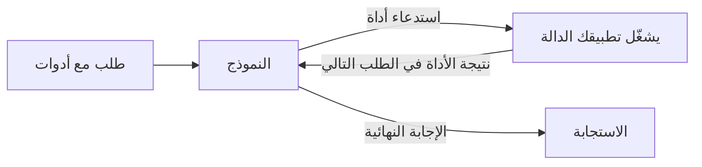

صِف دوالك في `tools`، فيجيب النموذج باستدعاء إحداها، مثل استعلام في قاعدة بيانات أو التحقق من الطقس، بدلًا من التخمين. يشغّل تطبيقك الدالة ويعيد النتيجة؛ ثم يكتب النموذج الإجابة النهائية.



يعمل استدعاء الأدوات على نقاط نهاية النص الثلاث كلها، ولكل منها تنسيقها:

| نقطة النهاية | استدعاء النموذج | نتيجتك |
| --- | --- | --- |
| `/v1/chat/completions` | `tool_calls` في رسالة المساعد، و`finish_reason: "tool_calls"` | رسالة `role: "tool"` |
| `/v1/responses` | عنصر إخراج `function_call` | عنصر إدخال `function_call_output` |
| `/v1/messages` | كتلة محتوى `tool_use` | كتلة محتوى `tool_result` |

## إرسال طلب مع أدوات

```bash
curl https://api.phaseo.app/v1/chat/completions \
  -H "Authorization: Bearer $PHASEO_API_KEY" \
  -H "Content-Type: application/json" \
  -d '{
    "model": "openai/gpt-6-astra",
    "messages": [
      { "role": "user", "content": "What is the weather in London?" }
    ],
    "tools": [
      {
        "type": "function",
        "function": {
          "name": "get_weather",
          "description": "Get current weather by city",
          "parameters": {
            "type": "object",
            "properties": {
              "city": { "type": "string" }
            },
            "required": ["city"]
          }
        }
      }
    ],
    "tool_choice": {
      "type": "function",
      "function": { "name": "get_weather" }
    }
  }'
```

يفرض `tool_choice` هنا الاستدعاء. احذفه، أو عيّنه إلى `"auto"`، ليقرر النموذج بنفسه.

يردّ النموذج باستدعاء بدلًا من نص:

```json
{
  "id": "chatcmpl_...",
  "object": "chat.completion",
  "choices": [
    {
      "index": 0,
      "finish_reason": "tool_calls",
      "message": {
        "role": "assistant",
        "content": null,
        "tool_calls": [
          {
            "id": "call_123",
            "type": "function",
            "function": {
              "name": "get_weather",
              "arguments": "{\"city\":\"London\"}"
            }
          }
        ]
      }
    }
  ]
}
```

حلّل `arguments` وتحقّق منها قبل تشغيل أي شيء؛ راجع [سلامة استدعاء الأدوات](./tool-calling-safety). ثم أرسل رسالة المساعد ونتيجتك في الطلب التالي. تعرض صفحة [أنماط استدعاء الأدوات](./tool-calling-patterns) طلب المتابعة هذا لـ Chat Completions وResponses.

## ترك Phaseo يشغّل الأداة

الأدوات التي يبدأ نوعها بـ `phaseo:` تعمل على جانب Phaseo: يستدعيها النموذج، وينفّذها Phaseo ويواصل الحلقة، وتحصل أنت على الإجابة النهائية دون كتابة منفِّذ. يمكنك مزجها مع دوالك الخاصة في طلب واحد.

| الأداة | النوع |
| --- | --- |
| [التاريخ والوقت](./server-tools/datetime) | `phaseo:datetime` |
| [بحث الويب](./server-tools/web-search) | `phaseo:web_search` |
| [Web Fetch](./server-tools/web-fetch) | `phaseo:web_fetch` |
| [Advisor](./server-tools/advisor) | `phaseo:advisor` |
| [Subagent](./server-tools/subagent) | `phaseo:subagent` |
| [Fusion](./server-tools/fusion) | `phaseo:fusion` |
| [البحث عن النماذج](./server-tools/search-models) | `phaseo:search_models` |
| [إنشاء الصور](./server-tools/image-generation) | `phaseo:image_generation` |
| [تطبيق التصحيح](./server-tools/apply-patch) | `phaseo:apply_patch` (في Responses فقط) |

```json
{
  "tools": [
    { "type": "phaseo:datetime", "parameters": { "timezones": ["Europe/London", "UTC"] } }
  ],
  "tool_choice": "auto"
}
```

راجع [أدوات الخادم](./server-tools) للاطلاع على الحدود وعدّادات الاستخدام والأسعار.

## بث استدعاءات الأدوات

تقبل طلبات استدعاء الأدوات `stream: true`. تصل معاملات استدعاء الدالة على أجزاء؛ اجمعها كلها قبل تحليل الاستدعاء. عندما تعمل أداة خادم، ينهي Phaseo دور تلك الأداة، ويشغّلها، ويواصل النموذج، ويبث لك بقية الإجابة، فيظل عميلك يقرأ تدفقًا واحدًا. راجع [البث](./streaming).

للإجابات التي يجب أن تطابق مخططًا بدلًا من استدعاء دالة، استخدم [المخرجات المنظّمة](./structured-outputs).
