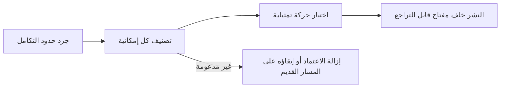

ابحث عن كل إمكانية يستخدمها تكامل البوابة الحالي لديك، ثم نفّذ ما يذكره العمود الأخير قبل نقل الحركة. آخر مراجعة: 4 نوفمبر 2026.

نفّذ الترحيل بهذا الترتيب. فهو يكشف السلوكيات التي قد تتغير حتى عندما تقبل المنصتان طلب OpenAI المتوافق نفسه.

## جرد حدود التكامل

سجّل كل موضع تظهر فيه البوابة الحالية، حتى لا يترك الترحيل مسار إعداد ثانيًا مخفيًا:

- عناوين URL الأساسية ومتغيرات البيئة لمفاتيح API؛
- تهيئة SDK والترويسات المخصصة؛
- معرّفات النماذج والنماذج الاحتياطية؛
- ترتيب المزوّدين وقوائم السماح ومتطلبات الخصوصية؛
- شيفرة البث واستدعاء الأدوات والمخرجات المنظّمة؛
- مهام الدُفعات والملفات وخطافات الويب واستطلاع حالة المهام غير المتزامنة؛
- إسناد الطلبات وبيانات المستخدم أو الجلسة الوصفية.

## الطلبات

| الإمكانية | على Phaseo | قبل التحويل |
| --- | --- | --- |
| المصادقة | `Authorization: Bearer $PHASEO_API_KEY` | غيّر عنوان URL الأساسي والمفتاح، ثم أرسل طلبًا واحدًا موثّقًا. |
| Chat Completions | `/v1/chat/completions` | اختبر الطلبات العادية والمتدفقة وطلبات استدعاء الأدوات والمخرجات المنظّمة. تعيد الحقول غير المعروفة في المستوى الأعلى `400`. |
| Responses | `/v1/responses`، دون حالة مخزّنة | اختبر تنسيقات الإدخال وأحداث البث والأدوات والتحليل. يعيد `previous_response_id` و`conversation` الخطأ `400`؛ أرسل السجل الكامل. |
| Anthropic Messages | `/v1/messages` على المضيف الجذر `https://api.phaseo.app` | مرّر المفتاح كرمز bearer، وراجع كل ترويسة `anthropic-beta`؛ فـ Phaseo لا يمررها. |
| معرّفات النماذج | `<org>/<model>` | تحقّق من كل معرّف إنتاج في `GET /v1/models?format=openai`. لا تفترض تطابق الأسماء المستعارة. |
| التضمينات والصور والصوت والإشراف | مدعومة حسب النموذج والمزوّد | تأكد من أن النموذج يدعم العملية. |

## التوجيه والسياسات

| الإمكانية | على Phaseo | قبل التحويل |
| --- | --- | --- |
| النماذج الاحتياطية | مصفوفة `models`، من 1 إلى 25 إدخالًا | تعمل النماذج الاحتياطية عند `429` و`500` و`502` و`503` و`504`، ولا تعمل أبدًا عند أخطاء الطلب. |
| ترتيب المزوّدين | `provider.order` | أعد إنشاء الترتيب الذي لا يزال عبء العمل يحتاجه فقط. |
| قوائم السماح والتجاهل للمزوّدين | `provider.only` و`provider.ignore` | تحقّق من معرّفات المزوّدين ومن بقاء مسار واحد على الأقل. |
| الفرز حسب السعر أو زمن الاستجابة أو الإنتاجية | `provider.sort` | بعد الاختبار، تحقّق من المزوّد المختار في تفاصيل الطلب. |
| عدم الاحتفاظ بالبيانات | `provider.require_zero_data_retention` (الاسم البديل `provider.zdr`) | تأكد من وجود مزوّد مطابق للنموذج قبل فرضه. |
| التنفيذ الإقليمي وإقامة البيانات | `provider.required_execution_region` و`provider.required_data_region` وإعدادات الخصوصية الافتراضية لمساحة العمل | اختبر كلًا من المسار الناجح وخطأ عدم وجود مزوّد مطابق. |
| المطالبات والإعدادات الافتراضية المشتركة | [الإعدادات المسبقة](../guides/presets) | انقل الإعدادات المشتركة إلى إعداد مسبق بدلًا من نسخها إلى كل مستدعٍ. |

## العمليات

| الإمكانية | على Phaseo | قبل التحويل |
| --- | --- | --- |
| إسناد التطبيق | `X-App-Id` و`X-App-Name` و`HTTP-Referer` و`X-Title` و`X-App-Categories` | احتفظ بالترويسات التي تصف التطبيق المستدعي؛ فإسقاطها أثناء الترحيل يصعّب مقارنة التكلفة والاستخدام. تحقّق من تجميع التطبيقات في لوحة التحكم. راجع [إسناد التطبيق](../guides/app-attribution) لقيم الفئات. |
| تسميات التكلفة | تسميات `X-Phaseo-Metadata` | اربط الخصائص المخصصة أو الوسوم بالتسميات. |
| تفاصيل الطلب | سجلات الطلبات و`GET /v1/generations?id=<request_id>` | قارن المزوّد وزمن الاستجابة واستخدام الرموز والسعر لمطالبات تمثيلية. |
| إعادة التشغيل | `replay_request` عندما تكون قيمة `replay_supported` هي `true` | تأكد من إمكانية استعادة نقطة النهاية والحمولة لطلب فاشل. |
| مهام الدُفعات والمهام غير المتزامنة | واجهات API للدُفعات والملفات والفيديو وخطافات الويب وWebSocket | تحقّق من انتقالات الحالة والفوترة النهائية والإلغاء واسترجاع النتائج. يحتفظ `/v1/files` بمدخلات الدُفعات فقط. |
| حدود المعدّل | حصة طلبات في الدقيقة لكل مستخدم، تبدأ من 10 لمساحة العمل الجديدة | قد يصل إليها وكيل يرسل حركة فريق كامل عبر مالك مفتاح واحد. راجع [الحدود](../api-reference/limits). |
| النشر التدريجي | تقسيم الحركة في العميل أو البنية التحتية | أبقِ التراجع مجرد تغيير لعنوان URL الأساسي والمفتاح حتى يستقر التحويل. |

## غير متوفر

لا يوجد لهذه مقابل في Phaseo. أبقِها في التطبيق أو على المنصة القديمة:

- **تخزين الاستجابات مؤقتًا.** لا يخزّن Phaseo الاستجابات مؤقتًا. لكن [التخزين المؤقت للمطالبات](../guides/prompt-caching) لا يزال يخفّض تكلفة الإدخال.
- **الاستجابات والمحادثات المخزّنة.** لا يوجد `GET` أو `DELETE /v1/responses/{id}`.
- **عدّ الرموز** (`/v1/messages/count_tokens`).
- **OpenAI Assistants وThreads ومخازن المتجهات والضبط الدقيق و`/v1/completions` القديمة.**

## تصنيف كل إمكانية

امنح كل سلوك إنتاجي حالة واحدة، باستخدام الجداول أعلاه والدليل الخاص بـ [منصتك المصدر](./index#platform-migrations):

| الحالة | المعنى |
| --- | --- |
| دون تغيير | تم التحقق من حقل الطلب نفسه وسلوك الاستجابة نفسه. |
| مُقابَلة | يعطي Phaseo النتيجة نفسها عبر حقل أو إعداد مختلف. |
| مُكيَّفة | تترجم طبقة توافق الطلب أو الاستجابة. |
| غير مدعومة | أزل الاعتماد أو أبقِ عبء العمل هذا على مساره الحالي. |
| غير متحقق منها | قد يكون الدعم موجودًا، لكن لا يوجد دليل شبيه بالإنتاج بعد. |

## التحقق على حركتك الفعلية

لا يجعل توافق API هذه العناصر تتصرف بالطريقة نفسها:

- الاختيار التلقائي للمزوّد وترتيب النماذج الاحتياطية؛
- تقارب ذاكرة التخزين المؤقت للمطالبات وتسعيرها؛
- حقول الطلب الخاصة بالمزوّد والبيانات الوصفية الخاصة بالاستجابة فقط؛
- حدود المعدّل وتوقيت إعادة المحاولة؛
- سياسات الاحتفاظ بالبيانات وإقامتها والتدريب عليها؛
- التوفر الدقيق للنماذج وأسعارها.

أنشئ مجموعة اختبار صغيرة من أنماط عبء العمل الحقيقية، دون نسخ بيانات إنتاج حساسة، ثم شغّل:

1. طلبًا عاديًا واحدًا لكل نقطة نهاية مستخدمة؛
2. البث عبر مسار العميل نفسه المستخدم في الإنتاج؛
3. استدعاءات الأدوات والمخرجات المنظّمة بمخططات واقعية؛
4. كل قيد على المزوّد أو الخصوصية؛
5. المفاتيح غير الصالحة والنماذج غير الصالحة وحدود المعدّل وحالات فشل عدم توفر المزوّد؛
6. مهام الدُفعات أو المهام غير المتزامنة عبر النجاح والفشل والإلغاء.

قارن جودة المخرجات وزمن الاستجابة واستخدام الرموز والمزوّد المختار والتكلفة النهائية. سجّل معرّف كل طلب لتتمكن من فحصه في سجلات الطلبات أو باستخدام `GET /v1/generations?id=<request_id>`.

## النشر باستخدام مفتاح قابل للتراجع

ابدأ بحركة التطوير والحركة الداخلية. لا تنقل حصة صغيرة من الإنتاج إلا بعد نجاح مجموعة الاختبار، وأبقِ التراجع مقتصرًا على عنوان URL الأساسي والمفتاح حتى تستقر النتائج. لا تجمع التحويل مع تغييرات في المطالبات أو النماذج أو التوجيه؛ أجرِها بعد التحقق من حدود البوابة.
