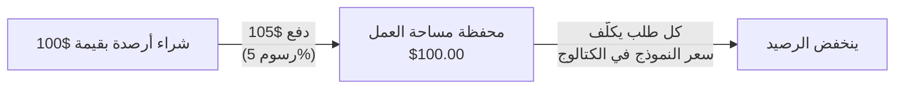

اشترِ الأرصدة مرة واحدة وأنفقها على الطلبات بسعر الكتالوج لكل نموذج. الرسوم الوحيدة التي يفرضها Phaseo على الطلبات المُدارة هي 5% من كل عملية شراء للأرصدة، بحد أدنى $1؛ ولا تحمل الطلبات نفسها أي هامش إضافي.

## تكلفة الشحن

الرسوم هي القيمة الأكبر بين 5% من الأرصدة التي تشتريها و$1. وتُضاف إلى المبلغ الذي تدفعه.

| الأرصدة التي تشتريها | الرسوم | ما تدفعه |
| ---: | ---: | ---: |
| $5.00 | $1.00 (الحد الأدنى) | $6.00 |
| $20.00 | $1.00 | $21.00 |
| $100.00 | $5.00 | $105.00 |
| $1,000.00 | $50.00 | $1,050.00 |

وبالعكس، تضيف دفعة بقيمة $100.00 أرصدة بقيمة $95.24 ورسومًا بقيمة $4.76. تبدأ عمليات الشحن من لوحة التحكم من $5.

اشترِ الأرصدة من **الإعدادات -> الفوترة -> الفوترة والأرصدة**، أو من الطرفية باستخدام `phaseo credits add --amount <usd>` (راجع [البدء السريع](../quickstart#add-credits-for-paid-models)). تعرض الصفحة نفسها رصيدك والرسوم الحالية والإنفاق الأخير؛ وتسرد **الإعدادات -> الفوترة -> المعاملات** كل عملية شراء.

## ما الذي لا يستخدم الأرصدة

| الاستخدام | رسوم Phaseo |
| --- | --- |
| النماذج المجانية (`phaseo/free` والنماذج المسعّرة بـ $0) | لا شيء. لطلبات النماذج المجانية حصة يومية؛ راجع [الخطط](../exploring/subscription-plans). |
| استخدام مفتاحك الخاص (BYOK) | لا يلزم شحن. أول 250,000 طلب BYOK مكتمل لكل مساحة عمل في كل شهر بتوقيت UTC بلا رسوم خدمة، ثم 2.5% من التكلفة المكافئة لدى المزوّد. يفوترك المزوّد على استخدام النموذج. راجع [اعتبارات BYOK](../guides/routing-and-fallbacks#byok-considerations). |

## Enterprise

Self Serve Enterprise اشتراك شهري منفصل يوفّر SSO وSCIM وإدارة الدليل والأقسام ودعم البريد الإلكتروني ذا الأولوية. يبدأ من $29 شهريًا لما يصل إلى 100 عضو في مساحة العمل، ويبلغ $79 شهريًا عند 1,000 عضو. لا يتضمن أرصدة ولا يغيّر رسوم 5% (بحد أدنى $1). تحتوي صفحة [الخطط](../exploring/subscription-plans#enterprise-member-pricing) على التسعير الكامل للأعضاء وطريقة احتساب الأعضاء.

للفوترة بالفواتير أو المشتريات أو الشروط التجارية المخصصة، تواصل مع [مركز المساعدة](https://phaseo.app/help). لا يحتاج الاستخدام القياسي لـ Gateway إلى Enterprise.
