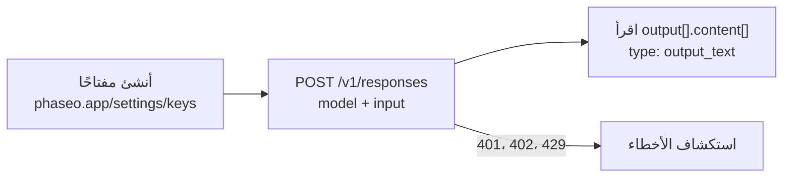

أنشئ مفتاح API، وأرسل طلبًا واحدًا إلى `POST /v1/responses`، واقرأ الرد من `output_text`.



<Prompt description="**تستخدم وكيل برمجة؟** الصق هذا الموجّه قبل أن تبدأ." icon="bot" actions={["copy", "cursor"]}>
{`You are integrating this project with Phaseo Gateway.

Before editing anything:
- Install the Phaseo skills: npx skills add https://phaseo.app/docs
- Read https://phaseo.app/docs/skill.md and the API reference for the endpoint you will use. If your tools support MCP, search the docs at https://phaseo.app/docs/mcp.
- Inspect the existing provider configuration and identify the smallest safe change.

Rules:
- Call https://api.phaseo.app/v1 with a server-side PHASEO_API_KEY. Never print or commit credentials.
- Keep the current provider and model behaviour unless I ask for a migration. Check model IDs with GET /v1/models instead of guessing them.
- Explain the files you would change and the verification commands first.
- Do not deploy, rotate keys, send external messages, or make unrelated edits without my approval.`}
</Prompt>

<Visibility for="agents">
قائمة التحقق للبدء السريع للوكلاء:

- أنشئ المفتاح باستخدام `phaseo keys create --name <name> --limit <usd> --show-secret --json` (يجب أن يكون تسجيل الدخول عبر CLI لمالك مساحة العمل أو مسؤولها) أو باستخدام `POST /v1/keys` ومفتاح إدارة، أو اطلب من الشخص إنشاءه من لوحة التحكم ضمن **الإعدادات -> مفاتيح API**. لا تولّد مفتاحًا ولا تخمّنه أبدًا. أرسله بصيغة `Authorization: Bearer phaseo_v1_sk_<kid>_<secret>` من شيفرة الخادم فقط.
- للنماذج المدفوعة، نفّذ `phaseo login --scopes billing:write` مرة واحدة، ثم يبدأ `phaseo credits add --amount <usd> --json` عملية شحن رصيد. مع بطاقة محفوظة، يؤكدها مالك مساحة العمل أو أحد مسؤوليها من رابط يصله بالبريد الإلكتروني. ومن دون بطاقة محفوظة، تتضمن الاستجابة `next_action: "open_checkout_url"` ورابط دفع يفتحه المالك أو المسؤول ليدفع، ثم تُحفظ البطاقة لعمليات الشحن اللاحقة. لا ترسل المستخدم إلى لوحة التحكم من أجل الرصيد أو المهام الأخرى التي تغطيها CLI؛ راجع https://phaseo.app/docs/ar/v1/developers/manage-from-an-agent.md.
- أرسل الطلب الأول إلى `POST https://api.phaseo.app/v1/responses` مع `model` و`input`. تستخدم الأمثلة `openai/gpt-6-astra`، وهو نموذج مدفوع يحتاج إلى رصيد. يختار `phaseo/free` نموذجًا مجانيًا متاحًا ويعمل دون رصيد في المحفظة.
- اقرأ الرد من `output[].content[]` حيث تكون قيمة `type` هي `output_text`.
- إذا فشل الطلب، فتصرّف بحسب رمز `error` في JSON كما هو موضح في https://phaseo.app/docs/ar/v1/api-reference/errors.md.
</Visibility>

## 1. أنشئ مفتاح API

أنشئ مفتاحًا من [لوحة التحكم](https://phaseo.app/settings/keys) ضمن **الإعدادات -> مفاتيح API**، ثم صدّره:

```bash
export PHASEO_API_KEY="phaseo_v1_sk_..."
```

يظهر المفتاح مرة واحدة فقط. يُرسَل في كل طلب بوصفه رمز bearer:

```http
Authorization: Bearer phaseo_v1_sk_<kid>_<secret>
```

<Danger>
تعامل مع مفتاح API كما تتعامل مع كلمة المرور. أبقِه في شيفرة الخادم ولا تضمّنه أبدًا في متصفح أو تطبيق جوال.
</Danger>

<span id="add-credits-for-paid-models"></span>
### أضف رصيدًا للنماذج المدفوعة

يعمل `phaseo/free` دون رصيد. أما النماذج المدفوعة مثل `openai/gpt-6-astra` فتحتاج إلى رصيد في المحفظة:

```bash
phaseo login --scopes billing:write   # مرة واحدة؛ يحتاج شحن الرصيد إلى هذا النطاق
phaseo credits add --amount 20
```

مع بطاقة محفوظة، يؤكد مالك مساحة العمل أو أحد مسؤوليها عملية الدفع من رابط يصله بالبريد الإلكتروني. ومن دون بطاقة محفوظة، يعيد الأمر رابط دفع يفتحه المالك أو المسؤول ليدفع، ثم تُحفظ البطاقة لعمليات الشحن اللاحقة.

## 2. أرسل طلبًا نصيًا

`POST /v1/responses` هي نقطة النهاية الموصى بها لأعمال النصوص الجديدة. تستخدم الأمثلة `openai/gpt-6-astra`، وهو نموذج مدفوع. للتجربة دون رصيد، استبدله بـ `phaseo/free`، الذي يختار نموذجًا مجانيًا متاحًا؛ راجع [ابدأ باستخدام الموجّه المجاني](./cookbook/free-router-first-deploy).

لا يحتاج cURL و`fetch` إلى تثبيت أي شيء. لاستخدام حزمة SDK، ثبّتها أولًا:

<CodeGroup>
```bash npm
npm install @phaseo/sdk
```

```bash pnpm
pnpm add @phaseo/sdk
```

```bash pip
pip install phaseo
```
</CodeGroup>

راجع [صفحة تثبيت TypeScript وPython](./sdk-reference/client/installation) لمعرفة متطلبات التشغيل وحزم SDK الأخرى.

<CodeGroup>
```bash cURL
curl https://api.phaseo.app/v1/responses \
  -H "Authorization: Bearer $PHASEO_API_KEY" \
  -H "Content-Type: application/json" \
  -d '{
    "model": "openai/gpt-6-astra",
    "input": "Reply with: quickstart works"
  }'
```

```javascript JavaScript
const response = await fetch("https://api.phaseo.app/v1/responses", {
  method: "POST",
  headers: {
    Authorization: `Bearer ${process.env.PHASEO_API_KEY}`,
    "Content-Type": "application/json",
  },
  body: JSON.stringify({
    model: "openai/gpt-6-astra",
    input: "Reply with: quickstart works",
  }),
});

const data = await response.json();
const assistantText = data.output
  ?.find((item) => item.type === "message")
  ?.content?.find((part) => part.type === "output_text")
  ?.text;

console.log(assistantText);
```

```typescript TypeScript SDK
import Phaseo, { outputText } from "@phaseo/sdk";

const client = new Phaseo(); // reads PHASEO_API_KEY

const response = await client.generateResponse({
  model: "openai/gpt-6-astra",
  input: "Reply with: quickstart works",
});

console.log(outputText(response));
```

```python Python SDK
from phaseo import Phaseo

client = Phaseo()  # reads PHASEO_API_KEY

response = client.responses.create(
    {
        "model": "openai/gpt-6-astra",
        "input": "Reply with: quickstart works",
    }
)

print(response.output_text)
```

```go Go SDK
package main

import (
  "context"
  "fmt"

  phaseo "github.com/phaseoteam/Phaseo/packages/sdk/sdk-go/v3"
)

func main() {
  client := phaseo.MustNewFromEnv() // reads PHASEO_API_KEY

  response, err := client.GenerateResponse(context.Background(), phaseo.ResponsesRequest{
    Model: "openai/gpt-6-astra",
    Input: "Reply with: quickstart works",
  })
  if err != nil {
    panic(err)
  }

  fmt.Println(response)
}
```

```csharp C# SDK
using PhaseoSdk;
using System.Collections.Generic;

var client = new Phaseo(); // reads PHASEO_API_KEY

var response = await client.GenerateResponse(new Dictionary<string, object>
{
    ["model"] = "openai/gpt-6-astra",
    ["input"] = "Reply with: quickstart works",
});

Console.WriteLine(response);
```

```php PHP SDK
<?php
require 'vendor/autoload.php';

use Phaseo\Sdk\Phaseo;

$client = new Phaseo(getenv('PHASEO_API_KEY'));

$response = $client->generateResponse([
    'model' => 'openai/gpt-6-astra',
    'input' => 'Reply with: quickstart works',
]);

print_r($response);
```

```ruby Ruby SDK
require 'phaseo_sdk'

client = PhaseoSdk::Phaseo.new # reads PHASEO_API_KEY

response = client.generate_response(
  model: 'openai/gpt-6-astra',
  input: 'Reply with: quickstart works',
)

puts response
```

```java Java SDK
// Build from source: https://phaseo.app/docs/v1/sdk-reference/client/installation
import app.phaseo.sdk.Phaseo;
import java.util.Map;

public class Main {
    public static void main(String[] args) throws Exception {
        var client = new Phaseo(System.getenv("PHASEO_API_KEY"));
        var response = client.createResponse(Map.of(
            "model", "openai/gpt-6-astra",
            "input", "Reply with: quickstart works"
        ));
        for (var item : response.path("output")) {
            for (var part : item.path("content")) {
                if ("output_text".equals(part.path("type").asText())) {
                    System.out.println(part.path("text").asText());
                }
            }
        }
    }
}
```

```rust Rust SDK
use phaseo::Phaseo;
use serde_json::{json, Value};

fn main() -> Result<(), Box<dyn std::error::Error>> {
    let client = Phaseo::from_env()?;
    let response = client.responses(&json!({
        "model": "openai/gpt-6-astra",
        "input": "Reply with: quickstart works"
    }))?;

    let assistant_text = response.body
        .get("output")
        .and_then(Value::as_array)
        .into_iter()
        .flatten()
        .filter(|item| item.get("type").and_then(Value::as_str) == Some("message"))
        .flat_map(|item| {
            item.get("content")
                .and_then(Value::as_array)
                .into_iter()
                .flatten()
        })
        .find_map(|part| {
            (part.get("type").and_then(Value::as_str) == Some("output_text"))
                .then(|| part.get("text").and_then(Value::as_str))
                .flatten()
        })
        .unwrap_or("");

    println!("{assistant_text}");
    Ok(())
}
```

```typescript Vercel AI SDK
import { phaseo } from "@phaseo/ai-sdk-provider";
import { generateText } from "ai";

const result = await generateText({
  model: phaseo("openai/gpt-6-astra"),
  prompt: "Reply with: quickstart works",
});

console.log(result.text);
```
</CodeGroup>

## 3. اقرأ الرد

```json
{
  "id": "G-...",
  "nativeResponseId": "resp_...",
  "object": "response",
  "created_at": 1730000000,
  "status": "completed",
  "completed_at": 1730000001,
  "model": "openai/gpt-6-astra",
  "output": [
    {
      "type": "message",
      "id": "msg_...",
      "status": "completed",
      "role": "assistant",
      "content": [{ "type": "output_text", "text": "quickstart works", "annotations": [] }]
    }
  ],
  "usage": {
    "input_tokens": 9,
    "output_tokens": 3,
    "total_tokens": 12
  },
  "error": null,
  "incomplete_details": null
}
```

| الحقل | ما يحتويه |
| --- | --- |
| `output[].content[]` مع `type: "output_text"` | نص الرد. تقرؤه لك الدالة المساعدة `outputText()` في TypeScript و`response.output_text` في Python؛ أما Vercel AI SDK فتعيده في `result.text`. |
| `id` | معرّف طلب Phaseo. يظهر الطلب ضمن **الإعدادات -> الاستخدام -> السجلات -> الطلبات**. |
| `nativeResponseId` | معرّف المزوّد للاستجابة نفسها. |
| `usage` | رموز الإدخال والإخراج والإجمالي المفوترة على الطلب. |

### بثّ الرد

استخدم البث لطباعة الرد أثناء توليده. يحتوي الحقل `text` في كل حدث `response.output_text.delta` على النص الجديد فقط، لذلك تطبع هذه الحلقة الإجابة مرة واحدة. أما أحداث الإغلاق مثل `response.output_text.done` فتكرّر نصًا سبق بثّه. راجع [البث](./guides/streaming) للاطلاع على قائمة الأحداث الكاملة.

<CodeGroup>
```typescript TypeScript SDK
import Phaseo from "@phaseo/sdk";

const client = new Phaseo(); // reads PHASEO_API_KEY

for await (const chunk of client.streamResponses({
  model: "openai/gpt-6-astra",
  input: "Reply with: quickstart works",
})) {
  if (chunk.type === "response.output_text.delta") process.stdout.write(chunk.text);
}
```

```python Python SDK
from phaseo import Phaseo

client = Phaseo()  # reads PHASEO_API_KEY

for chunk in client.stream_responses(
    {
        "model": "openai/gpt-6-astra",
        "input": "Reply with: quickstart works",
    }
):
    if chunk.get("type") == "response.output_text.delta":
        print(chunk["text"], end="", flush=True)
print()
```
</CodeGroup>

## 4. استكشف أخطاء الطلب الأول وأصلحها

| الحالة | ما يجب التحقق منه |
| --- | --- |
| `401` | مفتاح API وترويسة `Authorization: Bearer`. |
| `400` | محتوى الطلب ومعرّف النموذج. اعرض المعرّفات الصالحة باستخدام `GET /v1/models`. |
| `402` | رصيدك. أضف رصيدًا أو انتقل إلى `phaseo/free`. |
| `429` أو `5xx` | أعد المحاولة مع تراجع أُسّي. |

يسرد [مرجع الأخطاء](./api-reference/errors) كل رمز خطأ وما يجب فعله حياله.

## احصل على إجابات ذات أنواع محددة بدل النص

عندما تحتاج شيفرتك إلى قيمة لا إلى نص نثري، أرسل الأسئلة إلى `POST /v1/decisions` (تجريبي). تعود كل إجابة بنوع محدد مع الاحتمالات، وبترتيب الأسئلة نفسه. أنواع الأسئلة هي `predicate` (نعم/لا)، و`choice` (أحد خياراتك)، و`score` (مستوى على مقياسك).

<CodeGroup>
```bash cURL
curl https://api.phaseo.app/v1/decisions \
  -H "Authorization: Bearer $PHASEO_API_KEY" \
  -H "Content-Type: application/json" \
  -d '{
    "model": "openai/gpt-6-luna",
    "input": "I was charged twice and need a refund. I cannot log in to pay my team.",
    "questions": [
      {
        "type": "choice",
        "name": "department",
        "instructions": "Which team should handle this request?",
        "choices": [
          { "value": "billing", "description": "Payments, invoices, refunds and duplicate charges" },
          { "value": "support", "description": "Product usage and troubleshooting" }
        ]
      },
      {
        "type": "predicate",
        "name": "is_urgent",
        "instructions": "Is the customer blocked from using the product?"
      }
    ]
  }'
```

```typescript TypeScript SDK
import Phaseo from "@phaseo/sdk";

const client = new Phaseo(); // reads PHASEO_API_KEY

const decision = await client.decisions.create({
  model: "openai/gpt-6-luna",
  input: "I was charged twice and need a refund. I cannot log in to pay my team.",
  questions: [
    {
      type: "choice",
      name: "department",
      instructions: "Which team should handle this request?",
      choices: [
        { value: "billing", description: "Payments, invoices, refunds and duplicate charges" },
        { value: "support", description: "Product usage and troubleshooting" },
      ],
    },
    {
      type: "predicate",
      name: "is_urgent",
      instructions: "Is the customer blocked from using the product?",
    },
  ],
});

console.log(decision.answers);
```

```python Python SDK
from phaseo import Phaseo

client = Phaseo()  # reads PHASEO_API_KEY

decision = client.decisions.create(
    {
        "model": "openai/gpt-6-luna",
        "input": "I was charged twice and need a refund. I cannot log in to pay my team.",
        "questions": [
            {
                "type": "choice",
                "name": "department",
                "instructions": "Which team should handle this request?",
                "choices": [
                    {"value": "billing", "description": "Payments, invoices, refunds and duplicate charges"},
                    {"value": "support", "description": "Product usage and troubleshooting"},
                ],
            },
            {
                "type": "predicate",
                "name": "is_urgent",
                "instructions": "Is the customer blocked from using the product?",
            },
        ],
    }
)

print(decision["answers"])
```
</CodeGroup>

الاستجابة (القيم توضيحية):

```json
{
  "model": "openai/gpt-6-luna",
  "answers": [
    {
      "type": "choice",
      "name": "department",
      "choice": "billing",
      "confidence": 0.89,
      "probabilities": [
        { "value": "billing", "probability": 0.91 },
        { "value": "support", "probability": 0.09 }
      ]
    },
    { "type": "predicate", "name": "is_urgent", "probability": 0.84 }
  ],
  "usage": { "input_tokens": 42, "output_tokens": 18, "total_tokens": 60 }
}
```

اقرأ `answers[0].choice` أو `answers[1].probability`، واستخدم `confidence` أو `probabilities` لتحديد عتبتك الخاصة. يسرد [مرجع Decisions](./api-reference/endpoint/decisions) كل نماذج القرارات وحدودها وأسعارها، وإدخال الصور، والتنسيق الأقدم `state` مع خرائط الأسئلة المسمّاة (`noul` و`criteria`)، الذي لا يزال يعمل وتتطلبه بعض النماذج.

## ولّد فيديو

توليد الفيديو غير متزامن: أنشئ مهمة، واستعلم عن حالتها، ثم نزّل الملف.

```bash
# 1. أنشئ المهمة
curl https://api.phaseo.app/v1/videos \
  -H "Authorization: Bearer $PHASEO_API_KEY" \
  -H "Content-Type: application/json" \
  -d '{
    "model": "google/veo-3.1-fast",
    "prompt": "A cinematic sunrise over a mountain lake"
  }'

# 2. استعلم حتى تصبح الحالة completed
curl https://api.phaseo.app/v1/videos/VIDEO_ID \
  -H "Authorization: Bearer $PHASEO_API_KEY"

# 3. نزّل الفيديو
curl https://api.phaseo.app/v1/videos/VIDEO_ID/content \
  -H "Authorization: Bearer $PHASEO_API_KEY" \
  -o video.mp4
```

لتلقّي webhook بدل الاستعلام المتكرر، راجع [المهام غير المتزامنة وWebhooks](./guides/async-video-and-batch).

## تابع البناء

<Columns cols={2}>
	<Card title="التكامل مع Gateway" icon="plug" href="./developers/integrating-with-the-gateway">
		اختر نقطة نهاية وجهّز تكاملًا للإنتاج.
	</Card>
	<Card title="مرجع API" icon="book" href="./api-reference/introduction">
		كل حقول الطلب والاستجابة لكل نقطة نهاية.
	</Card>
	<Card title="أمثلة" icon="code" href="./guides/examples">
		تطبيقات مبدئية لسير العمل الشائع.
	</Card>
	<Card title="الدعم" icon="message-circle" href="https://phaseo.app/help">
		احصل على مساعدة في تصحيح الأخطاء والتوجيه وسلوك النماذج.
	</Card>
</Columns>
