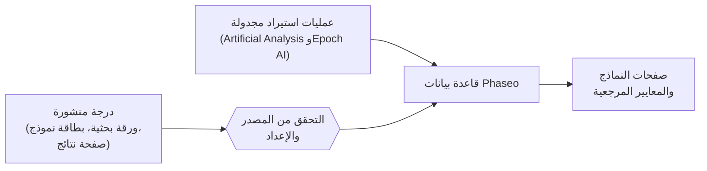

ينشر Phaseo درجات المعايير المرجعية التي قاسها آخرون، مع رابط إلى مصدر كل درجة. ولا يشغّل المعايير المرجعية بنفسه ولا يدمجها في درجة واحدة.

## من أين تأتي الدرجات

| المصدر | كيف تصل |
| --- | --- |
| الأوراق البحثية وبطاقات النماذج والإعلانات من مطوّري النماذج | يضيفها المشرفون، وتُوسم بأنها **مُبلَّغ عنها ذاتيًا** |
| صفحات النتائج لدى منظّمي المعايير المرجعية | يضيفها المشرفون |
| مؤشرات Artificial Analysis وEpoch AI | عمليات استيراد مجدولة، يُتحقق منها كل ساعة |
| تقارير المجتمع | مشكلات GitHub، تُنشر بعد أن يتحقق أحد المشرفين من الأدلة |

تحتاج كل درجة إلى مصدر عام أو سجل تقييم قابل لإعادة الإنتاج قبل نشرها.

## ما معنى التوحيد

يُبقي Phaseo كل معيار مرجعي على مقياسه الخاص. فهو يوحّد السجل المحيط بالدرجة، لا الدرجة نفسها:

1. تُطابَق كل نتيجة مع معرّف معيار مرجعي واحد، بحيث يُجمَّع المعيار نفسه الوارد بأسماء مختلفة معًا.
2. يُحتفظ بالإعداد كنسخة مختلفة عندما يختلف، مثل عدد الأمثلة (few-shot) أو أداة التقييم أو جهد الاستدلال، بدلًا من دمجه في الإعداد الافتراضي.
3. لكل معيار مرجعي اتجاه ترتيب. المعايير التي تكون فيها القيمة الأقل أفضل، مثل معدلات الخطأ، ترتّب أقل درجة أولًا.
4. يبقى رابط المصدر ووسم الإبلاغ الذاتي مع الدرجة.

وسم الإبلاغ الذاتي إفصاح، لا رفض. قد تُخزَّن درجة تفتقر إلى سياق كافٍ مع ملاحظات عن المصدر؛ فلا تعاملها كأنها مساوية لصف متحقق منه بالكامل في لوحة الصدارة.

## الإبلاغ عن تعارض

1. افتح مشكلة تتضمن الأدلة المذكورة في [إرسال درجات المعايير المرجعية](./submitting-scores.mdx).
2. أجب عن أسئلة المراجعة في المشكلة. ينشر المشرفون التصحيحات المتحقق منها عبر محرر قاعدة البيانات.
3. للمساهمات البحثية الأكبر، نسّق عبر [Discord](https://discord.gg/aQyywCvgZ5).

تشرح صفحة [توحيد المعايير المرجعية](https://phaseo.app/how-phaseo-normalises-ai-benchmarks) العامة القواعد نفسها لقرّاء الكتالوج.
