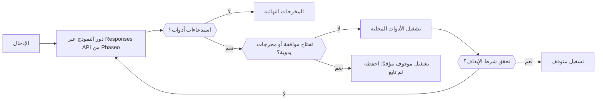

استخدم Agent SDK من Phaseo عندما لا يكفي طلب واحد: تشغّل الحزمة حلقة محدودة داخل عمليتك، ترسل كل دور إلى Responses API، وتنفّذ الأدوات التي يستدعيها النموذج، وتتوقف بانتظار شخص عندما تحتاج أداة إلى موافقة. أنت تحتفظ بحالة التشغيل؛ ولا تستضيف Phaseo أي شيء للوكيل.

## اختر حزمتك

| اللغة | الحزمة | الإصدار | حزمة العميل الأساسية التي تثبّتها |
| --- | --- | --- | --- |
| TypeScript | [`@phaseo/agent-sdk`](https://www.npmjs.com/package/@phaseo/agent-sdk) | 0.3.0 | `@phaseo/sdk` |
| Python | [`phaseo-agent-sdk`](https://pypi.org/project/phaseo-agent-sdk/) (الوحدة `phaseo_agent`) | 0.3.0 | `phaseo` 3.x |
| Go | [`github.com/phaseoteam/Phaseo/packages/sdk/agent-sdk-go`](https://pkg.go.dev/github.com/phaseoteam/Phaseo/packages/sdk/agent-sdk-go) | v0.3.0 | `sdk-go/v3` |
| C# | [`Phaseo.AgentSdk`](https://www.nuget.org/packages/Phaseo.AgentSdk) | 0.3.0 | `Phaseo.Sdk` |
| PHP | [`phaseo/agent-sdk`](https://packagist.org/packages/phaseo/agent-sdk) | v0.3.0 | `phaseo/sdk` `^3.0.0` |
| Ruby | [`phaseo_agent_sdk`](https://rubygems.org/gems/phaseo_agent_sdk) | 0.3.0 | `phaseo_sdk` `>= 3.0.0, < 4.0.0` |
| Java | `app.phaseo:phaseo-agent-sdk` (Maven Central) | 0.3.0 | `app.phaseo:phaseo-sdk` 3.0.0 |
| Rust | [`phaseo-agent`](https://crates.io/crates/phaseo-agent) | 0.2.0 | `phaseo` 0.2 |

TypeScript هو التصميم المرجعي. لا تتوفر Agent SDK للغة C++. تجد أوامر التثبيت ومتطلبات وقت التشغيل في [التثبيت](./installation)، وتبني صفحة [الاستخدام](./usage) أول وكيل.

<Prompt description="اطلب من وكيل برمجة بناء أول وكيل باستخدام Agent SDK من Phaseo بلغتك." icon="bot" actions={["copy", "cursor"]}>
{`Build a small agent in this project with the Phaseo Agent SDK.

1. Install the Phaseo skills: npx skills add https://phaseo.app/docs
   For TypeScript, follow the phaseo-agent-sdk-typescript skill.
2. Read the Agent SDK pages at https://phaseo.app/docs/v1/sdk-reference/agent/overview, pick this project's language tab, and use only the APIs it documents.
3. Define one agent with at most two local tools that fit [AGENT TASK]. Keep the loop bounded with a step limit, and require approval for any tool that changes data.
4. Use a server-side PHASEO_API_KEY and check the model ID with GET /v1/models before using it.
5. Stream the agent's steps to the console so a run can be inspected.
6. Run the agent once, then report what you verified and what you could not verify.`}
</Prompt>

## قارن ما يدعمه كل وقت تشغيل

تشغّل كل حزم SDK أدوات محلية، وتتوقف عند معرّفات استدعاءات أدوات محددة بانتظار الموافقة أو المخرجات اليدوية، وتعيد حالة تشغيل قابلة للتسلسل يخزّنها تطبيقك. أما الباقي فيختلف حسب اللغة:

| الإمكانية | TypeScript | Python | Go | C# | PHP | Ruby | Java | Rust |
| --- | --- | --- | --- | --- | --- | --- | --- | --- |
| حد الخطوات الافتراضي | 12 | 12 | 8 | 12 | 12 | 12 | 12 | 8 |
| بلوغ حد الخطوات | يرمي `Max steps exceeded` | يرفع `RuntimeError` | يعيد خطأ | يرمي `InvalidOperationException` | يرمي استثناء | يرفع استثناء | يرمي استثناء | يعيد تشغيلًا `stopped` (`max_steps:N`) |
| بث النموذج | قابل للتكرار غير المتزامن | مكرِّر (خيط في الخلفية) | قناة | قابل للعدّ غير المتزامن | قابل للتكرار؛ لا يعمل إلا أثناء تكرارك عليه (Fiber) | مُعدِّد (خيط عامل) | قوائم بعد التشغيل؛ مباشرة عبر `onEvent` | غير متاح بعد |
| أحداث تقدّم الأدوات | مولّد غير متزامن | `emit_progress` أو مولّد | `EmitProgress` | `EmitProgress` | `emitProgress` | `emit_progress` | `emitProgress` | غير متاح بعد |
| أدوات متزامنة | نعم | نعم (خيوط) | نعم | نعم | لا | نعم (خيوط) | نعم (مجمّع خيوط) | لا |
| مهلة الأداة | تُلغي `context.signal` | تُفشل التشغيل؛ ويستمر الخيط في العمل | تُفشل الاستدعاء؛ وتستمر goroutine في العمل | تُلغي `CancellationToken` | تُفحص بعد عودة الأداة | تقاطع الاستدعاء | تقاطع الخيط | لا توجد |
| التحقق من المخطط وقت التشغيل | نعم | نعم | نعم | نعم | نعم | نعم | نعم | لا؛ يُرسل JSON Schema إلى النموذج فقط |
| خطأ الأداة افتراضيًا | يُفشل التشغيل | يُفشل التشغيل | يُفشل التشغيل | يُفشل التشغيل | يُفشل التشغيل | يُفشل التشغيل | يُفشل التشغيل | يُعاد إلى النموذج |
| الموافقة والرفض بمعرّف الاستدعاء | نعم | نعم | نعم | نعم | نعم | نعم | نعم | الموافقة فقط |
| أدوات تفاعلية (بمشاركة بشرية) | نعم | نعم | نعم | نعم | نعم | نعم | نعم | `human_review` على مستوى الوكيل فقط |
| شروط الإيقاف | قابلة للتركيب | قابلة للتركيب؛ تُفحص فقط في الخطوات التي لا تتضمن استدعاءات أدوات | قابلة للتركيب | قابلة للتركيب | قابلة للتركيب | قابلة للتركيب | قابلة للتركيب | حد الخطوات |
| أدوار ديناميكية | نعم | النموذج والتعليمات وإعدادات أخذ العينات؛ والأدوات عبر `next_turn_params` | نعم | نعم | نعم | نعم | نعم | النموذج وحد الخطوات والسياق لكل تشغيل |
| عناصر خط زمني محددة النوع | الاتحاد `AgentItem` | قواميس | خريطة `Details` | قاموس `Details` | مصفوفات | Hashes | خريطة `details()` | لا؛ اقرأ `messages` و`steps` |
| الاستخدام والتكلفة | نعم | نعم | نعم | نعم | نعم | نعم | نعم | الرموز، والتكلفة عندما تتضمن الاستجابة `meta.cost` أو `cost` |
| الإلغاء | `cancel()` | `cancel()` | Context | `CancellationToken` | `cancel()` | `cancel` | `cancel()` | غير متاح بعد |
| التقاط Devtools | نعم | نعم | نعم | نعم | نعم | نعم | نعم | غير متاح بعد |

Rust (`phaseo-agent` 0.2) متزامن: لا بث، ولا تنفيذ غير متزامن، ولا أدوات متزامنة، ولا تحقق من المخططات وقت التشغيل، ولا التقاط Devtools. شغّله على خيط عامل عندما لا ينبغي أن يحجب التشغيل معالج الطلبات. تشغّل PHP الأدوات واحدة تلو الأخرى، ولا يتقدّم بثها إلا ما دامت شيفرتك تكرّر عليه.

## اختر بين Agent SDK أو حزمة العميل أو الـ API المباشرة

| الاستخدام | اختر | ما يتولاه |
| --- | --- | --- |
| طلب API واحد أو تغطية كاملة لنقاط النهاية | [حزمة SDK للعميل](../client/overview) | أنواع API المولّدة والنقل |
| منطق تطبيق متعدد الخطوات يستخدم الأدوات | Agent SDK | الحلقة المحلية والأدوات ونقاط الحفظ والمراجعة والأحداث وDevtools |
| نقل مخصص أو لغة غير مدعومة | API مباشرة | معالجة طلبات HTTP واستجاباتها |

يرسل عميل Gateway في كل Agent SDK أدوار النموذج عبر حزمة SDK للعميل في تلك اللغة. تقبل معظمها خريطة `requestOptions` (أو ما يعادلها في اللغة) لحقول Responses API الإضافية؛ ومع ذلك يحدد الوكيل بنفسه `model` و`input` و`instructions` وأدوات الدوال الخاصة به. يرسل محوّل Rust 0.2 حقول الوكيل الموحّدة فقط، ولا يوفّر خطافًا للخيارات الإضافية.

## ابدأ من وصفة

| الوصفة | اللغة |
| --- | --- |
| [ابنِ حلقة وكيل متينة](../../cookbook/agent-sdk-durable-loop) | TypeScript |
| [ابحث باستخدام مخرجات منظَّمة وبحث الويب](../../cookbook/agent-sdk-research-brief) | TypeScript |
| [فرز طلبات الدعم بالإعدادات المسبقة وإخفاقات تراعي ضوابط الحماية](../../cookbook/agent-sdk-support-triage) | TypeScript |
| [شغّل وكيل مراجعة شيفرة بأدوات وقت التشغيل](../../cookbook/agent-sdk-coding-review) | TypeScript |
| [شغّل أدوات الوكيل المحلية بالتوازي](../../cookbook/agent-sdk-parallel-tools) | TypeScript |
| [استخرج JSON منظَّمًا](../../cookbook/agent-sdk-python-structured-extraction) | Python |
| [ابنِ وكيلًا لدليل تشغيل العمليات](../../cookbook/agent-sdk-go-ops-runbook) | Go |
| [فرز التذاكر](../../cookbook/agent-sdk-csharp-ticket-triage) | C# |
| [راجع محتوى نظام إدارة المحتوى](../../cookbook/agent-sdk-php-content-review) | PHP |
| [لخّص الملاحظات الداخلية](../../cookbook/agent-sdk-ruby-rag-notes) | Ruby |

يمكن نقل وصفات TypeScript إلى أي لغة باستخدام واجهات API الموثقة في هذه الصفحات.
