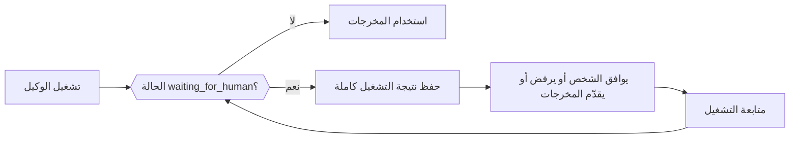

عندما يحتاج الوكيل إلى شخص، أو إلى مهمة خارجية، أو إلى أداة ينفّذها تطبيقك، يعود التشغيل بشكل طبيعي (لا كخطأ) بالحالة `waiting_for_human` ومعه كل ما يلزم للمتابعة. احفظ النتيجة كاملة، واجمع القرار في تطبيقك، ثم مرّر النتيجة المحفوظة والقرار إلى دالة المتابعة في الوكيل.



<Note>
لا تخزّن Phaseo عمليات تشغيل Agent SDK. احفظ الحالة القابلة للاستئناف في تطبيقك عندما يجب أن تصمد بعد انتهاء طلب أو إعادة تشغيل العملية.
</Note>

| اللغة | المتابعة | المتابعة مع البث | ملاحظات |
| --- | --- | --- | --- |
| TypeScript | `agent.continueRun()` | `agent.continueStream()` | |
| Python | `agent.continue_run()` | `agent.continue_stream()` | |
| Go | `agent.Continue(ctx, ContinueOptions)` | `agent.ContinueStream` | |
| C# | `agent.ContinueRun(ContinueOptions)` | `agent.ContinueStream` | |
| PHP | `$agent->continueRun()` | `$agent->continueStream()` | تحمّل `continueRunById()` التشغيل من أداة وصول إلى الحالة أولًا |
| Ruby | `agent.continue_run` | `agent.continue_stream` | |
| Java | `agent.continueRun(ContinueOptions)` | `agent.continueStream` | `ContinueOptions` سجل موضعي |
| Rust | `agent.continue_run(&mut client, options)` | لا يوجد | تضيف `continue_with_events` دالة رد نداء للأحداث؛ وعمليات التشغيل متزامنة |

## وافق على استدعاءات الأدوات أو ارفضها

توقف الأدوات المشروطة بالموافقة واليدوية والتفاعلية (بمشاركة بشرية) التشغيل مؤقتًا قبل تنفيذها. لكل استدعاء معلّق `call` من النموذج (مع `id` الخاص به) و`kind`: إما `approval` أو `manual` أو `hitl`. أجب عن كل استدعاء بمعرّف الاستدعاء بعينه، لا باسم الأداة، كي يبقى استدعاءان للأداة نفسها منفصلين.

الاستدعاء الموافَق عليه ينفّذ أداته. أما الاستدعاء المرفوض فيرسل `{"error": "<reason>"}` إلى النموذج بوصفه نتيجة الأداة، مع السبب الافتراضي `Tool call rejected`.

<CodeGroup>

```typescript TypeScript
const resumed = await agent.continueRun({
  run: paused,
  client,
  approvals: [{ toolCallId: "call_deploy_42" }],
  rejections: [
    { toolCallId: "call_delete_17", reason: "Not authorized" },
  ],
});
```

```python Python
from phaseo_agent import AgentToolDecision

pending = paused.run.pause.pending_tool_calls

continued = agent.continue_run(
    run=paused,
    client=client,
    approvals=[AgentToolDecision(pending[0].call.id)],
    rejections=[AgentToolDecision(pending[1].call.id, "Not authorized")],
)
```

```go Go
var approvals, rejections []phaseoagent.ToolDecision
for _, pending := range result.Run.Pause.PendingToolCalls {
  if pending.Kind != "approval" {
    continue
  }
  if userApproved(pending.Call) {
    approvals = append(approvals, phaseoagent.ToolDecision{ToolCallID: pending.Call.ID})
  } else {
    rejections = append(rejections, phaseoagent.ToolDecision{ToolCallID: pending.Call.ID, Reason: "Not now"})
  }
}

result, err = agent.Continue(ctx, phaseoagent.ContinueOptions{
  Run: result, Client: client, Approvals: approvals, Rejections: rejections,
})
```

```csharp C#
var pending = result.Run.Pause!.PendingToolCalls!.Where(item => item.Kind == "approval");

result = await agent.ContinueRun(new ContinueOptions
{
    Run = result,
    Client = client,
    Approvals = pending.Where(item => UserApproved(item.Call)).Select(item => new ToolDecision(item.Call.Id)).ToList(),
    Rejections = pending.Where(item => !UserApproved(item.Call)).Select(item => new ToolDecision(item.Call.Id, "Not now")).ToList(),
});
```

```php PHP
use Phaseo\AgentSdk\ToolDecision;

$approvals = $rejections = [];
foreach ($result->run->pause->pendingToolCalls as $pending) {
    if ($pending->kind !== "approval") continue;
    if (userApproved($pending->call)) {
        $approvals[] = new ToolDecision($pending->call->id);
    } else {
        $rejections[] = new ToolDecision($pending->call->id, "Not now");
    }
}

$result = $agent->continueRun(run: $result, client: $client, approvals: $approvals, rejections: $rejections);
```

```ruby Ruby
pending = result.run.pause.pending_tool_calls.select { |item| item.kind == "approval" }
approved, declined = pending.partition { |item| user_approved?(item.call) }

result = agent.continue_run(
  run: result,
  client: client,
  approvals: approved.map { |item| PhaseoAgentSdk::ToolDecision.new(tool_call_id: item.call.id) },
  rejections: declined.map { |item| PhaseoAgentSdk::ToolDecision.new(tool_call_id: item.call.id, reason: "Not now") }
)
```

```java Java
var pending = result.run().pause().pendingToolCalls();
var approvals = pending.stream().filter(item -> item.kind().equals("approval") && userApproved(item.call()))
    .map(item -> new AgentSdk.ToolDecision(item.call().id())).toList();
var rejections = pending.stream().filter(item -> item.kind().equals("approval") && !userApproved(item.call()))
    .map(item -> new AgentSdk.ToolDecision(item.call().id(), "Not now")).toList();

result = agent.continueRun(new AgentSdk.ContinueOptions(
    result, client, null, null, null, null, null, null, null, null, null,
    approvals, rejections, List.of()));
```

```rust Rust
use phaseo_agent::{ContinueOptions, ToolDecision};

let approvals = paused.run.pause.as_ref().unwrap()
    .pending_tool_calls
    .iter()
    .map(|pending| ToolDecision {
        tool_call_id: pending.call.id.clone(),
        reason: Some("Approved by the release operator".to_string()),
    })
    .collect();

let mut options = ContinueOptions::new(paused);
options.approvals = approvals;

let completed = agent.continue_run(&mut client, options)?;
```

</CodeGroup>

أين توجد الاستدعاءات المعلّقة، وما الذي يحدث عند غياب قرار:

| اللغة | الاستدعاءات المعلّقة | غياب القرار |
| --- | --- | --- |
| TypeScript | `run.pause.pendingToolCalls` | يرمي `Missing approval decision for tool call <id>` |
| Python | `run.pause.pending_tool_calls` | يرفع `ValueError` |
| Go | `Run.Pause.PendingToolCalls` | يعيد `missing approval decision for tool call <id>` |
| C# | `Run.Pause.PendingToolCalls` | يرمي `Missing approval decision for tool call <id>` |
| PHP | `$result->run->pause->pendingToolCalls` | يرمي `Missing approval decision for tool call <id>` |
| Ruby | `result.run.pause.pending_tool_calls` | يرفع `Missing approval decision for tool call <id>` |
| Java | `run().pause().pendingToolCalls()` | يرمي `Missing approval decision for tool call <id>` |
| Rust | `run.pause.pending_tool_calls` (من النوع `Option`) | يعيد `AgentError` |

للتوقف المؤقت نفسه أيضًا `kind`. تضبطه Go وC# على `tool_approval` لكل توقف بسبب أداة. وتضبط PHP وRuby وJava القيمة `tool_approval` عندما يحتاج أي استدعاء معلّق إلى موافقة، وإلا فنوع الاستدعاء الأول. أما Rust فتستخدم `tool_approval` لاستدعاءات الموافقة، و`external_output` عندما تحتاج كل الاستدعاءات المعلّقة إلى نتيجة خارجية، و`tool_input` عند الجمع بين الاثنين.

<Warning>
لا يوجد في Rust `0.2` نوع للرفض ولا حقل `rejections`. اترك الاستدعاء غير الموافَق عليه موقوفًا مؤقتًا، أو طبّق سياسة الرفض في تطبيقك قبل المتابعة.
</Warning>

لاشتراط الموافقة على كل استدعاء أداة بدلًا من كل أداة على حدة، اضبط `requireApproval` على تعريف الوكيل (`require_approval` في Python وRuby، و`RequireApproval` في Go وC#). في TypeScript هي دالة `requireApproval(call, context)`. لا تدعم Rust الموافقة إلا لكل أداة، عبر `Tool::require_approval()`. توضح صفحة [الأدوات](./tools) كيف يُعرَّف كل نوع من الأدوات.

## قدّم النتائج للأدوات اليدوية والتفاعلية

لاستدعاءات `manual` و`hitl`، مرّر النتيجة التي أنتجها تطبيقك، مفهرسة بمعرّف الاستدعاء. في Rust، هذه هي الأدوات المبنية باستخدام `Tool::external(...)`.

<CodeGroup>

```typescript TypeScript
await agent.continueRun({
  run: paused,
  client,
  toolOutputs: [{ toolCallId: callId, output: { status: "shipped" } }],
});
```

```python Python
from phaseo_agent import AgentToolOutput

agent.continue_run(
    run=paused,
    client=client,
    tool_outputs=[AgentToolOutput(call_id, {"status": "shipped"})],
)
```

```go Go
ToolOutputs: []phaseoagent.ToolOutput{{ToolCallID: callID, Output: map[string]any{"status": "shipped"}}},
```

```csharp C#
ToolOutputs = new[] { new ToolOutput(callId, new { status = "shipped" }) },
```

```php PHP
use Phaseo\AgentSdk\ToolOutput;

toolOutputs: [new ToolOutput($callId, ["status" => "shipped"])],
```

```ruby Ruby
tool_outputs: [PhaseoAgentSdk::ToolOutput.new(tool_call_id: call_id, output: { status: "shipped" })]
```

```java Java
// The toolOutputs argument of ContinueOptions
List.of(new AgentSdk.ToolOutput(callId, Map.of("status", "shipped")))
```

```rust Rust
use phaseo_agent::{ContinueOptions, ToolOutput};
use serde_json::json;

let mut options = ContinueOptions::new(paused);
options.tool_outputs = vec![ToolOutput {
    tool_call_id: call_id,
    output: json!({ "status": "shipped" }),
}];

let completed = agent.continue_run(&mut client, options)?;
```

</CodeGroup>

يؤدي غياب المخرجات إلى فشل المتابعة بالخطأ `Missing output for tool call <id>` (`missing` بأحرف صغيرة في Go، و`ValueError` في Python، و`AgentError` في Rust). لا تحل رسالة الإدخال البشري محل مخرجات الأداة.

## توقّف للمراجعة البشرية

اضبط دالة رد نداء للمراجعة البشرية على تعريف الوكيل لفحص كل استجابة من النموذج قبل أن يتابع التشغيل. أعِد طلب مراجعة يتضمن `reason` (واختياريًا `payload`) للتوقف مؤقتًا، أو لا تُعِد شيئًا للاستمرار. قيمة `kind` للتوقف هي `human_review`. تستقبل دالة رد النداء معرّف التشغيل وفهرس الخطوة والرسائل واستجابة النموذج والمخرجات المحلَّلة (في Rust: معرّفي التشغيل والوكيل وفهرس الخطوة والرسائل والاستجابة وسياق التطبيق).

<CodeGroup>

```typescript TypeScript
const agent = createAgent({
  id: "support-agent",
  humanReview: ({ response }) =>
    response.message.content.includes("needs approval")
      ? {
          reason: "approval_required",
          payload: { draft: response.message.content },
        }
      : null,
});
```

```python Python
from phaseo_agent import AgentHumanReviewRequest

def review(context):
    if "needs approval" in context.response.message.content:
        return AgentHumanReviewRequest("approval_required", {"draft": context.response.message.content})
    return None

agent = create_agent({"id": "support-agent", "human_review": review})
```

```go Go
HumanReview: func(review phaseoagent.HumanReviewContext) *phaseoagent.HumanReviewRequest {
  if strings.Contains(review.Response.Message.Content, "refund") {
    return &phaseoagent.HumanReviewRequest{Reason: "Refunds need sign-off"}
  }
  return nil
},
```

```csharp C#
HumanReview = review => Task.FromResult<HumanReviewRequest?>(
    review.Response.Message.Content.Contains("refund")
        ? new HumanReviewRequest("Refunds need sign-off")
        : null),
```

```php PHP
use Phaseo\AgentSdk\HumanReviewRequest;

humanReview: fn ($review) => str_contains($review->response->message->content, "refund")
    ? new HumanReviewRequest("Refunds need sign-off")
    : null,
```

```ruby Ruby
human_review: ->(review) {
  if review.response.message.content.include?("refund")
    PhaseoAgentSdk::HumanReviewRequest.new(reason: "Refunds need sign-off")
  end
}
```

```java Java
AgentSdk.HumanReview review = context ->
    context.response().message().content().contains("refund")
        ? new AgentSdk.HumanReviewRequest("Refunds need sign-off", null)
        : null;
```

```rust Rust
use phaseo_agent::{AgentDefinition, HumanReviewRequest};
use serde_json::json;

let definition = AgentDefinition::new("review-agent", "openai/gpt-6-astra")
    .human_review(|context| {
        if context.response.message.content.contains("needs approval") {
            Some(HumanReviewRequest {
                reason: "Review the proposed action".to_string(),
                payload: json!({ "draft": context.response.message.content }),
            })
        } else {
            None
        }
    });
```

</CodeGroup>

تابع بإدخال بشري، يُضاف إلى المحادثة كرسالة من المستخدم:

<CodeGroup>

```typescript TypeScript
const continued = await agent.continueRun({
  run: pausedResult,
  client,
  humanInput: "Approved. Continue and return the final answer.",
});
```

```python Python
continued = agent.continue_run(
    run=paused,
    client=client,
    human_input="Approved. Continue and return the final answer.",
)
```

```go Go
result, err = agent.Continue(ctx, phaseoagent.ContinueOptions{
  Run:        result,
  Client:     client,
  HumanInput: "Approved. Refund up to $50.",
})
```

```csharp C#
result = await agent.ContinueRun(new ContinueOptions
{
    Run = result,
    Client = client,
    HumanInput = "Approved. Refund up to $50.",
});
```

```php PHP
$result = $agent->continueRun(
    run: $result,
    client: $client,
    humanInput: "Approved. Refund up to $50."
);
```

```ruby Ruby
result = agent.continue_run(
  run: result,
  client: client,
  human_input: "Approved. Refund up to $50."
)
```

```java Java
result = agent.continueRun(new AgentSdk.ContinueOptions(
    result, client, null, null, null, null,
    "Approved. Refund up to $50.",          // humanInput
    null, null, null, null));
```

```rust Rust
use phaseo_agent::ContinueOptions;

let mut options = ContinueOptions::new(paused);
options.human_input = Some("Approved. Continue and return the final result.".to_string());

let completed = agent.continue_run(&mut client, options)?;
```

</CodeGroup>

تفشل متابعة توقف المراجعة دون إدخال بشري بالخطأ `Run <id> is waiting for human input` (في Go: `run <id> is waiting for human input`؛ وفي Java: `Run is waiting for human input`). تشترط Rust قيمة `human_input` غير فارغة. وتقبل TypeScript أيضًا `humanMessages` منظَّمة.

## احفظ حالة التشغيل بين الطلبات

نتيجة التشغيل بيانات عادية: خزّنها في قاعدة بياناتك أو مخزن الكائنات أو سجل المهمة، وأبقِ `context` التطبيق قابلًا للتسلسل. لا يمكن متابعة التشغيل إلا بوكيل يحمل المعرّف نفسه. توضح [وصفة حلقة الوكيل المتينة](../../cookbook/agent-sdk-durable-loop) تدفقًا كاملًا للحفظ والاستئناف.

لتدع حزمة SDK تحفظ عمليات التشغيل وتحمّلها نيابة عنك، مرّر أداة وصول إلى الحالة تتضمن `load(runId)` و`save(result)`. عندها تحفظ الحزمة بعد كل تشغيل ومتابعة، ويمكنك المتابعة بمعرّف التشغيل بدلًا من تمرير السجل عبر كل طبقة.

| اللغة | أداة الوصول إلى الحالة | المتابعة بالمعرّف |
| --- | --- | --- |
| TypeScript | `state` مع الدالتين غير المتزامنتين `load(runId)` و`save(result)` | `continueRun({ runId, state, client })` |
| Python | `state`، وتنفّذ `AgentStateAccessor` | `continue_run(run_id=..., state=..., client=...)` |
| Go | `State`، وتنفّذ `StateAccessor`، في `RunOptions` و`ContinueOptions` | `ContinueOptions{RunID: id, State: store}` |
| C# | `State`، وتنفّذ `IStateAccessor`، في `RunOptions` و`ContinueOptions` | `new ContinueOptions { RunId = id, State = store, Client = client }` |
| PHP | `state`، وتنفّذ `StateAccessor` | `continueRunById($runId, $state, $client, approvals: ..., rejections: ..., toolOutputs: ...)`؛ ويرمي `Run <id> not found` إذا لم يوجد |
| Ruby | `state:`، أي كائن يتضمن `load(run_id)` و`save(result)` | `continue_run(run_id: id, state: store, client: client)` |
| Java | `StateAccessor`، آخر وسيط في `RunOptions` | `ContinueOptions` ذو 16 وسيطًا مع `runId` و`state` في الآخر و`run` بقيمة null. يحمّل التشغيل لكنه لا يحفظ النتيجة بعد المتابعة، لذا احفظها بنفسك. |
| Rust | لا يوجد | سلسِل `RunResult` باستخدام Serde ومرّره إلى `ContinueOptions::new` |

<CodeGroup>

```go Go
type StateAccessor interface {
  Load(ctx context.Context, runID string) (*phaseoagent.RunResult, error)
  Save(ctx context.Context, result phaseoagent.RunResult) error
}
```

```csharp C#
public interface IStateAccessor
{
    Task<RunResult?> Load(string runId, CancellationToken cancellationToken = default);
    Task Save(RunResult result, CancellationToken cancellationToken = default);
}
```

```rust Rust
use phaseo_agent::RunResult;

// Save the paused run
std::fs::write("paused-run.json", serde_json::to_string_pretty(&paused)?)?;

// Restore it later
let paused: RunResult = serde_json::from_str(&std::fs::read_to_string("paused-run.json")?)?;
```

</CodeGroup>

في Rust، أعد إنشاء تعريف الوكيل والأدوات نفسها قبل المتابعة: فالإغلاقات (closures) و`AgentDefinition` ليست جزءًا من التشغيل المسلسَل. يُخزَّن النموذج الفعلي وحد الخطوات في `RunRecord`، لذا تبقى تجاوزات كل تشغيل فعّالة بعد المتابعة.

أيًّا كان ما تخزّنه، يتولى تطبيقك تشفير عمليات التشغيل المحفوظة والاحتفاظ بها، والتفويض للموافقات والإدخال البشري، وضمان تساوي القوة (idempotency) للآثار الجانبية التي تُنفَّذ مجددًا بعد الاستئناف.
