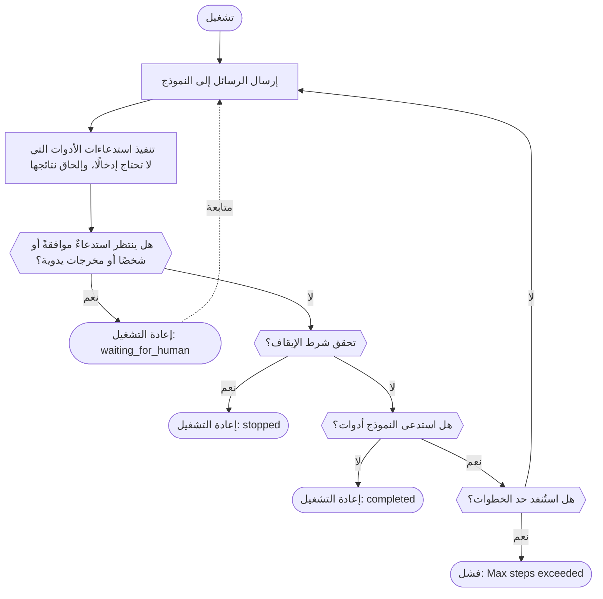

عرّف أداة، وأنشئ وكيلًا، وشغّله باستخدام عميل Gateway. يستدعي النموذج أداتك، فتنفّذها الحزمة وتعيد النتيجة إليه، ويعود التشغيل عندما يجيب النموذج دون استدعاء أداة، أو يتوقف بانتظار شخص، أو يتحقق [شرط إيقاف](./stop-conditions). وإذا بلغ التشغيل حد الخطوات أولًا، تطلق الحزمة خطأً؛ ولا تعيد التشغيل بالحالة `stopped` سوى Rust. لا تستضيف Phaseo الوكيل ولا تخزّن عمليات تشغيله؛ بل يفعل ذلك تطبيقك.

## ابنِ أول وكيل

<CodeGroup>

```typescript TypeScript
import {
  createAgent,
  createGatewayAgentClient,
  defineTool,
} from "@phaseo/agent-sdk";

const lookupDocs = defineTool({
  id: "lookup-docs",
  description: "Look up an internal docs page by slug.",
  parameters: {
    type: "object",
    properties: {
      slug: { type: "string" },
    },
    required: ["slug"],
    additionalProperties: false,
  },
  async execute(input: { slug: string }) {
    return {
      slug: input.slug,
      url: `https://phaseo.app/docs/v1/${input.slug}`,
    };
  },
});

const agent = createAgent({
  id: "support-docs-agent",
  model: "openai/gpt-6-astra",
  instructions: "Use tools when helpful and finish with a concise answer.",
  tools: [lookupDocs],
});

const result = await agent.run({
  input: "Find the docs page for presets and explain when to use them.",
  client: createGatewayAgentClient({
    clientOptions: {
      apiKey: process.env.PHASEO_API_KEY!,
    },
  }),
});

console.log(result.output);
```

```python Python
import os
from phaseo_agent import AgentTool, create_agent, create_gateway_agent_client, define_tool

lookup_docs = define_tool(AgentTool(
    id="lookup-docs",
    description="Look up an internal docs page by slug.",
    parameters={
        "type": "object",
        "properties": {"slug": {"type": "string"}},
        "required": ["slug"],
        "additionalProperties": False,
    },
    execute=lambda tool_input, runtime: {
        "slug": tool_input["slug"],
        "url": f"https://phaseo.app/docs/v1/{tool_input['slug']}",
    },
))

agent = create_agent({
    "id": "support-docs-agent",
    "model": "openai/gpt-6-astra",
    "instructions": "Use tools when helpful and finish with a concise answer.",
    "tools": [lookup_docs],
})

result = agent.run(
    input="Find the docs page for presets and explain when to use them.",
    client=create_gateway_agent_client(client_options={"api_key": os.environ["PHASEO_API_KEY"]}),
)

print(result.output)
```

```go Go
package main

import (
  "context"
  "fmt"

  phaseoagent "github.com/phaseoteam/Phaseo/packages/sdk/agent-sdk-go"
)

func main() {
  client, err := phaseoagent.CreateGatewayAgentClient(phaseoagent.GatewayAgentClientOptions{})
  if err != nil {
    panic(err) // PHASEO_API_KEY is required
  }

  lookup := phaseoagent.DefineTool(phaseoagent.Tool{
    ID:          "lookup_docs",
    Description: "Look up a Phaseo documentation topic",
    Parameters: map[string]any{
      "type":       "object",
      "properties": map[string]any{"topic": map[string]any{"type": "string"}},
      "required":   []string{"topic"},
    },
    Execute: func(input any, runtime phaseoagent.RuntimeContext) (any, error) {
      args, _ := input.(map[string]any)
      return map[string]any{"topic": args["topic"], "found": true}, nil
    },
  })

  agent := phaseoagent.CreateAgent(phaseoagent.AgentDefinition{
    ID:           "docs-agent",
    Model:        "openai/gpt-6-astra",
    Instructions: "Use tools when helpful and finish with a concise answer.",
    Tools:        []phaseoagent.Tool{lookup},
    MaxSteps:     6,
  })

  result, err := agent.Run(context.Background(), phaseoagent.RunOptions{
    Input:  "Explain when to use routing presets.",
    Client: client,
  })
  if err != nil {
    panic(err)
  }

  fmt.Println(result.Output)
  fmt.Println(result.Run.Status, result.Usage.TotalTokens)
}
```

```csharp C#
using System.Text.Json;
using PhaseoAgentSdk;

var lookup = AgentSdk.DefineTool(new Tool(
    "lookup_docs",
    async (input, runtime) =>
    {
        var topic = ((JsonElement)input!).GetProperty("topic").GetString();
        return new { topic, found = true };
    },
    "Look up a Phaseo documentation topic",
    new Dictionary<string, object?>
    {
        ["type"] = "object",
        ["properties"] = new Dictionary<string, object?> { ["topic"] = new { type = "string" } },
        ["required"] = new[] { "topic" },
    }));

var agent = AgentSdk.CreateAgent(new AgentDefinition
{
    Id = "docs-agent",
    Model = "openai/gpt-6-astra",
    Instructions = "Use tools when helpful and finish with a concise answer.",
    Tools = new[] { lookup },
    MaxSteps = 6,
});

var result = await agent.Run(new RunOptions
{
    Input = "Explain when to use routing presets.",
    Client = AgentSdk.CreateGatewayAgentClient(), // throws if PHASEO_API_KEY is missing
});

Console.WriteLine(result.Output);
Console.WriteLine($"{result.Run.Status} {result.Usage.TotalTokens}");
```

```php PHP
<?php
require "vendor/autoload.php";

use Phaseo\AgentSdk\AgentDefinition;
use Phaseo\AgentSdk\AgentSdk;
use Phaseo\AgentSdk\Tool;

$lookup = AgentSdk::defineTool(new Tool(
    id: "lookup_docs",
    execute: fn (array $input, $runtime) => ["topic" => $input["topic"], "found" => true],
    description: "Look up a Phaseo documentation topic",
    parameters: [
        "type" => "object",
        "properties" => ["topic" => ["type" => "string"]],
        "required" => ["topic"],
    ],
));

$agent = AgentSdk::createAgent(new AgentDefinition(
    id: "docs-agent",
    model: "openai/gpt-6-astra",
    instructions: "Use tools when helpful and finish with a concise answer.",
    tools: [$lookup],
    maxSteps: 6,
));

$result = $agent->run(
    input: "Explain when to use routing presets.",
    client: AgentSdk::createGatewayAgentClient() // throws if PHASEO_API_KEY is missing
);

echo $result->output . PHP_EOL;
echo $result->run->status . " " . $result->usage["total_tokens"] . PHP_EOL;
```

```ruby Ruby
require "phaseo_agent_sdk"

lookup = PhaseoAgentSdk.define_tool(
  PhaseoAgentSdk::Tool.new(
    id: "lookup_docs",
    description: "Look up a Phaseo documentation topic",
    parameters: {
      type: "object",
      properties: { topic: { type: "string" } },
      required: ["topic"]
    },
    execute: ->(input, runtime) { { topic: input["topic"], found: true } }
  )
)

agent = PhaseoAgentSdk.create_agent(
  id: "docs-agent",
  model: "openai/gpt-6-astra",
  instructions: "Use tools when helpful and finish with a concise answer.",
  tools: [lookup],
  max_steps: 6
)

result = agent.run(
  input: "Explain when to use routing presets.",
  client: PhaseoAgentSdk.create_gateway_agent_client # raises if PHASEO_API_KEY is missing
)

puts result.output
puts "#{result.run.status} #{result.usage[:total_tokens]}"
```

```java Java
import app.phaseo.agent.AgentSdk;
import java.time.Duration;
import java.util.List;
import java.util.Map;

var lookup = AgentSdk.defineTool(new AgentSdk.Tool(
    "lookup_docs",
    (input, context) -> Map.of("topic", ((Map<?, ?>) input).get("topic"), "found", true),
    "Look up a Phaseo documentation topic",
    Map.of(
        "type", "object",
        "properties", Map.of("topic", Map.of("type", "string")),
        "required", List.of("topic")),
    Duration.ofSeconds(10)
));

var agent = AgentSdk.createAgent(new AgentSdk.AgentDefinition(
    "docs-agent",                       // id
    "openai/gpt-6-astra",               // model
    null,                               // preset
    "Use tools when helpful and finish with a concise answer.", // instructions
    List.of(lookup),                    // tools
    6,                                  // maxSteps
    null, null, null, null              // parseOutput, humanReview, modelRetry, toolExecution
));

var result = agent.run(new AgentSdk.RunOptions(
    "Explain when to use routing presets.",  // input
    AgentSdk.createGatewayAgentClient(),     // throws if PHASEO_API_KEY is missing
    null, null, null, null, null, null, null, null
));

System.out.println(result.output());
System.out.println(result.run().status() + " " + result.usage().totalTokens());
```

```rust Rust
use phaseo_agent::{
    create_agent, create_gateway_agent_client, define_tool, AgentDefinition,
    RunOptions, Tool,
};
use serde_json::json;

fn main() -> Result<(), Box<dyn std::error::Error>> {
    let lookup = define_tool(Tool::new(
        "lookup_docs",
        "Look up a Phaseo documentation topic",
        json!({
            "type": "object",
            "properties": {
                "topic": { "type": "string" }
            },
            "required": ["topic"]
        }),
        |input, context| {
            Ok(json!({
                "topic": input["topic"],
                "run_id": context.run_id,
                "found": true
            }))
        },
    ));

    let agent = create_agent(
        AgentDefinition::new("docs-agent", "openai/gpt-6-astra")
            .instructions("Use lookup_docs when helpful. Answer concisely.")
            .max_steps(6)
            .tool(lookup),
    );

    let mut client = create_gateway_agent_client("openai/gpt-6-astra")?;
    let result = agent.run(
        &mut client,
        RunOptions::new("Explain when to use routing presets."),
    )?;

    println!("{}", result.output);
    println!("steps: {}", result.run.step_count);
    println!("tokens: {}", result.usage.total_tokens);
    Ok(())
}
```

</CodeGroup>

معرّف الأداة هو اسم الدالة الذي يراه النموذج، ومعاملاتها هي JSON Schema الذي يملؤه النموذج. تصل الوسائط إلى شيفرتك بالشكل الأصلي لكل لغة:

| اللغة | ما تستقبله الأداة | ملاحظات |
| --- | --- | --- |
| TypeScript | كائن محدد النوع | `execute(input, context)` |
| Python | `dict` | `execute(tool_input, runtime)` |
| Go | `any` (JSON مفكوك، عادةً `map[string]any`) | `Execute(input, runtime) (any, error)` |
| C# | `JsonElement` | `Execute(input, runtime)`، مع انتظاره (await) |
| PHP | مصفوفة ترابطية | `execute(array $input, $runtime)` |
| Ruby | Hash بمفاتيح نصية | ابنِ الأدوات باستخدام `PhaseoAgentSdk::Tool.new`؛ تعيد `define_tool` ما تمرّره إليها كما هو، لذا لن يعمل Hash عادي |
| Java | `Map` | السجلات موضعية؛ مرّر `null` لأي شيء لا تضبطه |
| Rust | `serde_json::Value` | يعمل الإغلاق (closure) محليًا؛ ويحتوي `RuntimeContext` على معرّف التشغيل ومعرّف الوكيل وفهرس الخطوة وسياق التطبيق واستدعاء الأداة |

إذا لم يحدد الوكيل ولا التشغيل ولا العميل نموذجًا أو إعدادًا مسبقًا، يرسل عميل Gateway القيمة `phaseo/free`. أما `create_gateway_agent_client` في Rust فتأخذ النموذج وسيطًا.

## كيف يعمل التشغيل



تُحفظ كل خطوة كنقطة حفظ في نتيجة التشغيل المعادة. للاستئناف عبر الطلبات أو بعد إعادة التشغيل، احفظ تلك النتيجة في مخزنك الخاص ومرّرها إلى دالة المتابعة، أو امنح الوكيل أداة وصول إلى الحالة؛ راجع [الحالة والموافقة](./state-and-approval). يختلف حد الخطوات وما يحدث عند استنفاده حسب اللغة:

<Tabs>
<Tab title="TypeScript">

يأخذ كل استدعاء لـ `run()` أو `continueRun()` ما يصل إلى 12 خطوة ما لم تضبط `maxSteps`؛ وبعد ذلك يرمي `Max steps exceeded`. استخدم [شروط الإيقاف](./stop-conditions) لإنهاء التشغيل بشكل نظيف.

</Tab>
<Tab title="Python">

يأخذ التشغيل ما يصل إلى 12 خطوة ما لم تضبط `max_steps`؛ وبعد ذلك يرفع `RuntimeError`. لا تُفحص شروط الإيقاف إلا في خطوة لا يستدعي فيها النموذج أي أداة، لذا يختلف الترتيب عن المخطط: تستمر حلقة الأدوات حتى تتوقف مؤقتًا، أو تجيب، أو تستنفد `max_steps`.

</Tab>
<Tab title="Go">

يفشل التشغيل الذي يحتاج إلى أكثر من `MaxSteps` من أدوار النموذج (الافتراضي 8) بالخطأ `Max steps exceeded (N)`.

</Tab>
<Tab title="C#">

يرمي التشغيل الذي يحتاج إلى أكثر من `MaxSteps` من أدوار النموذج (الافتراضي 12) الاستثناء `InvalidOperationException("Max steps exceeded (N)")`.

</Tab>
<Tab title="PHP">

يرمي التشغيل الذي يحتاج إلى أكثر من `maxSteps` من أدوار النموذج (الافتراضي 12) الاستثناء `Max steps exceeded (N)`.

</Tab>
<Tab title="Ruby">

يرفع التشغيل الذي يحتاج إلى أكثر من `max_steps` من أدوار النموذج (الافتراضي 12) الاستثناء `Max steps exceeded (N)`.

</Tab>
<Tab title="Java">

يرمي التشغيل الذي يحتاج إلى أكثر من `maxSteps` من أدوار النموذج (الافتراضي 12) الاستثناء `Max steps exceeded (N)`.

</Tab>
<Tab title="Rust">

يأخذ التشغيل ما يصل إلى 8 أدوار للنموذج ما لم تستدعِ `.max_steps(n)` أو تضبط `RunOptions.max_steps`. بلوغ الحد لا يسبب فشلًا: يعود التشغيل بقيمة `run.status` تساوي `stopped` وقيمة `run.stop_reason` تساوي `max_steps:<limit>`. عمليات التشغيل متزامنة وتُنفَّذ الأدوات المحلية واحدة تلو الأخرى، لذا استخدم خيطًا عاملًا أو حدًّا لمهمة عندما لا ينبغي أن يحجب التشغيل معالج الطلبات.

</Tab>
</Tabs>

## اقرأ نتيجة التشغيل

يعيد كل تشغيل الأجزاء نفسها. تتبع أسماء الحقول نمط الكتابة في كل لغة (`output`، `Output`، `output()`):

| الجزء | المحتوى |
| --- | --- |
| `run` | الحالة والمعرّفات والنموذج الفعلي وحد الخطوات والسياق وحالة التوقف المؤقت وسبب الإيقاف |
| `steps` | سجل واحد لكل دور للنموذج: معرّف الطلب والمزوّد والنموذج وسبب الانتهاء والتحذيرات واستدعاءات الأدوات والاستخدام |
| `messages` | المحادثة كاملة، بما فيها نتائج الأدوات |
| `output` | المخرجات النهائية |
| `usage` | رموز الإدخال والإخراج والمخزّنة مؤقتًا والإجمالية، والتكلفة |

تأتي `usage.cost` في Rust فقط من قيمة رقمية `meta.cost` أو `cost` في الاستجابة؛ ولا تحوّل `cost_nanos` أو `cost_cents`. استخدم استجابة Gateway أو سجل التوليد لتقارير الإنفاق في Rust.

## اعثر على الميزة المناسبة

| لكي… | الصفحة |
| --- | --- |
| تمنح النموذج أدوات محلية أو يدوية أو تبلّغ عن التقدم | [الأدوات](./tools) |
| تتوقف مؤقتًا للموافقة أو لشخص، ثم تستأنف | [الحالة والموافقة](./state-and-approval) |
| تعرض النص ونشاط الأدوات لحظة حدوثه | [البث](./streaming) |
| تعرض خطًا زمنيًا للرسائل والاستدلال واستدعاءات الأدوات | [العناصر](./items) |
| تحدّ الخطوات أو الرموز أو التكلفة أو الوقت | [شروط الإيقاف](./stop-conditions) |
| تغيّر النموذج أو الأدوات بين الأدوار | [الأدوار الديناميكية](./dynamic-turns) |
| تحصل على مخرجات محددة النوع، أو تعيد محاولة استدعاءات النموذج، أو تستخدم إعدادًا مسبقًا | [المخرجات وإعادة المحاولة](./run-controls) |
| تسجّل كل خطوة أو تدققها | [خطافات دورة الحياة](./lifecycle-hooks) |
| تسجّل الاستخدام والتكلفة ومعرّفات الطلبات لتشغيل ما | [المراقبة](./observability) |
| تعالج أخطاء Gateway والمخطط وحد الخطوات | [الأحداث والأخطاء](./events-and-errors) |
| تفحص عمليات التشغيل محليًا | [DevTools](./devtools) |

كل تصدير مدرج في [مرجع API](./api-reference)، والوكلاء الكاملون موجودون في [الأمثلة](./examples).
