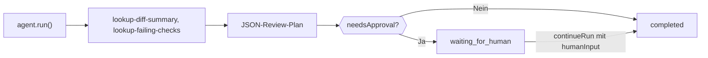

Baue einen TypeScript-Agenten, der einen Pull Request mit lokalen Tools untersucht, einen streng strukturierten JSON-Review-Plan zurückgibt und für eine Person anhält, wenn der Plan eine Freigabe verlangt. Am Ende hast du ein Skript, das einen validierten `CodeReviewPlan` ausgibt und bei `waiting_for_human` stoppt, bis jemand ihn freigibt.

Die Tools liefern feste Beispieldaten, das Skript dient also der Veranschaulichung; ersetze sie durch Aufrufe an deinen Code-Host und deine CI. Eine fertig verpackte Version liegt in `packages/sdk/agent-sdk-ts/examples/coding-review-agent.ts`.



## Agenten bauen

<Steps>
<Step title="Installieren">

```bash
npm install @phaseo/agent-sdk zod
export PHASEO_API_KEY="phaseo_v1_sk_..."
```

</Step>
<Step title="Agenten schreiben">

```ts review-agent.ts
import { z } from "zod";
import { createAgent, createGatewayAgentClient, defineTool } from "@phaseo/agent-sdk";

const CodeReviewPlan = z
  .object({
    risk: z.enum(["low", "medium", "high"]),
    summary: z.string().min(1),
    recommendedActions: z.array(z.string()).min(1),
    needsApproval: z.boolean(),
  })
  .strict();
type CodeReviewPlan = z.infer<typeof CodeReviewPlan>;

const PullRequestInput = z.object({ pullRequestId: z.string().regex(/^pr_\d+$/) }).strict();
const pullRequestParameters = {
  type: "object",
  properties: { pullRequestId: { type: "string", pattern: "^pr_\\d+$" } },
  required: ["pullRequestId"],
  additionalProperties: false,
};

// Nur lesende, deterministische Tools: sicher erneut ausführbar, wenn ein Worker den Lauf fortsetzt.
const lookupDiffSummary = defineTool({
  id: "lookup-diff-summary",
  description: "Return a short summary of the changed files in one pull request.",
  parameters: pullRequestParameters,
  inputSchema: PullRequestInput,
  async execute({ pullRequestId }) {
    return {
      pullRequestId,
      files: ["apps/api/src/pipeline/before/index.ts"],
      summary: "Changes touch request validation.",
    };
  },
});

const lookupFailingChecks = defineTool({
  id: "lookup-failing-checks",
  description: "Return the failing CI checks for one pull request.",
  parameters: pullRequestParameters,
  inputSchema: PullRequestInput,
  async execute({ pullRequestId }) {
    return { pullRequestId, failingChecks: ["web-typecheck"] };
  },
});

const codingReviewAgent = createAgent<string, CodeReviewPlan>({
  id: "coding-review-agent",
  model: "openai/gpt-6-astra",
  instructions:
    "Use the available tools to inspect the coding task, then return a strict JSON review plan.",
  tools: [lookupDiffSummary, lookupFailingChecks],
  maxSteps: 6,
  parseOutput: (text) => JSON.parse(text),
  outputSchema: CodeReviewPlan,
  humanReview: ({ parsedOutput }) =>
    parsedOutput?.needsApproval
      ? { reason: "coding_review_approval_required", payload: parsedOutput }
      : null,
});

// Das Gateway genau diese JSON-Form anfordern lassen und fast gültiges JSON reparieren.
const client = createGatewayAgentClient({
  clientOptions: { apiKey: process.env.PHASEO_API_KEY! },
  responseFormat: {
    type: "json_schema",
    name: "code_review_plan",
    schema: {
      type: "object",
      properties: {
        risk: { type: "string", enum: ["low", "medium", "high"] },
        summary: { type: "string" },
        recommendedActions: { type: "array", items: { type: "string" }, minItems: 1 },
        needsApproval: { type: "boolean" },
      },
      required: ["risk", "summary", "recommendedActions", "needsApproval"],
      additionalProperties: false,
    },
  },
  plugins: [{ id: "response-healing", mode: "strict" }],
});

const result = await codingReviewAgent.run({
  input: "Review pull request pr_482 and produce a remediation plan.",
  client,
  onEvent(event) {
    console.log(event.type, event.runId);
  },
});

if (result.run.status === "waiting_for_human") {
  console.log("Needs approval:", result.run.pause?.payload);

  // In einer echten App `result` speichern und fortsetzen, wenn eine prüfende Person freigibt.
  if (process.env.APPROVE === "yes") {
    const continued = await codingReviewAgent.continueRun({
      run: result,
      client,
      humanInput: "Approved. Finalize the plan.",
    });
    console.log(continued.output);
  }
} else {
  console.log(result.output);
}
```

`responseFormat` lässt das Gateway dieses Schema anfordern, und `outputSchema` prüft das geparste Ergebnis in deinem Prozess noch einmal. Der strenge Modus der [Antwortreparatur](./response-healing-for-structured-json) entpackt nur JSON, das bereits gültig ist.

</Step>
<Step title="Ausführen">

```bash
npx tsx review-agent.ts
APPROVE=yes npx tsx review-agent.ts
```

</Step>
</Steps>

## Prüfen, ob es funktioniert hat

- Das Ereignisprotokoll zeigt `tool.started` und `tool.completed` für beide Tools und danach `checkpoint.saved` nach dem Tool-Schritt.
- Ein Plan mit `needsApproval: true` beendet den ersten Lauf bei `waiting_for_human`, mit dem Plan in `result.run.pause.payload`; mit `APPROVE=yes` läuft er weiter bis `completed`.
- Unter **Einstellungen → Nutzung → Protokolle** zeigt jeder Modellzug die Tool-Aufrufe, und der Plugin-Eintrag der Anfrage zeigt, ob die Reparatur gelaufen ist.
- Ein Plan, der das Schema verletzt, lässt den Lauf mit einem `AgentSchemaValidationError` fehlschlagen, statt fehlerhafte Daten zurückzugeben.

## Für echte Repositorys absichern

Halte Review-Tools nur lesend. Wenn du ein Tool hinzufügst, das kommentiert, pusht oder mergt, setze darauf `requireApproval: true`, damit der Lauf vor dessen Ausführung anhält, und gib es mit `continueRun({ run, client, approvals: [toolCallId] })` frei. Behandle Diff-Inhalte als nicht vertrauenswürdige Eingabe: Code-Kommentare können Anweisungen enthalten, die sich an das Modell richten. Damit ein wartendes Review Neustarts übersteht, speichere den Lauf mit einem `state`-Accessor wie in der [robusten Agent-Schleife](./agent-sdk-durable-loop). [Status und Freigabe](../sdk-reference/agent/state-and-approval) behandelt Freigaben und Ablehnungen.
