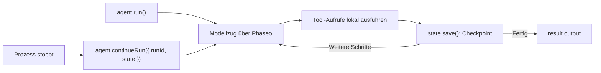

Führe mit dem TypeScript Agent SDK einen Agenten mit Tools aus und speichere seinen Zustand nach jedem Schritt, damit ein abgestürzter oder neu gestarteter Prozess dort weitermacht, wo er aufgehört hat. Am Ende hast du ein Skript, das eine Frage zur Dokumentation mit einem Nachschlage-Tool beantwortet, jeden Lauf in `.agent-runs/<run id>.json` schreibt und einen Lauf fortsetzt, wenn du seine ID übergibst.

Das Skript dient der Veranschaulichung: Der Dateispeicher eignet sich für einen einzelnen Rechner. Behalte in der Produktion dasselbe `load`/`save`-Paar bei, aber hinterlege es mit deiner Datenbank. Phaseo speichert Agent-SDK-Läufe nicht für dich.



## Agenten bauen

<Steps>
<Step title="Installieren">

<CodeGroup>
```bash npm
npm install @phaseo/agent-sdk zod
```

```bash pnpm
pnpm add @phaseo/agent-sdk zod
```

```bash yarn
yarn add @phaseo/agent-sdk zod
```

```bash bun
bun add @phaseo/agent-sdk zod
```
</CodeGroup>

`@phaseo/agent-sdk` installiert `@phaseo/sdk` mit. Setze deinen Schlüssel:

```bash
export PHASEO_API_KEY="phaseo_v1_sk_..."
```

</Step>
<Step title="Agenten schreiben">

```ts agent.ts
import { mkdir, readFile, writeFile } from "node:fs/promises";
import { z } from "zod";
import {
  createAgent,
  createGatewayAgentClient,
  defineTool,
  type AgentStateAccessor,
} from "@phaseo/agent-sdk";

const DOC_SLUGS = ["guides/presets", "guides/routing-and-fallbacks", "guides/streaming"] as const;

// Das Modell sieht nur `parameters`; `inputSchema` lehnt alles andere ab, bevor execute läuft.
const lookupDocs = defineTool({
  id: "lookup-docs",
  description: "Return the URL of one Phaseo docs page by slug.",
  parameters: {
    type: "object",
    properties: { slug: { type: "string", enum: [...DOC_SLUGS] } },
    required: ["slug"],
    additionalProperties: false,
  },
  inputSchema: z.object({ slug: z.enum(DOC_SLUGS) }).strict(),
  async execute({ slug }) {
    return { slug, url: `https://phaseo.app/docs/v1/${slug}` };
  },
});

const agent = createAgent<string, string>({
  id: "support-docs-agent",
  model: "openai/gpt-6-astra",
  instructions: "Use tools when helpful and finish with a concise answer that includes the docs URL.",
  tools: [lookupDocs],
  maxSteps: 6,
});

// Den ganzen Lauf nach jedem Schritt speichern. Tausche diese beiden Funktionen gegen deine Datenbank.
const RUNS_DIR = ".agent-runs";
const state: AgentStateAccessor<string, unknown, string> = {
  async load(runId) {
    try {
      return JSON.parse(await readFile(`${RUNS_DIR}/${runId}.json`, "utf8"));
    } catch {
      return null;
    }
  },
  async save(result) {
    await mkdir(RUNS_DIR, { recursive: true });
    await writeFile(`${RUNS_DIR}/${result.run.id}.json`, JSON.stringify(result));
  },
};

const client = createGatewayAgentClient({
  clientOptions: { apiKey: process.env.PHASEO_API_KEY! },
});

const onEvent = (event: { type: string; runId: string }) => {
  if (event.type === "checkpoint.saved") console.log("checkpoint", event.runId);
};

const resumeId = process.argv[2];
let result;

if (resumeId) {
  const saved = await state.load(resumeId);
  if (!saved) throw new Error(`No saved run ${resumeId}`);
  result = saved.run.status === "completed"
    ? saved
    : await agent.continueRun({ run: saved, client, state, onEvent });
} else {
  result = await agent.run({
    input: "Find the docs page for presets and explain when to use them.",
    client,
    state,
    onEvent,
  });
}

console.log(result.run.id, result.run.status);
console.log(result.output);
```

</Step>
<Step title="Ausführen">

```bash
npx tsx agent.ts
```

Um das Fortsetzen zu testen, stoppe das Skript nach der ersten `checkpoint`-Zeile mit `Ctrl+C` und übergib dann die ausgegebene Lauf-ID (eine UUID):

```bash
npx tsx agent.ts 3f6c1d2e-...
```

</Step>
</Steps>

## Prüfen, ob es funktioniert hat

- Das Skript gibt pro Schritt einmal `checkpoint` aus, danach die Lauf-ID, `completed` und eine Antwort mit einer `phaseo.app/docs`-URL.
- `.agent-runs/<run id>.json` enthält Lauf-ID, Status, Nachrichtenverlauf, die Tool-Aufrufe und Ergebnisse jedes Schritts sowie die endgültige Ausgabe.
- Nach einem unterbrochenen Lauf schließt der Fortsetzungsbefehl dieselbe Lauf-ID ab, statt einen neuen Lauf zu starten.
- Jeder Modellzug erscheint unter **Einstellungen → Nutzung → Protokolle**. Protokolliere die Lauf-ID neben jeder Anfrage-ID, damit du sie zuordnen kannst.

## Was der gespeicherte Zustand enthält

Jedes gespeicherte Ergebnis ist das vollständige `AgentRunResult`: `run` (ID, Status, Nachrichten, Nutzung, eine eventuelle Pause), `steps` mit ihren Gateway-Anfrage-IDs und Tool-Aufrufen sowie `output`, sobald der Lauf abgeschlossen ist. `continueRun()` akzeptiert es direkt, oder eine `runId` zusammen mit `state`, und ruft dann selbst `load()` auf.

Ein Tool-Aufruf, der lief, als der Prozess stoppte, kann seine Wirkung bereits gehabt haben, halte Tools also idempotent. Das SDK repariert den Verlauf eines Aufrufs, der nie ein Ergebnis bekommen hat, bevor es fortfährt. [Status und Freigabe](../sdk-reference/agent/state-and-approval) behandelt Pausen und Freigaben.

## Behutsam erweitern

Behalte einen Agenten pro Workflow, eine kurze Tool-Liste und eine Protokollzeile pro Lauf mit Lauf-ID und Anfrage-IDs. Wenn du Freigabepausen oder mehrere Agenten mit gemeinsamen Tools brauchst, behalte dieses Paar aus Gateway-Client und Zustand bei und baue darum herum: Der [Code-Review-Agent](./agent-sdk-coding-review) ergänzt eine Freigabepause, und [Parallele Tools](./agent-sdk-parallel-tools) führt Tools nebeneinander aus. Für gemeinsame Anfrage-Standards rufe ein [Preset](../guides/presets) statt eines festen Modells auf.
