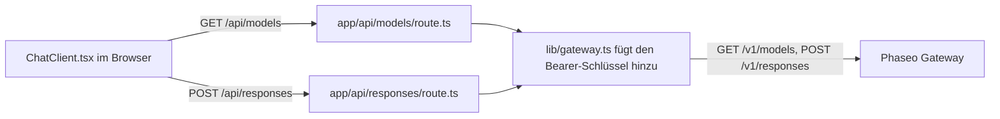

Führe eine kleine Next.js-Chat-App aus, deren Browser-Code nur mit deinen eigenen Server-Routen spricht, sodass dein Phaseo-API-Schlüssel nie den Browser erreicht. Am Ende hast du eine lokale Chat-Seite mit einer Modellauswahl, die aus `GET /v1/models` befüllt wird, und Antworten von `POST /v1/responses`.

Das Beispiel dient der Veranschaulichung: Seine Routen haben weder Anmeldung noch Ratenbegrenzung, sodass jeder, der sie erreicht, deinen Schlüssel verbraucht. Ergänze zuerst die Prüfungen aus [Vor dem Deployment](#before-you-deploy-it).

Damit ein Coding-Agent dieselbe App von Grund auf baut, füge diesen Prompt ein:

<Prompt
  description="Erstelle eine **Next.js-Web-Chat-App** auf Basis von Phaseo Gateway."
  icon="message-square"
  actions={["copy", "cursor"]}
>
{`You are building a small production-style chat app with Phaseo Gateway.

Create a Next.js app with:
- a chat UI
- a model picker backed by GET https://api.phaseo.app/v1/models
- a server-side route that calls POST https://api.phaseo.app/v1/responses
- server-side API key handling using PHASEO_API_KEY (Authorization: Bearer)
- loading, success, and error states

Keep the app intentionally small and easy to inspect.

Implementation requirements:
- Use one local API route for model discovery.
- Use one local API route for responses generation.
- Keep secrets server-side only.
- Send the whole conversation in input on every turn. The gateway rejects previous_response_id.
- Only accept model IDs from an allowlist on the server, and cap the input length.
- Show the request/response flow clearly in code.
- Add a short README with setup and run steps.

Verification:
- Run the app if possible.
- Verify two successful chat turns in a row.
- Report the exact files changed, what you verified, and any remaining assumptions.`}
</Prompt>

## So ist das Beispiel aufgebaut



Das Beispiel liegt in [examples/web-chat-nextjs](https://github.com/phaseoteam/Phaseo/tree/main/examples/web-chat-nextjs):

| Datei | Aufgabe |
| --- | --- |
| `app/components/ChatClient.tsx` | Eingabe, Lade- und Fehlerzustand, gerenderte Nachrichten, Modellauswahl |
| `app/api/models/route.ts` | Gibt die Modell-IDs aus `GET /v1/models` zurück |
| `app/api/responses/route.ts` | Prüft, ob `model` und `input` nicht leere Strings sind (`400 missing_model`, `400 missing_input`), und ruft dann `POST /v1/responses` auf |
| `lib/gateway.ts` | Baut URL und Header: `Authorization: Bearer $PHASEO_API_KEY`, `x-title` und `http-referer`, wenn gesetzt |

## Beispiel ausführen

Du brauchst Node.js und einen Phaseo-API-Schlüssel.

<Steps>
<Step title="Installieren">

```bash
cd examples/web-chat-nextjs
npm install
```

Das Beispiel enthält eine `package-lock.json`, daher installiert `npm` die getesteten Versionen.

</Step>
<Step title=".env.local anlegen">

Das Beispiel hat keine `.env.example`. Lege `.env.local` selbst an:

```bash .env.local
PHASEO_API_KEY=phaseo_v1_sk_...
# Optional. Standard ist https://api.phaseo.app; /v1 wird automatisch ergänzt.
NEXT_PUBLIC_GATEWAY_URL=https://api.phaseo.app
# Optionale Header für die App-Zuordnung.
GATEWAY_APP_TITLE=My chat app
GATEWAY_HTTP_REFERER=https://myapp.example
```

`NEXT_PUBLIC_GATEWAY_URL` wird hier nur auf dem Server gelesen, aber das Präfix `NEXT_PUBLIC_` würde den Wert für Browser-Code offenlegen, also schreibe niemals einen Schlüssel hinein. [App-Zuordnung](../guides/app-attribution) erklärt die beiden optionalen Header.

</Step>
<Step title="Den zweiten Chat-Zug reparieren">

`ChatClient.tsx` sendet die `id` der vorherigen Antwort als `previous_response_id`. Das Gateway speichert keine Antworten und lehnt dieses Feld daher mit `400 validation_error` (Schlüsselwort `unsupported_param`) ab, und die zweite Nachricht schlägt fehl. Lösche in `app/api/responses/route.ts` den Block, der `previous_response_id` in den Payload kopiert:

```ts app/api/responses/route.ts
  // Diese Zeilen löschen:
  if (typeof body.previous_response_id === 'string' && body.previous_response_id.trim()) {
    payload.previous_response_id = body.previous_response_id.trim();
  }
```

Jeder Zug wird dann für sich beantwortet. Um den Kontext zu behalten, sende die früheren Züge als Array von Nachrichten in `input`.

</Step>
<Step title="Entwicklungsserver starten">

```bash
npm run dev
```

Öffne `http://localhost:3000`.

</Step>
</Steps>

## Prüfen, ob es funktioniert hat

- Die Modellauswahl füllt sich mit Modell-IDs.
- Zwei Nachrichten hintereinander erhalten jeweils eine Antwort.
- Im Netzwerk-Panel des Browsers gehen Anfragen nur an `/api/models` und `/api/responses`, und keine Anfrage enthält `PHASEO_API_KEY`.
- Eine ungültige Modell-ID zeigt die Fehlermeldung des Gateways statt einer leeren Antwort.
- Die Anfragen erscheinen unter **Einstellungen → Nutzung → Protokolle** mit dem App-Titel, den du gesetzt hast.

<span id="before-you-deploy-it"></span>
## Vor dem Deployment

- **Routen authentifizieren.** Verlange auf `/api/responses` und `/api/models` eine angemeldete Person, oder nutze die [OAuth-Workbench](./build-an-oauth-nextjs-workbench), damit jede Person ihr eigenes Guthaben verbraucht.
- **Modelle per Zulassungsliste beschränken.** Die Route leitet jeden `model`-String aus dem Browser weiter. Prüfe ihn auf dem Server gegen eine feste Liste.
- **Eingabe und Rate begrenzen.** Begrenze die Eingabelänge und die Anfragen pro Person und setze ein [Ausgabenlimit für den Schlüssel](../api-reference/limits#key-limits-and-budgets).
- **Streamen, wenn du es brauchst.** Setze `stream: true` und leite die Ereignisse weiter; [Streaming](../guides/streaming) zeigt, welches Ereignis einen Responses-Stream beendet.

Für ein Backend-Skript statt einer UI beginne mit der [Node-REST-Smoke-App](./build-a-node-rest-smoke-app) oder der [Python-Gateway-CLI](./build-a-python-gateway-cli).
