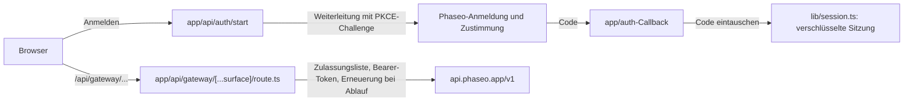

Lass Personen sich mit Phaseo anmelden und in deiner App ihre eigenen Credits ausgeben: OAuth 2.1 mit PKCE gibt deinem Server ein Zugriffstoken, und ein serverseitiger Proxy hängt es an jeden Gateway-Aufruf an. Am Ende hast du eine lokale App mit Anmeldung, sitzungsgebundenen Tokens, die sich erneuern, Modellsuche, einem Chat-Ablauf über `/responses` und einem Tester für weitere Endpunkte.

Das Beispiel dient zur Veranschaulichung. Seine `lib/oauth.ts` ruft noch einen älteren Anmelde-Endpunkt auf, was Schritt 3 von [Ausführen](#run-it) behebt, und seine Proxy-Zulassungsliste ist breiter, als ein Produkt sie braucht.

Damit ein Coding-Agent dieselbe App von Grund auf baut, füge diesen Prompt ein:

<Prompt
  description="Baue eine **angemeldete Next.js-Workbench** mit OAuth und einem einheitlichen Phaseo-Proxy."
  icon="shield-user"
  actions={["copy", "cursor"]}
>
{`You are building a signed-in Next.js app on top of Phaseo Gateway.

Create a workbench-style app with:
- OAuth 2.1 + PKCE sign-in against https://api.phaseo.app/oauth/authorize and https://api.phaseo.app/oauth/token (discover them from https://api.phaseo.app/.well-known/oauth-authorization-server), requesting the gateway:access scope
- session-backed token storage in an encrypted, httpOnly cookie
- one unified gateway proxy route on the server that calls https://api.phaseo.app/v1
- model discovery
- one chat flow using the Responses API, sending the whole conversation in input on every turn
- one generic endpoint tester for additional Phaseo endpoints

Requirements:
- Keep gateway credentials and access tokens server-side.
- Use a proxy allowlist of exact paths for safety.
- Support token refresh. Store the new refresh token from every refresh and drop the old one.
- Sign out by sending the refresh token to https://api.phaseo.app/oauth/revoke.
- Keep the workbench understandable rather than over-engineered.
- Add a short README with setup, env vars, and run steps.

Verification:
- run the app if possible
- verify sign-in flow as far as local setup allows
- verify at least one proxied gateway request path
- report exactly what you verified and what remains dependent on external OAuth configuration.`}
</Prompt>

## Wie das Beispiel aufgebaut ist



Das Beispiel liegt in [examples/oauth-client-nextjs](https://github.com/phaseoteam/Phaseo/tree/main/examples/oauth-client-nextjs):

| Datei | Aufgabe |
| --- | --- |
| `app/page.tsx` | Einstiegsseite für die Anmeldung |
| `app/dashboard/page.tsx` | Geschützte Shell |
| `app/dashboard/GatewayWorkbench.tsx` | Lädt Steuerrouten, listet Modell-IDs auf, führt Chats über `POST /responses` aus und testet weitere Endpunkte |
| `app/api/gateway/[...surface]/route.ts` | Catch-all-Proxy: prüft die Zulassungsliste, fügt das Bearer-Token hinzu, erneuert es nach Ablauf und leitet Body und Status weiter |
| `lib/oauth.ts` | PKCE, Code-Austausch und Erneuerung |
| `lib/session.ts` | Verschlüsselte Sitzungsspeicherung |

Weil die Anmeldung von den Gateway-Aufrufen getrennt ist, sieht ein Anmeldeproblem nie wie ein Modellproblem aus, und alle Endpunkte teilen sich eine Stelle, die Tokens verwaltet.

<span id="run-it"></span>
## Ausführen

Du brauchst Node.js, eine OAuth-App mit `http://localhost:3000/auth/callback` (oder deinem eigenen Callback) als Weiterleitungs-URI und ein langes zufälliges Sitzungsgeheimnis. Lege die OAuth-App unter **Einstellungen → OAuth-Apps** oder mit der [OAuth-Clients-API](../api-reference/endpoint/oauth-clients-create) an.

<Steps>
<Step title="Installieren">

```bash
cd examples/oauth-client-nextjs
npm install
```

</Step>
<Step title=".env.local anlegen">

Das Beispiel enthält keine `.env.example`. Lege `.env.local` mit den Namen an, die der Code liest:

```bash .env.local
NEXT_PUBLIC_OAUTH_CLIENT_ID=your_client_id
OAUTH_CLIENT_SECRET=your_client_secret
# Das Beispiel liest diesen Namen für die Basis-URL des OAuth-Servers.
NEXT_PUBLIC_AISTATS_URL=https://api.phaseo.app
NEXT_PUBLIC_REDIRECT_URI=http://localhost:3000/auth/callback
SESSION_SECRET=a-long-random-string
NEXT_PUBLIC_GATEWAY_URL=https://api.phaseo.app
```

Lege `OAUTH_CLIENT_SECRET` oder `SESSION_SECRET` nie in eine `NEXT_PUBLIC_`-Variable.

</Step>
<Step title="Das Beispiel auf die aktuellen OAuth-Endpunkte umstellen">

`lib/oauth.ts` baut `${NEXT_PUBLIC_AISTATS_URL}/auth/v1/oauth/authorize` und `/auth/v1/token` und fordert `openid email profile` an. Der OAuth-Server von Phaseo veröffentlicht seine Endpunkte unter `https://api.phaseo.app/.well-known/oauth-authorization-server`:

| Zweck | URL |
| --- | --- |
| Autorisieren | `https://api.phaseo.app/oauth/authorize` |
| Token | `https://api.phaseo.app/oauth/token` |
| Widerrufen | `https://api.phaseo.app/oauth/revoke` |

Ändere die drei URLs in `lib/oauth.ts` auf diese und füge `gateway:access` zu `scope` hinzu, damit das Token das Gateway aufrufen kann.

</Step>
<Step title="Den Entwicklungsserver starten">

```bash
npm run dev
```

Öffne `http://localhost:3000`, melde dich an und öffne das Dashboard.

</Step>
</Steps>

## Prüfen, ob es funktioniert hat

- Die Anmeldung kehrt zu deiner Callback-URL zurück und legt eine Sitzung an.
- Das Dashboard listet Modelle über `/api/gateway/models` auf.
- Eine Chatrunde über `/api/gateway/responses` erhält eine Antwort, und keine Browseranfrage enthält das Zugriffstoken.
- Ein Pfad außerhalb der Proxy-Zulassungsliste wird abgelehnt.

## Laufzeiten der Tokens

Der Token-Endpunkt gibt zwei Tokens zurück:

| Token | Gültig | Verwendung |
| --- | --- | --- |
| `access_token` | 7 Tage (`expires_in`) | Sende es als `Authorization: Bearer` bei Gateway-Anfragen. Es verbraucht Credits in dem Workspace, den die Person gewählt hat. |
| `refresh_token` | 90 Tage ab der letzten Verwendung | Sende es mit `grant_type=refresh_token`, um ein neues Paar zu erhalten. |

- **Bei jeder Erneuerung rotieren.** Jede Erneuerung liefert ein neues Zugriffstoken und ein neues Refresh-Token. Speichere beide und verwirf die alten: Das alte Zugriffstoken funktioniert sofort nicht mehr, und das alte Refresh-Token lässt sich nicht erneut verwenden.
- **Nach Ablauf erneuern.** Du kannst erneuern, nachdem das Zugriffstoken abgelaufen ist, solange das Refresh-Token noch gültig ist.
- **Ein Refresh-Token nie wiederverwenden.** Eine zweite Verwendung beendet die Anmeldung. Phaseo behandelt es als geleaktes Token und widerruft das Zugriffstoken und alle Refresh-Tokens dieser Anmeldung, sodass sich die Person erneut anmelden muss.
- **Scopes werden nur kleiner.** Eine Erneuerung fügt nie Scopes hinzu. Sie behält die Scopes, denen die Person zugestimmt hat, abzüglich derer, die sie inzwischen entfernt hat.
- **Wenn die Erneuerung fehlschlägt.** Die Erneuerung schlägt fehl, sobald die Person deine App widerruft, ihren Schlüssel widerruft oder deaktiviert, einen Scope entfernt, den der Schlüssel braucht (zum Beispiel `gateway:access`), oder den Workspace verlässt. Das Entfernen von `gateway:access` widerruft außerdem den Schlüssel, sodass sein Zugriffstoken sofort nicht mehr funktioniert. Den Scope erneut zu erteilen, bringt das Refresh-Token nicht zurück. Schicke die Person erneut durch die Anmeldung.
- **Erneutes Anmelden erneuert den Schlüssel.** Es erneuert denselben Schlüssel, statt einen neuen hinzuzufügen, unabhängig davon, ob du `resource=https://api.phaseo.app/v1` sendest. Du erhältst ein neues Zugriffstoken und ein neues Refresh-Token, die bisherigen funktionieren nicht mehr, und der Schlüssel behält die Ausgaben dieses Monats. Sein monatliches Ausgabenlimit wird zu dem, dem die Person gerade zugestimmt hat. Das Refresh-Token einer früheren Anmeldung wird einfach abgelehnt, und es an den Token- oder Revoke-Endpunkt zu senden, beendet die neue Anmeldung nicht.
- **Ein pausierter Schlüssel blockiert die Anmeldung.** Ist einer der Schlüssel deiner App für diese Person und diesen Workspace pausiert, unabhängig von seiner Ressource, gibt der Token-Endpunkt `invalid_grant` zurück, bis jemand den Schlüssel unter **Einstellungen → API-Schlüssel** wieder aktiviert. Die Erneuerung funktioniert nur, solange der Schlüssel nicht widerrufen ist: Nach einer Abmeldung oder einem anderen Widerruf stellt die Anmeldung einen neuen Schlüssel aus, dessen Limits und Ausgaben bei null beginnen.
- **Mit Revoke abmelden.** Sende das Refresh-Token an `https://api.phaseo.app/oauth/revoke`. Das widerruft den Schlüssel und alle Refresh-Tokens der Anmeldung, auch eines, das eine Erneuerung kurz zuvor ausgestellt hat.

## Ausgabenlimits

Auf dem Zustimmungsbildschirm legt die Person ein monatliches Ausgabenlimit für deine App fest: standardmäßig $20.00, einen anderen Betrag oder kein Limit. Sobald der Schlüssel diesen Betrag in einem Kalendermonat ausgegeben hat, geben Gateway-Anfragen `429` mit `key_limit_exceeded` zurück, bis der nächste Monat beginnt oder die Person das Limit unter **Einstellungen → API-Schlüssel** erhöht.

Egal welche Scopes sie hat: Deine App kann dieses Limit über die API weder aufheben noch umgehen. Sie kann API-Schlüssel nur umbenennen oder löschen. Sie kann keine Schlüssel erstellen oder rotieren, weder Limits, Status noch Ablauf eines Schlüssels ändern, keine Verwaltungsschlüssel oder vertrauenswürdigen Workloads anlegen, keine Mitglieder hinzufügen, keine Budgets, Guardrails, Ratenlimits oder Ausgaberegeln ändern und weder die Preislimits des Workspace für das Routing noch seinen BYOK-Fallback auf Credits ändern.

## Bevor du es auslieferst

- **Die Zulassungsliste kürzen.** `lib/gateway.ts` erlaubt exakte Pfade sowie jeden Pfad unter `videos/`, `music/generate/`, `control/` und `internal/`. Behalte nur die exakten Pfade, die dein Produkt aufruft.
- **Die ganze Unterhaltung senden.** Das Gateway speichert keine Antworten und lehnt `previous_response_id` ab, also sende frühere Runden erneut in `input`.
- **Den Tester ersetzen.** Behalte die Workbench für die interne QA und baue zweckgebundene Abläufe für Endnutzer.

Für eine App mit API-Schlüssel ohne Anmeldung beginnst du mit der [Next.js-Web-Chat-App](./build-a-nextjs-web-chat-app).
