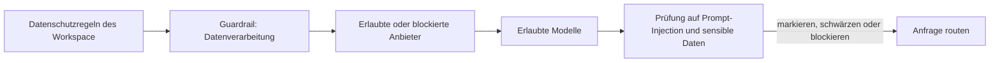

Lege eine Guardrail unter **Einstellungen → Leitplanken** an, hänge sie an einen API-Schlüssel mit geringem Risiko und weite sie erst aus, wenn die Protokolle zeigen, dass sie sich richtig verhält. Am Ende erreicht dieser Schlüssel nur noch die Anbieter und Modelle, die du erlaubst, und seine Prompts werden auf Prompt-Injection und sensible Daten geprüft, bevor sie ein Modell erreichen.

Dies ist ein Ablauf im Dashboard; dieselbe Richtlinie lässt sich mit der [Guardrails-API](../api-reference/endpoint/guardrails-create) skripten.

Die Datenschutzregeln des Workspace gelten zuerst; eine Guardrail kann sie nur weiter einschränken. Guardrails begrenzen keine Ausgaben: Setze dafür ein Limit für den Schlüssel oder ein [Workspace-Budget](../api-reference/limits#key-limits-and-budgets).

## Einführen

<Steps>
<Step title="Die Guardrail anlegen">

Öffne **Einstellungen → Leitplanken → Neue Leitplanke**. Benenne sie nach dem, was sie durchsetzt, etwa `eu-models-pii-redact`, nicht nach einem Team, damit du sie für mehrere Schlüssel wiederverwenden kannst.

Lege den Routenzugriff vor den Inhaltsprüfungen fest:

| Einstellung | Optionen |
| --- | --- |
| **Anbietermodus** | Alle Anbieter erlauben, Nur ausgewählte Anbieter erlauben oder Alle Anbieter außer ausgewählten erlauben |
| **Modellmodus** | Alle Modelle erlauben oder Nur ausgewählte Modelle erlauben (gilt nach der Anbieterfilterung) |
| **Datenverarbeitung** | Nur ZDR, und ob kostenlose oder kostenpflichtige Endpunkte, die mit Eingaben trainieren dürfen, zulässig bleiben |

Eine typische erste Richtlinie blockiert Anbieter mit geringem Vertrauen und erlaubt nur die exakten Produktionsmodelle, die der Schlüssel erreichen soll. Prüfe in der Vorschau, welche Anbieter und Modelle routbar bleiben und ob **Nur … erlauben** enger ist, als du beabsichtigt hast.

</Step>
<Step title="Inhaltsprüfungen hinzufügen">

**Prompt-Injection** durchsucht von Nutzern gelieferte Inhalte nach gängigen Injection-Mustern. **Sensible Daten** erkennt Daten, bevor die Anfrage Phaseo verlässt:

| Detektor | Geschwärzt als | Erhöht die Latenz |
| --- | --- | --- |
| E-Mail-Adresse | `[EMAIL]` | Nein |
| Telefonnummer | `[PHONE]` | Nein |
| US-Sozialversicherungsnummer | `[SSN]` | Nein |
| Kreditkartennummer | `[CREDIT_CARD]` | Nein |
| IP-Adresse (IPv4) | `[IP_ADDRESS]` | Nein |
| Personenname | `[PERSON_NAME]` | Ja |
| Postanschrift | `[ADDRESS]` | Ja |

Jede Prüfung hat eine Aktion: **Markieren**, **Schwärzen** oder **Blockieren**. Starte Prompt-Injection mit **Markieren** oder **Schwärzen** und wechsle erst zu **Blockieren**, nachdem du die Fehlalarme geprüft hast. Nutze zuerst die schnellen Detektoren. Füge eigene Muster als explizite Regex-Regeln hinzu.

</Step>
<Step title="In der Vorschau testen">

Schicke vor dem Speichern drei Eingaben durch die Vorschau: eine harmlose, eine, die eindeutig gestoppt werden sollte, und einen realistischen Produktions-Prompt. Prüfe den Schwärzungstext, das Ergebnis (blockiert oder erlaubt) und dass nichts Unbeteiligtes anschlägt.

</Step>
<Step title="An einen Schlüssel hängen">

Wähle unter **Auf Schlüssel anwenden** einen Staging-Schlüssel oder einen Schlüssel mit geringem Risiko. Du kannst die Guardrail schon beim Anlegen anhängen. **Auf Mitglieder anwenden** setzt sie stattdessen für die API-Schlüssel durch, die diese Mitglieder erstellen. Mitglieder können eine Guardrail, die ein Workspace-Owner oder Admin zugewiesen hat, weder bearbeiten noch entfernen.

</Step>
<Step title="Die Durchsetzung prüfen">

Sende echte Anfragen über den Schlüssel und prüfe dann:

- **Einstellungen → Nutzung → Leitplanken** für die Anzahl blockierter, geschwärzter und markierter Anfragen.
- Den Abschnitt **Durchsetzung der Leitplanken** einer Anfrage unter **Einstellungen → Nutzung → Protokolle**, um zu sehen, welche Guardrail und welcher Detektor ausgelöst haben.
- Die Spalte **Leitplanken** unter **Einstellungen → API-Schlüssel**, um zu bestätigen, an welchen Schlüsseln sie hängt.

</Step>
<Step title="Den Rollout ausweiten">

Hänge dieselbe Guardrail an weitere Schlüssel, verschärfe die Aktionen von **Markieren** zu **Schwärzen** oder **Blockieren** und füge die Detektoren für Personennamen und Anschriften nur dort hinzu, wo ihre Latenz akzeptabel ist.

</Step>
</Steps>

Eine deaktivierte Guardrail behält ihre Konfiguration, wird aber nicht durchgesetzt. Um Routing-Regeln zwischen Aufrufern zu teilen, statt sie für Schlüssel durchzusetzen, verwende ein [Preset](../guides/presets).
