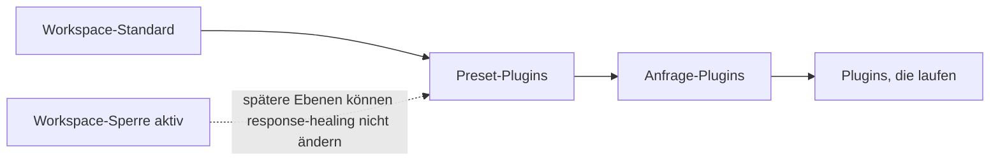

Schalte [Response Healing](./response-healing-for-structured-json) einmal für den ganzen Workspace oder für ein Preset ein, statt in jeder Anfrage. Am Ende erhält jeder Aufrufer mit strukturierter Ausgabe dieselbe Healing-Richtlinie, und du kannst sie sperren, damit kein Preset und keine Anfrage sie abschaltet.

Dies ist ein Ablauf im Dashboard; das Anfragebeispiel am Ende ist produktionsreif.

## Wie die Ebenen zusammenwirken

Phaseo stellt die Plugin-Liste jeder Anfrage aus drei Ebenen zusammen. Eine spätere Ebene ersetzt die Einstellungen einer früheren Ebene für dasselbe Plugin, es sei denn, die frühere ist gesperrt:



| Ebene | Festgelegt in | Überschreibt |
| --- | --- | --- |
| Workspace | **Einstellungen → Routing → Antwortreparatur** | Nichts |
| Preset | **Einstellungen → Voreinstellungen → (Preset) → Antwortreparatur** | Den Workspace, sofern er nicht gesperrt ist |
| Anfrage | `plugins` im Body | Das Preset und den Workspace, sofern der Workspace nicht gesperrt ist |

## Einrichten

<Steps>
<Step title="Den Workspace-Standard einschalten">

Schalte unter **Einstellungen → Routing → Antwortreparatur** die Option **Standardmäßig aktivieren** ein und wähle einen **Reparaturmodus**: `safe` für begrenzte Syntaxreparaturen, `strict`, um nur JSON auszupacken, das bereits gültig war. Verwende dies für breite Standards, die alle API-Schlüssel im Workspace teilen.

</Step>
<Step title="Sperren, wenn es nicht verhandelbar ist">

Schalte **Arbeitsbereichsrichtlinie sperren** ein. Presets und Anfragen können Healing dann weder abschalten noch seinen Modus ändern. Die Protokolle zeigen weiterhin, ob es angewendet oder übersprungen wurde.

</Step>
<Step title="Preset-Standards für einen Workflow festlegen">

Schalte im Preset-Editor **Antwortreparatur** ein und wähle den Modus, wenn eine Gruppe von Anfragen sowohl ein strukturiertes Ausgabeformat als auch Healing tragen soll. Aufrufer dieses Presets senden dann nur noch ihre Eingabe.

</Step>
</Steps>

## Für eine Anfrage überschreiben

Ist der Workspace nicht gesperrt, kann eine Anfrage das Plugin selbst setzen. `"enabled": false` schaltet es für diese Anfrage ab:

```json
{
  "model": "openai/gpt-6-astra",
  "input": "Return the summary as JSON.",
  "text": {
    "format": {
      "type": "json_schema",
      "name": "answer",
      "schema": {
        "type": "object",
        "properties": { "summary": { "type": "string" } },
        "required": ["summary"],
        "additionalProperties": false
      }
    }
  },
  "plugins": [{ "id": "response-healing", "enabled": true, "mode": "strict" }],
  "meta": true
}
```

## Prüfen, welche Richtlinie lief

Öffne die Anfrage unter **Einstellungen → Nutzung → Protokolle** oder lies `meta.plugin_executions`, wenn du `meta: true` gesendet hast. Dort stehen der Status (`applied`, `skipped` oder `failed`), der tatsächlich ausgeführte Modus und gegebenenfalls `validation_errors`, wenn ein reparierter Kandidat nicht zum Schema passte.

Wenn sich zwei Dienste unterschiedlich verhalten, vergleiche die Workspace-Einstellung und ihre Sperre, die Plugins des Presets und die `plugins` jeder Anfrage, bevor du es als Modellproblem behandelst.
