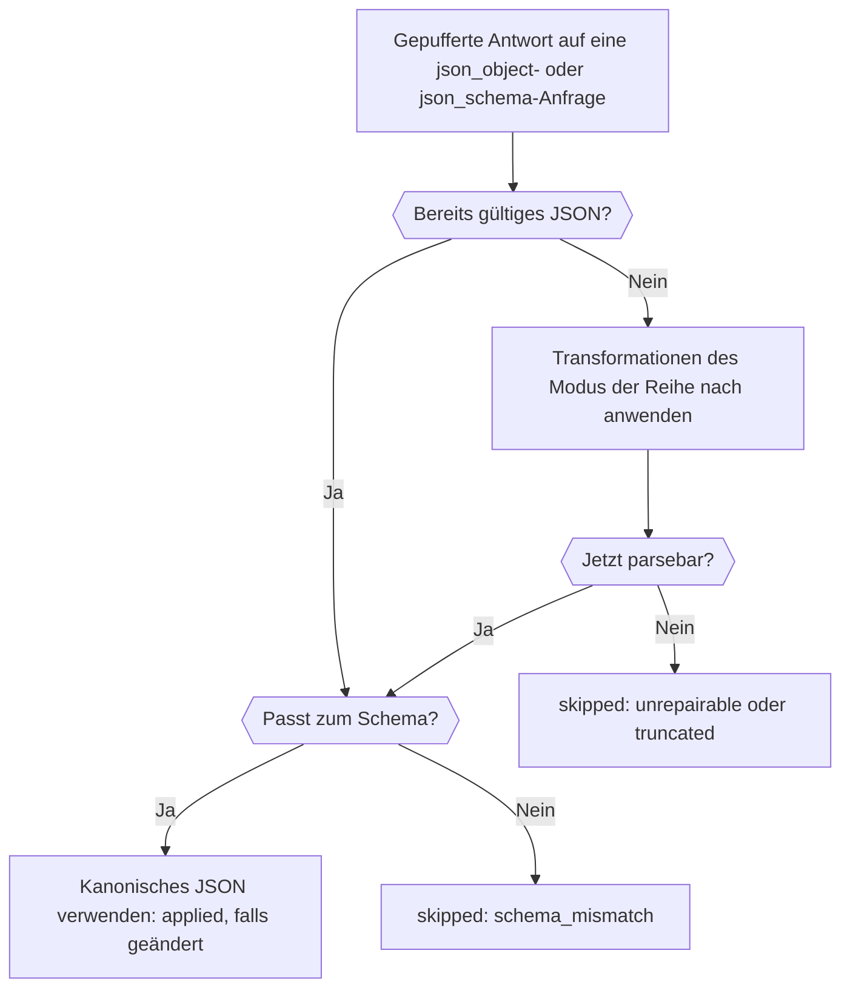

Füge einer Anfrage mit strukturierter Ausgabe das Plugin `response-healing` hinzu, und Phaseo repariert fast gültiges JSON, etwa JSON in einem Markdown-Codeblock oder mit einem überzähligen Komma, bevor es deinen Parser erreicht. Am Ende hast du eine Anfrage, die ein JSON Schema anfordert, die Antwort bei Bedarf repariert und dir in der Antwort mitteilt, ob sie das getan hat.

Die Anfrage ist produktionsreif. Healing behebt nur die Syntax, daher validiert dein Code das Ergebnis weiterhin, wie unter [Das Ergebnis validieren](../guides/structured-outputs#validate-the-result) beschrieben.



## Eine Anfrage mit Healing senden

<CodeGroup>
```bash cURL
curl https://api.phaseo.app/v1/responses \
  -H "Authorization: Bearer $PHASEO_API_KEY" \
  -H "Content-Type: application/json" \
  -d '{
    "model": "openai/gpt-6-astra",
    "input": "Summarize this release in one sentence: dark mode and faster search.",
    "text": {
      "format": {
        "type": "json_schema",
        "name": "answer",
        "strict": true,
        "schema": {
          "type": "object",
          "properties": { "summary": { "type": "string" } },
          "required": ["summary"],
          "additionalProperties": false
        }
      }
    },
    "plugins": [{ "id": "response-healing", "mode": "safe" }],
    "meta": true
  }'
```

```typescript TypeScript
import Phaseo from "@phaseo/sdk";

const client = new Phaseo({ apiKey: process.env.PHASEO_API_KEY! });

const response = await client.generateResponse({
  model: "openai/gpt-6-astra",
  input: "Summarize this release in one sentence: dark mode and faster search.",
  text: {
    format: {
      type: "json_schema",
      name: "answer",
      strict: true,
      schema: {
        type: "object",
        properties: { summary: { type: "string" } },
        required: ["summary"],
        additionalProperties: false,
      },
    },
  },
  plugins: [{ id: "response-healing", mode: "safe" }],
  meta: true,
});

console.log(response.meta?.plugin_executions);
```

```python Python
import os

from phaseo import Phaseo

client = Phaseo(api_key=os.environ["PHASEO_API_KEY"])

response = client.generate_response(
    {
        "model": "openai/gpt-6-astra",
        "input": "Summarize this release in one sentence: dark mode and faster search.",
        "text": {
            "format": {
                "type": "json_schema",
                "name": "answer",
                "strict": True,
                "schema": {
                    "type": "object",
                    "properties": {"summary": {"type": "string"}},
                    "required": ["summary"],
                    "additionalProperties": False,
                },
            }
        },
        "plugins": [{"id": "response-healing", "mode": "safe"}],
        "meta": True,
    }
)

print(response["meta"].get("plugin_executions"))
```
</CodeGroup>

Bei Chat Completions sendest du dasselbe Schema in `response_format` statt in `text.format`. Healing läuft nur, wenn die Anfrage `json_object` oder `json_schema` anfordert, und nie bei Streams: Eine gestreamte Anfrage überspringt es mit `streaming_unsupported`.

## Prüfen, ob es lief

Mit `meta: true` listet `meta.plugin_executions` das Plugin auf, wenn es lief:

```json
{
  "id": "response-healing",
  "stage": "response.post_provider",
  "status": "applied",
  "changed": true,
  "metadata": {
    "attempted": true,
    "healed": true,
    "mode": "safe",
    "transforms_applied": ["strip_markdown_fence"]
  }
}
```

| `status` | Bedeutung |
| --- | --- |
| `applied` | Die Antwort wurde in gültiges JSON umgeschrieben. |
| `skipped` | Die Antwort blieb unverändert. Mit `attempted: false` war die Anfrage nicht zulässig; andernfalls war das JSON bereits gültig oder ließ sich nicht reparieren. `metadata.failure_reason` nennt den Grund: `streaming_unsupported`, `not_json` (keine strukturierte Ausgabe angefordert oder kein Text), `unrepairable`, `truncated` (die Antwort endete am Token-Limit) oder `schema_mismatch` mit `validation_errors`. |
| `failed` | Das Plugin selbst ist fehlgeschlagen (`reason: plugin_error`); die Antwort ist unverändert. |

Derselbe Eintrag erscheint bei der Anfrage unter **Einstellungen → Nutzung → Protokolle**. Taucht das Plugin nie auf, prüfe, ob die Anfrage, ihr Preset oder der Workspace es tatsächlich eingeschaltet hat; [Plugin-Standards festlegen](./plugin-defaults-and-response-healing) zeigt, wo.

## Einen Modus wählen

| Modus | Transformationen, der Reihe nach |
| --- | --- |
| `safe` (Standard) | Markdown-Codeblock entfernen, auf das äußerste `{…}` oder `[…]` kürzen, überzählige Kommas entfernen, Schlüssel ohne Anführungszeichen in Anführungszeichen setzen und fehlende schließende Klammern ergänzen (nicht, wenn die Antwort das Token-Limit erreicht hat) |
| `strict` | Nur Markdown-Codeblock entfernen und auf das äußerste `{…}` oder `[…]` kürzen, sodass nur JSON akzeptiert wird, das in seiner Umhüllung bereits gültig war |

Mit einem JSON Schema wird das reparierte Ergebnis geprüft, bevor es die Antwort ersetzt: Pflichtschlüssel, Typen, `enum` und `const`, Array-Grenzen und `uniqueItems`, Zeichenkettenlänge, `pattern` und die Formate `email`, `uri`, `uuid` und `date-time`, Zahlengrenzen und `multipleOf`, Anzahl der Eigenschaften und `additionalProperties: false`.

## Wissen, wann es nicht hilft

Healing erfindet nie fehlende Felder, rät keine Werte und macht aus Prosa keine Daten. Unterscheide diese Fehler, bevor du darauf zurückgreifst:

| Fehler | Lösung |
| --- | --- |
| Strukturell fast korrektes JSON | Response Healing |
| Gültiges JSON mit falschen Feldern | Schema und Prompt verschärfen |
| Prosa statt JSON | `json_schema` anfordern, nicht nur eine Anweisung im Prompt |
| Am Token-Limit abgeschnitten | `max_output_tokens` erhöhen |

Healing funktioniert am besten bei einem einzelnen Objekt mit expliziten Pflichtschlüsseln, niedriger Temperatur und ohne Aufforderung zu Text außerhalb des JSON. Schalte es zuerst für ein Preset ein, beobachte `plugin_executions` in den Protokollen und weite es aus, sobald die reparierten Payloads zu deinem Schema passen.
