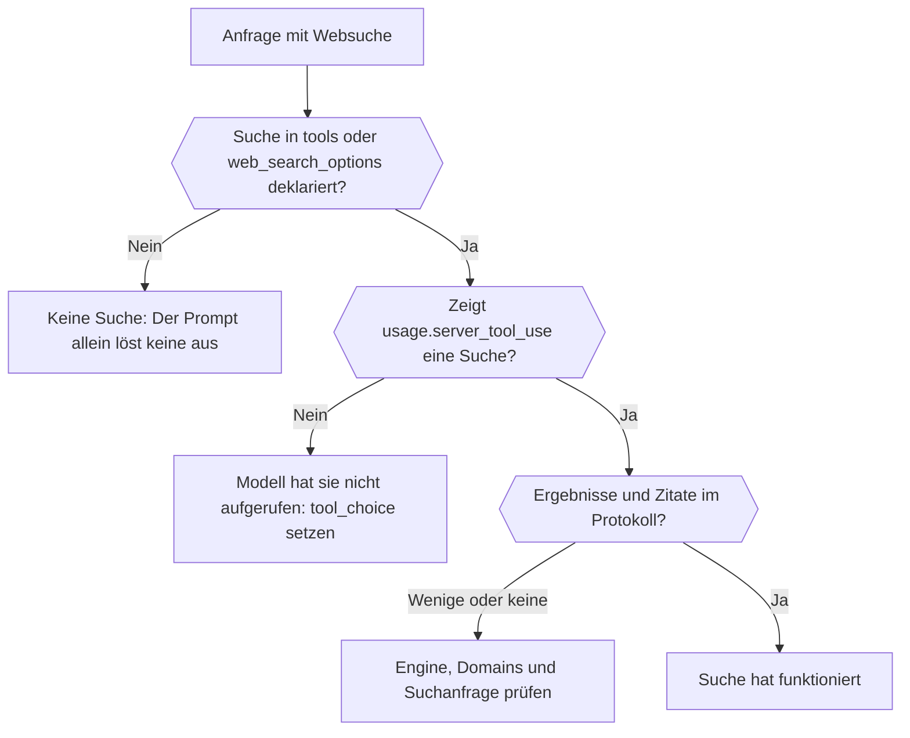

Finde anhand der Antwort und des Anfrageprotokolls heraus, ob eine Websuche tatsächlich lief, welche Engine sie ausgeführt hat und was sie zurückgegeben hat. Am Ende kannst du eine Suche, die nie stattfand, von einer unterscheiden, die lief und wenig gefunden hat.



## Die Suche in der Anfrage deklarieren

Im Prompt nach „den neuesten Nachrichten“ zu fragen, führt keine Suche aus. Füge sie ausdrücklich hinzu:

```json
{
  "model": "openai/gpt-6-astra",
  "input": "What changed in the Phaseo changelog this week?",
  "tools": [{ "type": "phaseo:web_search", "parameters": { "max_results": 5 } }],
  "tool_choice": "phaseo:web_search"
}
```

`phaseo:web_search` funktioniert bei Chat Completions, Responses und Messages. `web_search_options` funktioniert dort, wo der Endpunkt es unterstützt. `tool_choice` erzwingt den Aufruf; ohne es kann das Modell aus dem Gedächtnis antworten. Der [Leitfaden zur Websuche](../guides/server-tools/web-search) listet jeden Parameter auf.

## Prüfen, ob sie lief

| Wo du nachsiehst | Was es zeigt |
| --- | --- |
| `usage.server_tool_use.web_search_requests` in der Antwort | Wie viele verwaltete Suchen liefen |
| **Überwachung der Websuche** bei der Anfrage unter **Einstellungen → Nutzung → Protokolle** | Verwaltete Suchen, native Suchen, Anzahl der Ergebnisse und Anzahl der Zitate, mit den extrahierten Ergebnis- und Zitateinträgen |
| **Beobachtbarkeit des Routings** bei derselben Anfrage | Welche Anbieter berücksichtigt wurden und welche entfernt wurden, weil sie die Anfrage nicht unterstützten |

## Die Fehlerfälle unterscheiden

| Was du siehst | Ursache | Lösung |
| --- | --- | --- |
| Überhaupt keine Suchzähler | Die Suche wurde nicht deklariert, oder das Modell hat sich gegen den Aufruf entschieden | Tool hinzufügen und `tool_choice` setzen |
| Das Tool gibt dem Modell `search_not_configured` zurück | Die gewählte verwaltete Engine ist nicht aktiviert | Die Standard-Engine oder eine andere verwenden |
| Das Tool gibt `unsupported_search_engine` zurück | Das Modell hat innerhalb eines Aufrufs `engine: "native"` angefordert | `native` nur in der Tool-Definition setzen |
| `400 not_supported`, Grund `regional_hosted_tool_not_supported` | An `eu.api.phaseo.app` oder `us.api.phaseo.app` gesendet, die Server-Tools ablehnen | `api.phaseo.app` verwenden |
| Suchen liefen, aber es gibt kaum Zitate | Suchanfrage oder Quellen waren schwach | `max_results`, `allowed_domains` oder `engine` anpassen |

Mit `engine: "native"` geht die Anfrage nur an Anbieter, die die Websuche selbst ausführen. Bedient keiner davon das Modell, führt Phaseo stattdessen seine Standard-Engine aus und rechnet sie als verwaltete Suche ab, sodass eine native Anfrage verwaltete Zähler zeigen kann.

## Anfragen vergleichen

Wenn sich die Ergebnisse zwischen Läufen unterscheiden, vergleiche die Modell-ID, den gewählten Anbieter, die Suchparameter und die Anzahl der Ergebnisse und Zitate. Die Zahlen sind anbieterübergreifend normalisiert, sodass Unterschiede in der Suchqualität sichtbar werden, ohne rohe Payloads zu lesen. Für einen vollständigen fundierten Workflow siehe [Verwaltete Websuche in TypeScript](./sdk-typescript-managed-search); für eine bekannte URL verwende stattdessen [Web Fetch](./tool-grounding-with-web-fetch).
