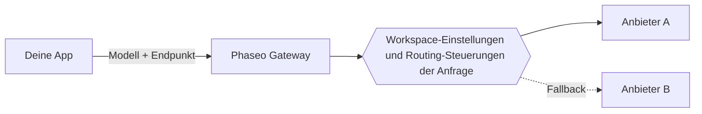

Sende eine Modell-ID an einen Phaseo-Endpunkt, und Phaseo routet die Anfrage an einen Anbieter, der dieses Modell hostet. Deine Anwendung wählt Modell und Endpunkt; deine Workspace-Einstellungen und die Routing-Steuerungen der Anfrage entscheiden, welche Anbieter sie bedienen dürfen.

## Modelle und Anbieter

Ein Modell ist das System, das die Ausgabe erzeugt. Ein Anbieter hostet das Modell und bestimmt dessen Verfügbarkeit, unterstützte Parameter, Preise und Leistung. Ein Modell kann mehrere Anbieterangebote haben.

Der öffentliche Katalog listet auch Modelle auf, die noch nicht über das Gateway verfügbar sind. Prüfe die [Modellverfügbarkeit](../exploring/models.mdx), bevor du eine ID in einer Anfrage verwendest.

## Anfragen und Routing

Verwende [Responses, Chat Completions oder Messages](../api-reference/introduction.mdx), je nachdem, welches zum Protokoll deiner Anwendung passt. Ein gemeinsamer Endpunkt bedeutet nicht, dass jedes Modell jeden Parameter unterstützt; die Fähigkeiten der Anbieter unterscheiden sich weiterhin.

[Routing-Steuerungen](../guides/routing-and-fallbacks.mdx) schränken ein, welche Anbieter eine Anfrage bedienen dürfen und wie sie gereiht werden. Fallbacks bleiben innerhalb dieser Einschränkungen und hängen von verfügbarer Kapazität ab, garantieren also keinen Erfolg.

## Abrechnung und Zugriff

Verwaltete Anfragen nutzen das Guthaben deines Phaseo-Workspace, und `:free`-Modelle laufen ohne eingezahlte Credits. Mit deinen eigenen Anbieter-Zugangsdaten (BYOK) gelten die Abrechnung und die Kontolimits des Anbieters. Prüfe [Preise und Abrechnung](../pricing/tiers.mdx) vor dem Rollout.

[Video- und Batch-Jobs](../guides/async-video-and-batch.mdx) geben einen Job zurück, bevor die Verarbeitung abgeschlossen ist; der Vorschauzugang dazu wird pro Workspace verwaltet. Frage den Status ab oder empfange einen Webhook und lade dann das Ergebnis herunter.

## Nächste Schritte

Sende deine erste Anfrage mit dem [Schnellstart](../quickstart.mdx) und [integriere dann das Gateway](./integrating-with-the-gateway.mdx) in deine Anwendung, wobei der Schlüssel in deinem Backend bleibt. Wenn etwas fehlschlägt, zeigt [Zuverlässigkeit und Status](./reliability-and-status.mdx), wie du der Sache nachgehst, und die [Anfrageprotokolle](../guides/integrations/observability.mdx) zeigen Nutzung, Latenz, Kosten und Fehler jeder Anfrage.
