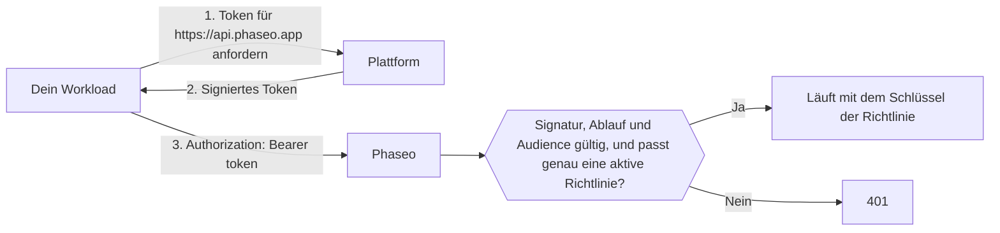

<Note>
Vertrauenswürdige Workloads sind in der Beta und werden schrittweise für Workspaces freigeschaltet. Wenn **Einstellungen → API-Schlüssel → Vertrauenswürdige Workloads** in deinem Dashboard nicht erscheint, hat dein Workspace die Funktion noch nicht.
</Note>

Sende das kurzlebige OIDC-Token deiner Plattform statt eines Phaseo-API-Schlüssels als Bearer-Token, dann muss nichts Langlebiges in deinen Projekteinstellungen oder CI-Secrets liegen. Plattformen geben jedem Deployment, Job oder Workload ein signiertes Token, das angibt, wer er ist, etwa „das Produktions-Deployment des Projekts `website`“ oder „ein Job im GitLab-Projekt `4815162`“, und das Token läuft innerhalb weniger Stunden ab. Du legst fest, welchen Workloads Phaseo vertraut.

Phaseo vertraut Tokens von Vercel, GitHub Actions, GitLab, Google Cloud, Buildkite, CircleCI und AWS sowie von einem OIDC-Issuer, den du selbst betreibst, etwa einem Kubernetes-Cluster, Bitbucket Pipelines oder selbst verwaltetem GitLab. Nutze für alles andere weiterhin API-Schlüssel, etwa für lokale Skripte und mobile Apps.

## So funktioniert es



Ein Workspace-Inhaber oder -Admin erstellt eine **Vertrauensrichtlinie**, die die Plattform, den vertrauenswürdigen Inhaber (etwa einen GitHub-Inhaber, ein GitLab-Projekt oder eine AWS-Rolle) und optionale Bedingungen nennt, etwa ein Projekt, ein Repository, einen Branch oder eine Umgebung. Eine passende Anfrage läuft mit dem Schlüssel der Richtlinie, mit denselben Ratenlimits, Budgets, Logs und derselben Abrechnung wie eine Anfrage mit einem API-Schlüssel.

Tokens müssen für die Audience `https://api.phaseo.app` ausgestellt sein; Phaseo lehnt jede andere Audience ab. Die meisten Plattformen verwenden standardmäßig eine Audience, die alle Dienste teilen, die dein Workload aufruft. Würde Phaseo diese akzeptieren, könnte ein Token, das du an einen anderen Dienst gesendet hast, gegen Phaseo wiederverwendet werden.

## Vertrauensrichtlinie erstellen

<Steps>
<Step title="Vertrauenswürdige Workloads öffnen">
Öffne **Einstellungen → API-Schlüssel → Vertrauenswürdige Workloads** und wähle **Neue Richtlinie**. Nur Workspace-Inhaber und -Admins können Richtlinien verwalten.
</Step>
<Step title="Plattform wählen und IDs eintragen">
Jede Plattform bindet die Richtlinie an eine ID, die nicht umbenannt oder von jemand anderem übernommen werden kann. Namen können den Besitzer wechseln, deshalb vertraut Phaseo nie allein einem Namen.

<Tabs>
<Tab title="Vercel">
- **Team-Slug**: der Slug des Teams, wie in `vercel.com/<team-slug>`. Lass ihn leer, wenn dein Projekt den globalen Issuer-Modus von Vercel nutzt (Issuer `https://oidc.vercel.com` statt `https://oidc.vercel.com/<team-slug>`).
- **Team-ID**: beginnt mit `team_`. Du findest sie in den Team-Einstellungen in Vercel.
- **Projekt-ID** (empfohlen): beginnt mit `prj_`. Du findest sie in den Projekteinstellungen in Vercel. Ohne sie wird jedem Projekt im Team vertraut.
- **Umgebung**: Produktion, Vorschau oder Entwicklung. Lass alle Kästchen leer, um jede Umgebung zu akzeptieren.
</Tab>
<Tab title="GitHub Actions">
- **Inhaber-ID**: die numerische ID des Nutzers oder der Organisation, der das Repository gehört.
- **Repository-ID** (empfohlen): die numerische Repository-ID. Ohne sie wird jedem Repository des Inhabers vertraut.
- **Branch oder Tag** und **Umgebung** (optional): zum Beispiel `refs/heads/main` oder `production`.

Beide IDs bekommst du mit der GitHub CLI:

```bash
gh api repos/OWNER/REPO --jq '.id, .owner.id'
```
</Tab>
<Tab title="GitLab">
Für Projekte auf GitLab.com. Für selbst verwaltetes GitLab wählst du **Eigener OIDC-Issuer**.

- **Projekt-ID**: die numerische ID auf der Übersichtsseite des Projekts. Sie bleibt gleich, wenn das Projekt umbenannt oder in eine andere Gruppe verschoben wird. Deshalb bindet Phaseo sie und nicht die Gruppe.
- **Branch oder Tag** (optional): der Name des Branches oder Tags, etwa `main`.
- **Umgebung** (optional): die Umgebung des Jobs, etwa `production`.

Lass beide Bedingungen leer, um jeden Job im Projekt zu akzeptieren.
</Tab>
<Tab title="Google Cloud">
Für Tokens vom Metadatenserver auf Cloud Run, Compute Engine, GKE, Cloud Run functions, App Engine und Cloud Build.

- **Eindeutige ID des Dienstkontos**: die numerische eindeutige ID auf der Detailseite des Dienstkontos in der Google Cloud Console. Alle Google-Konten teilen denselben Issuer, daher unterscheidet diese ID deinen Workload. Nutze nicht stattdessen die E-Mail-Adresse: Wird das Dienstkonto gelöscht, kann jemand ein neues mit derselben E-Mail-Adresse anlegen.
- **E-Mail des Dienstkontos** (optional): eine zusätzliche Prüfung. Tokens enthalten die E-Mail-Adresse nur, wenn der Workload sie mit `format=full` anfordert.
</Tab>
<Tab title="Buildkite">
- **Organisations-ID**: die UUID der Organisation. Jedes Buildkite-Token trägt sie im Claim `organization_id`, du kannst sie also aus einem Token auslesen, das eine deiner Pipelines anfordert. Anders als der Slug der Organisation ändert sie sich nie.
- **Pipeline-Slug** (optional): Ohne ihn wird jeder Pipeline der Organisation vertraut.
</Tab>
<Tab title="CircleCI">
- **Organisations-ID**: findest du unter **Organization Settings → Overview**. Jede CircleCI-Organisation hat einen eigenen Issuer, `https://oidc.circleci.com/org/<organisation ID>`, und Phaseo bildet ihn aus dieser ID.
- **Projekt-ID** (optional): findest du unter **Project Settings → Overview**. Ohne sie wird jedem Projekt der Organisation vertraut.
</Tab>
<Tab title="AWS">
Für Tokens aus der ausgehenden IAM-Identitätsföderation (outbound identity federation), mit der eine IAM-Rolle ein signiertes Token für einen externen Dienst erhält.

- **Issuer-URL**: Jedes AWS-Konto hat einen eigenen Issuer, der auf `.tokens.sts.global.api.aws` endet. Führe `aws iam get-outbound-web-identity-federation-info` aus und kopiere `IssuerIdentifier`. Schlägt das fehl, schalte die Funktion zuerst mit `aws iam enable-outbound-web-identity-federation` ein.
- **ARN der IAM-Rolle**: Nur Tokens für diese Rolle werden akzeptiert, etwa `arn:aws:iam::123456789012:role/evals`. Der Issuer identifiziert bereits dein Konto, daher identifiziert der Rollen-ARN den Workload.
</Tab>
<Tab title="Eigener OIDC-Issuer">
Nutze diese Option für jeden anderen OIDC-Issuer, der alle diese Bedingungen erfüllt:

- Seine Issuer-URL ist eine öffentliche `https://`-URL ohne Port, Query oder Fragment und liegt nicht auf einem Host, der zu einer der Plattformen oben gehört.
- Er stellt unter `<issuer>/.well-known/openid-configuration` ein Discovery-Dokument bereit.
- Seine Signaturschlüssel (`jwks_uri`) liegen auf demselben Host wie der Issuer.
- Er signiert Tokens mit RS256, ES256 oder ES384 und kann sie für die Audience `https://api.phaseo.app` ausstellen.

Fülle aus:

- **Issuer-URL**: Kopiere sie genau so, wie sie im Claim `iss` des Tokens steht, einschließlich eines abschließenden Schrägstrichs.
- **Inhaber-Claim** und **Inhaber-Wert**: der Claim, den jedes Token tragen muss, und der genaue Wert, den er haben muss. Wähle einen Claim, den niemand sonst wiederverwenden kann, etwa eine numerische ID, und keinen Namen, der umbenannt oder neu registriert werden kann.
- **Zusätzlicher Claim** und **Erforderlicher Wert** (optional): ein weiterer Claim, zu dem das Token passen muss.

Bedingungen gelten nur für Claims der obersten Ebene. Verschachtelte Claims, etwa das Objekt `kubernetes.io` von Kubernetes, können nicht verwendet werden.

**Kubernetes (EKS, GKE, AKS)**: Jeder Cluster hat einen eigenen Issuer. Führe auf EKS `aws eks describe-cluster --name <cluster> --query cluster.identity.oidc.issuer` aus. Schalte auf AKS den OIDC-Issuer ein und führe `az aks show -n <cluster> -g <resource-group> --query oidcIssuerProfile.issuerUrl` aus. Auf GKE ist der Issuer `https://container.googleapis.com/v1/projects/<project>/locations/<location>/clusters/<cluster>`. Nutze `sub` als Inhaber-Claim mit dem Wert `system:serviceaccount:<namespace>:<service-account>`.

Selbst verwaltete Kubernetes-Cluster, deren Discovery-Endpunkt nicht öffentlich ist, funktionieren nicht. Phaseo muss das Discovery-Dokument und die Schlüssel ohne Zugangsdaten aus dem Internet abrufen, und die meisten Cluster erlauben das standardmäßig nicht.

**Bitbucket Pipelines**: Der Issuer ist `https://api.bitbucket.org/2.0/workspaces/<workspace>/pipelines-config/identity/oidc`. Nutze `workspaceUuid` als Inhaber-Claim, mit dem Wert einschließlich seiner geschweiften Klammern, etwa `{a1b2c3d4-...}`. Fordere die Phaseo-Audience im Step an:

```yaml
- step:
    oidc:
      audiences:
        - https://api.phaseo.app
```

**Selbst verwaltetes GitLab**: Der Issuer ist deine GitLab-URL, etwa `https://gitlab.example.com`. Nutze `project_id` als Inhaber-Claim, mit der numerischen ID des Projekts. Deine Instanz muss aus dem Internet erreichbar sein.
</Tab>
</Tabs>
</Step>
<Step title="Längstes akzeptiertes Token festlegen">
Gib unter **Längstes akzeptiertes Token (Stunden)** die längste Laufzeit an, die du akzeptierst. Tokens, die länger gültig ausgestellt wurden, werden abgelehnt. Das Maximum und der Standardwert sind 12 Stunden, was auch Vercel-Entwicklungstokens abdeckt.
</Step>
</Steps>

Richtlinien greifen innerhalb von etwa einer Minute. Wenn du eine Richtlinie ausschaltest oder löschst, funktionieren ihre Tokens innerhalb derselben Zeit nicht mehr.

## Richtlinien mit Terraform oder der API verwalten

Verwalte Richtlinien als Code mit einem [Management-Schlüssel](./management-api-keys.mdx), der die Funktionen `keys:read`, `keys:write` und `keys:delete` hat. Nur Workspaces mit vertrauenswürdigen Workloads können diese Routen nutzen.

Verwende in Terraform die Ressource `phaseo_trusted_workload`:

```hcl
resource "phaseo_trusted_workload" "deploy" {
  name     = "GitHub deploy (main)"
  platform = "github_actions"
  owner_id = "123456"

  claim_conditions = {
    repository_id = ["987654321"]
    ref           = ["refs/heads/main"]
  }
}
```

`owner_id` ist der Wert des Inhaber-Claims der Plattform. Setze `issuer`, wo die Plattform einen braucht:

| `platform` | `issuer` | Inhaber-Claim |
| --- | --- | --- |
| `vercel` | Erforderlich: `https://oidc.vercel.com/<team-slug>` oder `https://oidc.vercel.com` im globalen Issuer-Modus | `owner_id` (Team-ID) |
| `github_actions` | Standard: `https://token.actions.githubusercontent.com` | `repository_owner_id` |
| `gitlab` | Standard: `https://gitlab.com` | `project_id` |
| `google_cloud` | Standard: `https://accounts.google.com` | `sub` (eindeutige ID des Dienstkontos) |
| `buildkite` | Standard: `https://agent.buildkite.com` | `organization_id` |
| `circleci` | Erforderlich: `https://oidc.circleci.com/org/<organisation ID>` | `oidc.circleci.com/org-id` |
| `aws` | Erforderlich: der Issuer deines Kontos | `sub` (ARN der IAM-Rolle) |
| `custom` | Erforderlich: deine Issuer-URL | Der Claim, den du in `owner_claim` setzt |

Setze für einen eigenen Issuer zusätzlich `owner_claim`:

```hcl
resource "phaseo_trusted_workload" "cluster" {
  name        = "Production cluster"
  platform    = "custom"
  issuer      = "https://oidc.eks.us-east-1.amazonaws.com/id/EXAMPLED539D4633E53DE1B71EXAMPLE"
  owner_claim = "sub"
  owner_id    = "system:serviceaccount:prod:api"
}
```

Weitere Felder:

| Feld | Werte |
| --- | --- |
| `claim_conditions` | Claim-Name zu erlaubten Werten; jeder Claim muss zu einem seiner Werte passen. Bis zu 15 Claims neben dem Inhaber-Claim und 20 Werte pro Claim. `iss`, `aud`, `exp`, `iat`, `nbf`, `jti` und der Inhaber-Claim können nicht verwendet werden. |
| `max_token_lifetime_seconds` | Längste akzeptierte Token-Laufzeit, `60` bis `43200` (12 Stunden). Standard ist `43200`. |
| `enabled` (Terraform) oder `status` (API: `active` oder `disabled`) | Ob passende Tokens akzeptiert werden. |

Wenn du Plattform, Issuer, Inhaber-Claim oder Inhaber änderst, wird die Richtlinie ersetzt. Eine Richtlinie hat kein Geheimnis, daher wird nichts Vertrauliches im Terraform-State gespeichert.

Sende über die API dieselben Felder an `/v1/workload-identity/policies`. In der API heißt die Plattform `provider`:

```bash
curl https://api.phaseo.app/v1/workload-identity/policies \
  -H "Authorization: Bearer $PHASEO_MANAGEMENT_KEY" \
  -H "Content-Type: application/json" \
  -d '{"name":"GitHub deploy (main)","provider":"github_actions","owner_id":"123456","claim_conditions":{"repository_id":["987654321"],"ref":["refs/heads/main"]}}'
```

Für einen eigenen Issuer:

```bash
curl https://api.phaseo.app/v1/workload-identity/policies \
  -H "Authorization: Bearer $PHASEO_MANAGEMENT_KEY" \
  -H "Content-Type: application/json" \
  -d '{"name":"Production cluster","provider":"custom","issuer":"https://oidc.eks.us-east-1.amazonaws.com/id/EXAMPLED539D4633E53DE1B71EXAMPLE","owner_claim":"sub","owner_id":"system:serviceaccount:prod:api"}'
```

Die [API-Referenz](../api-reference/endpoint/trusted-workloads-create.mdx) listet alle Felder und Antworten auf.

## Phaseo mit einem Token aufrufen

Jedes Phaseo-SDK akzeptiert statt des API-Schlüssels eine Funktion und ruft sie vor jeder Anfrage und jedem erneuten Versuch auf, sodass jede Anfrage ein aktuelles Token verwendet. Jedes SDK außer C++ enthält eine Hilfsfunktion für GitHub Actions und Vercel. Sie holt ein für `https://api.phaseo.app` ausgestelltes Token und verwendet es wieder, bis eine Minute vor seinem Ablauf:

| SDK | GitHub Actions | Vercel |
| --- | --- | --- |
| TypeScript | `githubActionsToken()` | `vercelToken()` |
| Python | `github_actions_token()` | `vercel_token()` |
| Go | `phaseo.GitHubActionsToken()` | `phaseo.VercelToken()` |
| Java | `WorkloadTokens.gitHubActions()` | `WorkloadTokens.vercel()` |
| C# | `WorkloadTokens.GitHubActions()` | `WorkloadTokens.Vercel()` |
| PHP | `WorkloadTokens::githubActions()` | `WorkloadTokens::vercel()` |
| Ruby | `PhaseoSdk::WorkloadTokens.github_actions` | `PhaseoSdk::WorkloadTokens.vercel` |
| Rust | `phaseo::auth::github_actions_token()` | `phaseo::auth::vercel_token()` |
| C++ | Übergib eine eigene Funktion an `set_api_key_provider` | Übergib eine eigene Funktion an `set_api_key_provider` |

Die Hilfsfunktionen benötigen das nächste Release des jeweiligen SDK. Auf Vercel tauscht die Hilfsfunktion das Token des Deployments aus `VERCEL_OIDC_TOKEN_FILE` oder `VERCEL_OIDC_TOKEN` um. In Vercel Functions kommt das Token mit jeder Anfrage im Header `x-vercel-oidc-token`; übergib es der Hilfsfunktion als Token-Quelle.

Auf anderen Plattformen übergibst du eine eigene Funktion, die das Token zurückgibt, etwa eine, die die Variable des GitLab-Jobs liest oder den Metadatenserver von Google Cloud aufruft:

```ts
import Phaseo from "@phaseo/sdk";

const client = new Phaseo({
	apiKey: async () => {
		const response = await fetch(
			"http://metadata.google.internal/computeMetadata/v1/instance/service-accounts/default/identity?audience=https://api.phaseo.app",
			{ headers: { "Metadata-Flavor": "Google" } },
		);
		return response.text();
	},
});
```

<Tabs>
<Tab title="Vercel">
Nutze `getVercelOidcToken` aus dem Server-Einstiegspunkt von `@vercel/oidc` 4.x. Wenn du `audience` übergibst, wird das Token des Deployments gegen eines getauscht, das für Phaseo ausgestellt ist.

Mit dem [TypeScript-SDK](../sdk-reference/client/overview.mdx) übergibst du es als `apiKey`-Funktion:

```ts
import Phaseo from "@phaseo/sdk";
import { getVercelOidcToken } from "@vercel/oidc";

const client = new Phaseo({
	apiKey: () => getVercelOidcToken({ audience: "https://api.phaseo.app" }),
});

const response = await client.responses.create({
	model: "openai/gpt-6-astra",
	input: "Hello from a trusted workload",
});
```

Für eine Funktion als `apiKey` brauchst du eine Version von `@phaseo/sdk`, die neuer als 3.0.0 ist.

Mit jedem beliebigen HTTP-Client forderst du pro Anfrage ein Token an und sendest es als Bearer-Token:

```ts
import { getVercelOidcToken } from "@vercel/oidc";

const token = await getVercelOidcToken({ audience: "https://api.phaseo.app" });

const response = await fetch("https://api.phaseo.app/v1/chat/completions", {
	method: "POST",
	headers: {
		Authorization: `Bearer ${token}`,
		"Content-Type": "application/json",
	},
	body: JSON.stringify({
		model: "openai/gpt-6-astra",
		messages: [{ role: "user", content: "Hello from a trusted workload" }],
	}),
});
```

Speichere das Token nicht in einer Variablen auf Modulebene: Vercel kann es zwischen Anfragen ändern.
</Tab>
<Tab title="GitHub Actions">
Der Job braucht die Berechtigung `id-token: write`, um ein Token anzufordern.

```yaml
permissions:
  id-token: write
  contents: read

jobs:
  evals:
    runs-on: ubuntu-latest
    steps:
      - uses: actions/github-script@v7
        with:
          script: |
            const token = await core.getIDToken("https://api.phaseo.app");
            const response = await fetch("https://api.phaseo.app/v1/chat/completions", {
              method: "POST",
              headers: {
                Authorization: `Bearer ${token}`,
                "Content-Type": "application/json",
              },
              body: JSON.stringify({
                model: "openai/gpt-6-astra",
                messages: [{ role: "user", content: "Hello from GitHub Actions" }],
              }),
            });
            core.info(String(response.status));
```

In einem Shell-Schritt forderst du das Token mit `curl` an:

```bash
TOKEN=$(curl -sS -H "Authorization: bearer $ACTIONS_ID_TOKEN_REQUEST_TOKEN" \
  "$ACTIONS_ID_TOKEN_REQUEST_URL&audience=https://api.phaseo.app" | jq -r .value)

curl https://api.phaseo.app/v1/chat/completions \
  -H "Authorization: Bearer $TOKEN" \
  -H "Content-Type: application/json" \
  -d '{"model":"openai/gpt-6-astra","messages":[{"role":"user","content":"Hello"}]}'
```

GitHub-Actions-Tokens sind kurzlebig, fordere bei langen Jobs also ein neues an.
</Tab>
<Tab title="GitLab">
Ergänze den Job in `.gitlab-ci.yml` um einen Eintrag `id_tokens`. GitLab legt das Token in der Variablen ab, die du benennst:

```yaml
evals:
  id_tokens:
    PHASEO_TOKEN:
      aud: https://api.phaseo.app
  script:
    - >
      curl https://api.phaseo.app/v1/chat/completions
      -H "Authorization: Bearer $PHASEO_TOKEN"
      -H "Content-Type: application/json"
      -d '{"model":"openai/gpt-6-astra","messages":[{"role":"user","content":"Hello from GitLab"}]}'
```

Das Token gilt so lange wie das Timeout des Jobs.
</Tab>
<Tab title="Google Cloud">
Fordere das Token beim Metadatenserver an. Das funktioniert auf Cloud Run, Compute Engine, GKE, Cloud Run functions, App Engine und Cloud Build:

```bash
TOKEN=$(curl -sS -H "Metadata-Flavor: Google" \
  "http://metadata.google.internal/computeMetadata/v1/instance/service-accounts/default/identity?audience=https://api.phaseo.app")

curl https://api.phaseo.app/v1/chat/completions \
  -H "Authorization: Bearer $TOKEN" \
  -H "Content-Type: application/json" \
  -d '{"model":"openai/gpt-6-astra","messages":[{"role":"user","content":"Hello from Google Cloud"}]}'
```

Hänge `&format=full` an die URL an, wenn deine Richtlinie die E-Mail des Dienstkontos prüft. Tokens gelten 1 Stunde.
</Tab>
<Tab title="Buildkite">
Fordere das Token im Befehl eines Steps mit dem Agent an:

```bash
TOKEN=$(buildkite-agent oidc request-token --audience https://api.phaseo.app)

curl https://api.phaseo.app/v1/chat/completions \
  -H "Authorization: Bearer $TOKEN" \
  -H "Content-Type: application/json" \
  -d '{"model":"openai/gpt-6-astra","messages":[{"role":"user","content":"Hello from Buildkite"}]}'
```

Tokens gelten standardmäßig 5 Minuten. Fordere bei längeren Steps ein neues an oder übergib `--lifetime` in Sekunden.
</Tab>
<Tab title="CircleCI">
Fordere das Token in einem Job-Schritt mit der CircleCI CLI an:

```bash
TOKEN=$(circleci run oidc get --claims '{"aud":"https://api.phaseo.app"}')

curl https://api.phaseo.app/v1/chat/completions \
  -H "Authorization: Bearer $TOKEN" \
  -H "Content-Type: application/json" \
  -d '{"model":"openai/gpt-6-astra","messages":[{"role":"user","content":"Hello from CircleCI"}]}'
```

Tokens gelten 1 Stunde.
</Tab>
<Tab title="AWS">
Schalte die ausgehende Identitätsföderation einmal pro AWS-Konto ein und fordere dann als IAM-Rolle ein Token an. Die Rolle braucht die Berechtigung für `sts:GetWebIdentityToken`.

```bash
# Einmal pro Konto
aws iam enable-outbound-web-identity-federation

# Im Workload
TOKEN=$(aws sts get-web-identity-token --audience https://api.phaseo.app \
  --signing-algorithm ES384 --query WebIdentityToken --output text)

curl https://api.phaseo.app/v1/chat/completions \
  -H "Authorization: Bearer $TOKEN" \
  -H "Content-Type: application/json" \
  -d '{"model":"openai/gpt-6-astra","messages":[{"role":"user","content":"Hello from AWS"}]}'
```

Phaseo akzeptiert `ES384` und `RS256`. Tokens gelten standardmäßig 5 Minuten; übergib `--duration-seconds` für bis zu 1 Stunde.
</Tab>
<Tab title="Eigener OIDC-Issuer">
Binde auf Kubernetes ein projiziertes Service-Account-Token ein, das für die Phaseo-Audience ausgestellt ist:

```yaml
spec:
  serviceAccountName: api
  containers:
    - name: app
      volumeMounts:
        - name: phaseo-token
          mountPath: /var/run/secrets/phaseo
  volumes:
    - name: phaseo-token
      projected:
        sources:
          - serviceAccountToken:
              audience: https://api.phaseo.app
              expirationSeconds: 3600
              path: token
```

Lies `/var/run/secrets/phaseo/token` vor jeder Anfrage und sende den Inhalt als Bearer-Token. Kubernetes erneuert die Datei, bevor das Token abläuft, also behalte den Wert nicht im Speicher.

In Bitbucket Pipelines erhält ein Step mit gesetzten `oidc`-Audiences das Token in `BITBUCKET_STEP_OIDC_TOKEN`.
</Tab>
</Tabs>

## Verhalten und Limits

- **Dieselben Kontrollen wie bei einem Schlüssel.** Anfragen laufen mit dem Schlüssel der Richtlinie, daher gelten Ratenlimits des Schlüssels, Budgets, Abteilungszuordnungen, IP-Allowlists, Logging-Einstellungen und Abrechnung wie gewohnt.
- **Nur Modellaufrufe.** Workload-Tokens funktionieren überall dort, wo ein Gateway-API-Schlüssel funktioniert. Management-APIs lehnen sie ab.
- **Genau eine passende Richtlinie.** Ein Token, das zu mehr als einer aktiven Richtlinie passt, wird abgelehnt. Liegen die Richtlinien in verschiedenen Workspaces, sende die Workspace-ID im Header `x-phaseo-workspace`, um einen auszuwählen. Liegen sie im selben Workspace, grenze ihre Bedingungen so ein, dass nur eine passt.
- **Token-Laufzeit.** Tokens, die länger gültig ausgestellt wurden als das **Längste akzeptierte Token** der Richtlinie, werden abgelehnt, und Phaseo akzeptiert nie Tokens, die für mehr als 12 Stunden ausgestellt wurden. Buildkite- und AWS-Tokens gelten standardmäßig 5 Minuten, Google-Cloud- und CircleCI-Tokens 1 Stunde. GitLab-Tokens gelten so lange wie das Timeout des Jobs, daher erhält ein Job mit einem Timeout über 12 Stunden ein Token, das Phaseo ablehnt. AKS kann Tokens für bis zu 24 Stunden ausstellen, setze also ein kürzeres `expirationSeconds`.
- **Azure wird noch nicht unterstützt.** Verwaltete Identitäten in Azure können keine Tokens für die Phaseo-Audience anfordern. Pods auf AKS können trotzdem ein Kubernetes-Service-Account-Token über einen eigenen Issuer nutzen.
- **API-Schlüssel bleiben unverändert.** Vertrauenswürdige Workloads ergänzen eine zweite Art der Authentifizierung; sie ändern oder deaktivieren keine API-Schlüssel.

## Abgelehntes Token beheben

Ein abgelehntes Token gibt `401` mit dem Fehlercode `unauthorised` und einem dieser `reason`-Werte zurück:

| `reason` | Bedeutung | Was du tun kannst |
| --- | --- | --- |
| `workload_token_wrong_audience` | Das Token wurde nicht für `https://api.phaseo.app` ausgestellt. | Fordere das Token mit dieser Audience an. |
| `workload_token_malformed` | Das Token ist kein wohlgeformtes OIDC-Token: Es hat keine Schlüssel-ID, keinen Issuer oder keine gültigen Zeit-Claims. | Sende das Token unverändert, genau so, wie die Plattform es ausgestellt hat. |
| `workload_issuer_not_trusted` | Keine aktive Richtlinie nutzt den Issuer dieses Tokens. | Prüfe, ob die Richtlinie eingeschaltet ist und ob ihr Issuer genau mit dem Claim `iss` des Tokens übereinstimmt, einschließlich Vercel-Team-Slug oder Issuer-Modus und eines abschließenden Schrägstrichs bei einem eigenen Issuer. |
| `workload_identity_no_matching_policy` | Das Token ist gültig, aber keine aktive Richtlinie passt dazu. | Prüfe die Inhaber-ID, die Bedingungen für Projekt, Repository, Pipeline, Branch, Tag oder Umgebung und dass das Token nicht länger gilt als das **Längste akzeptierte Token** der Richtlinie. |
| `workload_identity_ambiguous` | Mehr als eine aktive Richtlinie passt zu diesem Token. | Sende über Workspaces hinweg `x-phaseo-workspace: <workspace id>`. Grenze innerhalb eines Workspace die Bedingungen der Richtlinien ein. |
| `workload_identity_not_enabled` | Vertrauenswürdige Workloads sind für diesen Workspace noch nicht verfügbar. | Nutze vorerst einen API-Schlüssel. |
| `workload_token_expired` | Das Token ist abgelaufen. | Fordere für jede Anfrage oder jeden Job-Schritt ein neues Token an. |
| `workload_token_not_yet_valid` | Die `nbf`-Zeit des Tokens liegt mehr als eine Minute in der Zukunft. | Prüfe die Uhr auf dem Rechner, der die Tokens ausstellt. |
| `workload_token_lifetime_too_long` | Das Token wurde für mehr als 12 Stunden ausgestellt, das Maximum, das Phaseo akzeptiert. | Fordere ein kürzer gültiges Token an, etwa mit einem kürzeren `expirationSeconds` auf Kubernetes oder einem kürzeren Job-Timeout auf GitLab. |
| `workload_token_too_many_claims` | Das Token eines eigenen Issuers enthält mehr als 100 verschiedene Claim-Werte auf oberster Ebene. | Konfiguriere den Issuer so, dass er weniger Claims sendet, oder verschiebe zusätzliche Werte in ein verschachteltes Objekt. |
| `workload_token_unsupported_alg` | Das Token ist nicht mit RS256, ES256 oder ES384 signiert. | Konfiguriere den Issuer für einen dieser Algorithmen. |
| `workload_token_invalid_signature` | Die Signatur des Tokens passt nicht zu den Schlüsseln der Plattform. | Sende das Token unverändert, genau so, wie die Plattform es ausgestellt hat. |
| `workload_token_key_not_found` | Die veröffentlichten Schlüssel des Issuers enthalten nicht den Schlüssel, mit dem das Token signiert wurde. | Versuche es nach kurzer Wartezeit erneut. Prüfe bei einem eigenen Issuer, ob seine `jwks_uri` den aktuellen Signaturschlüssel bereitstellt. |
| `key_ip_not_allowed` | Der Schlüssel der Richtlinie hat eine IP-Allowlist, die den Aufrufer nicht enthält. | Füge die IP-Adressen des Workloads zur Allowlist des Schlüssels hinzu. |
| `workload_jwks_unavailable` | Phaseo konnte die Signaturschlüssel der Plattform nicht abrufen. | Versuche es nach kurzer Wartezeit erneut. Prüfe bei einem eigenen Issuer, ob `<issuer>/.well-known/openid-configuration` ohne Zugangsdaten aus dem öffentlichen Internet lädt und ob seine `jwks_uri` auf demselben Host liegt. |
