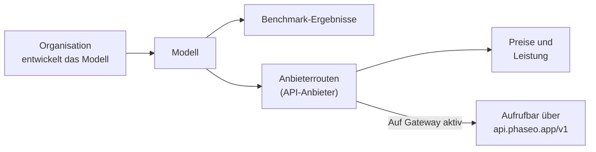

Schlage jedes Modell auf [phaseo.app](https://phaseo.app/models) nach, um zu sehen, wer es entwickelt hat, welche Anbieter es bereitstellen, was es kostet und wie es abschneidet, und rufe es dann über das Gateway auf, wenn es eine aktive Route hat.

## Was der Katalog enthält

| Eintrag | Was er ist | Wo du nachsiehst |
| --- | --- | --- |
| [Organisationen](./organisations.mdx) | Unternehmen und Forschungslabore, die Modelle entwickeln und veröffentlichen. | [Organisationen](https://phaseo.app/organisations) |
| [Modelle](./models.mdx) | Jedes veröffentlichte Modell, gruppiert in Familien verwandter Modelle. | [Modelle](https://phaseo.app/models) |
| [Benchmarks](./benchmarks.mdx) | Evaluierungen und die Punktzahlen, die Modelle darin erreichen. | [Vergleichstests](https://phaseo.app/benchmarks) |
| [API-Anbieter](./api-providers.mdx) | Plattformen, die Modelle über eine API bereitstellen. | [API-Anbieter](https://phaseo.app/api-providers) |
| [Preise und Leistung](./pricing-performance.mdx) | Der Preis jedes Anbieters pro Token, Bild, Sekunde oder Anfrage und die gemessene Gateway-Geschwindigkeit. | Modellseiten, [Vergleichen](https://phaseo.app/compare) |
| [Abonnementpläne](./subscription-plans.mdx) | Phaseo-Pläne und Abonnements, die Anbieter verkaufen. | [Abonnementpläne](https://phaseo.app/subscription-plans) |

Ein Katalogeintrag bedeutet nicht, dass du das Modell aufrufen kannst. Nur Modelle mit der Markierung **Auf Gateway aktiv** haben eine Route; `GET /v1/models` gibt nur diese zurück.

## So liest du die Daten

- **Preise** sind in USD angegeben, pro 1 Million Tokens für Text oder in der eigenen Einheit des Anbieters (pro Bild, pro Sekunde, pro Anfrage) für Medien.
- **Daten** sind UTC-Tage, auf Englisch als `01 Jan 2026` angezeigt.
- **Benchmark-Punktzahlen** behalten die eigene Skala und Richtung des Benchmarks. Phaseo rechnet sie nicht in eine gemeinsame Punktzahl um; siehe [Benchmarks](./benchmarks.mdx).
- **Familien** gruppieren verwandte Modelle, etwa die Größen und Versionen einer Modellreihe.

## Wie die Daten aktuell bleiben

Synchronisierungsjobs der Anbieter schlagen neue Preise vor, die ein Admin vor der Veröffentlichung prüft. Benchmark-Importe und Jobs für den Modell-Lebenszyklus aktualisieren die Datenbank nach Zeitplan. Jeder kann über ein GitHub-Issue eine Korrektur oder einen fehlenden Eintrag melden; die Maintainer prüfen die Belege und übernehmen genehmigte Änderungen. Siehe [Mitwirken](../contributing/overview.mdx).

## Beispielfragen

| Ziel | Wo du die Antwort findest |
| --- | --- |
| Zwei Modelle in einem Benchmark vergleichen | [Vergleichen](https://phaseo.app/compare) oder die Seite des Benchmarks |
| Das günstigste Modell für eine Aufgabe finden | Die Liste [Modelle](https://phaseo.app/models) nach Preis sortiert, dann der [Preisrechner](https://phaseo.app/tools/pricing-calculator) |
| Sehen, wie sich ein Benchmark im Zeitverlauf entwickelt hat | Das Diagramm **Verlauf** des Benchmarks |
| Anbieter finden, die eine Funktion unterstützen | Der Bereich **Anbieter** auf der Modellseite oder `GET /v1/models/{author}/{slug}/endpoints` |
| Einträge finden, zu denen du beitragen kannst | Modellseiten mit fehlenden Benchmarks oder Metadaten; siehe [Mitwirken](../contributing/overview.mdx) |
