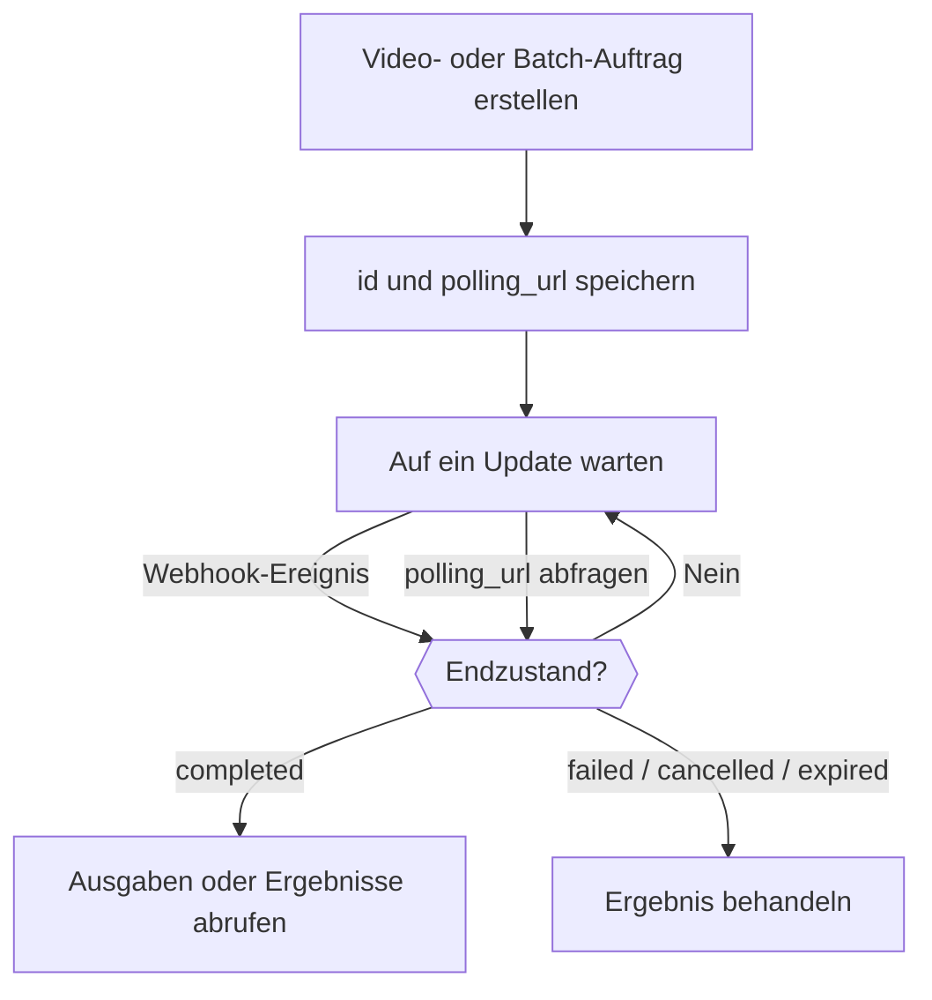

<Note>
Die Video API und die Batch API sind Beta-Vorschauen, die nur auf Einladung für ausgewählte Workspaces verfügbar sind. Prüfe die Verfügbarkeit unter **Einstellungen → Funktionsvorschau**. Der Zugang wird pro Workspace verwaltet; eine persönliche Web-Einstellung gewährt keinen API-Zugang. Es gelten die üblichen Gebühren für die Modellnutzung.
</Note>

Wenn du ein Video oder einen Batch erstellst, erhältst du einen Auftrag zurück, bevor die Arbeit erledigt ist. Speichere seine `id` und seine `polling_url` und warte dann auf einen Webhook oder frage den Status ab, bis der Auftrag einen Endzustand erreicht: `completed`, `failed`, `cancelled` oder `expired`. Eine erfolgreiche Erstellungsantwort bedeutet nur, dass der Auftrag angenommen wurde.



Behalte den Polling-Pfad bei, auch wenn du Webhooks nutzt. Beginne während der Beta mit kleinen Anfragen und einem Ausgabenlimit für den API-Schlüssel. Referenzeingaben, Abbruch und Aufbewahrung der Ausgaben hängen von Anbieter und Modell ab. Speichere eine eigene Kopie abgeschlossener Ausgaben, bevor sie ablaufen.

<span id="receive-updates"></span>
## Updates empfangen

Hänge beim Erstellen beider Auftragsarten einen Webhook-Endpunkt an, der zu deinem Workspace gehört:

```json
{
  "webhook": {
    "endpoint_id": "YOUR_ENDPOINT_ID",
    "events": ["job.status_changed", "job.completed", "job.failed", "job.cancelled", "job.expired"]
  }
}
```

Phaseo gleicht den Anbieterstatus ab und sendet die Benachrichtigungen, daher erzeugen auch Anbieter, die nur Polling unterstützen, etwa Anthropic-Message-Batches, Webhooks. Eine fehlgeschlagene Webhook-Zustellung bedeutet nicht, dass der Auftrag fehlgeschlagen ist.

Abonniere Batch- und Video-Ereignisse getrennt mit Ereignistypen mit Namensraum wie `batch.completed` oder `video.failed`. Generische `job.*`-Ereignistypen funktionieren weiterhin und abonnieren die passende Phase für beide Auftragsarten.

### Zustellungen prüfen und bestätigen

Prüfe `x-phaseo-signature` mit dem Endpunktgeheimnis: Sie ist der hexadezimale HMAC-SHA256 aus `x-phaseo-timestamp`, einem wörtlichen Punkt und dem **unveränderten Anfragekörper**. Prüfe, ob der Zeitstempel aktuell ist, dedupliziere anhand von `x-phaseo-event-id` und bestätige angenommene Zustellungen mit einer 2xx-Antwort. Zustellungen können wiederholt werden oder in anderer Reihenfolge eintreffen, also rufe den Auftrag ab, bevor du eine widersprüchliche Statusänderung anwendest.

| Versuch | Wann |
| --- | --- |
| 1 | Sobald das Ereignis eintritt |
| 2 | Etwa 1 Minute nach einem fehlgeschlagenen Versuch |
| 3 | Etwa 5 Minuten später |
| 4 | Etwa 15 Minuten später; schlägt er fehl, wird die Zustellung als endgültig fehlgeschlagen markiert |

Eine 2xx-Antwort beendet die Zustellung. Hintergrunddurchläufe senden die Wiederholungen, daher kann eine Wiederholung später als geplant eintreffen. Jeder Versuch protokolliert Nummer, Zeitpunkt, HTTP-Status, Fehler und nächsten Wiederholungszeitpunkt. Dedupliziere trotzdem: Eine verlorene Bestätigung oder ein unterbrochener Worker kann eine Zustellung ungewiss machen.

Nutze nach dem Speichern eines Endpunkts **Testereignis senden** in den Einstellungen, um eine signierte `webhook.test`-Nutzlast zuzustellen. Eine Testzustellung wird einmal versucht, nicht wiederholt und nicht dem Zustellverlauf des Auftrags hinzugefügt.

## Auftrags- und Anfrageprotokolle ansehen

Nutze unter **Einstellungen → Nutzung → Protokolle** den Bereich **Anfragen** für Details zu Inferenzanfragen, **Video** für Video-Lebenszyklen und **Stapelverarbeitung** für Batch-Aufträge und Zeilenergebnisse. Die Detailansichten für Video und Batch enthalten Abrechnungsstatus, Anbieterversuche und Webhook-Versuche. Ein Auftrag kann erfolgreich abgeschlossen werden, während seine Webhook-Zustellung fehlschlägt.

Beim Einreichen eines Videos wird Guthaben reserviert, bevor der Anbieter kontaktiert wird. Ein Timeout ohne Task-ID behält die Reservierung für den Abgleich; es ist kein Beleg für eine fehlgeschlagene Generierung. Wird eine kostenpflichtige Video- oder Batch-Reservierung nach erfolgreicher Arbeit unerwartet mit null bepreist, bleibt die Abrechnung mit `unexpected_zero_cost` zur Untersuchung offen. Eine Erstellungsantwort mit Kosten von null ist für sich genommen bei asynchroner Generierung normal.

## Schätzen, was ein Video kostet

Videopreise hängen von Anbieter und Modell ab. Ein Preis pro Sekunde muss mit der abrechenbaren Dauer multipliziert werden; ein Preis pro Clip gilt nur für die angegebene Dauer und Auflösung. Mehrere Ausgaben und kostenpflichtige Referenzeingaben können den Gesamtbetrag erhöhen.

Text-/Bildgenerierung mit LTX berechnet Ausgabesekunden, Audio-zu-Video dagegen Sekunden des Eingabe-Audios. BytePlus Seedance nutzt Video-Tokens, mit anderen Tarifen, wenn ein Referenzvideo vorhanden ist. MiniMax Hailuo V1 nutzt Clip-Preise mit fester Dauer; H3 rechnet in Sekunden ab und kann Referenzeingaben berechnen. Prüfe die Preisdimensionen des ausgewählten Anbieters, statt einen Schlagzeilenpreis als Kosten einer ganzen Anfrage zu deuten.

Reservierungen sind Schätzungen, die vor dem Einreichen zurückgehalten werden. Die endgültige Abrechnung nutzt den abrechenbaren Verbrauch des Auftrags; ungenutztes reserviertes Guthaben wird nach dem Abgleich freigegeben. Eine vom Anbieter unterstützte Auflösung oder Option garantiert nicht, dass sie in der Beta verfügbar ist.

## Dauer, Frames und Referenzen festlegen

Verwende `seconds` oder `duration` für die Ausgabedauer. Sind beide vorhanden, müssen sie übereinstimmen. Verwende `resolution` mit `aspect_ratio` oder eine Pixel-`size` wie `1280x720`.

Verwende `frame_images` für ausdrücklich angegebene erste und letzte Frames:

```json
{
  "frame_images": [
    {
      "type": "image_url",
      "frame_type": "first_frame",
      "image_url": { "url": "https://example.com/start.png" }
    }
  ],
  "input_references": [
    {
      "type": "image_url",
      "role": "reference",
      "image_url": { "url": "https://example.com/character.png" }
    }
  ]
}
```

Referenz-URLs müssen HTTPS verwenden. Gib für reine Referenzbilder ausdrücklich `role: "reference"` an: Ältere Anfragen ohne `frame_images` deuten das erste unbeschriftete Bild als ersten Frame. Kombiniere `frame_images` nicht mit Rollen für erste/letzte Frames in `input_references` oder mit `input_reference`.

Video- und Audioreferenzen verwenden `type: "video_url"` oder `"audio_url"` und `media_url: { "url": "https://..." }`. Modelle und Anbieter unterstützen unterschiedliche Kombinationen. Wo die Referenzdauer den Preis beeinflusst, gib `input_video_duration` und `input_audio_duration` in Sekunden an.

## Anbieterspezifische Videooptionen übergeben

Behalte Modell, Dauer, Auflösung, Audiogenerierung, Eingabemedien und Ausgabeanzahl in den kanonischen Feldern. Übergib anbieterspezifische Erweiterungen unter der kanonischen Anbieter-ID:

```json
{
  "provider_options": {
    "atlascloud": { "watermark": false, "output_format": "mp4" },
    "byteplus": { "camera_fixed": true }
  }
}
```

Nur die Optionen des ausgewählten Anbieters werden weitergeleitet. Optionen wählen keinen Anbieter aus; nutze dafür die Routing-Konfiguration `provider`. Kombiniere `provider_options` nicht mit dem älteren `provider_params`. Verschachtelte Optionen können keine vom Gateway kontrollierten Abrechnungs- oder Callback-Felder überschreiben.

| Anbieter | Beispiele nativer Erweiterungen | Referenz |
| --- | --- | --- |
| AtlasCloud Seedance 2.5 | `watermark`, `output_format`, `return_last_frame`, `omni_reference_task_type` | [Modell-API](https://www.atlascloud.ai/models/bytedance/seedance-2.5/reference-to-video) |
| Novita Seedance 1.5 | `watermark`, `camera_fixed`, `fps` (24), `service_tier` (`default`) | [Einheitliche Video-API](https://docs.novita.ai/api-reference/reference-unified-video-generation) |
| BytePlus Seedance | `camera_fixed` | Prüfe vor der Verwendung den Anbietervertrag des ausgewählten Modells. |
| MiniMax V1 | `fast_pretreatment`; nutze das kanonische `enhance_prompt` zur Prompt-Optimierung | [Video-API](https://platform.minimax.io/docs/api-reference/video-generation-t2v) |

AtlasCloud Seedance nutzt die nativen Felder `resolution`, `ratio` und `last_image`. Seine Referenz-zu-Video-Variante erhält geordnete Bild-, Video- und Audioreferenzen. Bearbeitung mit automatischer Dauer (`duration: -1`) wird vom Reservierungsvertrag des Gateways mit fester Dauer nicht unterstützt. Modellverfügbarkeit und Preise des Anbieters müssen eingerichtet sein, bevor ein Modell geroutet werden kann; eine Anbieteroption aktiviert kein nicht verfügbares Modell.

MiniMax H3 nutzt V2: 4–15 ganze Sekunden bei `768P` oder `2K`. H3 Max unterstützt 5–15 ganze Sekunden bei `480P` oder `768P`, mit Text oder Frame-Bildern. H3 unterstützt Bild-, Video- und Audioreferenzen; Referenzen können nicht mit ersten/letzten Frames gemischt werden. Beide Modelle erzeugen ein Video pro Anfrage und unterstützen keine V1-Optionen zur Prompt-Optimierung. Nutze das kanonische `aspect_ratio`; Frame-Eingaben bestimmen ihr eigenes Seitenverhältnis. Reservierungen für Referenzvideos decken das Eingabelimit des Anbieters von 15 Sekunden ab, der tatsächliche Verbrauch wird beim Abschluss abgerechnet. Siehe den [MiniMax-V2-Vertrag](https://platform.minimax.io/docs/api-reference/video-generation-v2-create).

## Prüfen, was jeder Batch-Anbieter unterstützt

Batch-Anfragen akzeptieren ebenfalls `provider_options`: OpenAI unterstützt `output_expires_after`, Mistral unterstützt `metadata`. Verwende kanonische Anbieter-IDs und dupliziere diese Felder nicht auf oberster Ebene. `provider_options: { "openai": { "output_expires_after": { "anchor": "created_at", "seconds": 86400 } } }` legt zum Beispiel die Aufbewahrung der OpenAI-Ausgaben fest. Zeileneingaben, Modelle, Endpunkte und Webhook-Ziele lassen sich nicht über Optionen überschreiben.

Mistral hat bereits einen nativen Batch-Adapter. Anthropic-Message-Batches werden abgefragt; andere Anbieter können Polling mit nativen Abschlussbenachrichtigungen kombinieren. Die Verfügbarkeit hängt von den unterstützten Endpunkten des Anbieters und der Batch-Allowlist der Bereitstellung ab. Prüfe die Antwort zu den Batch-Fähigkeiten, bevor du eine Datei oder Inline-Anfragen einreichst.

Vertex-Gemini-Batches akzeptieren Inline-`requests` mit `/v1/generateContent` oder `model` und `prompts`. Wähle `provider: "google-vertex"`, um Vertex zu nutzen. Erfolgreiche Zeilen werden zu Batch-Tarifen berechnet. Dieser Adapter erfordert verwaltete Zugangsdaten; BYOK, hochgeladene Files, Embeddings und `google-vertex-eu`-Batches sind nicht verfügbar. Die Eingabe ist auf 20 MB und 10.000 Anfragen begrenzt. Gespeicherte Ein- und Ausgaben laufen nach 30 Tagen ab.

Vertex-Ergebnisse identifizieren jede eingereichte Zeile mit `custom_id`, mit einer erfolgreichen Generierung in `response.body` oder einem anfragebezogenen `error`. Die Ausgabereihenfolge kann von der Eingabereihenfolge abweichen. Eine Einreichung mit ungewissem Anbieterergebnis bleibt mit aufrechterhaltener Guthabenreservierung in manueller Prüfung; erstelle keinen Ersatz, bis ihr Ergebnis bestätigt ist.

Ein abgeschlossener Batch kann fehlgeschlagene Zeilen enthalten. Prüfe jedes Ergebnis anhand seiner Custom-ID, statt anzunehmen, dass jede Zeile erfolgreich war. Behalte die ursprüngliche Eingabe und die Auftrags-ID, bis Ergebnisse und Abrechnung abgeglichen sind. Eine ungewisse Einreichung muss vor einer erneuten Einreichung untersucht werden, weil ein Anbieter die ursprüngliche Anfrage möglicherweise angenommen hat.

### Batch-Ergebnisse herunterladen

Sobald ein unterstützter Batch einen Endzustand erreicht, verweist seine `results_url` auf einen authentifizierten Phaseo-Download. Verwende deinen normalen Phaseo-API-Schlüssel aus dem Workspace, dem der Batch gehört:

```bash
curl --fail "https://api.phaseo.app/v1/batches/$BATCH_ID/results" \
  -H "Authorization: Bearer $PHASEO_API_KEY" \
  --output results.jsonl
```

Die Antwort streamt JSONL über denselben Endpunkt für jeden unterstützten Batch-Anbieter. Phaseo kombiniert getrennte Erfolgs- und Fehlerdateien, wandelt Inline-Ergebnis-Arrays in JSONL um und folgt der Ergebnis-Paginierung. Generierte Inhalte und anfragebezogene Fehler bleiben erhalten. Zeilenfelder bleiben anbieternativ: Nutze `custom_id` für OpenAI-kompatible und Anthropic-Zeilen, Anfragemetadaten für Gemini und `batch_request_id` für xAI. Erfolgreiche Anthropic-Zeilen enthalten die generierte Nachricht in `result.message`.

Downloads unterstützen die Adapter für OpenAI, Anthropic, Google AI Studio, Mistral, Together, Groq, Alibaba Cloud, Moonshot, Parasail, OVHcloud und xAI. Die Verfügbarkeit der Anbieter hängt weiterhin vom Vorschauzugang und der Einreichungs-Allowlist ab; Download-Unterstützung aktiviert keine zusätzlichen Routen. Die bestehenden Endpunkte `output_file_id`, `error_file_id` und für Dateiinhalte bleiben verfügbar. Der Endpunkt für Batch-Anfragezeilen enthält Tracking- und Abrechnungsmetadaten, keine generierten Nachrichtentexte.

Das Herunterladen von Ergebnissen reicht keinen weiteren Batch ein und verursacht keine zusätzliche Inferenzgebühr. Du brauchst keine Anbieter-Zugangsdaten. Webhooks melden Auftrags-Updates; lade die Ergebnisse separat herunter. Ein Auftrag im Endzustand kann Teilergebnisse oder gar keine Ausgabe haben: Der Endpunkt gibt während der Verarbeitung `409` zurück und `404`, wenn keine Ausgabe verfügbar ist. Speichere die Ergebnisse, bevor die Aufbewahrungsfrist des Anbieters endet. Wird ein Download unterbrochen, verwirf die Teildatei und wiederhole den Download, nicht die Batch-Einreichung. Inline-JSON-Ergebnisse werden mit einem Sicherheitslimit von 8 MiB pro Zeile gestreamt; native JSONL-Dateien werden ohne dieses Zeilenlimit gestreamt.

Für große Ausgaben gibt `client.batches.streamResults(batchId, { signal })` in TypeScript einen `ReadableStream<Uint8Array>` ohne Pufferung zurück. Leite ihn an dein Ziel weiter und brich den Stream ab oder löse das Signal aus, um vorzeitig aufzuhören; es gibt kein festes Gesamt-Timeout für den Download. `client.batches.stream_results(batch_id)` in Python liefert Byte-Blöcke mit dem konfigurierten HTTP-Timeout; schließe den Iterator, wenn du vorzeitig aufhörst. Die generierten `retrieveBatchResults`-Operationen geben den vollständigen JSONL-Text zurück und eignen sich am besten für kleine Ausgaben.

### Download-Limits für Batches

Downloads von Batch-Ergebnissen erlauben 10 Versuche pro Workspace und Batch in einem gleitenden Fenster von 30 Minuten, geteilt über API-Schlüssel und die Aliase `/batches` und `/batch`. Versuche, die die Download-Zulassung erreichen, zählen auch dann, wenn der Upstream-Download fehlschlägt oder abgebrochen wird. Fehler bei Eigentümerschaft und Bereitschaft zählen nicht. Eine `429`-Antwort enthält `Retry-After` in Sekunden. Ist der Limiter nicht verfügbar, geben Downloads `503` mit `Retry-After: 30` zurück.
