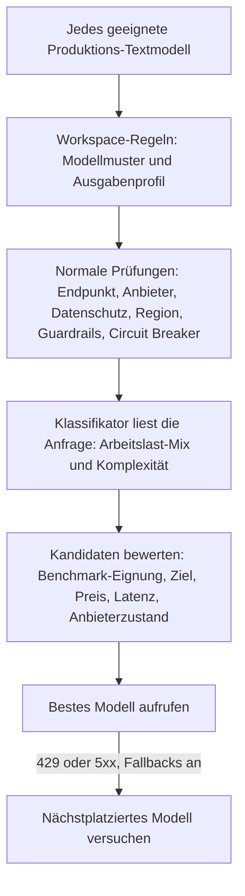

Sende `"model": "phaseo/auto"`, und Phaseo wählt für jede Anfrage ein Modell anhand der Arbeitslast, des Ziels deines Workspace und seiner Preisgrenzen. Auto Routing ist eine Alpha-Funktion, die für ausgewählte Workspaces verfügbar ist.

```json
{
  "model": "phaseo/auto",
  "input": "Review this TypeScript function for correctness."
}
```

Das Feld `model` der Antwort zeigt, welches Modell geantwortet hat.

## Wie ein Modell gewählt wird



1. **Kandidaten.** Phaseo beginnt mit jedem Produktions-Textmodell mit bekannten Standardpreisen und behält dann nur die, die zu deinen Modellmustern und deinem Ausgabenprofil passen.
2. **Prüfungen.** Jeder Kandidat muss dieselben Prüfungen für Endpunkt, Workspace-Modell, Anbieter, Datenschutz, Guardrails und Circuit Breaker bestehen wie eine Anfrage mit festem Modell.
3. **Klassifikator.** Ein fest eingestelltes, günstiges Modell liest die Anfrage und gibt einen Arbeitslast-Mix (Code, Reasoning, Tool-Nutzung und so weiter), einen Komplexitätswert und eine Konfidenz zurück. Es wählt nie selbst das Modell. Tools und strukturierte Ausgabe in der Anfrage werden ihm als vertrauenswürdige Fakten übergeben.
4. **Bewertung.** Die Komplexität legt das am wenigsten leistungsfähige Modell fest, das wahrscheinlich eine akzeptable Antwort liefert, plus einen Puffer. Phaseo kombiniert dann nicht selbst gemeldete Benchmarks aus dem Katalog mit deinem Ziel und dem aktuellen Preis, der Latenz, dem Zustand und der Zuverlässigkeit jedes Kandidaten. Fehlende Daten zählen als neutral; sie erweitern nie die Vorauswahl.

Die Anfrage kann Ziel, Ausgabenprofil oder Muster des Workspace nicht ändern. Eine Anfrage mit festem Modell überspringt Auto Routing vollständig.

## Einrichten

<Steps>
<Step title="Auto Routing öffnen">

Öffne **Dashboard -> Einstellungen -> Routing -> Automatisches Routing**.

</Step>
<Step title="Ein Ziel wählen">

| Ziel | Gewichtet am stärksten |
| --- | --- |
| `balanced` | Eine praktische Mischung aus Qualität, Preis, Latenz und Zuverlässigkeit. |
| `quality` | Benchmark-Ergebnisse, die für die Arbeitslast relevant sind. |
| `cost` | Niedrigere Preise für Eingabe- und Ausgabetokens. |
| `latency` | Niedrigere aktuelle Anbieterlatenz. |

</Step>
<Step title="Ein Ausgabenprofil wählen">

Jedes Profil ist eine harte Obergrenze für Textpreise der Standardstufe, in USD pro Million Tokens. Modelle darüber werden nie berücksichtigt.

| Ausgabenprofil | Max. Eingabe | Max. Ausgabe |
| --- | ---: | ---: |
| Sparsam | $0.10 | $0.50 |
| Standard | $0.30 | $1.50 |
| Premium | $1 | $5 |
| Jeder Preis | Keine | Keine |

Mit **Benutzerdefinierte Limits** legst du beide Obergrenzen selbst fest.

</Step>
<Step title="Modelle eingrenzen (optional)">

Füge Muster wie `anthropic/*`, `openai/gpt-5.*` oder eine exakte Modell-ID hinzu.

</Step>
<Step title="Fallbacks erlauben und speichern">

Mit aktivierten Fallbacks versucht Phaseo nach einem `429`, `500`, `502`, `503` oder `504` das nächstplatzierte Modell. Jeder Fallback durchläuft alle Prüfungen erneut. Client-Fehler wechseln das Modell nicht.

</Step>
</Steps>

Über die CLI: `phaseo routing auto update --objective <o> --spend-profile <p> --allowed-patterns <list> --allow-fallbacks` und `phaseo routing auto get`, um die Einstellung wieder auszulesen. Die API ist `PATCH /v1/routing/auto`.

<Warning>
  Ausgabenprofile und Muster entscheiden, welche Modelle infrage kommen. Sie garantieren keine Qualität, also prüfe den resultierenden Modell-Mix mit deinen eigenen Arbeitslasten.
</Warning>

## Die Klassifikator-Anfrage

Jede `phaseo/auto`-Anfrage erzeugt eine separate untergeordnete Anfrage an das Klassifikatormodell, unter demselben Workspace und derselben Abrechnungsidentität. Sie erscheint eigenständig in den Anfrageprotokollen mit `purpose=auto_routing_classifier` und der ID der übergeordneten Anfrage und wird eigenständig abgerechnet.

Schlägt der Klassifikator fehl, läuft in ein Timeout oder gibt ungültige Daten zurück, nutzt Phaseo stattdessen einen lokalen regelbasierten Klassifikator (Code, Reasoning, Tool-Nutzung, strukturierte Ausgabe, Übersetzung, Zusammenfassung oder allgemein), sodass die Hauptanfrage trotzdem läuft.

## Datenschutz- und Regionsgrenzen

Datengrenzen der Anfrage gelten auch für Auto Routing:

- Mit `provider.require_zero_data_retention: true` oder einer Workspace- oder Schlüssel-Guardrail, die nur Anbieter ohne Datenspeicherung zulässt, kommen nur Modelle mit einem solchen Anbieter in die Vorauswahl.
- Erforderliche Regionen werden gegen die Anbieter jedes Kandidaten geprüft.
- Die Klassifikator-Anfrage trägt dieselben Grenzen sowie die Anbieterlisten `only` und `ignore`. Kann ihr Modell sie nicht erfüllen, nutzt Phaseo den lokalen Klassifikator.

Bleibt allein wegen Anforderungen an den Datenstandort kein Modell übrig, schlägt die Anfrage mit `403 model_region_unavailable` und `unmet_requirements` fehl, wie es auch bei einem festen Modell der Fall wäre. Wurden Modelle auch aus anderen Gründen ausgeschlossen, schlägt sie mit `400 unsupported_model_or_endpoint` fehl.

## Eine Entscheidung untersuchen

Die Anfragedetails zeigen Arbeitslast, Ziel, ausgewähltes Modell, Fallback-Reihenfolge, die Scores und Faktor-Scores jedes Kandidaten, Benchmark-IDs, Ausschlüsse und die Algorithmusversion. Traces enthalten keine Prompt- oder Antwortinhalte.

## Mit anderem Routing kombinieren

- **Dynamische Routen.** Ein festes Modell, das eine angehängte [dynamische Route](./routing-and-fallbacks#attach-routing-rules-to-api-keys) wählt, hat Vorrang. Die Überschreibung wird protokolliert, und die Fallbacks von Auto Routing sind für diese Anfrage deaktiviert.
- **Anfrage-Fallbacks.** `phaseo/auto` verwaltet seine eigenen geordneten Fallbacks, daher kann es nicht mit einer [`models`-Liste](./routing-and-fallbacks#request-level-model-fallbacks) kombiniert werden oder darin vorkommen.
