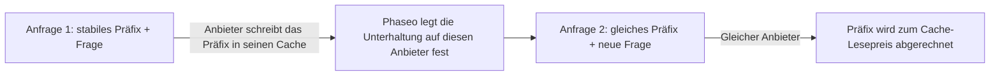

Halte den Anfang deines Prompts über Anfragen hinweg gleich, dann liest der Anbieter ihn aus seinem Cache, statt ihn erneut zu verarbeiten: Diese Token werden zum Cache-Lesepreis abgerechnet, und das erste Token kommt schneller an. Die meisten Anbieter cachen wiederholte Präfixe selbstständig. Claude cacht nur, was du mit `cache_control` markierst.



Auch mit Prompt-Caching läuft bei jeder Anfrage eine Inferenz. Es gibt keine frühere Antwort auf eine identische Anfrage zurück.

## Einen Prompt cachen

Markiere den letzten Block des stabilen Teils. Alles bis einschließlich dieses Blocks wird gecacht.

<CodeGroup>
```bash Chat Completions
curl https://api.phaseo.app/v1/chat/completions \
  -H "Authorization: Bearer $PHASEO_API_KEY" \
  -H "Content-Type: application/json" \
  -d '{
    "model": "anthropic/claude-sonnet-5.5",
    "messages": [
      {
        "role": "system",
        "content": [
          {
            "type": "text",
            "text": "You are a support assistant. Follow the company policy exactly.",
            "cache_control": { "type": "ephemeral", "ttl": "1h" }
          }
        ]
      },
      { "role": "user", "content": "Summarise the latest ticket." }
    ]
  }'
```

```bash Responses
curl https://api.phaseo.app/v1/responses \
  -H "Authorization: Bearer $PHASEO_API_KEY" \
  -H "Content-Type: application/json" \
  -d '{
    "model": "anthropic/claude-sonnet-5.5",
    "input": [
      {
        "role": "user",
        "content": [
          {
            "type": "input_text",
            "text": "Reference document: Refunds are available for 30 days when...",
            "cache_control": { "type": "ephemeral", "ttl": "5m" }
          },
          {
            "type": "input_text",
            "text": "Answer this customer: Can I return an item after 20 days?"
          }
        ]
      }
    ]
  }'
```

```bash Anthropic Messages
curl https://api.phaseo.app/v1/messages \
  -H "Authorization: Bearer $PHASEO_API_KEY" \
  -H "Content-Type: application/json" \
  -d '{
    "model": "anthropic/claude-sonnet-5.5",
    "max_tokens": 512,
    "system": [
      {
        "type": "text",
        "text": "You are a careful support assistant. Use the policy below.",
        "cache_control": { "type": "ephemeral", "ttl": "1h" }
      }
    ],
    "messages": [
      {
        "role": "user",
        "content": [
          {
            "type": "text",
            "text": "Policy: refunds are available for 30 days when...",
            "cache_control": { "type": "ephemeral", "ttl": "5m" }
          },
          { "type": "text", "text": "Can this customer return an item after 20 days?" }
        ]
      }
    ],
    "tools": [
      {
        "name": "lookup_order",
        "description": "Look up order status.",
        "input_schema": {
          "type": "object",
          "properties": { "order_id": { "type": "string" } },
          "required": ["order_id"]
        },
        "cache_control": { "type": "ephemeral", "ttl": "5m" }
      }
    ]
  }'
```
</CodeGroup>

Prüfe dann, ob es funktioniert hat:

1. Sende die Anfrage einmal, um den Cache zu schreiben.
2. Sende sie erneut mit denselben cachefähigen Inhalten.
3. Prüfe `cached_tokens` und `cache_write_tokens` in den Nutzungsdaten der Antwort (siehe [Nutzungs- und Abrechnungsfelder](#usage-and-pricing-fields)) sowie die Cache-Meter in den Anfragedetails.
4. Vergleiche Latenz und Kosten über mehrere Aufrufe hinweg, nicht nur beim ersten.

Cache Inhalte, die über Anfragen hinweg gleich bleiben: lange Systemanweisungen, wiederverwendete Dokumente, Few-Shot-Beispiele, Tool-Definitionen und umfangreiche Tool-Ergebnisse, die der nächste Zug erneut sendet. Markiere keine Inhalte, die sich bei jeder Anfrage ändern, keine kurzen einmaligen Eingaben und keine Daten, die der Anbieter laut deiner Richtlinie nicht speichern darf.

<Note>
Phaseo sendet jedem Anbieter nur die Cache-Steuerungen, die er dokumentiert, und entfernt die übrigen. Cache-Steuerungen schließen nie einen Anbieter vom Routing aus. Jede Modellseite listet ihre Preise für Cache-Lese- und -Schreibvorgänge auf.
</Note>

<span id="which-providers-cache-automatically"></span>
## Welche Anbieter automatisch cachen

| Anbieter | Caching | Was Phaseo sendet |
| --- | --- | --- |
| [OpenAI](https://developers.openai.com/api/docs/guides/prompt-caching), [Azure OpenAI](https://learn.microsoft.com/en-us/azure/foundry/openai/how-to/prompt-caching) | Automatisch bei Prompts ab 1.024 Token | `prompt_cache_key`; Breakpoints und `prompt_cache_options` ab GPT-5.6; `prompt_cache_retention` bei älteren Modellen |
| [Anthropic Claude](https://platform.claude.com/docs/en/build-with-claude/prompt-caching) bei Anthropic, Claude on AWS, Amazon Bedrock und Google Vertex AI | Nur nach Aktivierung | `cache_control`-Breakpoints, höchstens vier pro Anfrage |
| [Google Gemini](https://ai.google.dev/gemini-api/docs/caching) bei Google AI Studio und [Vertex AI](https://docs.cloud.google.com/vertex-ai/generative-ai/docs/context-cache/context-cache-overview) | Automatisch ab Gemini 2.5 | `cached_content` für einen expliziten Cache, den du angelegt hast |
| [xAI](https://docs.x.ai/developers/advanced-api-usage/prompt-caching/maximizing-cache-hits) | Automatisch | `prompt_cache_key` und den Header `x-grok-conv-id` |
| [DeepSeek](https://api-docs.deepseek.com/guides/kv_cache) | Automatisch | Nichts weiter |
| [Moonshot AI](https://platform.kimi.ai/docs/guide/context-caching) | Automatisch, mit einer TTL von 5 Minuten; eine TTL von 1 Stunde bei Kimi K3 nach Aktivierung | `prompt_cache_key` und `prompt_cache_options` |
| [Groq](https://console.groq.com/docs/prompt-caching) | Automatisch bei den Modellen, die Groq auflistet | Nichts weiter |
| [Fireworks](https://docs.fireworks.ai/guides/prompt-caching) | Automatisch | `prompt_cache_key` sowie den Header `x-session-affinity` und `user` |
| [Cerebras](https://inference-docs.cerebras.ai/capabilities/prompt-caching) | Automatisch | `prompt_cache_key` |
| [Cloudflare Workers AI](https://developers.cloudflare.com/workers-ai/features/prompt-caching) | Automatisch bei ausgewählten Modellen | Den Header `x-session-affinity` |
| [Together AI](https://docs.together.ai/docs/inference/chat/prompt-caching), [Mistral](https://docs.mistral.ai/studio-api/conversations/advanced/prompt-caching) | Automatisch; `prompt_cache_key` erhöht die Trefferquote | `prompt_cache_key` |
| [Alibaba Model Studio](https://www.alibabacloud.com/help/en/model-studio/context-cache) | Automatisch (implizit); explizite Caches nur nach Aktivierung | `cache_control` auf Blockebene |
| [Venice](https://docs.venice.ai/overview/guides/prompt-caching) | Automatisch; Venice setzt Claude-Breakpoints selbst | `cache_control` auf Blockebene |
| [DeepInfra](https://docs.deepinfra.com/chat/prompt-cache-retention) | Automatisch; ein Aufbewahrungsfenster nur nach Aktivierung | `prompt_cache_key`, `prompt_cache_breakpoint` und `prompt_cache_options` |
| [Inference.net](https://inference.net/models/claude-opus-5/) | Automatisch; explizites Caching bei Claude- und Gemini-2.5-Modellen | `cache_control` auf Blockebene bei Claude- und Gemini-2.5-Modellen, ohne `ttl` |
| [Baseten](https://docs.baseten.co/inference/model-apis/pricing-and-limits) | Automatisch | `prompt_cache_key` und den Header `x-session-affinity` |
| [Morph](https://docs.morphllm.com/sdk/components/caching) | Automatisch | `prompt_cache_key` und den Header `x-session-id` |

Andere OpenAI-kompatible Anbieter erhalten `prompt_cache_key`, wenn ihre API das Feld akzeptiert, und keine weiteren Cache-Steuerungen. Phaseo sendet immer einen Hash aus deinem Arbeitsbereich und dem Schlüssel statt des Schlüssels selbst; siehe [Anbieter-Affinität](#provider-affinity).

<span id="cache-controls"></span>
## Cache-Steuerung

### Claude-Breakpoints von Phaseo setzen lassen

Ein `cache_control` auf oberster Ebene bei Chat Completions, Responses oder Anthropic Messages aktiviert Caching für Claude-Routen, und Phaseo setzt die Breakpoints für dich. Andere Anbieter ignorieren es.

```json
{
  "cache_control": { "type": "ephemeral", "ttl": "5m" }
}
```

Verwende `ttl: "5m"` (Standard) für kurzlebigen gemeinsamen Kontext und `ttl: "1h"`, wenn das Modell länger lebende Cache-Einträge unterstützt. Ein `cache_control` auf oberster Ebene hält die Unterhaltung außerdem bei einem Anbieter; siehe [Anbieter-Affinität](#provider-affinity).

`provider_options.anthropic.cache_control` ist dieselbe Einstellung und akzeptiert zusätzlich einen `scope`. Sendet eine Anfrage beides, gewinnt der Wert in `provider_options`:

```json
{
  "provider_options": {
    "anthropic": {
      "cache_control": { "type": "ephemeral", "ttl": "5m", "scope": "agent" }
    }
  }
}
```

| `scope` | Wo Phaseo Breakpoints setzt |
| --- | --- |
| `all_text` (Standard) | Der Systemtext und die drei neuesten Nutzernachrichten, die Text oder Bilder enthalten. |
| `last_user_message` | Nur die neueste Nutzernachricht. |
| `agent` | Für Tool-Schleifen: die letzte Tool-Definition, der Systemtext, die letzte Nachricht (einschließlich Tool-Ergebnissen) und die Nachricht aus dem vorherigen Schritt. `conversation` ist ein Alias. |
| `none` | Nirgends. |

Verwende `agent` für mehrstufige Tool-Schleifen. `all_text` und `last_user_message` markieren keine Nachrichten, die nur Tool-Ergebnisse enthalten, sodass das gecachte Präfix nicht weiterwächst. Nicht erkannte `scope`-Werte werden als `agent` behandelt.

Breakpoints, die du selbst an Blöcken setzt, haben Vorrang vor der Standardrichtlinie und zählen zu Anthropics Grenze von vier pro Anfrage: Die Standardrichtlinie setzt ab vier keine weiteren Markierungen. Tragen deine eigenen Blöcke mehr als vier Markierungen, behält Phaseo die erste und die drei neuesten und entfernt die übrigen, damit die Anfrage nicht abgelehnt wird.

### Cache-Breakpoints an Blöcken

Eine Cache-Markierung an einem Inhaltsblock cacht alles bis einschließlich dieses Blocks. Phaseo akzeptiert zwei Schreibweisen:

- `cache_control`: `{"type": "ephemeral"}`, mit einer optionalen `ttl` von `5m` oder `1h`.
- `prompt_cache_breakpoint`: OpenAIs `{"mode": "explicit"}`, mit einer optionalen `ttl` von `30m` oder `12h` (siehe [12-Stunden-Cache bei OpenAI](#12-hour-cache-on-openai)). Trägt ein Block beides, gewinnt `prompt_cache_breakpoint`.

Bei Chat Completions und Responses werden Markierungen an Text- und Bildteilen, an Funktions-Tool-Definitionen und an Tool-Ergebnissen akzeptiert, deren Inhalt ein Array aus Textteilen ist. Anthropic Messages akzeptiert `cache_control` überall dort, wo Anthropic es akzeptiert: an `system`-Textblöcken, an Text- und Bildblöcken in Nachrichten, an Tool-Ergebnisblöcken und an Tool-Definitionen. Hat eine Anfrage mehrere TTLs, verlangt Anthropic, dass die `1h`-Breakpoints vor den `5m`-Breakpoints stehen.

Jeder Anbieter erhält die Markierung in seiner eigenen Form:

| Anbieter | `cache_control` am Block | `prompt_cache_breakpoint` |
| --- | --- | --- |
| Claude bei Anthropic, Claude on AWS, Amazon Bedrock und Google Vertex AI | Gesendet als `{"type": "ephemeral"}` mit deiner `ttl` | Gesendet als `cache_control: {"type": "ephemeral"}` |
| OpenAI, ab GPT-5.6 | Gesendet als `prompt_cache_breakpoint: {"mode": "explicit"}`; die `ttl` wird entfernt | Gesendet, mit seiner `ttl` |
| Azure OpenAI, ab GPT-5.6 | Gesendet als `prompt_cache_breakpoint: {"mode": "explicit"}`; die `ttl` wird entfernt | Gesendet ohne `ttl` |
| OpenAI und Azure OpenAI, ältere Modelle | Entfernt | Entfernt |
| DeepInfra | Entfernt | Gesendet ohne `ttl` |
| Alibaba Model Studio und Venice | Gesendet | Entfernt |
| Inference.net, Claude- und Gemini-2.5-Modelle | Gesendet ohne `ttl` | Entfernt |
| Andere Anbieter | Entfernt | Entfernt |

Markierungen an Tool-Definitionen erreichen nur Claude-Routen, Alibaba Model Studio, Venice sowie die Claude- und Gemini-2.5-Modelle von Inference.net; OpenAI akzeptiert keine Breakpoints an Tools. Das Entfernen einer Markierung lässt den Rest des Prompts unverändert, sodass das gecachte Präfix zu einer Anfrage ohne Markierung passt.

Amazon Bedrock und Google Vertex AI cachen Claude 3.7 Sonnet, 3.5 Sonnet und 3 Opus nur für 5 Minuten, und Bedrock kann eine `ttl` bei diesen Modellen ablehnen. Auf diesen Routen sendet Phaseo deine Breakpoints ohne `ttl`, sodass sie 5 Minuten lang cachen, und meldet ein entferntes `1h` als `cache_control.ttl` im Header `X-Phaseo-Dropped-Params` und in `meta.routing.dropped_params`. Inference.net dokumentiert Breakpoints ohne `ttl`, daher entfernt und meldet Phaseo dort eine `ttl` auf dieselbe Weise, und die Schreibvorgänge werden als 5-Minuten-Schreibvorgänge abgerechnet.

<span id="openai-retention-and-options"></span>
### Aufbewahrung und Optionen bei OpenAI

Die Cache-Steuerungen von OpenAI hängen von der Modellgeneration ab. Phaseo sendet jede nur dorthin, wo sie akzeptiert wird:

| Feld | Werte | Gesendet an |
| --- | --- | --- |
| `prompt_cache_options` | `mode`: `implicit` oder `explicit`; `ttl`: `30m` (Standard) oder `12h` | OpenAI ab GPT-5.6 |
| `prompt_cache_options` | `mode`: `implicit` oder `explicit`; `ttl`: `30m` | Azure OpenAI ab GPT-5.6 |
| `prompt_cache_options` | `mode`: `explicit`; `ttl`: `5m` oder `1h` | DeepInfra |
| `prompt_cache_options` | `mode`: `implicit`; `ttl`: `5m` (Standard) oder `1h` bei Kimi K3 | Moonshot AI |
| `prompt_cache_retention` | `in_memory` oder `24h` | OpenAI- und Azure-OpenAI-Modelle vor GPT-5.6 |

Der Modus `explicit` cacht nur die Breakpoints, die du setzt. DeepInfra braucht außerdem `prompt_cache_key` bei jeder Anfrage der Sitzung. Phaseo sendet ein `1h` für Moonshot AI nur an Kimi-K3-Routen mit einem Schreibpreis für 1 Stunde, sodass diese Schreibvorgänge zu diesem Preis abgerechnet werden; anderswo entfernt es die `ttl` und meldet sie als `prompt_cache_options.ttl` im Header `X-Phaseo-Dropped-Params`. Andere Anbieter erhalten keines der beiden Felder.

Sende eines der Felder auf oberster Ebene oder unter `provider_options.openai`. Sind beide vorhanden, gewinnt der Wert auf oberster Ebene:

```json
{
  "prompt_cache_retention": "24h",
  "provider_options": {
    "openai": { "prompt_cache_retention": "in_memory" }
  }
}
```

Hier verwendet die Anfrage `24h`.

<span id="12-hour-cache-on-openai"></span>
### 12-Stunden-Cache bei OpenAI

Ab GPT-5.6 behält OpenAI einen Cache-Eintrag mindestens 12 Stunden, wenn du `ttl: "12h"` setzt, entweder für die ganze Anfrage in `prompt_cache_options` oder für einen Breakpoint in `prompt_cache_breakpoint`. Ein Breakpoint ohne eigene `ttl` übernimmt die der Anfrage. OpenAI berechnet einen 12-Stunden-Schreibvorgang mit dem 2,5-Fachen des Eingabepreises und einen 30-Minuten-Schreibvorgang mit dem 1,25-Fachen; Cache-Lesevorgänge kosten in beiden Fällen gleich viel.

```json
{
  "model": "openai/gpt-5.6-sol",
  "prompt_cache_options": { "ttl": "30m" },
  "input": [
    {
      "role": "developer",
      "content": [
        {
          "type": "input_text",
          "text": "Shared tool manual...",
          "prompt_cache_breakpoint": { "mode": "explicit", "ttl": "12h" }
        }
      ]
    },
    { "role": "user", "content": "Find the failing test." }
  ]
}
```

- OpenAI dokumentiert die Lebensdauer von 12 Stunden nur für seine Responses API. Eine Chat-Completions-Anfrage, die sie anfordert, läuft über OpenAIs Responses API, und die Antwort behält das Chat-Completions-Format.
- Routen, die einen 12-Stunden-Cache akzeptieren, werden zuerst versucht: OpenAIs eigene API (`openai` und `openai-eu`) bei einem Modell ab GPT-5.6, dessen Preiskarte einen Schreibpreis für 12 Stunden hat. Jede andere Route, etwa Azure OpenAI, ein anderer Anbieter oder ein Modell vor GPT-5.6, erhält die Anfrage ohne ihn, sodass der Standard von 30 Minuten gilt. Die Anfrage läuft trotzdem, und das entfernte Feld wird als `prompt_cache_options.ttl` oder `prompt_cache_breakpoint.ttl` im Header `X-Phaseo-Dropped-Params` und in `meta.routing.dropped_params` gemeldet.

### Einen expliziten Gemini-Cache nutzen

Gemini 2.5 und neuer cachen implizit, ohne dass du etwas senden musst. Um einen expliziten Cache zu nutzen, den du mit Googles Caching-API angelegt hast, übergib seinen Namen in `provider_options.google.cached_content`:

```json
{
  "provider_options": {
    "google": { "cached_content": "cachedContents/abc123" }
  }
}
```

- Bei Google AI Studio funktioniert `cached_content` nur mit deinem eigenen Google-API-Schlüssel (BYOK). Mit dem Schlüssel von Phaseo gibt die Anfrage `400` zurück, weil der Cache zu dem Konto gehört, das ihn angelegt hat.
- Bei Vertex AI funktioniert `cached_content` nur mit deinen eigenen Vertex-AI-Zugangsdaten; mit den Zugangsdaten von Phaseo gibt die Anfrage `400` zurück. Sende den vollständigen Namen des Caches, `projects/{project}/locations/{location}/cachedContents/{id}`, dann sendet Phaseo die Anfrage an dieses Projekt und diesen Standort. Ein Kurzname wie `cachedContents/abc123` verwendet `project_id` und `region` aus deinem Dienstkonto-JSON und gibt `400` zurück, wenn eines davon fehlt.
- Google unterstützt keine expliziten Caches bei Gemini 4 Argon und neuer.

`provider_options.google.cache_control` und `provider_options.google.cache_ttl` werden akzeptiert, aber nicht an Google gesendet.

### Responses: die ganze Unterhaltung senden

Phaseo speichert keine Antworten. Anfragen, die `previous_response_id` oder `conversation` setzen, geben `400` `unsupported_param` zurück. Sende daher bei jedem Schritt die ganze Unterhaltung in `input`. Ihr stabiler Anfang ist das Präfix, das gecacht wird. Sende in Tool-Schleifen auch die `reasoning`-Ausgabeelemente zurück; siehe [Reasoning in Tool-Schleifen](../api-reference/endpoint/responses.mdx#reasoning-in-tool-loops).

<span id="change-reasoning-effort-mid-conversation"></span>
### Reasoning-Aufwand mitten in der Unterhaltung ändern

Ändere `reasoning_effort` (Chat Completions) oder `reasoning.effort` (Responses) zwischen Anfragen, und Phaseo erhält Claudes Prompt-Cache: Es sendet die Änderung als Aufwandsmarkierung innerhalb von `messages` statt als neuen Aufwand auf oberster Ebene. Das funktioniert, solange du Claudes Reasoning unverändert zurücksendest. Bei Anthropic Messages sendest du die Markierung selbst. Siehe [Reasoning-Aufwand mitten in der Unterhaltung ändern](./reasoning-effort.mdx).

<span id="usage-and-pricing-fields"></span>
## Nutzungs- und Abrechnungsfelder

Jeder Text-Endpunkt meldet Cache-Lese- und -Schreibvorgänge. Chat Completions und Responses folgen der Semantik von OpenAI: Die Eingabezahl enthält Cache-Lese- und -Schreibvorgänge. Anthropic Messages folgt der von Anthropic: `input_tokens` schließt sie aus.

| Endpunkt | Gesamte Eingabe | Cache-Lesevorgänge | Cache-Schreibvorgänge |
| --- | --- | --- | --- |
| Chat Completions | `prompt_tokens`, einschließlich Lese- und Schreibvorgängen | `prompt_tokens_details.cached_tokens` | `prompt_tokens_details.cache_write_tokens` |
| Responses | `input_tokens`, einschließlich Lese- und Schreibvorgängen | `input_tokens_details.cached_tokens` | `input_tokens_details.cache_write_tokens`, bei OpenAI ab GPT-5.6 nach Lebensdauer aufgeteilt in `input_tokens_details.cache_write_tokens_details.ttl_30m_tokens` und `ttl_12h_tokens` |
| Anthropic Messages | `input_tokens` + `cache_read_input_tokens` + `cache_creation_input_tokens` | `cache_read_input_tokens` | `cache_creation_input_tokens`, nach TTL aufgeteilt in `cache_creation.ephemeral_5m_input_tokens` und `cache_creation.ephemeral_1h_input_tokens` |

Bei Chat Completions und Responses ist die ungecachte Eingabe die gesamte Eingabe minus Cache-Lesevorgänge minus Cache-Schreibvorgänge. Gestreamte Anthropic-Messages-Antworten tragen die Cache-Felder in `message_delta`. Die Nutzungsdaten von Chat Completions haben keine Aufteilung nach Lebensdauer, weil OpenAI dort keine dokumentiert; die Anfragedetails erfassen sie trotzdem.

<Note>
Frühere Antworten meldeten Cache-Schreibvorgänge als `output_tokens_details.cached_tokens` (`completion_tokens_details.cached_tokens` bei Chat Completions), und Claude-Routen ließen Cache-Lese- und -Schreibvorgänge bei Chat Completions und Responses aus `input_tokens` heraus. Beides gilt nicht mehr: Lies Schreibvorgänge aus `cache_write_tokens`. Nicht gestreamte Anthropic-Messages-Antworten gaben früher `cache_creation_input_tokens: null` zurück; jetzt geben sie die echten Werte zurück.
</Note>

Anfragedetails und Preisaufschlüsselungen verwenden diese Meter:

| Meter | Zählt |
| --- | --- |
| `cached_read_text_tokens` | Cache-Lesevorgänge. |
| `cached_write_text_tokens` | Cache-Schreibvorgänge, wenn der Anbieter einen einzigen Cache-Schreibpreis hat. |
| `cached_write_text_tokens_5m`, `cached_write_text_tokens_1h` | Claude-Cache-Schreibvorgänge mit einer TTL von 5 Minuten oder 1 Stunde, wenn der Anbieter sie getrennt meldet. |
| `cached_write_text_tokens_30m`, `cached_write_text_tokens_12h` | OpenAI-Cache-Schreibvorgänge mit einer Lebensdauer von 30 Minuten oder 12 Stunden. |

### Wie gecachte Token abgerechnet werden

Phaseo rechnet jedes Eingabetoken genau einmal zu genau einem Preis ab: ungecachte Eingabe zum Eingabepreis, Cache-Lesevorgänge zum Cache-Lesepreis und Cache-Schreibvorgänge zum Cache-Schreibpreis oder, wenn der Anbieter sie getrennt berechnet, zu den Preisen für 5 Minuten und 1 Stunde (Claude) bzw. 30 Minuten und 12 Stunden (OpenAI). Manche Anbieter zählen Cache-Schreibvorgänge in die Eingabesumme, andere melden sie zusätzlich; in beiden Fällen wird ein geschriebenes Token nie zusätzlich als normale Eingabe berechnet.

Bei beispielhaften Preisen von $5.00 pro 1 Mio. Eingabetoken, $0.50 für Cache-Lesevorgänge, $6.25 für 30-Minuten-Cache-Schreibvorgänge und $30.00 für Ausgabe kostet eine Anfrage mit 53.100 Eingabetoken, davon 48.000 Cache-Lesevorgänge und 3.000 Cache-Schreibvorgänge, sowie 850 Ausgabetoken:

| Token | Preis pro 1 Mio. | Kosten |
| --- | ---: | ---: |
| 2.100 ungecachte Eingabe | $5.00 | $0.01050 |
| 48.000 Cache-Lesevorgänge | $0.50 | $0.02400 |
| 3.000 Cache-Schreibvorgänge | $6.25 | $0.01875 |
| 850 Ausgabe | $30.00 | $0.02550 |
| Gesamt | | $0.07875 |

Hätten 2.000 dieser Schreibvorgänge eine Lebensdauer von 12 Stunden, kosteten sie $12.50 statt $6.25 pro 1 Mio., und die Anfrage würde $0.09125 kosten.

Manche Anbieter gewähren bei einigen Modellen keinen Rabatt auf gecachte Token. Deren Modellseiten zeigen denselben Preis für Eingabe und Cache-Lesevorgänge.

### Wenn eine Route noch keinen Cache-Preis hat

Meldet ein Anbieter gecachte Token auf einer Route, für die der Katalog noch keinen Cache-Preis hat, schlägt die Anfrage nicht fehl:

- Cache-Lesevorgänge werden zum Eingabepreis der Route abgerechnet.
- Cache-Schreibvorgänge werden zum Eingabepreis mal dem dokumentierten Schreibfaktor des Anbieters abgerechnet.
- Die Preiszeile ist mit `pricing_fallback: "input_rate"` gekennzeichnet.

| Schreibvorgänge | Faktor auf den Eingabepreis |
| --- | --- |
| Claude, jede Plattform | 1,25× für 5-Minuten-Schreibvorgänge, 2× für 1-Stunden-Schreibvorgänge |
| OpenAI-Schreibvorgänge mit 30 Minuten, jede Route | 1,25× |
| OpenAI-Schreibvorgänge mit 12 Stunden, jede Route | 2,5× |
| OpenAI, Azure OpenAI und Alibaba, andere Schreibvorgänge | 1,25× |
| Moonshot AI und Kimi K3 | 1× für 5-Minuten-Schreibvorgänge, 2× für 1-Stunden-Schreibvorgänge |
| Andere Anbieter | 1× |

Auf einer Claude-Route, deren Katalog nur einen Cache-Schreibpreis hat, ist dieser Preis der 5-Minuten-Preis. Schreibvorgänge, die der Anbieter als 1-Stunden-Schreibvorgänge meldet, werden zum doppelten Eingabepreis abgerechnet, in einer Zeile `cached_write_text_tokens_1h` mit der Kennzeichnung `pricing_fallback: "input_rate"`.

Das letzte `message_delta` einer gestreamten Claude-Antwort meldet die gesamten Cache-Schreibvorgänge ohne Aufteilung nach TTL. Schreibvorgänge über diese Aufteilung hinaus werden als 5-Minuten-Schreibvorgänge abgerechnet, weil Schreibvorgänge von Server-Tools auch dann 5 Minuten nutzen können, wenn die Anfrage 1 Stunde anfordert.

<span id="provider-affinity"></span>
## Anbieter-Affinität

Ein Prompt-Cache liegt bei einem Anbieter und oft bei einer Region oder einem Deployment dieses Anbieters. Phaseo hält zusammengehörige Anfragen beim Anbieter und bei der Route, die sie bedient haben, damit eine Agentenschleife nicht dafür bezahlt, ihren Cache anderswo neu aufzubauen.

Sende `prompt_cache_key` oder `session_id` oder aktiviere Caching mit `cache_control` (auf oberster Ebene, als `provider_options.anthropic.cache_control` oder als `cache_control`- bzw. `prompt_cache_breakpoint`-Markierung an einem Nachrichtenblock oder Tool), um eine Unterhaltung festzulegen. Phaseo legt sie auf den Anbieter und die Route fest, die die erste erfolgreiche Anfrage bedient haben, und spätere Anfragen mit demselben Schlüssel gehen ebenfalls dorthin. Festlegungen gelten pro Arbeitsbereich, Endpunkt und Modell.

Wie lange eine Festlegung gilt, hängt von der Cache-Aufbewahrung des Anbieters ab:

| Anfrage | Festlegung gilt |
| --- | --- |
| `session_id` | 24 Stunden, verlängert, solange die Sitzung aktiv ist |
| Anthropic `cache_control` mit `ttl: "1h"` | 90 Minuten |
| OpenAI oder Azure OpenAI mit `prompt_cache_retention: "24h"` | 24 Stunden |
| OpenAI oder Azure OpenAI mit In-Memory-Aufbewahrung (Standard) | 90 Minuten |
| OpenAI mit `ttl: "12h"` in `prompt_cache_options` oder an einem Breakpoint, oder ein gemeldeter 12-Stunden-Schreibvorgang | 18 Stunden |
| OpenAI oder Azure OpenAI mit `prompt_cache_options.ttl: "30m"` | 45 Minuten |
| Alles andere | 15 Minuten |

Eine Festlegung wechselt nur, wenn ihr Anbieter ausfällt (ein offener Circuit Breaker oder eine hohe aktuelle Fehlerquote), wenn das von Phaseo verwaltete Kontingent bei diesem Anbieter aufgebraucht ist oder wenn die aktive Route, Voreinstellung, Guardrail oder Anfragerichtlinie ihn nicht mehr zulässt. Die Anfrage wechselt dann per Failover, und die Festlegung geht auf den Anbieter über, der sie bedient hat. Die Anfragedetails vermerken dies als `sticky_routing.demotionReason` in der Routing-Diagnose. Festgelegte Anfragen werden nicht genutzt, um sich erholende Anbieter zu testen.

Ohne Schlüssel, `session_id` oder Cache-Markierung legt Phaseo den Anfangskontext trotzdem 15 Minuten lang auf einen Anbieter fest, der dafür einen Cache-Lese- oder -Schreibvorgang gemeldet hat, sofern gecachte Eingabe bei diesem Anbieter günstiger ist als normale Eingabe.

Phaseo sendet Anbietern einen Hash aus deinem Arbeitsbereich und `prompt_cache_key`, nie den Rohschlüssel, sodass derselbe Schlüssel in zwei Arbeitsbereichen nie einen Anbieter-Cache teilt. Gibt es nur eine `session_id`, leitet Phaseo diesen Hash für OpenAI, xAI, Fireworks und Cerebras aus der Sitzung ab. Fireworks, Cloudflare Workers AI und Baseten erhalten ihn zusätzlich im Header `x-session-affinity`, Morph im Header `x-session-id` und xAI als `x-grok-conv-id`, sofern du nicht `provider_options.xai.conversation_id` setzt. Antworten geben weiterhin deinen eigenen `prompt_cache_key` zurück.

Setze `provider.cache_aware_routing` auf `false`, um für eine Anfrage darauf zu verzichten. Setze `routing.session_affinity` auf `false`, wenn die Anfrage eine `session_id` enthält, aber nur normales kontextbasiertes Routing nutzen soll; Phaseo leitet dann auch keinen Anbieter-Cache-Schlüssel mehr aus der Sitzung ab. Wie Affinität mit Anbieterreihenfolge und Fallbacks zusammenspielt, steht unter [Routing und Fallbacks](./routing-and-fallbacks.mdx). Jedes Cache-Feld ist außerdem in der [Parameterreferenz](../api-reference/parameters.mdx) aufgeführt.
