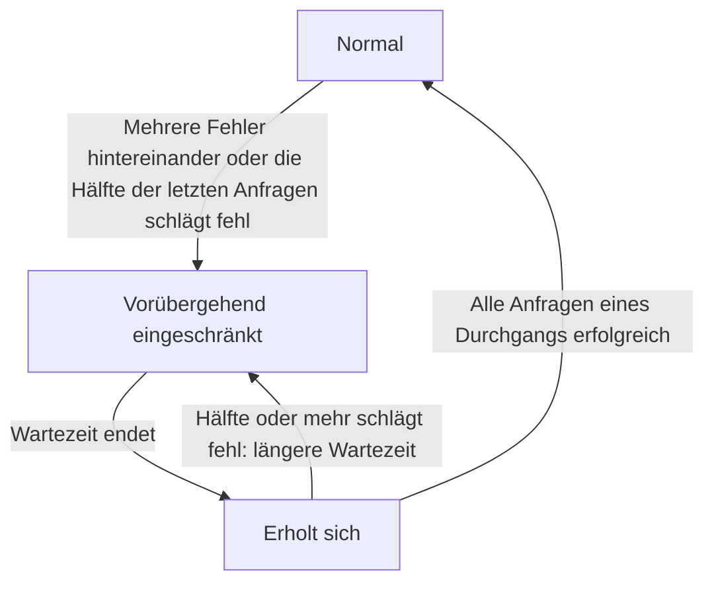

import { ProviderStatusExplorer } from "/snippets/provider-status.jsx";

Auf einer Modellseite stehen hinter jedem Anbieternamen bis zu zwei Symbole: ein **Statussymbol**, das Phaseo festlegt, und ein **Live-Routing-Symbol**, das nur erscheint, solange das Gateway Traffic von einem fehlerhaften Anbieter wegleitet.

<ProviderStatusExplorer locale="de" />

## Statussymbol

Phaseo legt diesen Status manuell fest, und er bleibt bestehen, bis Phaseo ihn ändert. Eine Route mit niedrigerer Priorität ist eine letzte Reserve: Das Gateway versucht sie erst nach allen anderen gesunden Anbietern.

| Symbol | Status | Routing |
| --- | --- | --- |
| <Icon icon="circle-check" color="#16a34a" /> | `Active` | Wird normal geroutet. |
| <Icon icon="triangle-alert" color="#d97706" /> | `Niedrigere Priorität` | Nur als Reserve, nach allen anderen gesunden Anbietern. |
| <Icon icon="ban" color="#dc2626" /> | `Disabled` | Wird nicht geroutet. |

## Live-Routing

Das Gateway legt dies automatisch für jeden Anbieter, jedes Modell und jeden Endpunkt fest, anhand der Anfragen, die es gerade verarbeitet. Eine eingeschränkte oder sich erholende Route bleibt routbar, aber andere Anbieter werden zuerst versucht.

## Verfügbarkeit und Integration

Die Status-Hoverkarte zeigt außerdem, ob der Anbieter das Modell anbietet und ob Phaseo es aktiviert hat. Eine Route ist nur öffentlich, wenn beides zutrifft. Ein Anbieter kann zum Beispiel ein neues Modell anbieten (`Available`), während Phaseo die Unterstützung noch entwickelt (`Implementing`).

### Verfügbarkeit beim Anbieter

| Status | Bedeutung |
| --- | --- |
| `Available` | Der Anbieter nimmt aktuell Anfragen für das Angebot an. |
| `Preview` | Der Anbieter stellt das Angebot als Vorschau bereit. |
| `Limited Access` | Das Angebot ist vorhanden, aber der Zugriff hängt von Konto, Region, Zulassungsliste oder Kapazität ab. |
| `Coming Soon` | Der Anbieter hat das Angebot angekündigt oder aufgeführt, es ist aber noch nicht nutzbar. |
| `Deprecated` | Das Angebot ist weiterhin verfügbar, der Anbieter empfiehlt jedoch eine Migration. |
| `Removed` | Der Anbieter stellt das Angebot nicht mehr bereit. |
| `Unknown` | Phaseo hat die Verfügbarkeit beim ursprünglichen Anbieter noch nicht überprüft. |

### Phaseo-Integration

| Status | Bedeutung | Phaseo-Routing |
| --- | --- | --- |
| `Unsupported` | Phaseo hat keine kompatible Integration für das Angebot. | Nicht routbar. |
| `Planned` | Die Integration wurde eingeplant, aber die Arbeit hat noch nicht begonnen. | Nicht routbar. |
| `Implementing` | Die Integration wird gerade entwickelt. | Nicht routbar. |
| `Testing` | Die Integration ist implementiert und wird in Vertrags-, Staging- oder Canary-Tests geprüft. | Nicht öffentlich routbar. |
| `Enabled` | Die Integration wird unterstützt und ist für den Produktionseinsatz aktiviert. | Routbar, sofern Routing-Schalter und Zustand es zulassen. |
| `Disabled` | Phaseo hat die Integration bewusst deaktiviert. | Nicht routbar. |
| `Blocked` | Eine externe oder noch offene Abhängigkeit verhindert den Rollout. | Nicht routbar. |

Nur `Enabled`-Routen können öffentlich sein. `Internal`-Routen bedienen nur den eigenen Test-Traffic von Phaseo.

## Kompatibilität

`availability_status`, `routing_status`, `is_active_gateway` und `routable` bleiben für bestehende Integrationen in der API. Neue Integrationen sollten die getrennten Anbieter- und Phaseo-Felder lesen.

## Verwandte Seiten

- [Routing und Fallbacks](./routing-and-fallbacks.mdx)
- [Service-Stufen](./service-tiers.mdx)
- [Modelle-API-Referenz](../api-reference/endpoint/models.mdx)
