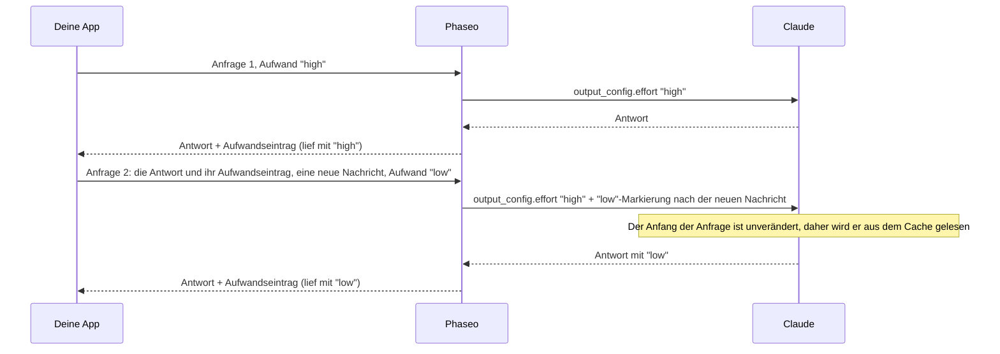

import { EffortCacheExplorer } from "/snippets/effort-cache.jsx";

Sende bei einer beliebigen Anfrage einen anderen `reasoning_effort` (Chat Completions) oder `reasoning.effort` (Responses), und Phaseo ändert Claudes Aufwand, ohne seinen Prompt-Cache neu zu starten. Sonst musst du an deinem Code nichts ändern, solange du Claudes Reasoning bei jeder Anfrage unverändert zurücksendest.

<EffortCacheExplorer locale="de" />

Phaseo sendet Claude weiter den Aufwand der ersten Anfrage deiner Unterhaltung und fügt jede Änderung als Aufwandsmarkierung nach deiner neuen Nachricht ein. Alles vor der Markierung bleibt gleich, daher liest Claude es aus dem Cache. Verwirfst du das Reasoning, ändert Phaseo stattdessen den Aufwand auf oberster Ebene, und Claude verarbeitet alles ab seiner ersten Antwort erneut, statt es aus dem Cache zu lesen.

## Wie Phaseo den Cache erhält

Claude liest eine gecachte Unterhaltung nur, wenn der Anfang der Anfrage Byte für Byte gleich ist, und der Aufwand auf oberster Ebene gehört zu diesem Anfang. Anthropics [Aufwand pro Nachricht](https://platform.claude.com/docs/en/build-with-claude/effort-per-message) ändert die Stufe stattdessen innerhalb von `messages`, mit einer `system`-Nachricht, die leeren `content` und ein `output_config.effort` hat. Phaseo schreibt diese Markierungen für dich:



Phaseo speichert zwischen Anfragen nichts. Jede Claude-Antwort endet mit einem Reasoning-Eintrag, der die Stufe festhält, mit der sie lief, und Phaseo baut jede frühere Markierung an derselben Stelle aus den Einträgen neu auf, die du zurücksendest:

| Anfrage | Du sendest | Phaseo sendet an Claude |
| --- | --- | --- |
| 1 | `"high"` | `output_config.effort: "high"` |
| 2 | `"low"` | `"high"`, dazu eine `low`-Markierung nach deiner neuen Nachricht |
| 3 | `"low"` | `"high"`, dazu dieselbe Markierung an derselben Stelle |
| 4 | `"high"` | `"high"`, die frühere Markierung und eine `high`-Markierung nach deiner neuen Nachricht |

Nachrichten, die du zurücksendest, werden nie verändert. Die Markierungen gibt es nur in der Anfrage, die Phaseo an Claude sendet.

## Reasoning unverändert zurücksenden

<Warning>
Sende jeden Reasoning-Eintrag bei jeder Anfrage genau so zurück, wie du ihn erhalten hast: Chat-`reasoning_details`, Responses-`reasoning`-Elemente und Anthropic-`thinking`-Blöcke, verschlüsselt oder nicht. Verwirf, bearbeite, sortiere oder fasse sie nicht zusammen. Ohne sie startet eine Aufwandsänderung Claudes Cache neu, und Claude verliert sein Reasoning zwischen den Schritten der Tool-Schleife.
</Warning>

Der Aufwandseintrag hat keinen Text. Bei Chat Completions ist es der letzte `reasoning.encrypted`-Eintrag in `reasoning_details`:

```json
{
  "role": "assistant",
  "content": "1. Export the data. 2. Create the schema. 3. Import and verify.",
  "reasoning_details": [
    { "type": "reasoning.text", "text": "…", "signature": "phx1.…", "format": "anthropic-claude-v1" },
    { "type": "reasoning.encrypted", "data": "phx1.…", "format": "anthropic-claude-v1" }
  ]
}
```

Bei Responses ist es das letzte `reasoning`-Element in `output`, mit einer `id`, die mit `rs_effort_` beginnt:

```json
{ "type": "reasoning", "id": "rs_effort_req_123", "summary": [], "content": [], "encrypted_content": "phx1.…" }
```

Der Wert ist undurchsichtig, und Phaseo entfernt ihn, bevor die Unterhaltung einen Anbieter erreicht.

## Aufwand in deinem Code ändern

Hänge Claudes ganze Antwort an deine Unterhaltung an und setze dann den gewünschten Aufwand für die nächste Anfrage. Das `cache_control` auf oberster Ebene schaltet Caching für Claude-Routen ein; siehe [Prompt-Caching](./prompt-caching.mdx#which-providers-cache-automatically).

### Chat Completions

<CodeGroup>
```ts TypeScript
import OpenAI from "openai";

const client = new OpenAI({
	apiKey: process.env.PHASEO_API_KEY,
	baseURL: "https://api.phaseo.app/v1",
});

const messages: OpenAI.ChatCompletionMessageParam[] = [
	{ role: "user", content: "Plan a migration from SQLite to PostgreSQL." },
];

async function ask(effort: "low" | "medium" | "high") {
	const response = await client.chat.completions.create({
		model: "anthropic/claude-opus-5.5",
		reasoning_effort: effort,
		messages,
		// @ts-expect-error Phaseo-Feld: cacht die Unterhaltung auf Claude-Routen
		cache_control: { type: "ephemeral" },
	});
	const message = response.choices[0].message;
	messages.push(message); // die ganze Nachricht, samt reasoning_details
	return message.content;
}

await ask("high");
messages.push({ role: "user", content: "Summarise the plan in one sentence." });
await ask("low"); // Claude liest Anfrage 1 aus dem Cache
```

```python Python
import os
from openai import OpenAI

client = OpenAI(
    api_key=os.environ["PHASEO_API_KEY"],
    base_url="https://api.phaseo.app/v1",
)

messages = [{"role": "user", "content": "Plan a migration from SQLite to PostgreSQL."}]

def ask(effort: str) -> str | None:
    response = client.chat.completions.create(
        model="anthropic/claude-opus-5.5",
        reasoning_effort=effort,
        messages=messages,
        extra_body={"cache_control": {"type": "ephemeral"}},
    )
    message = response.choices[0].message
    # Die ganze Nachricht, samt reasoning_details
    messages.append(message.model_dump(exclude_none=True))
    return message.content

ask("high")
messages.append({"role": "user", "content": "Summarise the plan in one sentence."})
ask("low")  # Claude liest Anfrage 1 aus dem Cache
```
</CodeGroup>

### Responses

Phaseo speichert keine Antworten. Sende daher die ganze Unterhaltung in `input`, einschließlich jedes `output`-Elements.

<CodeGroup>
```ts TypeScript
import OpenAI from "openai";

const client = new OpenAI({
	apiKey: process.env.PHASEO_API_KEY,
	baseURL: "https://api.phaseo.app/v1",
});

const input: OpenAI.Responses.ResponseInput = [
	{ role: "user", content: "Plan a migration from SQLite to PostgreSQL." },
];

async function ask(effort: "low" | "medium" | "high") {
	const response = await client.responses.create({
		model: "anthropic/claude-opus-5.5",
		reasoning: { effort },
		input,
		// @ts-expect-error Phaseo-Feld: cacht die Unterhaltung auf Claude-Routen
		cache_control: { type: "ephemeral" },
	});
	input.push(...response.output); // jedes Element, samt Reasoning-Elementen
	return response.output_text;
}

await ask("high");
input.push({ role: "user", content: "Summarise the plan in one sentence." });
await ask("low"); // Claude liest Anfrage 1 aus dem Cache
```

```python Python
import os
from openai import OpenAI

client = OpenAI(
    api_key=os.environ["PHASEO_API_KEY"],
    base_url="https://api.phaseo.app/v1",
)

conversation = [{"role": "user", "content": "Plan a migration from SQLite to PostgreSQL."}]

def ask(effort: str) -> str:
    response = client.responses.create(
        model="anthropic/claude-opus-5.5",
        reasoning={"effort": effort},
        input=conversation,
        extra_body={"cache_control": {"type": "ephemeral"}},
    )
    # Jedes Element, samt Reasoning-Elementen
    conversation.extend(item.model_dump(exclude_none=True) for item in response.output)
    return response.output_text

ask("high")
conversation.append({"role": "user", "content": "Summarise the plan in one sentence."})
ask("low")  # Claude liest Anfrage 1 aus dem Cache
```
</CodeGroup>

### Anthropic Messages

Bei `/v1/messages` sendest du die Markierung selbst: eine `system`-Nachricht mit leerem `content` und `output_config.effort`. Lass das `output_config.effort` auf oberster Ebene bei jeder Anfrage gleich, und lass jede Markierung bei späteren Anfragen an ihrer Stelle. Phaseo fügt den Beta-Header `mid-conversation-output-config-2026-07-01` hinzu, du musst ihn also nicht senden.

```bash cURL
curl https://api.phaseo.app/v1/messages \
  -H "x-api-key: $PHASEO_API_KEY" \
  -H "anthropic-version: 2023-06-01" \
  -H "Content-Type: application/json" \
  -d '{
    "model": "anthropic/claude-opus-5.5",
    "max_tokens": 4096,
    "cache_control": { "type": "ephemeral" },
    "output_config": { "effort": "high" },
    "messages": [
      { "role": "user", "content": "Plan a migration from SQLite to PostgreSQL." },
      { "role": "assistant", "content": "1. Export the data. 2. Create the schema. 3. Import and verify." },
      { "role": "system", "content": [], "output_config": { "effort": "low" } },
      { "role": "user", "content": "Summarise the plan in one sentence." }
    ]
  }'
```

Wo die Markierung steht, entscheidet, wann die neue Stufe beginnt:

- **Direkt nach einer Benutzernachricht:** Claudes Antwort auf diese Nachricht nutzt die neue Stufe.
- **An jeder anderen Stelle**, etwa zwischen Claudes Antwort und deiner nächsten Nachricht wie oben: Die neue Stufe beginnt mit deiner nächsten Nachricht.

Eine Benutzernachricht, die nur Tool-Ergebnisse enthält, zählt nicht als neue Nachricht. Auf Routen ohne Aufwand pro Nachricht entfernt Phaseo die Markierungen und sendet die geltende Stufe als Aufwand auf oberster Ebene.

## Wann die Änderung den Cache neu startet

Phaseo ändert den Aufwand auf oberster Ebene, wie bei anderen Anbietern, wenn:

- **Das Reasoning fehlt.** Deine letzte Claude-Antwort hat keinen Aufwandseintrag, weil dein Client `reasoning_details` oder `reasoning`-Elemente verworfen hat.
- **Die Änderung zwischen Schritten der Tool-Schleife kommt.** Deine letzte Nachricht enthält nur Tool-Ergebnisse, daher würde eine Markierung erst ab deiner nächsten Nachricht gelten. Phaseo ändert den Aufwand auf oberster Ebene, damit dieser Schritt mit der angeforderten Stufe läuft, und spätere Änderungen nutzen wieder Markierungen.
- **Die Anfrage keinen Aufwand setzt oder Reasoning ausschaltet.** Sende `reasoning_effort` oder `reasoning.effort` bei jeder Anfrage. `"none"` und `reasoning.enabled: false` schalten Reasoning aus.
- **Die Route es nicht unterstützt.** Siehe [Unterstützte Modelle](#supported-models).

Eine Änderung auf oberster Ebene behält den Teil der Unterhaltung vor Claudes erster Antwort im Cache. Claude verarbeitet alles ab dieser Antwort erneut und rechnet es als neuen Input ab.

<span id="supported-models"></span>
## Unterstützte Modelle

| Route | Modelle |
| --- | --- |
| Anthropic, Google Vertex AI | Claude Fable 5.2 und 5.1, Mythos 5.2 und 5.1, Opus 5.5 und 5, Sonnet 5.5, Haiku 5.5 |
| Claude on AWS | Dieselben Modelle außer Mythos |
| Amazon Bedrock | Claude Fable 5.1 und Opus 5.5 |

Auf allen anderen Routen, auch bei Claude auf Azure, geht eine Aufwandsänderung an die oberste Ebene.

## Prüfen, ob der Cache gehalten hat

Lies die Cache-Zähler der Anfrage nach einer Änderung: `usage.prompt_tokens_details.cached_tokens` bei Chat Completions, `usage.input_tokens_details.cached_tokens` bei Responses und `usage.cache_read_input_tokens` bei Anthropic Messages. [Nutzungs- und Abrechnungsfelder](./prompt-caching.mdx#usage-and-pricing-fields) listet alle Felder auf.

Wir haben am 11. November 2026 dieselbe Chat-Completions-Unterhaltung mit fünf Anfragen auf `anthropic/claude-haiku-5.5` gemessen, einmal mit zurückgesendeten Aufwandseinträgen und einmal ohne sie. Der Aufwand war `high`, `high`, `low`, `low`, `high`, und ein Dokument mit 3.400 Token kam in der zweiten Nachricht:

| Anfrage 3 (Aufwand von `high` auf `low`) | Aufwandseinträge verworfen | Aufwandseinträge zurückgesendet |
| --- | --- | --- |
| Aus dem Cache gelesene Token | 0 | 3.575 |
| Erneut verarbeitete und in den Cache geschriebene Token | 3.499 | 75 |
