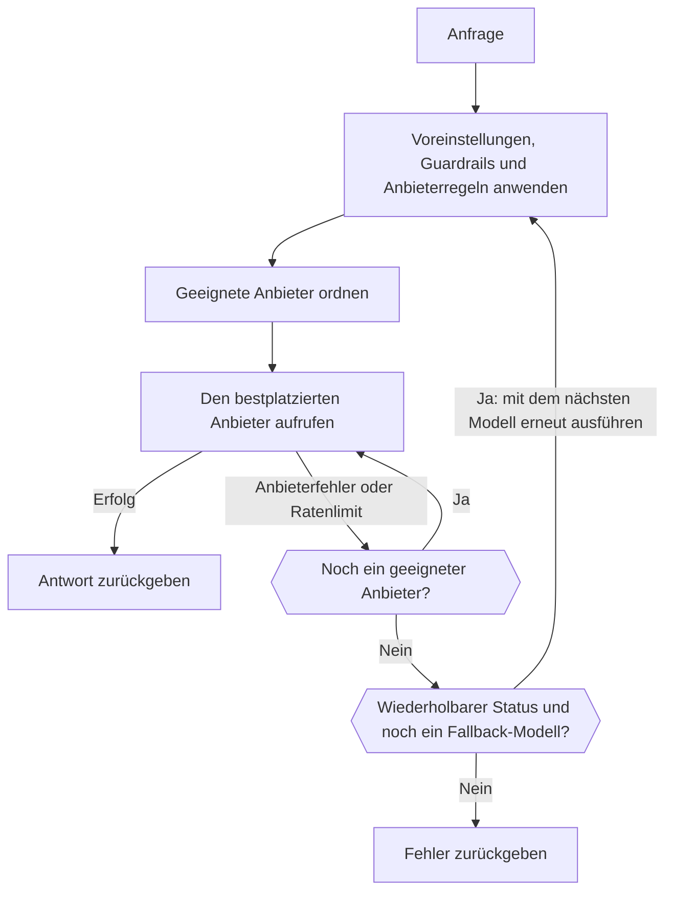

import { RoutingCostExplainer } from "/snippets/routing-cost.jsx";
import { FallbackChainExplorer } from "/snippets/fallback-chain.jsx";

Die meisten Modelle werden von mehreren Anbietern bereitgestellt. Für jede Anfrage behält das Gateway die Anbieter, die deine Regeln zulassen, ordnet sie nach Rang und ruft den besten auf. Fällt dieser Anbieter aus, versucht es den nächsten; scheitern alle Anbieter mit einem wiederholbaren Fehler, kann es zu einem Fallback-Modell weitergehen.



Dein Client sollte `429`- und `5xx`-Antworten trotzdem mit exponentiellem Backoff wiederholen.

<span id="choose-how-providers-are-ranked"></span>
## Festlegen, wie Anbieter geordnet werden

| Modus | Ordnet nach | Nutze ihn, wenn |
| --- | --- | --- |
| `balanced` (Standard) | Kosten pro erfolgreicher Antwort | Du die beste Mischung aus Preis, Geschwindigkeit und Zuverlässigkeit willst. |
| `price` | Preis | Kosten wichtiger sind als Antwortzeit. |
| `latency` | Zeit bis zum ersten Token | Antworten schnell beginnen müssen. |
| `throughput` | Ausgabegeschwindigkeit | Lange Ausgaben schnell fertig werden müssen. |

Lege den Standard des Arbeitsbereichs unter **Dashboard -> Einstellungen -> Routing** fest, mit `phaseo settings update --routing-mode <mode>` oder mit `routing_mode` über `PATCH /v1/settings`. Für eine einzelne Anfrage sendest du `provider.sort` oder `routing.mode` oder hängst ein Suffix an die Modell-ID an:

| Suffix | Modus | Beispiel |
| --- | --- | --- |
| `:nitro` | `throughput` | `openai/gpt-6-astra:nitro` |
| `:cheap` | `price` | `openai/gpt-6-astra:cheap` |
| `:fast` | `latency` | `openai/gpt-6-astra:fast` |

Ein Suffix überschreibt `routing.mode`, `provider.sort` sowie die Modi von Voreinstellung und Arbeitsbereich. Zulassungslisten, Regionen, Guardrails und Preisobergrenzen gelten weiterhin.

Die Routing-Einstellungsseite hat außerdem Schalter für Beta- und Alpha-Kanäle, sodass Vorschau-Anbieter nur Traffic erhalten, wenn du dich dafür entscheidest.

## Wie der Modus `balanced` Anbieter ordnet

Für Textanfragen (Chat Completions, Responses und Messages) schätzt `balanced` die **Kosten pro erfolgreicher Antwort** jedes Anbieters:

- **Token:** was eine typische Anfrage für dieses Modell beim Anbieter kostet, auf Basis der gemessenen Prompt- und Ausgabegrößen des Modells und der gemessenen Cache-Trefferquote des Anbieters.
- **Warten:** die Zeit bis zum ersten Token und bis zur vollständigen Antwort, umgerechnet in Dollar zum typischen Preis pro Sekunde des Modells.
- **Fehler:** die Summe geteilt durch die aktuelle Erfolgsquote des Anbieters, plus ein Aufschlag für Anbieterfehler und ein kleinerer für Ratenlimits.

Anbieter nahe an den niedrigsten Kosten teilen sich den Großteil des Traffics. Jeder Anbieter behält einen kleinen Anteil, damit eine Erholung bemerkt wird. Wähle ein Szenario, um zu sehen, wie es sich auswirkt (die Anbieter sind Beispiele):

<RoutingCostExplainer locale="de" />

Andere Endpunkte werden nach Zuverlässigkeit, Latenz, Tail-Latenz, Durchsatz, Preis und Token-Passung bewertet. Wenn du Anbieter bist, zeigt [Wie Anbieter Traffic gewinnen](./how-providers-earn-traffic), wie du einen größeren Anteil erhältst.

<span id="request-level-model-fallbacks"></span>
## Fallback-Modelle auf Anfrageebene

Liste Fallback-Modelle in `models` auf. Phaseo versucht zuerst `model`, dann jeden Eintrag der Reihe nach:

```json
{
  "model": "openai/gpt-6-astra",
  "models": ["anthropic/claude-sonnet-5.5", "google/gemini-4-argon"],
  "input": "Summarize this incident report."
}
```

Wähle, was jedes Modell zurückgibt, um zu sehen, wann Phaseo weitergeht:

<FallbackChainExplorer locale="de" />

**Was zum nächsten Modell führt.** Ein Modell wird erst versucht, nachdem das vorherige mit allen Anbieter-Wiederholungen mit `429`, `500`, `502`, `503` oder `504` geendet hat. Ein `429` aus einem Phaseo-Budget oder einem Kontingent für kostenlose Modelle führt ebenfalls weiter, da ein anderes Modell in das verbleibende Limit passen kann. Dasselbe gilt für ein Modell, das kein Anbieter mehr bereitstellt, zum Beispiel ein [eingestelltes](#retired-models).

**Was nicht dazu führt.** Client-Fehler wie `400`, `401`, `402`, `403`, `404`, `408`, `413` und `422` werden sofort zurückgegeben. Dasselbe gilt für Fehler, bevor das erste Modell läuft, etwa bei der Authentifizierung oder bei Ratenlimits des API-Schlüssels.

**Regeln für die Liste:**

- `model` ist erforderlich; nur `models` zu senden gibt `400` zurück.
- `models` akzeptiert 1 bis 25 Einträge. Duplikate und Kopien von `model` werden ignoriert.
- Einträge können Modell-IDs, [anbieterqualifizierte IDs](./provider-qualified-models) oder Voreinstellungen wie `@support` sein.
- Jeder Versuch wird als eigene Anfrage validiert (Endpunkt, Parameter, Arbeitsbereichsmodelle, Guardrails, Voreinstellungen, Preise, BYOK). Ein Fallback, der die Anfrage nicht bedienen kann, wird übersprungen und protokolliert; er ersetzt nie den Fehler, den du sonst bekommen würdest. Ein Versuch, der mit einem bereits gemachten identisch ist, wird ebenfalls übersprungen.

**Protokolle und Abrechnung.** Jeder Versuch ist eine eigene Anfrage mit eigenem Nutzungsdatensatz und wird so abgerechnet, als gäbe es keine Fallbacks. Das Feld `model` der Antwort nennt das Modell, das geantwortet hat, und sein Routing-Trace listet die ID der primären Anfrage, die Fallback-Reihenfolge und jeden früheren Versuch auf.

**Streaming, Video und Musik.** Ein Stream wechselt nur vor seinem ersten Byte zu einem Fallback; danach kommen Fehler im Stream an. Video und Musik wechseln nur, während der Job übermittelt wird.

**Mit anderen Routing-Steuerungen.** Fallbacks einer zugeordneten dynamischen Route haben Vorrang vor `models`, und ein von der Route festgelegtes Modell gilt weiterhin für jeden Versuch. Eine Voreinstellung wendet ihre eigenen Einschränkungen auf jeden Versuch an, in dem sie verwendet wird. [`phaseo/auto`](./auto-routing) verwaltet eigene Fallbacks und lässt sich nicht mit `models` kombinieren.

| Endpunkt | `models` |
| --- | --- |
| Chat Completions, Responses, Messages | Unterstützt, auch bei Streams vor dem ersten Byte |
| Embeddings, Moderations, Rerank | Unterstützt |
| Bilderzeugung und -bearbeitung | Unterstützt, auch bei Multipart-Uploads |
| Sprachausgabe, Transkription und Übersetzung | Unterstützt, auch bei Multipart-Uploads |
| OCR, Parse, Decisions | Unterstützt |
| Video- und Musikgenerierung | Bei der Job-Übermittlung unterstützt |
| Batches | `400`: Jede Batch-Zeile zielt auf ein Modell |
| Echtzeit- und Live-Sitzungen | `400`: Eine Sitzung ist an ein Modell gebunden |
| Council-Läufe | `400`: Modelle stammen aus der Laufkonfiguration |

Multipart-Endpunkte akzeptieren wiederholte `models`-Felder, `models[]`-Felder oder einen JSON-Array-String. Siehe auch [Ratenlimits](../api-reference/limits.mdx) und [Fehler](../api-reference/errors.mdx).

<span id="pin-one-provider"></span>
## Einen Anbieter festlegen

Setze den Anbieter vor die Modell-ID, um genau diesen Anbieter zu nutzen:

```json
{
  "model": "baseten:thinking-machines/inkling-small",
  "input": "Hello"
}
```

Das schaltet den anbieterübergreifenden Fallback für die Anfrage ab. Suffixe bleiben Teil der Modell-ID, wie in `baseten:google/gemma-4-26b-a4b:free`. [Anbieterqualifizierte Modell-IDs](./provider-qualified-models) beschreibt die vollständige Syntax und die Fehler.

## Einschränken, welche Anbieter genutzt werden

| Steuerung | Wo | Wirkung |
| --- | --- | --- |
| [Voreinstellungen](./presets) | **Einstellungen -> Voreinstellungen** | Erlaubte Modelle sowie Zulassungs- oder Ignorierlisten für Anbieter, angewendet vor der Rangfolge, sodass sie auch Fallbacks begrenzen. |
| [Regionales Routing](./regional-routing) | Anfrage oder Arbeitsbereich | Hält Ausführung oder Daten in einer Region. |
| Dynamische Routen | **Einstellungen -> Routing** | Regeln pro Schlüssel: siehe unten. |
| BYOK-Fallback | **Einstellungen -> BYOK** | Ob eine fehlgeschlagene BYOK-Anfrage mit Phaseo-Guthaben wiederholt werden darf. |

<span id="attach-routing-rules-to-api-keys"></span>
### Routing-Regeln an API-Schlüssel anhängen

Eine dynamische Route ist ein Ablauf aus Regeln, der einem oder mehreren Inferenz-API-Schlüsseln zugeordnet ist. Sie kann:

- nach Feldern im Anfrage-Body, Headern, benutzerdefinierten `metadata`, Endpunkt, Modell oder Sitzungs-ID verzweigen
- Traffic prozentual für A/B-Tests und Rollouts aufteilen
- tägliche, wöchentliche oder monatliche Anfragen oder Kosten pro Schlüssel begrenzen
- Modell, Routing-Modus, Anbieterpräferenz und Fallback-Modelle (bis zu acht) wechseln
- cache- und sitzungsbewusste Anbieter-Affinität einschalten

Bedingungen haben Ausgänge für wahr und falsch; Raten- und Budgetknoten haben Ausgänge für innerhalb und überschritten. Prozentuale Aufteilungen sind pro Sitzung oder Prompt-Cache-Schlüssel deterministisch, sodass eine gecachte Unterhaltung nicht zwischen Zweigen wechselt.

Speichern erstellt eine unveränderliche Entwurfsversion. Das Deployen kopiert diese Version ins Gateway und leert die Richtlinien-Caches seiner Schlüssel; frühere Versionen bleiben für ein Rollback verfügbar. Empfehlungen zum Anbieterzustand erscheinen unter **Insights**. Über die CLI: `phaseo routing dynamic-routes create`, `set-keys` und `deploy` oder die API `/v1/routing/dynamic-routes`.

Benutzerdefinierte Metadaten stehen bei den OpenAI-kompatiblen Text-Endpunkten im Anfrage-Body:

```json
{
  "model": "openai/gpt-6-astra",
  "metadata": { "customer_plan": "pro", "workspace": "acme" }
}
```

## Eine Unterhaltung bei einem Anbieter halten

Cache-bewusstes Routing ist bei Textgenerierung standardmäßig aktiv. Eine Anfrage, die `prompt_cache_key` oder `session_id` sendet oder Caching mit `cache_control` aktiviert (auf oberster Ebene, in `provider_options.anthropic` oder als `cache_control`- bzw. `prompt_cache_breakpoint`-Markierung an einem Nachrichtenblock oder Tool), wird auf den Anbieter und die Route festgelegt, die ihre erste erfolgreiche Anfrage bedient haben. Andere Anfragen werden für 15 Minuten festgelegt, sobald ein Anbieter einen Cache-Lese- oder -Schreibvorgang für denselben Anfangskontext meldet, sofern gecachte Eingabe bei diesem Anbieter günstiger ist als normale Eingabe.

| | |
| --- | --- |
| Dauer der Festlegung | 15 Minuten bis 24 Stunden, je nach Cache-Aufbewahrung des Anbieters. Mit `session_id` bis zu 24 Stunden Sitzungsaktivität. |
| Geltungsbereich | Pro Arbeitsbereich. Mit `session_id` an die Sitzung statt an den Anfangskontext gebunden. |
| Eine Festlegung wechselt, wenn | Der Circuit Breaker des Anbieters öffnet, seine Fehlerquote hoch ist, das von Phaseo verwaltete Kontingent bei ihm aufgebraucht ist oder deine Regeln ihn nicht mehr zulassen. |

Schalte es für eine Anfrage mit `provider.cache_aware_routing: false` ab, oder behalte die Cache-Affinität bei und ignoriere die Sitzung mit `routing.session_affinity: false`:

```json
{
  "model": "openai/gpt-6-astra",
  "session_id": "support-session-42",
  "routing": { "session_affinity": false }
}
```

[Anbieter-Affinität](./prompt-caching.mdx#provider-affinity) listet die Hinweise auf, die Phaseo an jeden Anbieter sendet.

<span id="explain-a-routing-decision"></span>
## Eine Routing-Entscheidung erklären

Öffne **Dashboard -> Einstellungen -> Nutzung -> Anfrageprotokolle**, wähle eine Anfrage aus und klappe **Beobachtbarkeit des Routings** unter **Antworten der Anbieter** auf. Dort siehst du:

- jeden eingestuften Anbieter mit seiner endgültigen Bewertung und welche ausgewählt und versucht wurden
- Anbieter, die vor der Rangfolge ausgeschlossen wurden, mit dem Grund
- Anbieter, die wegen ihres Rollout- oder Routing-Status herabgestuft wurden
- die Eingaben, Gewichte, Beiträge und Multiplikatoren jeder Bewertung

Bewertungsfaktoren ändern die Bewertung; erfasster Kontext erklärt die Entscheidung, ohne sie zwingend zu beeinflussen. Traces enthalten nur Zahlen und Status, nie Prompts oder Ausgaben. Anfragen von vor der Aktivierung der Routing-Beobachtbarkeit zeigen möglicherweise einen unvollständigen oder gar keinen Trace.

### Was die Verfügbarkeit eines Anbieters senkt

| Senkt die Verfügbarkeit | Senkt sie nicht |
| --- | --- |
| `401` Authentifizierungsfehler | `400` fehlerhafte Anfragen |
| `402` Zahlungsfehler | `403` geografische Einschränkungen |
| `404` Modell nicht gefunden | `413` zu große Payloads |
| `500` und höher | `429` Ratenlimits |
| Fehler nach dem Start eines Streams | |
| Ein `200`, das mit einem Fehlergrund endet | |

Geografische Einschränkungen und Ratenlimits werden getrennt erfasst, weil sie nicht bedeuten, dass der Anbieter ausgefallen ist. Protokolliere in der Produktion Anfrage-IDs, Statuscodes und Modell-IDs, damit du Fehler diesen Traces zuordnen kannst.

<span id="retired-models"></span>
## Eingestellte Modelle

Ein eingestelltes Modell funktioniert weiter, solange es noch ein Anbieter bereitstellt. Danach schlagen Anfragen mit `410 model_retired` fehl, es sei denn, der Arbeitsbereich leitet sie mit dem Routing für eingestellte Modelle an einen Ersatz weiter. Deine eigene `models`-Liste wird immer zuerst versucht. Siehe [Abkündigung und Einstellung von Modellen](./model-retirement.mdx).

<span id="byok-considerations"></span>
## Hinweise zu BYOK

Mit <Tooltip tip="Eigener Schlüssel: Phaseo leitet die Anfrage mit deinem eigenen Anbieter-API-Schlüssel weiter, und dein Anbieter rechnet die Modellnutzung direkt ab.">BYOK</Tooltip> routet und protokolliert Phaseo die Anfrage, während dein Anbieter die Modellnutzung abrechnet.

| | |
| --- | --- |
| Servicegebühr | Keine für die ersten 250.000 abgeschlossenen BYOK-Anfragen pro UTC-Monat, danach 2,5 % der anbieteräquivalenten Kosten. |
| Phaseo-Guthaben | Halte mindestens $1 verfügbar, für verwaltete Fallbacks und Gebühren nach dem Freikontingent. |
| Anbieterregeln | Kontingente, Datenrichtlinie, Modellzugriff und Kontolimits deines Anbieters gelten weiterhin. |
| Speicherung | Schlüssel werden mit AES-256-GCM verschlüsselt und an ihren Arbeitsbereich und Anbieter gebunden. |

Beschränke jeden Schlüssel auf die Modelle und API-Schlüssel, die ihn brauchen. Damit eine fehlgeschlagene BYOK-Anfrage nicht mit Phaseo-Guthaben wiederholt wird, schalte den Fallback unter **Dashboard -> Einstellungen -> BYOK** ab oder setze `byok_fallback_enabled` über `PATCH /v1/settings` (`phaseo settings update --body-json '{"byok_fallback_enabled":false}'`). Füge Schlüssel mit `phaseo byok create --provider <id> --name <name> --key-stdin` hinzu.
