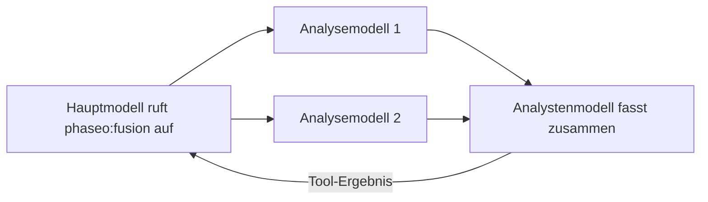

Füge `phaseo:fusion` hinzu, wenn eine Antwort von mehreren unabhängigen Meinungen profitiert, etwa bei einer Planungsentscheidung, einer Forschungssynthese oder einem Design-Review. Ruft das Hauptmodell das Tool auf, sendet Phaseo die Frage parallel an jedes Analysemodell, lässt ein Analystenmodell die Ergebnisse zusammenführen und gibt diese Synthese zurück. Das erhöht die Latenz. Nutze also einen einzelnen [Advisor](./advisor), wenn ein Prüfdurchgang reicht.



```json
{
  "tools": [
    {
      "type": "phaseo:fusion",
      "parameters": {
        "analysis_models": ["anthropic/claude-opus-5", "openai/gpt-5"],
        "model": "google/gemini-pro-latest",
        "instructions": "Reconcile disagreements and return concise synthesis guidance.",
        "max_uses": 1,
        "max_completion_tokens": 1400
      }
    }
  ]
}
```

Im Playground legt das Server-Tools-Menü dieselben Dinge fest: die Analysemodelle, ein optionales Richter- bzw. Analystenmodell und ein Aufruflimit.

## Parameter

| Parameter | Typ | Standard | Beschreibung |
| --- | --- | --- | --- |
| `analysis_models` | string[] | Pflicht | Mindestens 2 Modelle. Bei weniger wird die Anfrage abgelehnt. |
| `model` | string | Das Modell der Anfrage | Das Analystenmodell, das die Synthese schreibt. |
| `instructions` | string | Keine | Anweisungen für die Analyse- und die Analystenaufrufe. |
| `max_uses` | integer | `1` | Fusion-Aufrufe pro Anfrage, bis zu `4`. |
| `max_completion_tokens` | integer | `1400` | Ausgabe-Tokens für jede Analyse und die Synthese, bis zu `32000`. |

## Was das Modell sendet

Einen `prompt`: die Frage, die mehrere Perspektiven braucht.

## Was das Tool zurückgibt

```json
{
  "status": "ok",
  "analyses": 2,
  "analysis": "Both reviewers flag the cutover order..."
}
```

`analyses` zählt die Analysemodelle, die geantwortet haben. Fallen einige aus, nutzt die Synthese die übrigen. Fehlerergebnisse sind `fusion_invalid_request` (kein Prompt), `fusion_max_uses_exceeded`, `fusion_panel_failed` (jedes Analysemodell ist fehlgeschlagen) und `fusion_request_failed` (der Analyst ist fehlgeschlagen).

## Nutzung und Preise

Jeder Aufruf erhöht `usage.server_tool_use.fusion_requests` um 1 und kann über `server_tool_fusion_requests` abgerechnet werden. Die Tokens jedes Analyse- und Analystenaufrufs werden zur Nutzung der Anfrage addiert und zu den Preisen des jeweiligen Modells berechnet.
