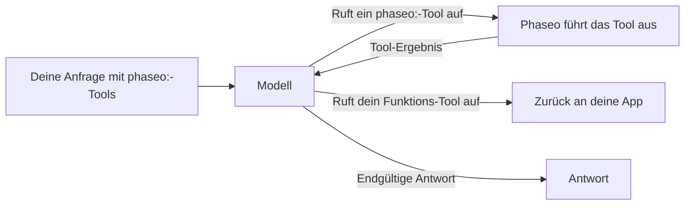

Füge `tools` ein `phaseo:`-Tool hinzu, dann führt Phaseo es für dich aus, wenn das Modell es aufruft: Das Modell fragt nach der aktuellen Uhrzeit, einer Websuche oder der Meinung eines zweiten Modells, Phaseo führt den Aufruf aus, gibt das Ergebnis zurück, und das Modell beendet seine Antwort. Du schreibst keinen eigenen Tool-Executor.



<Note>
Server-Tools befinden sich in der Beta. Anfrageformate und Ergebnis-Payloads können sich ändern, wenn sich die Unterstützung durch die Anbieter ändert.
</Note>

## Verfügbare Tools

| Tool | Typ | Wofür | Endpunkte |
| --- | --- | --- | --- |
| [Datetime](./datetime) | `phaseo:datetime` | Aktuelles Datum und aktuelle Uhrzeit in bis zu 5 Zeitzonen | Alle drei |
| [Websuche](./web-search) | `phaseo:web_search` | Im Web nach aktuellen oder belegten Informationen suchen | Alle drei |
| [Web Fetch](./web-fetch) | `phaseo:web_fetch` | Den Text einer bestimmten URL lesen | Alle drei |
| [Advisor](./advisor) | `phaseo:advisor` | Ein anderes Modell um eine Prüfung oder einen Plan bitten | Alle drei |
| [Subagent](./subagent) | `phaseo:subagent` | Eine abgeschlossene Aufgabe an ein Worker-Modell übergeben | Alle drei |
| [Fusion](./fusion) | `phaseo:fusion` | Analysen mehrerer Modelle einholen, dann eine Synthese | Alle drei |
| [Modellsuche](./search-models) | `phaseo:search_models` | Ein Modell im Live-Katalog von Phaseo finden | Alle drei |
| [Bildgenerierung](./image-generation) | `phaseo:image_generation` | Während der Antwort ein Bild erstellen | Alle drei |
| [Apply Patch](./apply-patch) | `phaseo:apply_patch` | Validierte Datei-Patches zurückgeben | Nur `/v1/responses` |

„Alle drei“ bedeutet `/v1/chat/completions`, `/v1/responses` und `/v1/messages`.

## Eine Anfrage senden

```bash
curl https://api.phaseo.app/v1/chat/completions \
  -H "Authorization: Bearer $PHASEO_API_KEY" \
  -H "Content-Type: application/json" \
  -d '{
    "model": "openai/gpt-6-astra",
    "messages": [
      { "role": "user", "content": "What are the latest AI policy updates this week?" }
    ],
    "tools": [
      { "type": "phaseo:web_search" },
      { "type": "phaseo:datetime", "parameters": { "timezones": ["Europe/London", "UTC"] } }
    ]
  }'
```

Jedes Tool nimmt ein optionales `parameters`-Objekt, das auf seiner Seite beschrieben ist. `stream: true` funktioniert ebenfalls: Phaseo führt die Tool-Runden selbst aus und streamt dir die endgültige Antwort.

## Server-Tools mit eigenen Funktionen kombinieren

Phaseo führt nur die `phaseo:`-Tools aus. Ein reguläres `function`-Tool in derselben Anfrage wird wie gewohnt an deine App zurückgegeben, und du sendest sein Ergebnis in einer Folgeanfrage zurück, wie unter [Tool-Aufrufe](../tool-calling) beschrieben.

```json
{
  "model": "openai/gpt-6-astra",
  "messages": [
    { "role": "user", "content": "Find recent funding news and save the best item." }
  ],
  "tools": [
    { "type": "phaseo:web_search", "parameters": { "max_results": 3 } },
    {
      "type": "function",
      "function": {
        "name": "save_research_item",
        "description": "Save a selected research item",
        "parameters": {
          "type": "object",
          "properties": {
            "title": { "type": "string" },
            "url": { "type": "string" }
          },
          "required": ["title", "url"]
        }
      }
    }
  ]
}
```

## Grenzen der Tool-Schleife

| Grenze | Wert | Wenn sie erreicht wird |
| --- | --- | --- |
| Server-Tool-Aufrufe pro Anfrage | `max_tool_calls` in der Anfrage, Standard `30`, Maximum `100` | `400 gateway_server_tool_limit` |
| Folgerunden | `8` | `502 gateway_server_tool_error` |
| Aufrufe eines Tools | `max_uses` dieses Tools | Das Tool gibt dem Modell ein Fehlerergebnis zurück, und das Modell kann ohne es weitermachen |

## Nutzung und Preise

Jedes Server-Tool fügt `usage.server_tool_use` einen Zähler hinzu, und die Preiskarte eines Modells kann den passenden Preiszähler abrechnen. Tokens, die ein zweites Modell verbraucht (Advisor, Subagent, Fusion, Bildgenerierung), werden zur Nutzung der Anfrage addiert und zu den Preisen dieses Modells berechnet.

```json
{
  "usage": {
    "input_tokens": 105,
    "output_tokens": 250,
    "server_tool_use": {
      "datetime_requests": 1,
      "web_search_requests": 2,
      "web_search_results": 8
    }
  }
}
```

| Tool | Nutzungszähler | Preiszähler |
| --- | --- | --- |
| Datetime | `datetime_requests` | Keiner |
| Websuche | `web_search_requests`, `web_search_results`, `web_search_extra_results` | `server_tool_web_search_requests`, `server_tool_web_search_extra_results` |
| Web Fetch | `web_fetch_requests` | `server_tool_web_fetch_requests` |
| Advisor | `advisor_requests` | `server_tool_advisor_requests` |
| Subagent | `subagent_requests` | `server_tool_subagent_requests` |
| Fusion | `fusion_requests` | `server_tool_fusion_requests` |
| Modellsuche | `search_models_requests` | `server_tool_search_models_requests` |
| Bildgenerierung | `image_generation_requests` | `server_tool_image_generation_requests` |
| Apply Patch | `apply_patch_requests` | `server_tool_apply_patch_requests` |

Läuft Websuche oder Web Fetch als eigenes Tool des Anbieters (`engine: "native"`), wird stattdessen über `native_web_search_requests` bzw. `native_web_fetch_requests` abgerechnet.
