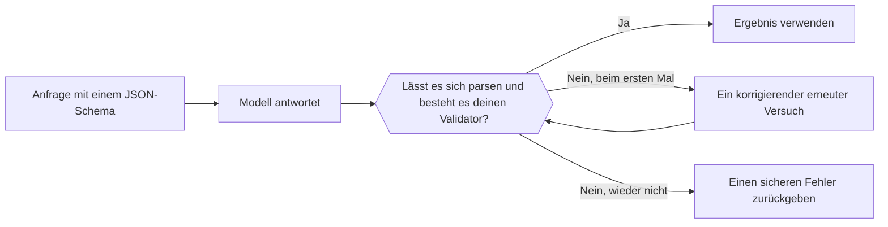

Schick ein JSON-Schema mit der Anfrage, und das Modell gibt statt Freitext JSON in dieser Form zurück. Dein Code parst und validiert es trotzdem, bevor er es verwendet.



## Ein Format wählen

| `type` | Was du bekommst |
| --- | --- |
| `json_schema` | JSON, das dem gesendeten Schema folgt. Verwende das standardmäßig. |
| `json_object` | Irgendein gültiges JSON-Objekt, ohne vorgegebene Form. |
| `text` | Reiner Text (der Standard). |

Wo das Format steht, hängt vom Endpunkt ab:

| Endpunkt | Feld |
| --- | --- |
| `/v1/chat/completions` | `response_format` |
| `/v1/responses` | `text.format` |
| `/v1/messages` | Nicht unterstützt. Bitte im Prompt um JSON und validiere es auf dieselbe Weise. |

## Ein Schema senden

<CodeGroup>
```bash Chat Completions
curl https://api.phaseo.app/v1/chat/completions \
  -H "Authorization: Bearer $PHASEO_API_KEY" \
  -H "Content-Type: application/json" \
  -d '{
    "model": "openai/gpt-6-astra",
    "messages": [
      { "role": "user", "content": "Return the city and weather for London." }
    ],
    "response_format": {
      "type": "json_schema",
      "json_schema": {
        "name": "weather",
        "strict": true,
        "schema": {
          "type": "object",
          "properties": {
            "city": { "type": "string" },
            "weather": { "type": "string" }
          },
          "required": ["city", "weather"],
          "additionalProperties": false
        }
      }
    }
  }'
```

```bash Responses
curl https://api.phaseo.app/v1/responses \
  -H "Authorization: Bearer $PHASEO_API_KEY" \
  -H "Content-Type: application/json" \
  -d '{
    "model": "openai/gpt-6-astra",
    "input": "Return the city and weather for London.",
    "text": {
      "format": {
        "type": "json_schema",
        "name": "weather",
        "strict": true,
        "schema": {
          "type": "object",
          "properties": {
            "city": { "type": "string" },
            "weather": { "type": "string" }
          },
          "required": ["city", "weather"],
          "additionalProperties": false
        }
      }
    }
  }'
```
</CodeGroup>

Das JSON kommt als String im Inhalt der Nachricht zurück:

```json
{
  "choices": [
    {
      "finish_reason": "stop",
      "message": {
        "role": "assistant",
        "content": "{\"city\":\"London\",\"weather\":\"Cloudy\"}"
      }
    }
  ]
}
```

## Das Schema entwerfen

Beginne mit einem kleinen Objekt. Führe jedes Feld unter `required` auf, nutze `enum` für bekannte Kategorien und setze `additionalProperties: false`, wenn zusätzliche Schlüssel abgelehnt werden müssen. Versioniere das Schema zusammen mit deinem serverseitigen Validator, damit die beiden nie auseinanderlaufen.

<span id="validate-the-result"></span>
## Das Ergebnis validieren

Prüfe vor dem Parsen auf eine Ablehnung, fehlenden Inhalt oder eine abgeschnittene Antwort (`finish_reason` ungleich `stop`). Validiere dann das geparste Objekt. Dieser Zod-Validator entspricht dem Schema oben:

```typescript
import { z } from "zod";

const Weather = z.object({
  city: z.string(),
  weather: z.string(),
}).strict();

function parseWeather(content: string) {
  return Weather.parse(JSON.parse(content));
}
```

Schlägt die Validierung fehl, versuche es einmal mit dem Fehler im Prompt erneut und gib danach einen sicheren Fehler zurück. Jeder erneute Versuch wird berechnet. Gültiges JSON beweist trotzdem nicht, dass die Werte stimmen oder dass eine Aktion erlaubt ist.

Erfasse Validierungsfehler nach Modell und Schemaversion, und führe deine Bewertungsfälle erneut aus, wenn sich eines davon ändert. Um fehlerhaftes JSON automatisch zu reparieren, siehe [Antwortreparatur](../cookbook/response-healing-for-structured-json.mdx).
