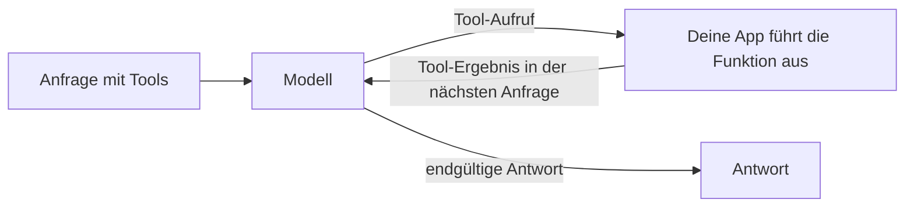

Beschreibe deine Funktionen in `tools`, und das Modell antwortet mit einem Aufruf einer davon, etwa einer Datenbankabfrage oder einer Wetterprüfung, statt zu raten. Deine App führt die Funktion aus und sendet das Ergebnis zurück; danach schreibt das Modell die endgültige Antwort.



Tool-Aufrufe funktionieren auf allen drei Text-Endpunkten, jeweils in ihrem eigenen Format:

| Endpunkt | Aufruf des Modells | Dein Ergebnis |
| --- | --- | --- |
| `/v1/chat/completions` | `tool_calls` in der Assistant-Nachricht, `finish_reason: "tool_calls"` | Eine Nachricht mit `role: "tool"` |
| `/v1/responses` | Ein Ausgabeelement `function_call` | Ein Eingabeelement `function_call_output` |
| `/v1/messages` | Ein Inhaltsblock `tool_use` | Ein Inhaltsblock `tool_result` |

## Eine Anfrage mit Tools senden

```bash
curl https://api.phaseo.app/v1/chat/completions \
  -H "Authorization: Bearer $PHASEO_API_KEY" \
  -H "Content-Type: application/json" \
  -d '{
    "model": "openai/gpt-6-astra",
    "messages": [
      { "role": "user", "content": "What is the weather in London?" }
    ],
    "tools": [
      {
        "type": "function",
        "function": {
          "name": "get_weather",
          "description": "Get current weather by city",
          "parameters": {
            "type": "object",
            "properties": {
              "city": { "type": "string" }
            },
            "required": ["city"]
          }
        }
      }
    ],
    "tool_choice": {
      "type": "function",
      "function": { "name": "get_weather" }
    }
  }'
```

`tool_choice` erzwingt hier den Aufruf. Lass es weg oder setze `"auto"`, damit das Modell selbst entscheidet.

Das Modell antwortet mit einem Aufruf statt mit Text:

```json
{
  "id": "chatcmpl_...",
  "object": "chat.completion",
  "choices": [
    {
      "index": 0,
      "finish_reason": "tool_calls",
      "message": {
        "role": "assistant",
        "content": null,
        "tool_calls": [
          {
            "id": "call_123",
            "type": "function",
            "function": {
              "name": "get_weather",
              "arguments": "{\"city\":\"London\"}"
            }
          }
        ]
      }
    }
  ]
}
```

Parse und prüfe `arguments`, bevor du etwas ausführst; siehe [Sicherheit bei Tool-Aufrufen](./tool-calling-safety). Sende dann die Assistant-Nachricht und dein Ergebnis in der nächsten Anfrage zurück. [Muster für Tool-Aufrufe](./tool-calling-patterns) zeigt diese Folgeanfrage für Chat Completions und Responses.

## Phaseo das Tool ausführen lassen

Tools, deren Typ mit `phaseo:` beginnt, laufen auf der Seite von Phaseo: Das Modell ruft sie auf, Phaseo führt sie aus und setzt die Schleife fort, und du bekommst die endgültige Antwort, ohne einen Executor zu schreiben. Du kannst sie in einer Anfrage mit deinen eigenen Funktionen kombinieren.

| Tool | Typ |
| --- | --- |
| [Datum und Uhrzeit](./server-tools/datetime) | `phaseo:datetime` |
| [Websuche](./server-tools/web-search) | `phaseo:web_search` |
| [Web Fetch](./server-tools/web-fetch) | `phaseo:web_fetch` |
| [Advisor](./server-tools/advisor) | `phaseo:advisor` |
| [Subagent](./server-tools/subagent) | `phaseo:subagent` |
| [Fusion](./server-tools/fusion) | `phaseo:fusion` |
| [Modellsuche](./server-tools/search-models) | `phaseo:search_models` |
| [Bildgenerierung](./server-tools/image-generation) | `phaseo:image_generation` |
| [Patch anwenden](./server-tools/apply-patch) | `phaseo:apply_patch` (nur Responses) |

```json
{
  "tools": [
    { "type": "phaseo:datetime", "parameters": { "timezones": ["Europe/London", "UTC"] } }
  ],
  "tool_choice": "auto"
}
```

Siehe [Server-Tools](./server-tools) zu Limits, Nutzungszählern und Preisen.

## Tool-Aufrufe streamen

Anfragen mit Tool-Aufrufen akzeptieren `stream: true`. Die Argumente von Funktionsaufrufen kommen in Teilen an; sammle sie alle, bevor du den Aufruf parst. Wenn ein Server-Tool läuft, schließt Phaseo diesen Tool-Durchgang ab, führt das Tool aus, setzt das Modell fort und streamt dir den Rest der Antwort, sodass dein Client weiterhin einen einzigen Stream liest. Siehe [Streaming](./streaming).

Für Antworten, die einem Schema entsprechen sollen, statt eine Funktion aufzurufen, nutze [Strukturierte Ausgaben](./structured-outputs).
